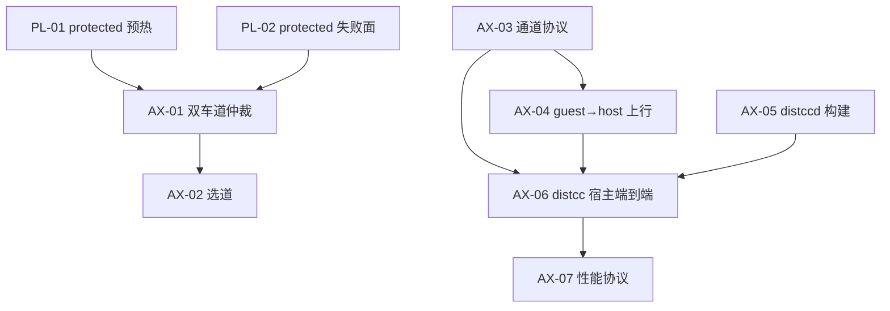

# 决策地图：Protected 机制优化 × 交叉加速（交火）零设备基线

- Type: map
- Status: active
- Date: 2026-10-23
- Base: `main 4765d4b`（2026-10-23 GitHub 最新）
- Owner: 主协调
- 性质：零设备实现与验收；真机验证在工单全部通过后单独排期

## 1. 已确认的方向

1. **protected 车道继续作为机制与产品主线**：生命周期、失败面、证据链、平台门复评优先。
2. **加速车道（交火）使用 non-protected 自定义 Linux VM**：与 Podroid 同路线，能正常 `exec`，不依赖 Microdroid payload 的 `execute_no_trans` 解除。
3. **第一版只做 distcc**：协议留版本与能力扩展点，不做通用 job 框架。
4. **protected 不能承担加速执行**：在 `microdroid_app` 获得 `system_file` 的 `execute_no_trans`（或平台提供可执行 payload 挂载）之前，protected 只做控制面/预热/观测，不把 distccd 放进 protected payload。
5. **真机测试后置**：本 effort 的所有工单必须在 JVM、fake AVF API、宿主 TCP/Unix socket、真实宿主 distcc 上完成验收，不运行 adb/设备/Gradle 设备任务。

## 2. 非目标

- 不修改 root、SELinux、pvmfw，不使用 `/system/bin/sh`、memfd、execveat、伪 shell 等绕过。
- 不改 FLN1 wire、payload 字节、accepted ADR、版本号、applicationId、签名身份或 release channel。
- 不做 UI 打磨、GPU、Wayland、QEMU 调参（与 Podroid 已是平手）、新发行版。
- 不把 fake 结果写成真机 PASS；不把 Fast Lane 写成 Full Linux。

## 3. 工单

| 票 | 主题 | 交付 | 依赖 | 状态 |
| --- | --- | --- | --- | --- |
| [PL-01](issues/PL-01-protected车道生命周期与预热复用.md) | protected 生命周期与预热复用 | 有界预热池、租约、健康检查、复用/冷建计数 | 无 | ready-for-human |
| [PL-02](issues/PL-02-protected失败面统一与平台门复评.md) | protected 失败面统一与平台门复评 | 固定 reason code、policy fixture 检查器、复评 runbook | 无 | ready-for-human |
| [AX-01](issues/AX-01-双车道并发与资源仲裁.md) | 双车道并发与资源仲裁 | DualLaneCoordinator、预算、启停顺序、崩溃恢复 | PL-01 | ready-for-human |
| [AX-02](issues/AX-02-加速车道能力事实与选道策略.md) | 能力事实与选道 | QEMU_ONLY / QEMU_PLUS_ACCEL、reason code、truth table | AX-01（接口） | ready-for-human |
| [AX-03](issues/AX-03-加速通道握手与帧协议.md) | 加速通道协议 | AXP1 握手、鉴权、帧、背压、重连 | 无 | ready-for-human |
| [AX-04](issues/AX-04-Guest到宿主加速上行链路.md) | guest→host 上行 | 地址选择、token、绑定范围、配置生成 | AX-03 | ready-for-human |
| [AX-05](issues/AX-05-distccd安卓arm64构建与许可证合规.md) | distccd 构建与合规 | arm64 产物、SBOM、NOTICE/SOURCE-OFFER、可复现 SHA | 无 | ready-for-human |
| [AX-06](issues/AX-06-distcc跨车道端到端宿主验证.md) | distcc 端到端宿主验证 | 真实 distcc 编译、链接、运行、回退 | AX-03/04/05 | ready-for-human |
| [AX-07](issues/AX-07-跨车道性能测量与验收协议.md) | 性能测量与验收 | 场景、n≥10、median/IQR、卸载率、设备 runbook | AX-06 | ready-for-agent |

## 4. 依赖图

## 5. 零设备验收口径

- JVM 单测、fake AVF API、fake 进程/时钟、内存 vsock 流、宿主真实 TCP。
- 宿主真实 distcc 客户端/服务器（x86_64）完成一次 C 编译、链接、运行。
- NDK/CMake 或等价交叉构建；ELF 对齐、SBOM、许可证检查。
- 不运行 adb、设备、Gradle 设备任务；不把 fake 当真实 AVF。
- 所有测试命令写进各票；CI 必须覆盖新增模块（`check_ci_module_coverage.py`）。

## 6. 真机交接（后置）

全部工单通过后，另开 DV-ACC 真机票，前置条件：

- 设备 `getCapabilities` 显示 non-protected 可用（bit2），且 `setProtectedVm(false)` 成功。
- 设备已完成一次 QEMU Full Lane 启停与一次加速 VM 启停。
- 设备证据只写稳定别名、SDK、ABI、结果码；原始日志/序列号/路径留在外部 artifact 根。

## 7. 批次二交付（2026-10-23）

- PL-02：canonical 失败词汇（7 类 / 16 code）、离线 gate 检查器、A16/A17/AOSP main 三个 fixture、复评 runbook。三例当前均 `GATE_CLOSED`。报告：`docs/reports/tickets/pl-02/implementation-report.zh-CN.md`。
- AX-01：`DualLaneCoordinator` + runtime 层 `LaneRuntime`/预算账本 + QEMU/FastLane 适配器；默认两个 start 请求先发出再等 readiness；ACCEL 失败降级、QEMU 先停。报告：`docs/reports/tickets/ax-01/implementation-report.zh-CN.md`。
- AX-04：gvproxy 主路径用 `192.168.127.254`（hostIP）→ 宿主 `127.0.0.1`，slirp 回退用 `10.0.2.2`；guestfwd 只在 slirp backend 有效，不选。报告：`docs/reports/tickets/ax-04/implementation-report.zh-CN.md`。
- 三票均零设备验证；CI 未运行。批次二分支 `feat/accelerator-batch2`，stacked 在 `feat/accelerator-batch1` 上。

## 8. 批次三交付（2026-10-23）

- 批次二修复（独立 fix commit）：`26abb10` 空 stage NPE；`04a8233` QEMU readiness 与存活分离；`41ce08c` 协调器等待可被并发取消。报告：`docs/reports/tickets/batch2-fixes/implementation-report.zh-CN.md`。
- AX-02：`AcceleratorFacts` / `AcceleratorDecision` / 纯函数 policy / fact provider seam；16 组 truth table 与 golden JSON。报告：`docs/reports/tickets/ax-02/implementation-report.zh-CN.md`。真实 Android provider 后置。
- AX-06：AXP1 HOST 包装 + `distccd --inetd` stdio 泵；真实 distcc 3.4 在宿主完成 C 编译/链接/运行，四条失败路径本地回退。回环模拟，不是 vsock/设备证据。报告：`docs/reports/tickets/ax-06/implementation-report.zh-CN.md`。
- 三票均零设备验证；CI 未运行。分支 `feat/accelerator-batch3`，stacked 在 `feat/accelerator-batch2` 上。

## 9. 提交规则

- 每票一分支：`feat/ax-0X-<slug>` 或 `feat/pl-0X-<slug>`。
- PR 到 `main`，CI 全绿后由维护者手动合并；不直接 push `main`。
- 本目录默认被 `.gitignore` 忽略；需要入库时只对本目录做显式 `git add -f`，不整目录强加。
