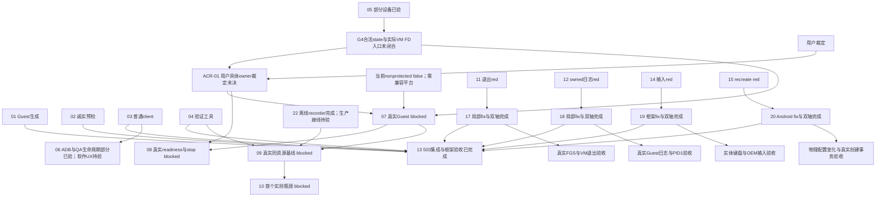
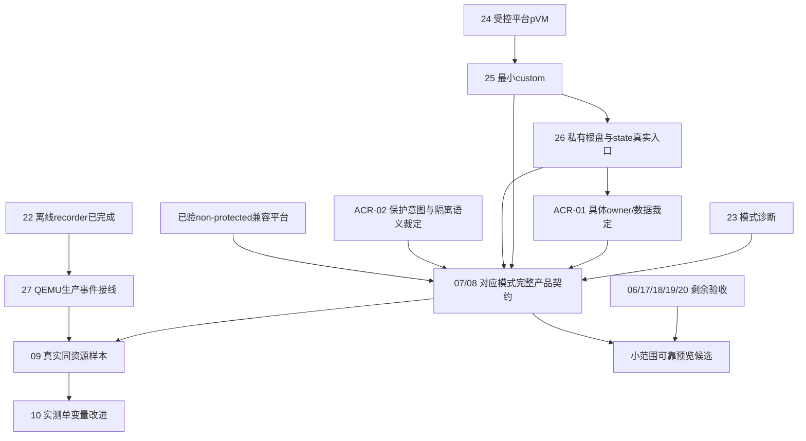

# AVF / Shizuku 升级决策地图

活动 effort：`.scratch/orchestella-avf-shizuku/`。Owner：Codex 主协调。最新更新：2026-10-17 protected优先近期规划（本文末节，28票）；2026-10-16 batch-01 / resume-01交付矩阵保留历史范围。唯一源码 `Orchestella_dev`，基线 `main@428860ad9a1cb335f8be78c157b2ff57faf2a6da`；dirty0.5.3保留未提交。本回合仅文档，不执行新增票。

## 当前事实与证据口径

本地图以当前原件替换旧的“设备待到、仅17票、尚未修产品、502待装”进度描述。2026-10-15研究与500本地交付、20261016交接及首审仍是历史证据，不改写其当时结论。正式研究唯一 canonical 为 `docs/research/2026-10-15-avf-shizuku-upgrade.md`；授权范围见 [scope](scope.md)，验收约束见 [spec](spec.md)。

以下 E 指开发根 `Orchestella/artifacts/avf-shizuku-device-20261016/batch-01/`，R 指 `E/resume-01/`。设备/安装/权限/Gradle/版本/签名实际操作均由主协调执行；本次收口只读原件、更新文档及定点保全。

- `R/integration-503/tests-and-source-audit.json`：App **747 tests / 98 suites**，failure/error/skip均0；lint Fatal0、Error0、Warning748。C三P2后17份冻结输入及D五份输入全部匹配。
- `R/integration-503/final-apk-verification.json`：原包503/0.5.3及独立`.phase5`503/0.5.3-phase5-local均已构建、核签名/版本；唯一guest_init和完整MIT notice与源码bytes相同；pinned Image、baseinitrd、runtime manifest、QEMU与500相同。**原包仅产物已核，不能声称已安装。** 原产品code300另一签名及user128数据保留；仅隔离`.phase5`503真实安装用于本轮框架验收。
- `R/integration-503/framework-acceptance.json`：503/probe3 **8场景PASS = 7向导 + 1输入**。真正Activity.recreate、非法草稿拒绝、受控creating marker和Android输入框架已验；没有实际下载/create/VM事务。
- C17新seal为 `E/lifecycle-logs/p2-stop-dispatch-fixed/final-freeze.json`；34项JDK及精确Main片段red/green有来源绑定，三P2已获17的Spec/Standards复审approve。批准限定源码/JVM，真实FGS/VM停止另验。
- QA4新seal为 `R/qa-deadline-fix/identity-v4-frozen-source.json`；实际Activity合成队列九场景/110断言PASS，05的`spec-final-qa4-20261016.zh-CN.md`及`standards-final-qa4-20261016.zh-CN.md`均限定approve。旧QA1三份原源码bytes缺口保留。
- `R/permission-control-summary.json`：固定QA/user0的CUSTOM单项、两项逐次ADB grant/cold-readback/revoke全部PASS，最终恢复双DENIED；这不是软件内grant/restore UX通过。
- `R/qa4-device-summary.json`：QA4 code4普通permission session同epoch跨旧5秒点，8277ms后仍可readback；normal remove、App force-stop→US退出/server活、server TERM→App观察death/US0、官方starter重启及重新bind均限定PASS。无权限变更、无VM、未强制真实B在途timer交错；最终QA双DENIED、US0/server1。
- `E/device/qa3-manager-capability-receipt.json`：真实getCapabilities bits1，protected=true、**nonprotected=false**。当前ROM不兼容现nonprotected custom Linux adapter。`qa3-context-fd-receipt.json`：App新私有QA state可写，US访问所给App Context目录EACCES，App→US合成RO/RW PFD正负门通过。它们没有证明G4实际VM FD入口、合法持久namespace或真实owner。

## 决策与保持的边界

保留Full Linux策略中性契约、单运行实例、App私有raw根盘、原token鉴权/单控制reader、默认loopback及App死亡后的冷恢复。普通client、Android grants、调用身份、Context、FD、VM、Guest和性能逐门证明。现真实AVF成功样本 **0**，不报提速。

当前技术建议R0：按本ROM真实nonprotected=false保留诚实软件执行路径。未来兼容平台还需G4/state/owner具体证据，用户再裁定ACR-01中的有限IPC、文件/秘密可读能力、死亡收敛及迁移回滚；本轮调试授权和原型/双轴approve均不代答该选择。未实施新生产VMowner或grant入口，**21没有文件，不创建占位票**。

## 2026-10-16批次22份工单的交付矩阵

以下为01–20、22及ACR-01的原22票交付范围，原17份加17/18/19/20/22五份。2026-10-17追加23–27及ACR-02后总数28，见末节；旧票完成/阻塞证据不被新规划改绿。

| 票 | 当前交付状态 | 已核证据 / 独立审查 | 剩余验收或真依赖 |
| --- | --- | --- | --- |
| [01](issues/01-clean-guest-generation.md) | completed，历史本地范围保留 | 500生成/严格bytes/双轴；本批Guest回归引用13 | 云kernel/build/smoke不由本地结果关闭 |
| [02](issues/02-honest-authorization-preflight.md) | completed-local，历史范围保留 | 两权限/UNKNOWN/文案及500双轴 | 原产品设备授权UI在06；不宣称AVF |
| [03](issues/03-shizuku-client-lifecycle.md) | completed-local，历史范围保留 | 普通client/13.1.5 MIT及500双轴 | 06生产UX、拒绝/撤回/首次配对/OEM/reboot |
| [04](issues/04-safe-validation-tools.md) | completed-local，历史工具范围 | 原100项及双轴；22后总127项 | 结构/关联校验不认证物理真实性 |
| [05](issues/05-identity-fd-feasibility.md) | partial-device-verified；后续FD/owner门开 | identity/Context/合成PFD/capability；QA4源码双轴与限定session/death实测 | 跨UID Binder负客户端、真实timeout/迟到FD、跨升级state/G4/owner；QA1三源缺口 |
| [06](issues/06-local-permission-device-acceptance.md) | partial-device-verified；软件UX门开 | ADB单/双权限对照恢复、QA4普通session/App-server death/reconnect | typed完整grant/readback/同session restore、拒绝/记忆拒绝/管理器撤回、本机首次配对/reboot/OEM、生产向导 |
| [ACR-01](issues/ACR-01-vm-ownership.md) | needs-architecture-decision | 技术方案、ROM能力/Context/合成FD反证 | 用户未裁定；兼容平台、G4/state/owner具体方案及必要ADR/spec |
| [07](issues/07-real-avf-guest.md) | blocked-platform-and-architecture | 真实nonprotected=false；无create/run | 兼容平台 + 05/G4 + ACR；真实Guest/鉴权/终端/网络/services/normal stop |
| [08](issues/08-bounded-readiness-and-stop.md) | blocked-owner-and-platform | 合成平台锁red、候选模型P2后5+9组；同轴复审限定approve | ACR/07；真实在途connect/迟到FD/正常stop/death/盘lease收敛 |
| [09](issues/09-real-performance-baseline.md) | blocked-real-avf | 04/22工具准备完成，真实样本0 | 07真实闭环 + 同资源/来源/正常停止；生产事件接线仍缺门 |
| [10](issues/10-first-measured-bottleneck.md) | blocked-measurement | 无优化/收益主张 | 09先有真实数据，再选单变量或证据化不采用 |
| [11](issues/11-exit-session-reproduction.md) | reproduced-fixed-and-qemu-stop-verified | 17修复/503集成/双轴；新Debian真实三停止与持久性 | 精确异常退出码/wait异常/错代/EOF/Activity重入/通知全矩阵、App死亡后VM冷恢复及AVF |
| [12](issues/12-owned-console-log-reproduction.md) | reproduced-fixed-and-native-log-observed | 18修复/集成/双轴；真实systemd、ready及journal/owned文件可查 | native-failed/recovery、console计数/逐event唯一性与完整编辑体验 |
| [13](issues/13-local-integration-verification.md) | completed-local-and-framework，限定本批集成 | 503原包/隔离包、747/98、lint0/748、8框架；逐模块双轴 | 外部设备/架构/发布门由对应票保留；未签整阶段全完 |
| [14](issues/14-physical-keyboard-reproduction.md) | reproduced-and-framework-verified；外设门开 | AltGr/死键red→19局部fix；501/502/503真实框架 | 实体国际布局键盘、OEM IME/焦点/锁屏/前后台 |
| [15](issues/15-wizard-recreation-reproduction.md) | reproduced-and-android-verified；外部门开 | 501真正recreate red→20；502/503七向导PASS | 物理rotation/uiMode/OEM、真实创建事务跨重建/进程死亡 |
| [16](issues/16-governance-source-recovery.md) | resolved-source-preserved，历史范围保留 | 三缺文档历史原文/来源保全 | 不把历史policy静默恢复active |
| [17](issues/17-session-exit-supervision-fix.md) | implemented-integrated-reviewed；QEMU停止/持久性已验 | 三P2双轴/503；真实三停止、STOPPED、重开标记与最终FGS撤销 | 精确exit23/wait异常/错代/EOF/Activity重入/通知全矩阵、App死亡后VM冷恢复及AVF |
| [18](issues/18-owned-provision-log-routing-fix.md) | implemented-integrated-reviewed；native journal已实测 | 五sink/Guest回归/双轴；真实Debian systemd ready与journal路由/owned marker | native-failed/recovery、console全程计数/逐event唯一性及完整编辑体验 |
| [19](issues/19-terminal-layout-encoding.md) | implemented-integrated-framework-reviewed；物理门开 | 30JUnit、501/502/503框架输入、D五输入匹配及双轴approve | 实体键盘国际布局/OEM IME/焦点/前后台/锁屏 |
| [20](issues/20-wizard-saved-draft.md) | implemented-integrated-android-reviewed；外部门开 | 14模型回归、502/503真实recreate/非法state/marker、双轴approve | rotation/uiMode/OEM、真正下载/create跨重建及进程死亡；marker不代事务 |
| [22](issues/22-offline-typed-recorder.md) | completed-offline-reviewed，限定离线 | 最终127=100+27测试；Spec/Standards approve | 生产Android时钟/阶段接线/真实receipt另验，不解除07/09/10 |

## 依赖图

图中依赖描述后续验收门；已完成的工具/修复不因AVF阻塞重新变成未实施。

06不是07的强制语义前置，合法ADB授权可独立使用；08是否阻塞09由实际stop/安全问题决定，不为图形顺序新增假依赖。当前07自身平台/架构门已阻断真实性能。

## 2026-10-16交付时frontier与精确未完成门（后续排序见最新规划）

当前没有待补的本批17/18/19/20源码修复或22离线实现；其局部代码、本地/必要框架集成和对应双轴结论已经齐备。未验外部范围保持可见：

1. 05/06：QA4普通session、App/server死亡与重连已实测；typed grant/同session restore完整软件流程、真实在途deadline交错、跨UID Binder/迟到FD、管理器撤回/拒绝/记忆拒绝、首次本机配对、设备reboot、OEM限制及原产品签名/UX仍未闭合。
2. 17/11：QEMU真实Guest poweroff、App正常关机、QA强制停止、持久标记和最终FGS撤销已验；剩余精确异常退出码/wait异常/错代/EOF/Activity重入/通知全矩阵、App死亡后VM冷恢复及AVF。QA原型US死亡不能代VM停止。
3. 18/12：真实Debian PID1=systemd、基础环境ready、owned unit输出journal及journal/owned文件可查已验；剩余native-failed/recovery、console全程计数/逐event唯一性及完整编辑体验。
4. 19/14与20/15：实体键盘/OEM IME、物理rotation/uiMode；真正下载/create跨重建/进程死亡，不能用creating marker关闭。
5. AVF：先有兼容nonprotected平台，解决合法state/G4与用户ACR具体裁定，再完成07和08真实Guest/stop；09随后采同资源样本，10仅依数据选择瓶颈。当前ROM能力反证不靠新owner批准改变。

无自动commit/push/ref/发布、设备/Gradle重复运行、网络或清理。正式最终编排报告归主协调；本次文档修改与前后精确快照、证据hash索引归 `R/tracker-closeout/` 和 `R/preservation/tracker-closeout/`。

## 历史引用

- 2026-10-15研究、16编号+ACR原17票、01–04/13本地500与16来源研究：旧外部 `Orchestella/artifacts/avf-shizuku-next-stage/20261015/closeout/`、原13报告及研究§1–13；旧715/96、lint0/747仅属500。
- 20261016两份 `docs/agent-handoff/AVF_SHIZUKU_REMAINING_{HANDOFF,PROMPT}_20261016.zh-CN.md` 是授权/事实交接；其中36份dirty500、初查无包、nonprotected未知、W/V未映射是当时快照，不能覆盖后续签名/其他user数据发现和QA3真实查询。恢复dispatch记主协调已恢复W/V。
- QA1/QA2失败、QA1三份源码缺口、502中间集成和各首审request-changes全部保留。首审不被后来的approve覆盖；当前判断按最新seal、复审及实际503/QA4原件。
- 固定Shizuku/API/AOSP来源和三份缺文档的历史来源沿研究与16，不重新clone/研究或恢复policy。

报告人：文档收口 Worker / Codex GPT-6.1-sol ｜ 日期：2026-10-16 ｜ 耗时：未可靠计量

## 2026-10-17：独立 Debian QEMU 真机验收增补

本节为后续实测，前文“待设备/待真实Guest”保留当时含义；当前进度以本节为准。唯一摘要为本批 `resume-01/qemu-device-summary.json`（19份原件的路径/bytes/SHA），原件及摘要均有即时 preservation。设备user0，独立 `.phase5` code503，新建且仅本轮使用的 `qa-qemu-503-01`；未操作原产品实例或其他user数据。

真实输入为Debian13、1vCPU、801MiB、4GiB新raw盘；App私有rootfs实核90351092B、SHA256 `000f18fbcea39b276754dee7a1972df357f53329371c2df477e6504e15ed2907`，与当前清单一致。实际下载命中端点未完整观察，不将配置URL当实际端点。App显示QEMU软件虚拟化，且进程为独立App UID下的QEMU子进程；这不是AVF成功或性能对照。

原终端固定查询实证UID0、PID1=systemd、`status=ready/stage=verified/attempt=1/operation_exit_code=0`及done存在。owned firstboot服务`Result=success/ExecMainStatus=0/ActiveState=active/SubState=exited`，`StandardOutput=journal/StandardError=journal`；当次owned marker在journal和owned文件均可查。没有完整统计常规console副本数或逐report唯一性；owned文件重复repository-refresh阶段名不能当同一event重复，audit/kernel消息继续保留。

Guest `/sbin/poweroff`、App“正常关机”、仅新QA“强制断电”均实际令QEMU子进程退出并显示/持久化STOPPED。强制停止及最终关机后owned前台服务不存在；同一实例在正常与强制停止后重开，固定持久标记仍为`ORCHESTELLA_QA503_PERSIST=1`，force后停机记录与重启后最终停机记录的实例ID及根盘引用hash一致。最终通过Guest正常关机收尾，QEMU0、owned前台服务无，测试盘保留。成功停止的精确owner exit code未独立记录，不能由UI或EOF倒推0；force后UI复用“guest正常关机”文案，仅签有意停止及底层退出，不称Guest进行了graceful shutdown。

剩余：真实exit23/wait异常/错代竞态注入、EOF先于owner退出、Activity重入与通知完整矩阵、App进程死亡后VM的真实冷恢复；日志native-failed一次摘要、无journal recovery、console全程计数/逐event exactly-once及完整编辑体验仍未验。原型QA4的US死亡不代VM死亡；QEMU结果不关闭07/08/09/10/ACR。当前ROM nonprotected=false、真实AVF样本0不变。创建/停止过程中未改源码或系统策略、未清数据/卸载/公开根盘/增reader。

报告人：主协调 Codex / GPT-6.1 ｜ 日期：2026-10-17 ｜ 本节仅同步新增实测，不重写旧封板

## 2026-10-17：Protected优先近期规划（当前frontier）

### Destination 与已确认方向

用户已确认protected优先研发、non-protected持续兼容、QEMU保证当前FullLinux可用，并要求更新近期优化文档。目标是有证据地判断protected能否满足无Root/共同kernel/App私有持久根盘/完整网络与生命周期契约，同时完成已可用路径的剩余可靠性门。

Canonical近期执行方案：[Protected优先近期优化方案](../../docs/reports/orchestration/protected-avf-near-term-plan-20261017.zh-CN.md)。资料依据：[当前设备重检](../../docs/research/2026-10-17-avf-device-recheck.md)、[完整Custom Linux路线研究](../../docs/research/2026-10-17-avf-custom-linux-route-study.md)。本map只索引事实/票/依赖，不复写全部来源。

当前已核：仍main428860a/单worktree/dirty0.5.3/code503，生产源码未改；真实AVF成功样本仍0。当前protected-only是ROM声明，不等芯片物理不能non-protected或已确认pKVM，社区覆盖/未来增长尚无实测分母。

### 新增垂直切片与状态

| 任务 | 类型/状态 | 真依赖与交付 |
| --- | --- | --- |
| [23 模式事实与诚实入口](issues/23-mode-capability-diagnostics.md) | implementation / ready-for-agent | 无；分模式/actor/来源/unknown，不隐式VM探测、不改策略承诺 |
| [24 受控protected平台payload](issues/24-bounded-protected-platform-probe.md) | prototype / ready-for-prototype | 离线控制门可立即；真机须合法身份、设备窗口/用户必要系统确认，先有收尾再start |
| [25 最小protected custom启动](issues/25-protected-custom-boot-feasibility.md) | prototype / blocked-by-protected-platform-evidence | 24同ROM真实boot/stop；合法最小kernel/initrd，拒绝层可归因，不开GUI/network |
| [26 私有根盘/state/FD入口](issues/26-protected-private-data-feasibility.md) | prototype / blocked-for-device-vm-stage | 25用于真实VM数据；来源/label低成本预检可先行；失败也交精确证据，不违私有盘契约 |
| [27 生产阶段与停止来源](issues/27-production-stage-recorder.md) | implementation / ready-for-agent | 22已离线完成；先QEMU真实链路，无protected前置，缺信号not_observed/真实偏序/零secret |
| [ACR-02 保护意图/降级/隔离表述](issues/ACR-02-protection-semantics.md) | decision / needs-architecture-decision | 用户对具体产品语义裁定；不阻塞23/24/27和旧可靠性验收 |

实际工单总数28：旧22+新23/24/25/26/27五票+ACR-02。21仍无文件，编号不补历史空洞。本轮只建票/改文档，不宣称新增实现。

### 当前可并行frontier与旧票复用

- 新就绪切片：[模式事实与入口](issues/23-mode-capability-diagnostics.md)、[受控平台原型的离线控制部分](issues/24-bounded-protected-platform-probe.md)、[QEMU真实阶段接线](issues/27-production-stage-recorder.md)。各票进入设备阶段前由主协调核初态/签名/盘/事务，独占设备/Gradle窗口。
- 可靠性立即复用：[会话监督剩余门](issues/17-session-exit-supervision-fix.md)、[真实创建事务跨重建](issues/20-wizard-saved-draft.md)，随后[owned失败/recovery](issues/18-owned-provision-log-routing-fix.md)、[授权软件闭环](issues/06-local-permission-device-acceptance.md)与[实体键盘/OEM](issues/19-terminal-layout-encoding.md)。已有修复/通过不重做，新增red才限定补fix。
- [non-protected原路线](issues/07-real-avf-guest.md)保留其原平台/身份前提；不依赖protected原型成败，暂无设备时维持旧fixture/20AVF入口和具体ROM未测矩阵，不强制购新机。
- [ACR-01](issues/ACR-01-vm-ownership.md)继续owner/state/FD/秘密可读/死亡收敛；[ACR-02](issues/ACR-02-protection-semantics.md)处理安全语义，两票并行准备而非彼此循环阻塞。
- 07/08的protected产品集成要25/26、相关ACR、合法入口与完整Guest/网络/stop门齐备；旧blocked状态不因“以protected为主”变ready。09/10仍无真实AVF不测收益；22离线127通过不等27已接生产。

### 最新依赖图（规划门，不回写旧验收）

图中Product汇总对应模式的放行条件：protected才需25/26，原non-protected路线不依赖它们；混合图不是要求一个ROM必须同时具备两模式。network/存储/内核硬契约如无法保持必须具体ACR，不以能力矩阵豁免。

### Fog / 停止与毕业条件

当前未证：本机protected实际boot、合法custom信任/私有数据入口、持久身份、平台network/完整IP网络、owner/死亡与盘lease、用户显式保护要求如何降级、真实跨ROM覆盖/性能。最早失败门若仅能靠Root/解锁/目录放权/未经允许信任改动解决，就冻结该设备产品化、保留证据并继续QEMU/兼容/独立可靠性工作，不无限grant或换桌面栈。

进入07产品集成前，必须补具体mode/spec/验收并保留QEMU和non-protected旧用户配置；原型与声明绿不能毕业成FullLinux。promotion/新版本/源码交付按近期方案；未提交实现不从HEAD重建worktree，无自动commit/push/发布。

文档计划审计与before/after保全：`Orchestella/artifacts/protected-avf-plan/20261017/`；本回合无联网/设备/构建/新测试或性能样本，accepted ADR保持。
