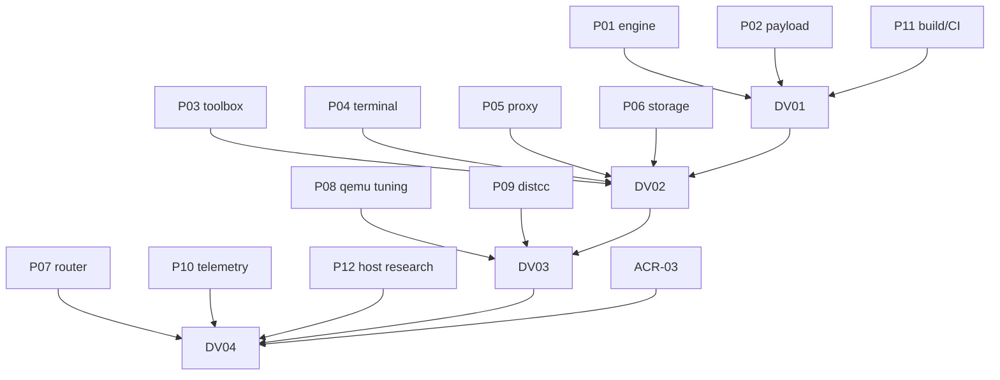

# Orchestella Fast Lane × QEMU 交叉优化决策地图

活动 effort：`.scratch/orchestella-fastlane/`。Owner：主协调。基线：`main 4b075c93`（2026-10-21 只读核对）。性质：**产品路线优先级重排 + 并行零设备实现 + 串行真机验证**；不改 Full Linux 承诺，不把 Fast Lane 叫 Full Linux。

Canonical 文档：

- [Fast Lane × QEMU 交叉优化 Spec](../../docs/reports/orchestration/fastlane-cross-lane-spec-20261021.zh-CN.md)
- [Protected Fast Lane 方案](../../docs/reports/orchestration/protected-fast-lane-plan-20261021.zh-CN.md)
- [参考项目调研](../../docs/research/2026-10-21-cross-lane-reference-survey.md)
- [ACR-03 Runtime 类别裁定](../orchestella-avf-shizuku/issues/ACR-03-protected-fast-lane-runtime-class.md)

## 当前方向

1. Full Linux VM 承诺保留给 **non-protected** 设备；当前不做 non-protected 实现，不买新机、不改绿 07/08。
2. 当前主线：在 protected-only 设备上用 **Microdroid 应用 payload** 提供硬件 vCPU 的 Fast Lane；QEMU 继续 Full Lane。
3. 交叉优化首选 **distcc 分布式编译**：QEMU guest 完整 Linux + Fast Lane 硬件编译，`distccd --inetd` 经 vsock 桥接，不依赖 guest TCP/原生网络。
4. 所有并行票必须**零设备**可构建/可测；真机验证收敛为 4 张串行票，全部并行票完成后才启动。
5. ACR-03 未通过前，Fast Lane 只做实验开关，不对外声明能力。

## 并行零设备 frontier（P01–P12）

| 票 | 模块 | 交付 | 状态 |
| --- | --- | --- | --- |
| [P01](issues/P01-engine-fastlane-adapter.md) | engine-fastlane | 反射适配器/launch/session/stop 分类 | ready-for-agent（zero-device） |
| [P02](issues/P02-payload-runtime.md) | payload | `AVmPayload_main`、vsock/PTY/storage/bridge | ready-for-agent（zero-device） |
| [P03](issues/P03-sealed-toolbox.md) | toolbox | Termux/静态工具、`bin/` 注入、manifest | ready-for-agent（zero-device） |
| [P04](issues/P04-terminal-multiplexer.md) | terminal | 多 PTY 帧协议/流控 | ready-for-agent（zero-device） |
| [P05](issues/P05-network-proxy.md) | network | SOCKS5/HTTP CONNECT + vsock 桥 | ready-for-agent（zero-device） |
| [P06](issues/P06-storage-export.md) | storage | encrypted home、tar 导出/导入 | ready-for-agent（zero-device） |
| [P07](issues/P07-capability-router.md) | router | 能力矩阵、Full/Fast/Auto | ready-for-agent（zero-device） |
| [P08](issues/P08-qemu-tuning.md) | QEMU | CPU/tb-size/iothread/aio/discard 参数 | ready-for-agent（zero-device） |
| [P09](issues/P09-distcc-cross-lane.md) | distcc | TCP↔vsock↔`distccd --inetd` | ready-for-agent（zero-device） |
| [P10](issues/P10-telemetry-security.md) | observability | 事件/指标/脱敏/删除 | ready-for-agent（zero-device） |
| [P11](issues/P11-build-ci-licensing.md) | build | payload/toolbox 构建、CI、NOTICE/SBOM | ready-for-agent（zero-device） |
| [P12](issues/P12-host-native-research.md) | research | Termux/glibc/PRoot 兜底评估 | ready-for-agent（zero-device） |

## 首批零设备落地（2026-10-21）

- `runtime/engine-fastlane`：`FastLaneLaunchSpec`/`FastLaneSession`/`FastLaneHandle`/`FastLaneChannel`/失败分类/有界 stop 骨架；10 个 JUnit 测试通过。
- `runtime/fastlane-distcc`：`DistccTcpVsockBridge`（loopback TCP ↔ FastLaneChannel 双向字节桥）；4 个 JUnit 测试通过。
- 验证方式：本环境无 Android SDK/JDK 17，Gradle 全仓配置失败；用 JDK 21 + standalone `javac --release 17 -Xlint:all -Werror` + JUnit 4.13.2 跑 14 tests（OK）。有 Android SDK 的环境应改跑 `:runtime:engine-fastlane:test` 与 `:runtime:fastlane-distcc:test`。
- P01/P09 仍为进行中：反射适配器、payload `distccd --inetd` 桥、Gradle check 待补。

## 串行真机 frontier（DV-01–DV-04）

**启动条件：P01–P12 全部完成（零设备验收通过）**；设备窗口唯一操作者；每张票独立初态/事务/证据。

| 票 | 依赖 | 内容 |
| --- | --- | --- |
| [DV-01](issues/DV-01-protected-payload-device.md) | P01–P12 | protected payload create/run/vsock/storage/stop；20 次启停 |
| [DV-02](issues/DV-02-toolbox-data-device.md) | DV-01 + P03/P04/P05/P06 | toolbox 执行、终端、代理、导出 |
| [DV-03](issues/DV-03-distcc-qemu-performance.md) | DV-01/02 + P08/P09 | distcc 真实编译 + QEMU A/B（n≥10） |
| [DV-04](issues/DV-04-product-e2e-release.md) | DV-01/02/03 + ACR-03 + P07/P10/P11 | 产品端到端、ACR-03、P0 发布门 |

## 依赖图

P09 的零设备版本可用假 distcc 客户端/服务器先做；与 P02/P03/P05 的集成在 DV-03 验证，不阻塞并行。

## 零设备验收口径

- JVM 单测/fake AVF SDK/纯函数 truth table；
- 宿主进程测试（本地 TCP/Unix socket、内存 vsock 流、假 distcc）；
- NDK/CMake 构建 payload；APK zip 检查；`zipalign -P 16`；
- 许可证/NOTICE/SBOM 清单；
- 不运行 adb/设备/Gradle 设备任务；不把 fake 当真实 AVF。

## 真机验收口径

- 设备/ROM/APK/caller/UID/模式/时间绑定；
- 每步原始输出脱敏；无序列号/IMEI/Android ID/账号/token/按键正文；
- 失败样本保留；`STOP_UNCONFIRMED` 保持 RUNNING/lease；
- 性能 n≥10、控温、同资源、median/IQR；
- Fast Lane 成功不签收 Full Linux；non-protected 仍为未来线。

## 停止条件

- DV-01 `rejected_at_stage`/`blocked_external`/`stop_unconfirmed`：Fast Lane 停止或先修生命周期。
- P03 无法从 `/mnt/apk/bin` 执行工具：降级 native payload 或停止。
- P09 编译器不匹配/协议失败且无合法修复：停止 distcc，保留选道/终端。
- P05 代理无法支持 DNS/TLS：Fast Lane 只做离线/终端。
- P08 无显著收益或回归：保留 QEMU 默认。
- ACR-03 要求 Full Linux：Fast Lane 停止；QEMU-only。
- 任何门需要 Root/unlock/pvmfw/SELinux 修改：立即停止。

## 证据与文档

- 研究：[`docs/research/2026-10-21-cross-lane-reference-survey.md`](../../docs/research/2026-10-21-cross-lane-reference-survey.md)
- Spec：[`docs/reports/orchestration/fastlane-cross-lane-spec-20261021.zh-CN.md`](../../docs/reports/orchestration/fastlane-cross-lane-spec-20261021.zh-CN.md)
- 参考项目：本地 `references/`（本地 exclude，不进入 GitHub）
- 本回合：只建图/票/文档，不运行设备/构建；P 票的真实代码由后续实现票闭合。
