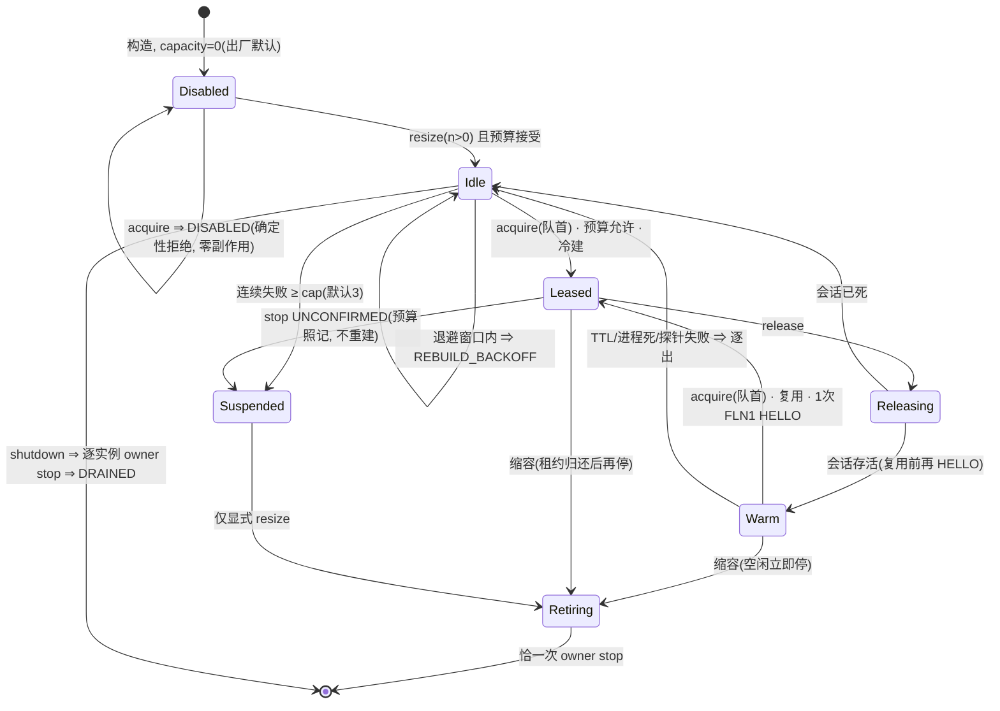

# PVM-06: 编译 worker 池与调度

- Type: implementation（Java，零设备）
- Status: implemented（零设备；Gradle 门禁待主会话统一跑）
- Priority: P1（单实例能跑通后才谈并行）
- Owner: app integration owner
- Blocked by: PVM-03（会话 5 内先完成）
- Parent: `../决策地图.md`
- Zero-device: 是（fake VM + fake 时钟）

## 背景

一个 protected VM 默认只有 1 vCPU（`CPU_TOPOLOGY_ONE_CPU`）。编译并行度只能来自**多个实例**。`ProtectedWarmPool` 已有租约/健康/复用计数的骨架，但容量默认 0，也没有「按 job 排队 + 预算」的调度。

本票把预热池扩成 worker 池：N 个 protected VM，每个跑 PVM-03 的服务端，宿主把 distcc 连接分派到空闲实例。

## 目标

- 池容量 `N` 可配，默认 0（opt-in），上限受预算账本约束。
- 调度：有界队列（默认 2×N）、超时、取消、公平性（FIFO 即可，不做优先级）。
- 健康：payload 心跳 / 连接探测；失败实例下线并重建，重建失败计数进固定码。
- 与 `DualLaneCoordinator` 的停止顺序一致：QEMU → ACCEL；`UNCONFIRMED` 保留 lease 与预算。
- 复用 PL-01 既有测试风格，不新增 stop owner。

## 任务

- [ ] `WorkerPool` 接口：`acquire(job) / release(lease) / health() / resize(n)`。
- [ ] 复用 `ProtectedWarmPool` 的租约语义；容量 0 时不创建任何 VM（行为与今天一致）。
- [ ] 队列：上限、拒绝码（`POOL_SATURATED`）、排队超时（`JOB_TIMEOUT`）。
- [ ] 计入 `LaneBudget`：每实例 1 vCPU + 内存；超预算拒绝并给出 reason。
- [ ] 拓扑开关：默认 `ONE_CPU`；`MATCH_HOST` 作为实验开关，默认关闭（平台支持但内存代价高）。
- [ ] 测试（fake VM）：容量 0 / 1 / N；队列满；实例崩溃重建；取消；预算拒绝；停止顺序。
- [ ] 埋点：池大小、占用、排队时长、重建次数（只计数，不含 job 内容）。

## 验收命令

```bash
./gradlew :app:testDebugUnitTest :runtime:instance:test --console=plain
python tools/ci/check_ci_module_coverage.py
```

## 边界

- 不做跨设备调度、不做优先级/抢占。
- 不改 `RuntimeProcessSupervisor` 的所有权；QEMU 停止仍归它。
- 不把池容量默认从 0 改成 1（需维护者决策，见决策地图 §8.4）。

## 失败信号

- 池容量 0 时创建了 VM → 违反「默认零副作用」。
- 停止时出现两个 stop owner → 违反 AX-01 约定。
- 重建风暴（失败实例无限重启）→ 需要退避与上限。

## 证据

- 单测 + 一份状态机说明（池生命周期图，Mermaid）。

## Comments

### Comment 1 · 2026-11-03 · 接口与文件坐标（Lane B 实现落点）

- `app/src/main/java/io/github/nyzeep/orchestella/WorkerPool.java`（新增，386 行）：接口本体。
  四个工单方法在 `:333`（`acquire(job, timeoutMs)`）、`:340`（`acquire(job)`，用配置默认排队超时）、
  `:353`（`release(lease)`）、`:362`（`health()`）、`:371`（`resize(n)`）；补充面 `:347`（`cancel(job)`）、
  `:381`（`shutdown`）。嵌套类型：固定码 `Code`（17 项，`:60`）、不透明作业身份 `Job`（`:102`）、
  `Lease`（`:135`）、带 `LaneRejectCode` reason 的 `WorkerPoolException`、`HealthReport`/`Stats`/
  `ShutdownResult`、预算缝 `Admission`（`:260`，内含 `ledgerBacked(LaneBudgetLedger)` 静态适配）、
  探测缝 `HealthProbe`（`:318`）。
- `app/src/main/java/io/github/nyzeep/orchestella/ProtectedWorkerPool.java`（新增，1132 行）：实现。
  组合 N 个 capacity-1 `ProtectedWarmPool`（租约/HELLO/逐出/owner-stop 语义逐字复用）；
  `Config`（`:89`，容量默认 0；`topology` 默认 ONE_CPU + `allowMatchHost` 双闸）；
  派发 `:380`、认领与预算询问 `:531`/`:576`、退避 `:601`、账本差分与 UNCONFIRMED 悬停 `:690`、
  取消 `:725`、归还 `:744`、健康 `:803`、缩容 `:929`、停机 `:1072`。
- `app/src/main/java/io/github/nyzeep/orchestella/ProtectedWarmPool.java`（最小增量）：
  `Code` 追加 `PROBE_FAILED`（`:75`）；只读 `warmSessionIfReady()`（`:326`）与健康逐出
  `evictWarm()`（`:341`）。PL-01 语义零改动，既有测试原样全绿。
- 落点说明：与 `ProtectedWarmPool` 同包同目录（工单建议形态），未建新 Gradle 模块；
  app 模块对 `:runtime:instance`（预算码）与 `:runtime:fastlane-terminal`（api 传递 engine-fastlane）
  的依赖已存在，未改任何 build 脚本。

### Comment 2 · 2026-11-03 · 测试清单与自验证据（javac 零错误 / JUnit 实跑）

- 新测试 `app/src/test/java/io/github/nyzeep/orchestella/ProtectedWorkerPoolTest.java`：
  **21 条**，fake VM（平台 API 假件，对齐 PL-01 测试形态）+ fake clock（可推进 `java.time.Clock`），
  覆盖票面七项：容量 0/1/N、队列满（`POOL_SATURATED`）、排队超时（`JOB_TIMEOUT`）、
  取消、FIFO 公平、崩溃重建、退避+上限（`REBUILD_BACKOFF`/`REBUILD_GIVE_UP`）、
  预算拒绝（注入 + `ledgerBacked` 两条，reason=`CPU_EXCEEDED`/`RAM_EXCEEDED`）、
  `resize` 预算上界、UNCONFIRMED 停用并保留预算、每实例恰一次 owner stop、
  探针失败下线重建与探针风暴防护、拓扑双测、埋点纯计数断言。
- 自验口径（**未跑 Gradle**，与并发车道互斥；产物在系统临时目录，未进仓库树）：
  javac（`-encoding UTF-8`，sourcepath 挂 app/engine-fastlane/fastlane-terminal/instance 四源集）
  对全部新/改源**零错误**；JUnit 4.13.2（jar 取自 Gradle 缓存）直跑：
  `ProtectedWorkerPoolTest` **OK (21 tests)**、回归 `ProtectedWarmPoolTest` **OK (18 tests)**、
  `DualLaneCoordinatorTest`+`AcceleratorLaneAssemblyTest` **OK (43 tests)**，合计 **82/82 绿**。
  邻接回归在临时目录放了一个 Gradle 生成的 `BuildConfig` 桩（不进仓库）。
- 完整判据表与输出摘录见报告
  `docs/reports/tickets/pvm-06/implementation-report.zh-CN.md` §1/§4。
- 残留门禁（主会话统一跑）：`./gradlew :app:testDebugUnitTest :runtime:instance:test
  --console=plain --offline`、`python tools/ci/check_ci_module_coverage.py`。

### Comment 3 · 2026-11-03 · 零接线声明 + 池生命周期状态图

**零接线**：产品启动路径零改动——`new ProtectedWorkerPool` 在 `app/src/main` 零命中
（仅测试构造）；`RuntimeProcessSupervisor` 所有权未动、无新增 stop owner（池内一切
stop 经 `FastLaneSession.stopRuntime`，每实例恰一次有断言钉住）；`LaneBudgetLedger`
只读消费、行为面零改动；容量默认保持 0（决策地图 §8.4），容量 0 时 acquire 在任何
排队/预算逻辑之前确定性拒绝（`DISABLED`），不建 VM、不入队、不触碰平台 API——与今天
行为可观测等价。产品接线归 PVM-09。槽位生命周期状态机（完整说明见报告 §3）：



### Comment 4 · 2026-11-03 · 边界自查（票面「失败信号」逐条）

- 容量 0 建 VM：未发生（`defaultCapacityIsZero…` 断言 `startCount=0`）。
- 双 stop owner：未发生（池无 QEMU 引用、无平台直停；`shutdownStopsEachInstanceExactlyOnce…`
  断言每实例 `stopRuntime` 恰 1 次）。
- 重建风暴：不可能（失败计数 + 指数退避 + `REBUILD_GIVE_UP` 停用，探针路径同闸，
  `rebuildFailureBacksOffThenGivesUpAtTheCap` 与 `repeatedProbeFailuresSuspendTheSlotAtTheCap` 钉住）。
- 真机项全部 `not-tested`（零设备轮）；下设备窗口入口：DV-PVM-02 02b crossfire 基础上
  观察 N=2 池的并发派发与重建行为。
