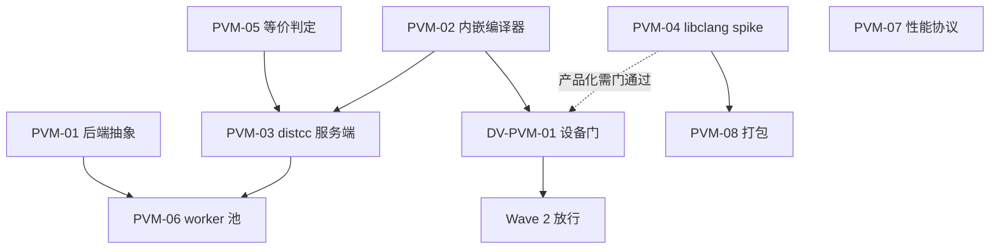

# 决策地图：protected pVM 编译服务（编译器即库）

- Type: map
- Status: active
- Date: 2026-10-24
- Base: `main 0d89767`（PR #18 未合并）
- Parent: `spec.md`
- 关系：新增路线。`orchestella-accelerator`（non-protected 加速车道）与 `orchestella-fastlane/P09` 保留，不删、不改绿，只标「另有后端」。

---

## 1. 已确认的方向

1. **加速车道 = 编译服务，不是某一种 VM**。后端可替换：`PVM_PAYLOAD`（本轮）/ `CUSTOM_VM`（已有，需 bit2）/ `HOST_NATIVE`（兜底，未评估）。
2. **protected 不再只做控制面**。它是本轮的计算面：payload 内跑编译器库，用硬件 vCPU，宿主看不到内存。
3. **不 exec 是硬约束**，不是优化项。任何需要 `fork/exec` 的设计在本 effort 内直接否决。
4. **本机即可验证**：protected-only 设备足够，不需要 bit2、不需要平台变更。这是相对上一轮路线的核心优势。
5. **先证伪再投入**：Wave 1 全部零设备且便宜；libclang 只做尺寸 spike，产品化等 DV-PVM-01 门。

## 2. 非目标

- 不改 root/SELinux/pvmfw；不使用 `execute_no_trans` 绕过；不改 FLN1 wire。
- 不做通用编译集群、不做远程链接、不做跨设备分发。
- 不宣称收益；没有 AX-07 口径的 ≥10 样本，一律 `not-tested`。
- 不改动 QEMU 默认参数（与 Podroid 已是平手，调参不是本轮主题）。

## 3. 现有资产：复用 / 改造 / 重写

### 3.1 可原样复用

| 资产 | 位置 | 用途 |
| --- | --- | --- |
| AXP1 协议 | `runtime/fastlane-distcc/.../axp1/` | 帧、token、能力协商、背压；只加一个可选压缩位 |
| distcc 宿主桥 | `runtime/fastlane-distcc/.../DistccTcpVsockBridge` | loopback listener、连接上限、空闲 watchdog、半关闭 |
| distcc golden | `runtime/fastlane-distcc/src/test/resources/` | `request-v1/response-v1` 字节夹具直接给 PVM-03 |
| 预热池 | `app/.../ProtectedWarmPool` | 租约/健康/复用计数，扩成 worker 池 |
| 双车道协调 | `runtime/instance/.../duallane/` | 预算账本、停止顺序、事件码 |
| 装配根 | `app/.../AcceleratorLaneAssembly` | 唯一 `new DualLaneCoordinator`，改为按后端装配 |
| 启动接线 | PR #18 `AcceleratorLaunchDispatcher` | flag 门与单一调用点，改为「选后端」而不是「起 non-protected VM」 |
| 性能协议 | `tools/accelerator-perf/`（12 文件 / 52 测试） | 场景、n≥10、median/IQR、compare 三态 |
| payload 骨架 | `fastlane-payload/`（CMake + SHARED lib + NDK 脚本） | 加编译服务目标，不新起工程 |

### 3.2 需抽象/改造

| 资产 | 问题 | 改法 |
| --- | --- | --- |
| `AcceleratorPolicy` | 只有一条判据：non-protected + image + vsock + triple + 热/电 | 引入 `CompileBackend`，判据变成「哪个后端可用」；non-protected 降为其中一个后端 |
| `AcceleratorFacts` | `nonProtectedSupported` 是一等门；没有 protected payload 维度 | 加 `protectedVmSupported`、`payloadPresent`、`payloadCompilerVersion` |
| `AcceleratorReasonCode` | 6 个码，全部围绕 non-protected/镜像 | 加 §5.3 的 8 个码；旧码保留不删 |

PVM-01 落地后的实际字段映射（2026-10-24，与 spec §4.4 对齐）：

| spec 概念 | 代码落点 | 备注 |
| --- | --- | --- |
| `PVM_PAYLOAD` / `CUSTOM_VM` / `HOST_NATIVE` | `CompileBackend`（+`NONE`） | `HOST_NATIVE` 本轮无评估门，恒不可选 |
| protected bit 缺失 | `AcceleratorFacts.protectedVmSupported`（默认 false） | provider 仅从 `MODE_UNSUPPORTED` 推 true |
| payload 编译器在场/缺失 | `payloadCompilerPresent`（默认 false）→ `PAYLOAD_IMAGE_MISSING` | 生产恒 false：manifest 格式归 PVM-04/08，读取归 app 票 |
| 编译器身份 | `payloadCompilerVersion` + `payloadTargetTriple` → `PAYLOAD_COMPILER_MISMATCH` | triple 必须 == requiredTriple；版本非空，给 required 版本时须相等 |
| 运行期失败 | `PAYLOAD_LOAD_FAILED` / `ARGV_REJECTED` / `JOB_TOO_LARGE` / `JOB_TIMEOUT` | 已入 enum，选道期不可触发，归 PVM-03/06 接线 |
| 拒绝明细 | `AcceleratorDecision.rejections: List<BackendDecision>` | 每个后端的否决理由全程可观测；`ACCEL_UNAVAILABLE_NO_NON_PROTECTED` 只由 CUSTOM_VM 分支产生 |
| `AcceleratorImageManifest` | 描述 custom VM 的 kernel/initrd/rootfs | 新增 payload 侧 manifest：llvm 版本、target、features、`.so` SHA |
| `distcc_bridge.cpp` | `spawn_piped(distccd)`，核心是 fork/exec | 保留 socket pump/帧处理，替换为 `InProcessCompiler` |
| `AcceleratorVmLauncher`（PR #18） | 只造 non-protected 自定义 VM | 并列 `PvmPayloadLauncher`（protected + `setPayloadBinaryName`） |

### 3.3 必须重写（不是补丁）

- 设备任务书里「设备资格门 = bit2」这一段：protected 后端不需要 bit2；
- 「加速车道 = non-protected VM」这句在 `决策地图`/`AX-08 报告` 里的表述：加改道说明，原文保留；
- `P09` 的 protected payload 假设（`bin/` 可执行）：标注失效原因与替代方案。

## 4. 工单

| 票 | 主题 | Wave | 交付 | 依赖 | 状态 |
| --- | --- | --- | --- | --- | --- |
| [PVM-01](issues/PVM-01-编译服务后端抽象与选道.md) | 后端抽象与选道 | 1 | `CompileBackend`、facts/policy/reason code、truth table 扩展 | 无 | **已合并**（PR #21，`6bce3ac`） |
| [PVM-02](issues/PVM-02-payload内嵌编译器内核.md) | payload 内嵌编译器内核 | 1 | `InProcessCompiler` + tcc 样机，host 单测，无 exec 断言 | 无 | **已合并**（PR #19，`63a272f`） |
| [PVM-04](issues/PVM-04-libclang交叉构建spike.md) | libclang 交叉构建 spike | 1 | NDK 构建脚本、尺寸/内存/依赖报告、SBOM | 无 | **已合并**（PR #23，`f81fc3a`；22.1.8，strip 后 123.8 MB） |
| [PVM-05](issues/PVM-05-产物等价判定.md) | 产物等价判定 | 1 | `tools/compiler-equivalence/` + 确定性开关 + fixtures | 无 | **已合并**（PR #20，`9b1a17a`） |
| [PVM-07](issues/PVM-07-性能协议扩展.md) | 性能协议扩展 | 1 | schema v2 字段、迁移、文档 | 无 | **已合并**（PR #22，`42d79fd`） |
| [DV-PVM-01](issues/DV-PVM-01-设备机制门.md) | 设备机制门 | Gate | 真机 payload 内编译一次，时间/内存/失败码 | PVM-02 | **已合并**（PR #25，`e2e5b60`）：01b 加载门+编译门 PASS；01a blocked（平台零写，tcc 无内存输出 API）；Wave 2 已放行 |
| [DV-PVM-02](issues/DV-PVM-02-真机端到端.md) | 真机端到端 | 2 | 02a 产品引擎真机编出 `.o`；02b QEMU guest 交叉加速 | PVM-03、PVM-08、DV-PVM-01 | **02a done**（分支 `feat/dv-pvm-02-device-e2e`）：`STAT=0x0000`、`.o` 91,568 B、两轮逐字节相同、设备上链接运行退出码 237；核心缺陷是 `-cc1` 不接受 `-fno-crash-diagnostics`，此前每个 job 都被自己的引擎拒掉。**02b not-attempted**（时间盒 + 生产 launch 未接线） |
| [PVM-03](issues/PVM-03-payload侧distcc服务端.md) | payload 侧 distcc 服务端 | 2 | 全 token、argv 白名单、资源上限、宿主 e2e（真实 distcc 客户端归 DV-PVM-02） | PVM-02、PVM-05 | **已合并**（PR #26，`6441bd6`；零设备，CLANG 引擎未编译） |
| [PVM-06](issues/PVM-06-编译worker池与调度.md) | worker 池与调度 | 2 | 多实例、租约、队列、拒绝码、预算 | PVM-01、PVM-03 | **not-started（会话 5 时间盒用尽）** |
| [PVM-08](issues/PVM-08-APK打包与体积.md) | APK 打包与体积 | 2 | `lib/arm64-v8a` 多 .so、16 KB 对齐、体积预算 | PVM-04 | **已合并**（PR #24，`d0990c3`；+131.2 MB，全门禁绿） |

## 5. 依赖图

## 6. 并行批次

- **Wave 1**：PVM-01、PVM-02、PVM-04（spike）、PVM-05、PVM-07 —— 五票无相互依赖，可并行。
- **Gate**：DV-PVM-01，一台 protected-only 设备即可；不通过就停 Wave 2。
- **Wave 2**：PVM-03、PVM-06、PVM-08。

## 7. 交付约定

- 每票一分支：`feat/pvm-0X-<slug>`；PR 到 `main`，merge commit；
- 零设备票必须在 `:app:testDebugUnitTest`、`:runtime:*:test`、`python -m unittest discover` 上自证；
- 真机票必须区分「设备实测 / 夹具」；
- `.scratch/` 与 `docs/` 默认 ignore，需要入库时显式 `git add -f` 并先跑 `check_sensitive_data.py`。

## 8. 已决（2026-10-24，维护者授权按最佳建议执行）

| # | 问题 | 决定 | 理由 |
| --- | --- | --- | --- |
| 1 | Gate 未过是否先投 libclang 构建 | **允许 PVM-04 spike 并行，但不进产品路径** | 只花机器时间，能最早暴露「体积/内存不可行」这一票否决风险；产品集成仍等 DV-PVM-01 |
| 2 | v1 只做 C 还是直接 C++ | **协议层同时支持 C/C++；产品声明与性能验收只覆盖 C，C++ 标 `not-tested`** | C++ 的 `.i` 体积与模板实例化会让传输成为瓶颈；完全不支持 C++ 又会砍掉一半真实场景 |
| 3 | 编译器版本如何对齐 | **随 App 分发同一份 clang（与 payload 内 libclang 同源构建）** | distcc 的 `.i` 兼容性依赖编译器一致；依赖 guest 发行版 clang 会让 `COMPILER_MISMATCH` 常态化 |
| 4 | 预热池默认容量 | **保持 0；flag 打开后允许 1，不自动扩张** | 默认零副作用是既有约定；1 个预热实例能消掉首次编译的等待，2 个以上要过预算与内存评审 |
| 5 | 是否并行开 HOST_NATIVE 兜底 | **不并行开**；写进 spec 作为 fallback，由 DV-PVM-01 失败触发 | 同时开三条线会分散注意力；兜底方案本身也需要一次独立评估 |

## 9. 2026-10-24 会话 1 审核追记

PR #19（PVM-02）与 PR #20（PVM-05）已审核并合并，`main = 9b1a17a`。三处需要后续处理，不阻塞合并：

1. **无 exec 门可以静默降级**：`inprocess_noexec.sh` 在找不到 `strace` 时打印 `SKIP` 并 `exit 0`。CI 已装 strace，但如果安装步骤被删/改，这个门会变成 no-op。修法：CI 设置 `FL_REQUIRE_NOEXEC=1`，该变量存在时 SKIP 视为失败。（归 PVM-03 或 CI 硬化）
2. **超时路径弃置 `TCCState`**（刻意泄漏）：长跑多超时会累积内存，PVM-06 的 worker 池设计前必须解决。样机专属问题，libclang 后端另算。
3. **CI 日志里看不到 `NOEXEC_OK`**：ctest 默认不打印通过用例的输出，所以断言「跑过」只能由 strace 安装步骤 + 本地 WSL 证据推断。后续把该 test 改成 `PASS_REGULAR_EXPRESSION "NOEXEC_OK"`，让「断言真的执行」变成可核对的证据。

另：两个 PR 各有一个 `--allow-empty` 提交用于重触发 CI，已随 merge 进入历史；不清理、不改写。

## 10. 2026-10-24 会话 2 审核追记

PR #21（PVM-01）与 PR #22（PVM-07）已审核并合并：`6bce3ac`、`42d79fd`，`main = 42d79fd`。

核对结论：

- **选道**：有序评估（`PVM_PAYLOAD` → `CUSTOM_VM` → `HOST_NATIVE`），每次否决都进 `rejections`，终态是「最后一个真正被评估的后端」的码；无候选时 `ACCEL_UNAVAILABLE_NO_BACKEND` + `backend=NONE`。`ACCEL_UNAVAILABLE_NO_NON_PROTECTED` 只由 `CUSTOM_VM` 分支产生——与 kick-off §3 一致，三组顶层码变化可接受。
- **真 bug 已修**：`AcceleratorFacts.Builder.batteryState` 曾把入参吞掉（`requireNonNull(batteryState)`），导致 battery 恒 `UNKNOWN`、所有 available 路径被 `THERMAL_BUDGET` 拒。修复提交 `05363ee`，本机与 CI 均复验。
- **truth table v2 = 26 组**，每条含完整 decision JSON（mode / reason / backend / rejections），不是只断言一个码。
- **perf v2**：新增字段全为可选，v1 的 required 列表与四个阈值常量（10 / 1.5× / 50‰ / IQR 方法）一字未动；v1 夹具与 golden 未改。
- **测试期望改动**：`AcceleratorLaneAssemblyTest` 三处 `assertEquals` 由旧码改为 `NO_BACKEND`，有注释说明，未删测试、未弱化断言。

需要后续处理：

1. ~~**perf 的 `ALLOWED_CODES` 未纳入 PVM 新失败码**~~ —— **已同步**（2026-10-25，PVM-03）：`collect.py` 与两版 schema 都加了四个码，`test_validate.py::test_pvm_failure_codes_are_accepted` 守住。
2. **`AndroidAcceleratorFactProvider` 仍不读 payload manifest**，`payloadCompilerPresent` 恒 false，`PVM_PAYLOAD` 生产选不中（会得到 `PAYLOAD_IMAGE_MISSING`）。manifest 格式由 PVM-04/08 定，读取另开 app 票。
3. **环境事实**：中文路径下 Gradle 单测跑不了；ASCII clone（`D:/t/orch`，仓库外）可跑，已由会话 2 验证。会话 2 结束时工作区停在 `feat/pvm-01` 分支，已复位到 `main`（无提交丢失）。

## 11. 2026-10-24 会话 3 审核追记

PR #23（PVM-04）与 PR #24（PVM-08）已审核并合并：`f81fc3a`、`d0990c3`，`main = d0990c3`。

核对结论：

- 两个 PR 全绿（各 4–5 个检查项），只加文本文件（5 + 4 个），**没有任何 `.so`/tarball 入库**；`origin/main` 未被直推。
- Gradle 接线是纯可选的：`orchestella.pvmCompiler.libDir` 未设置时**零行为变化**；设置时强制「必须同时有 payloadLibDir」并拒绝重复/越权库文件名——这条设计是对的，避免了两个源目录互相覆盖。
- 尺寸事实成立：strip 后 `libLLVM 61.7 MB + libclang-cpp 62.2 MB = 123.8 MB`，16 KB 对齐全 PASS，AArch64 六个初始化符号齐全，墙钟 41 min。

追认三条（维护者授权按最佳建议执行）：

1. **构建路径 WSL → Windows 原生**：证据是 WSL 跨调用整态重置 + 7 GB 内存上限；Linux/WSL 分支保留未测，记为已知缺口（换机器重建时先跑一次 `--help` 之外的最小 configure）。
2. **版本 22.1.8**：guest 是 Alpine 3.24.1（clang22 = 22.1.3），同 major；kick-off 里的 20.1.x 只是示例，不成立。
3. **ABI：RTTI=ON / EH=OFF**：payload 侧代码必须 `-fno-exceptions`；clang/LLVM 用 `Expected`/`Error` 不抛异常，接受。若 PVM-03 需要 EH，重建（体积会涨）。

必须带进 DV-PVM-01 的风险：

- **无 RUNPATH**：三个 `.so` 只靠同目录 + linker 命名空间解析。Microdroid 若不给同目录搜索，会直接 `PAYLOAD_LOAD_FAILED`——探针第一步就要撞这个，不要等到 PVM-03。
- **+131.2 MB 是叠加在真实产品 APK 上**（9.5 MB 是精简基线），真机安装时间/存储占用要记录。
- `build.sh` 有一处 `/d/AndroidSDK/...` 的 Windows 兜底路径（环境变量优先）；可移植性差，Linux 分支未实测。
- 本地重建 payload 时 TinyCC 源码根的 `version` 文件会被 libc++ 的 `<version>` 命中；CI 不受影响，但 PVM-03 本地构建要知道这个坑。

**DV-PVM-01 拆两段**：`01a` 用 tcc 样机 payload 证明机制（便宜、快），`01b` 用真实 libclang payload 证明「装得下、加载得动、编得出」。**01b 才是 Wave 2 的真正放行条件。**

## 12. 2026-10-25 会话 4 真机收口追记

- DV-PVM-01 真机执行完成：01a blocked（payload 域对自身 memfd 的
  write/ftruncate/mmap 与全部目录写均 EACCES(13)——guest 无任何文件写路径，
  tcc parse+codegen 本身已成功）；01b PASS（三 soname 无 RUNPATH 解析 + clang
  22.1.8 内存流进程内编译 10/10，p50 98ms，RSS +1.0%，2GB 无 OOM）。
- **Wave 2 放行**（按 2026-10-24 修订，01b 为放行条件）。设备事实：Gunyah、
  API 37、DebugPolicy log:false（guest 日志不可达，观测走 vsock 结果通道）。
- 对 Wave 2 的直接影响：PVM-03 的 payload 侧禁止任何文件落盘设计（平台约束），
  对象/日志走内存 + vsock；观测通道升格与阈值口径两项待维护者确认
  （报告 §8）。

## 13. 2026-10-25 审核追记：补丁轮与 Wave 2 放行

- 首版 PR #25 有两项 CI 红：敏感门（6 路径 + 2 个 16 位十六进制）与 payload host ctest（`::fd::` 哨兵进了默认构建，未打补丁的 tcc 打开失败）。**报告里「敏感门每次 OK」的说法不成立**——扫的是 `main..HEAD` 历史，历史未重写就一定会红。
- 补丁轮已修：规划文档移出 PR、报告去路径、十六进制拆常量、哨兵用 `FL_TCC_FD_SENTINEL` 门控（默认 OFF，仅 `build_probe.sh` 打开）；历史 squash 为 2 个干净提交（`9c95c9e` + `8eb0f4e`）。
- 复核通过：12/12 全绿、`SENSITIVE_DATA_OK`、默认路径回到 `/proc/self/fd`、重写前后差异恰好只含 6 个预期文件。**已合并**：PR #25 → `e2e5b60`。
- 三条决策确认：① 以 01b 放行 Wave 2，01a 的 blocked 接受（不补跑）；② vsock 升格为 Gunyah 构建的唯一遥测路径；③「3s/1MB」阈值作废，由 PVM-03 用真实 guest fixture 重定义，产品门仍是 AX-07 的 ≥1.5×。
- 下一轮：**PVM-03 + PVM-06**。PVM-03 起手就要把「零文件写」当硬约束：对象输出用 `setOutputStream(raw_svector_ostream)`，服务端全程内存 + vsock。

## 14. 2026-10-25 会话 5 审核追记

PR #26（PVM-03）已审核并合并：`6441bd6`，`main = 6441bd6`。

- 结构核实：服务库由 `cmake/pvm-compile-service.cmake` 统一定义并被顶层 include，**Android 分支可见**（修掉了上一轮 `elseif(FL_BUILD_HOST)` 的死结）；PVM-03 的四个测试已进默认 `fastlane_payload_tests`，CI 真跑。
- 协议核实：STAT 用 distcc 上游 `exitcode.h` 的 `0x6500/0x6900/0x7600/0x6e00`（不是自创 100/101/102）；`Axp1Capabilities` 新增 `ID_COMPILER_VERSION=6`，未知 id 保留，向后兼容。
- 真实引擎：`clang_engine.cpp` 由 `FL_BUILD_PVM_COMPILER_PAYLOAD=ON` + `FL_PVM_COMPILER_ENGINE=CLANG` 二次门控，**CI 从不编译它**；报告已如实标注「从未编译」——这是下一轮的第一件事。
- PVM-06 按时间盒 `not-started`，符合「不交半成品」约定；设计结论已写在报告 §4，可直接开工。
- 结论：**机制与服务层完成，交叉加速尚未发生**。`PVM_PAYLOAD` 仍选不中（payload facts 未接）、装配根仍只起 non-protected VM、APK 默认不带编译器库、无任何性能数据。
