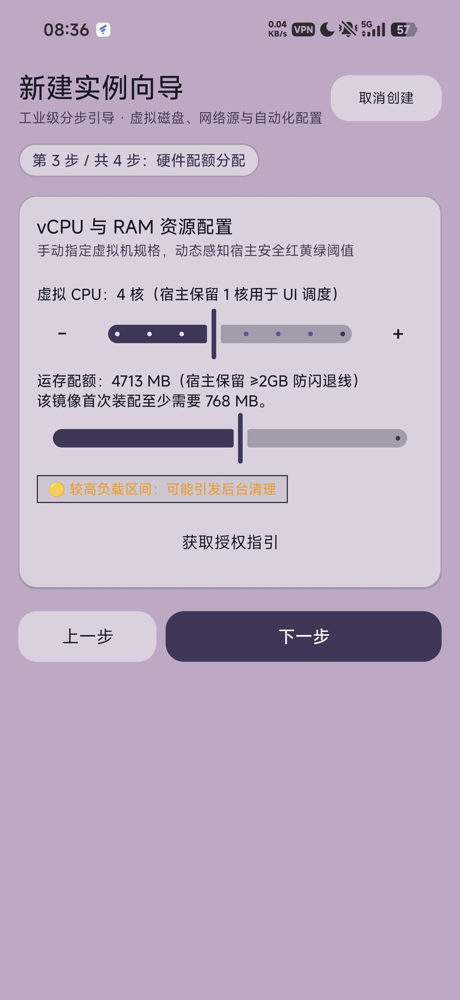
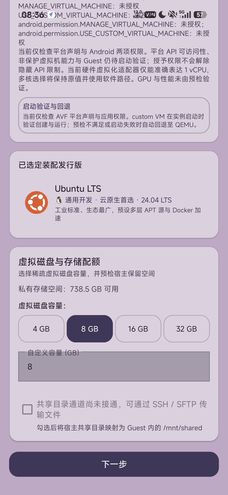
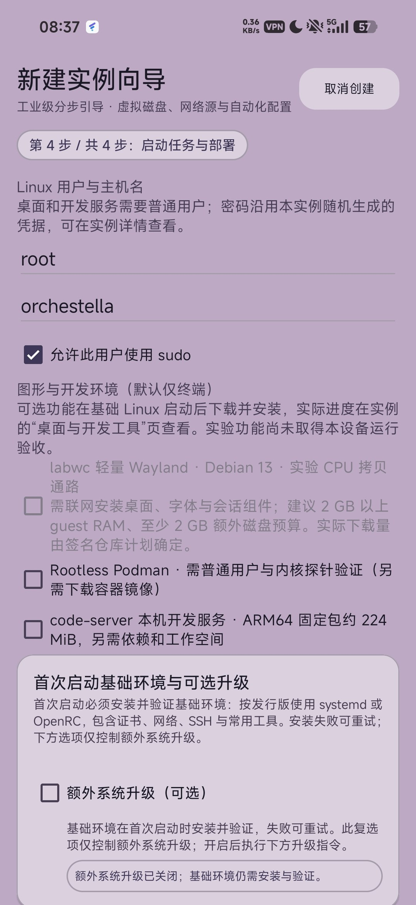
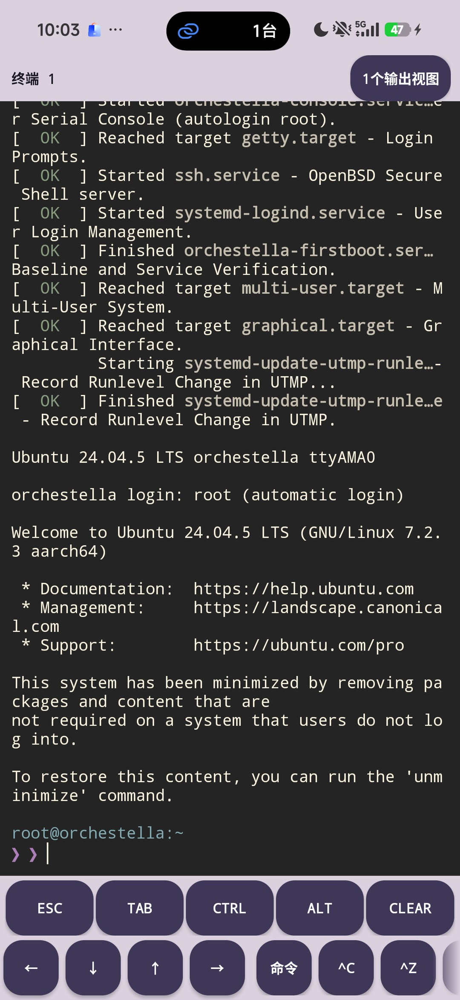

# Orchestella Studio

<div align="center">


**A Linux VM and mobile workstation for Android — no root required**<br />
*Native Linux VM runtime & mobile workstation, sandboxed inside an ordinary Android app*

[](https://github.com/Nyzeep/Orchestella-Studio/releases)
[](LICENSE)
[-green.svg?style=flat-square)](https://developer.android.com)
[](#)
[](https://github.com/Nyzeep/Orchestella-Studio/actions)

[**简体中文**](README.md) · English

</div>

---

## Screenshots

Captured on a real device (SM8850 / Android 16) with the default "Mascot · Lavender" theme.

|  |  |  |
| :---: | :---: | :---: |
| **Workbench · live telemetry** | **Distro catalog · one-tap install** | **New instance · vCPU & RAM** |
|  |  |  |
| **New instance · virtual disk** | **New instance · boot & deploy** | **Real Linux terminal** |

## What it does today

### Root-less Linux workstation (QEMU lane · verified)

- **A complete Linux kernel**: QEMU (TCG) runs an ARM64 GKI kernel; the guest finishes
  systemd boot and drops to a root shell. The `targetSdk 36` exec block is empirically
  cleared (zero exec-class AVC denials).
- **Seven distributions, one-tap provisioning**: Ubuntu / Debian / Fedora / Arch /
  openSUSE / AlmaLinux / Rocky Linux, with mirror speed tests and multi-tier fallback
  (CN cloud → CERNET → upstream).
- **Terminal**: a real Linux console (not an emulator), a 48dp touch key bar
  (ESC/TAB/CTRL/ALT…), adjustable font size / letter spacing / line spacing / cursor
  blink, and a terminal background image (cover crop + scrim).
- **Instance management**: multiple instances with per-instance vCPU / memory / storage /
  GPU-acceleration config; boot, interrupted-run recovery, full cold-backup export and
  import.
- **Network & port forwarding**: a user-space network stack (gvproxy) with explicit
  port-forwarding rules.
- **Workbench instruments**: MACH-ID, live CPU / RAM rings, battery temperature, storage,
  network state.

### Theming (new in 0.6.0)

- **30+ built-in themes** (Constructivist / Claude / Catppuccin / GitHub / Gruvbox /
  Rose Pine…), each carrying UI colours plus a 16-colour terminal ANSI palette, with
  custom accent and text colours.
- **The fixed "看板娘 · 淡紫工控" (Mascot Lavender) theme — the default**: colours measured
  from the artwork (`tools/branding/sample_palette.py`; every text/background pair
  ≥ 4.5:1 WCAG). One form only — it ignores the system's dark/light setting, and the
  first row of `THEME SELECTION` on the settings tab switches back to it in one tap.
- Three-tier global button corner radius (8 / 12 / 16dp, 16 default), wallpaper and
  surface opacity, and an app icon that is the original artwork mapped 1:1 (zero
  processing).

### Lane status

| Lane | Mechanism | Status |
| :--- | :--- | :--- |
| **QEMU** | translated execution (TCG), full kernel | **Available** — the backbone of everything above |
| **proot / bare** | native host instructions + `ptrace` syscall rewriting, no guest kernel | **Conditional** — 28-domain QA channel only |
| **pVM** | Microdroid on an EL2 hardware vCPU (protected) | **Conditional** — requires the device to register `virtualizationservice` (payload shipped by the extension package) |
| **UML** | a real kernel as an ordinary process | **Research line** — compile offload measured 2.04× slower than native; pivoted to long-running / container work |

Every figure and status label traces to
[the four-lane decision material (ACR draft)](docs/research/ACR-draft-four-lanes-20261029.md);
anything the repository cannot measure reads **unverified** instead of an estimate.

### Two packages (since 0.6.0)

- **Main package** `io.github.nyzeep.orchestella`: the app plus the full QEMU kernel path
  (everything above).
- **pVM accelerator extension** `…orchestella.accel` (optional): the pVM payload and
  compiler engine. Both packages must share a `versionCode`; main-only means the QEMU
  lane, and pVM entries say so explicitly.

## Roadmap

1. **36-domain pVM closed loop** (next device round): re-verify extension detection after
   install (`<queries>` visibility fix), land a `COMPLETED` distcc run in the pVM lane.
2. **Guest provisioning fix**: the guest kernel lacks `CONFIG_SECURITY_LANDLOCK`, which
   stops pacman 7's download sandbox — the single root cause of `package-install`
   failures (network verified healthy). Kernel config or a pacconf downgrade, pick one.
3. **UML research line**: 30-minute stability, dynamic linking, Docker. The compile role
   is measured out (940 ms vs 460 ms native on the 2,000-function fixture, 2.04×); only
   long-running user space / containers remain in scope.
4. **16 KB pages on a real device**: ELF / APK alignment passes the gate; execution is
   untested.
5. **AVF custom kernel assessment**: protected devices are closed by the chain of trust
   (pvmfw accepts only Google/OEM-signed images); meaningful only without protection —
   evaluate, do not commit.
6. **Performance baseline**: all four lanes measured in one round on one fixture (today's
   numbers come from different rounds and must not be compared).

## Installation

### Which packages you need

| Package | Purpose |
| :--- | :--- |
| Main (required) | The app plus the full QEMU kernel path |
| pVM accelerator extension (optional) | Only if you need compilation in the pVM lane |

Two hard rules: both packages must share the same `versionCode` (a mismatch is refused at
runtime with a reason); upgrade both together, never just one.

### Install notes

- Download the APK from the Releases page and install it the normal way. The package is
  signed with a personal certificate, so an "unknown source / unknown certificate"
  warning is expected.
- **Do not uninstall for a "clean install"**: uninstalling takes the instances, settings
  and credentials in the app's private directory with it.
- Installing over the previous version upgrades in place; with the two-package shape,
  update the main package and the extension together.

### pVM permission (extension users only)

```bash
adb shell pm grant io.github.nyzeep.orchestella android.permission.MANAGE_VIRTUAL_MACHINE
```

A granted permission ≠ a usable pVM lane: the device must also register
`virtualizationservice`, otherwise the app falls back to QEMU.

## Building from source

JDK 17 · Android SDK Platform 36 · NDK 27.0.12077973 · CMake 3.22+:

```bash
git clone https://github.com/Nyzeep/Orchestella-Studio.git
cd Orchestella-Studio
./gradlew :app:assembleDebug
```

- The build channel is a Gradle property, default `release`; internal dev channel
  `-Porchestella.buildChannel=dev`, isolated QA
  `-Porchestella.buildChannel=qa -Porchestella.buildPurpose=<purpose>` (add
  `-Porchestella.qaTargetSdk=28` for the proot lane).
- A release build missing any signing property fails in `validateReleaseSigning`
  ([signing standard](docs/standards/RELEASE-SIGNING.md)).
- `:accel-extension` has no payload-less variant: building it requires pre-staged inputs
  (`-Porchestella.fastlane.payloadLibDir` / `-Porchestella.pvmCompiler.libDir`); the
  repository ships none of those binaries.
- Quality gates: all `:runtime:*:check` + `:app:testDebugUnitTest` + lint + the 16 KB
  packaging check + the sensitive-data gate (`tools/ci/`).

## Known limitations

- **proot lives only in the 28-domain QA package**: the 36 domain executes only `.so`
  files under `nativeLibraryDir`.
- **Real AVF guest success samples: 0**: the current test device declares the AVF feature
  but never registered `virtualizationservice`.
- **UML is research only**: everything beyond single-file `-c` compiles (linking /
  systemd / Docker / SMP) is unverified.
- **16 KB pages**: real-device execution untested.
- **Signing**: no key in the repository; the 0.6.0 certificate counts once the Release
  page records its fingerprint.

## Docs & feedback

- [Documentation index (Chinese)](docs/README.md).
- [Four-lane decision material (ACR draft)](docs/research/ACR-draft-four-lanes-20261029.md).
- [Versioning & build channels](docs/standards/VERSIONING.md).
- Feedback: [open an issue](https://github.com/Nyzeep/Orchestella-Studio/issues/new) or
  [Discussions](https://github.com/Nyzeep/Orchestella-Studio/discussions). Strip
  passwords, tokens, SSH keys and personal file contents first; include app version,
  device model, Android version, distribution and reproduction steps.

## License & acknowledgements

The project as a whole is **GPL-3.0-or-later**; full text in [LICENSE](LICENSE).

| Component | License | Form & notes |
| :--- | :--- | :--- |
| QEMU 11.1.1 + statically linked libraries | GPL-2.0 (QEMU); glib LGPL-2.1+ etc. | Shipped in the APK; corresponding-source record in [NOTICE.QEMU](app/src/main/assets/NOTICE.QEMU) |
| Guest control agent | GPL-3.0-or-later (musl 1.2.6-r2 static) | Shipped; [NOTICE.GUEST-RUNTIME](app/src/main/assets/NOTICE.GUEST-RUNTIME) |
| BusyBox 1.36.1-r31 | GPL-2.0-only | Shipped in the Fast Lane toolbox; [NOTICE-fastlane.md](NOTICE-fastlane.md) |
| distcc 3.4 | GPL-2.0-or-later | **Not shipped** (separate process) |
| gvproxy / gvisor-tap-vsock | Apache-2.0 | User-space network layer |
| clang / LLVM | Apache-2.0 WITH LLVM-exception | Not shipped, no pinned binary |
| UML kernel (`zalexdev/linux-um-arm64` downstream, base 7.2-rc4) | GPL-2.0 | Binary not in the repository, not shipped with 0.6.0 |

Guest root filesystems follow their upstream licenses; consistency is checked by
`tools/release/check_licenses.py`, and a release bundle must contain every file listed in
`tools/release/release_bundle_manifest.json`.

## Previous versions

The v0.4.5 and older public packages have been taken off the Releases page (maintainer
visible only); the primary download path is now the 0.6.0 Release. Installation guides
do not transfer across the two generations.
