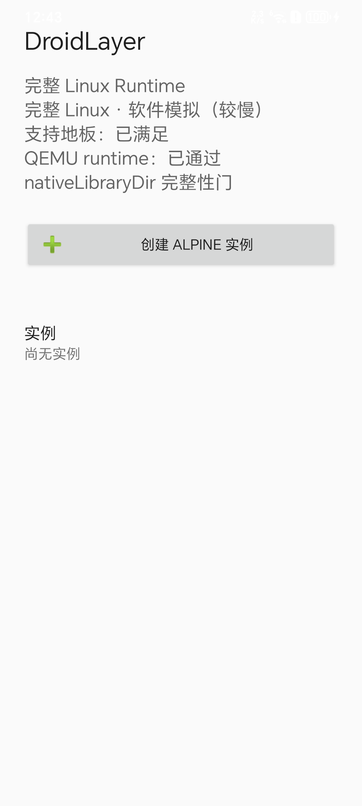
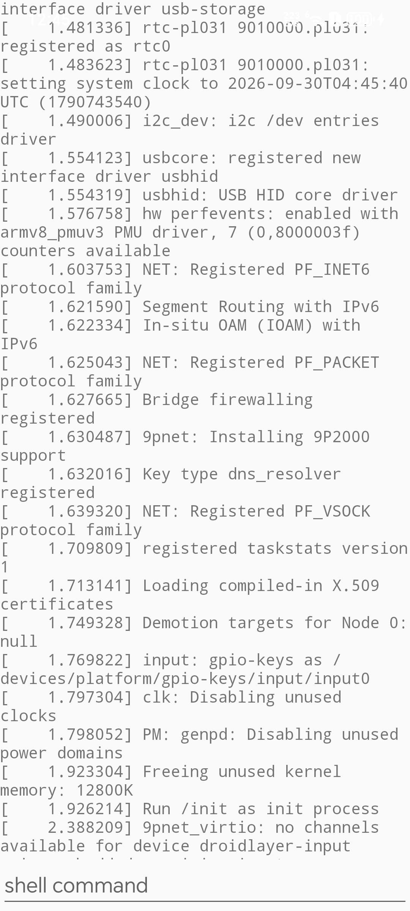
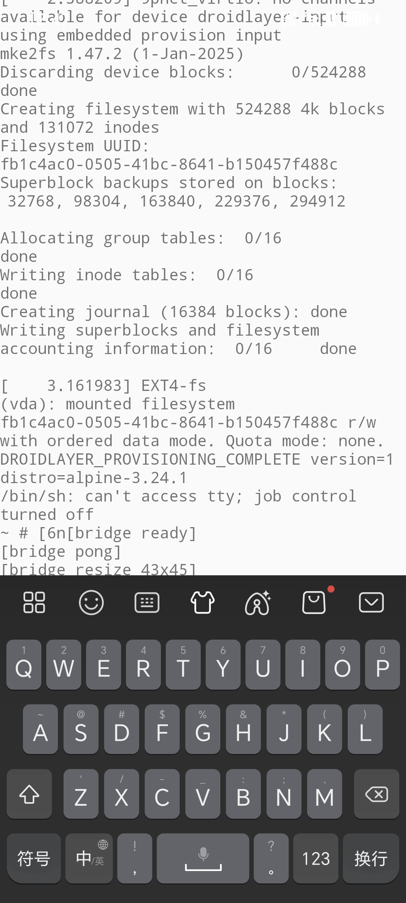
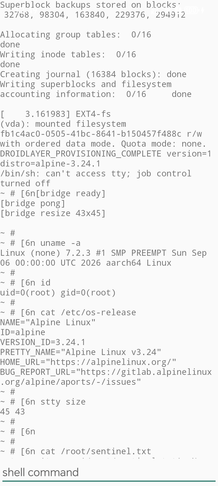

# Orchestella Studio

<div align="center">

**无需 Root 的 Android 原生双引擎 Linux 运行环境与移动工作站**  
*Native Dual-Engine Full Linux Runtime for Android Without Root*

[](https://github.com/Nyzeep/Orchestella-Studio/releases/tag/v0.1.0-alpha)
[](https://github.com/Nyzeep/Orchestella-Studio)
[](LICENSE)
[-green.svg?style=flat-square)](https://developer.android.com)
[](https://developer.android.com/ndk/guides/abis)
[](docs/reports/retro/phase1-mvp-retrospective.zh-CN.md)

[简体中文](#简体中文) | [English](#english)

</div>

---

<a name="简体中文"></a>
## 🇨🇳 简体中文

### 1. 项目简介

**Orchestella Studio** 是一款面向现代化 Android 设备的**免 Root 完整 Linux 虚拟机运行环境与移动开发工作站**。

与传统的 PRoot 容器、chroot 方案或受限终端不同，Orchestella Studio 依托 Android 原生生态，为每个实例运行一个**具备真实 Linux 内核（Linux 6.6 LTS）的独立虚拟机**。它摆脱了 PRoot 对 `ptrace` 机制的重度依赖与性能惩罚，彻底消除了系统调用拦截失效、多线程竞态与伪特权陷阱，为您在口袋中的移动设备上提供 100% 工业级标准的 Linux 开发与计算体验。

---

### 2. 核心架构亮点与特色特性

```
+-----------------------------------------------------------------------------------+
|                            Orchestella Studio (App Layer)                         |
|     [系统控制台]      [每实例随机凭据]     [电池执行策略]      [SAF 零拷贝导入导出]   |
+-----------------------------------------+-----------------------------------------+
|      硬件虚拟化引擎 (AVF / pKVM)        |        软件虚拟化引擎 (QEMU TCG 8.2)      |
|    - 近原生硬件加速 (L2 硬件级)          |    - 全架构兜底兼容 (L1 软件级)           |
|    - Vsock 高性能双向桥接通道           |    - Unix 抽象套接字双工传输              |
|    - 自动透明优雅降级保障               |    - GPL 边界与 nativeLibraryDir 纯净装配 |
+-----------------------------------------+-----------------------------------------+
|                             不可变契约层 (:runtime:contract)                      |
|   [Rootfs 装配]    [出站 NAT 网络]    [动态端口转发]    [Downloads 只读共享]       |
+-----------------------------------------------------------------------------------+
|                        Linux Guest 独立虚拟机环境 (Linux 6.6)                     |
|           Alpine Linux 3.24.1 (apk)     |     Debian 12/13 Bookworm/Trixie (apt)  |
+-----------------------------------------------------------------------------------+
```

#### 🚀 1. 双执行引擎融合（Dual-Engine Architecture）
- **硬件虚拟化（AVF / pKVM 策略）**：在支持 Android 虚拟化框架的设备上，获得 CPU 与内存的近原生硬件加速执行；
- **软件虚拟化（QEMU TCG 8.2 策略）**：在未解锁虚拟化权限或不受支持的设备上，自动无缝回退至工业级软件动态翻译引擎，确保 100% 机型覆盖；
- **诚实能力矩阵与透明降级**：内置严谨的设备硬件探针，透明汇报当前性能档位，绝不虚标假体验。

#### 🐧 2. 真实完整的 Linux 系统环境
- **独立完整内核**：搭载独立 Linux 6.6 LTS 内核，原生支持完整 Linux 系统调用（System Calls）、命名空间（Namespaces）、Cgroups 与网络协议栈；
- **官方双主流发行版**：开箱即用支持 Alpine Linux 3.24.1（轻量迅捷）与 Debian 12 Bookworm / 13 Trixie（全生态包仓库），支持使用原生 `apk` 与 `apt` 包管理器；
- **告别特权破坏**：提供真正的 `uid=0 (root)` 权限环境，告别 PRoot 的假 root 破坏与权限模拟崩溃。

#### 🌐 3. 完整开箱即用的网络协议栈
- **用户态出站 NAT**：虚拟机内部开箱即用访问公网，流畅进行软件包更新、Git 克隆、Wget 与 Curl；
- **动态运行态端口转发**：支持运行时动态添加/删除端口映射规则（如 `8080 -> 8080`, `22 -> 2222`），无论是开发调试 Web 服务还是启动 SSH 守护进程均如臂使指。

#### 🔌 4. 深度 Android 宿主双向集成
- **存储互通**：将 Android 系统 `Downloads/` 下载目录以安全只读方式挂载至虚拟机内部 `/mnt/shared`，便于快速读取宿主文件；
- **双向协议桥接**：虚拟机内部可直接触发 Android 系统通知栏推送、唤起系统默认浏览器访问安全白名单网址；
- **存储治理**：支持无损磁盘在线扩容（`resize2fs`），提供基于 Storage Access Framework (SAF) 的零拷贝镜像整机备份与恢复。

#### 🛡️ 5. 安全合规与长寿命后台常驻
- **每实例 16 位高熵独立随机凭据**：彻底反转固定后门弱密码，杜绝常量提权漏洞，支持 UI 凭据安全查看、一键复制与受控修改；
- **Android 14+ 前台服务合规**：常驻运行态通知与 `PARTIAL_WAKE_LOCK` 唤醒锁，保障编译任务与后台服务器锁屏不中断；
- **Phantom Process Killer 指引**：提供针对 Android 12+ 幻影进程查杀机制的系统级优化指引与一键解除命令；
- **零遥测隐私铁律**：更新检查支持完全关闭；关闭状态下严格保持 0 外部网络连接，绝不收集设备指纹或隐私数据。

---

### 3. 真机实测与展陈（Physical Device Verified）

> **验收环境**：HONOR 80 GT · 高通骁龙 8+ Gen 1 · Android 15 (API 35) · 12GB 物理内存

<div align="center">

| 系统控制台与状态徽章 | 首次极速引导终端 (15s 进入 Shell) |
| :---: | :---: |
|  |  |

| 真实 Linux 6.6 内核与 Root 验证 | 多实例管理与停止态 |
| :---: | :---: |
|  |  |

</div>

#### 实测性能基线表现
- **首次引导时间**：约 15 ~ 20 秒（完成磁盘格式化与系统冷启动，远优于规格承诺的 60 秒）；
- **二次快速启动**：约 2 ~ 3 秒（免格式化极速热恢复进入终端）；
- **优雅关机退出耗时**：2.3 秒（数据完整落盘）；
- **Shell 交互延迟**：< 20 毫秒（基于 Unix 抽象套接字 / Vsock 本地双工流，零肉眼延迟）；
- **宿主内存开销**：VmRSS 稳定在 250 ~ 260 MiB 之间。

---

### 4. 快速开始与使用指南

#### 4.1 安装要求
- **系统版本**：Android 8.0 (API 26) 或更高版本；
- **芯片架构**：ARM64 (arm64-v8a)；
- **物理内存**：建议 ≥ 3 GiB（低于 3 GiB 的设备应用将诚实拒绝启动以保护系统稳定）；
- **存储空间**：建议可用内部存储空间 ≥ 4 GiB。

#### 4.2 极速上手三步法
1. **下载安装**：前往 [Releases 页面](https://github.com/Nyzeep/Orchestella-Studio/releases) 下载最新的 `Orchestella-Studio-v0.1.0-alpha.apk` 并安装到手机；
2. **创建实例**：打开应用，点击「创建 Alpine 实例」或「创建 Debian 实例」，应用将自动校验并准备环境；
3. **启动与交互**：
   - 点击实例列表中的「启动」按钮；
   - 首次启动完成初始化后即进入全屏 Monospace 终端；
   - 输入 `uname -a` 查看真实 Linux 6.6 LTS 内核信息；
   - 输入 `apk update` 或 `apt update` 尽情体验纯正的 Linux 生态！

#### 4.3 硬件加速升级向导（可选）
如果您的设备支持硬件虚拟化（pKVM）：
- 打开应用主界面的「提升到硬件加速」向导；
- 推荐安装并激活 **Shizuku**，一键为 Orchestella Studio 授予虚拟化权限；
- 或者通过电脑 USB 调试执行一行 ADB 授权命令：
  ```bash
  adb shell pm grant io.github.nyzeep.orchestella android.permission.MANAGE_VIRTUAL_MACHINE
  ```

---

### 5. 常见问题（FAQ）

**Q：Orchestella Studio 和 Termux / AidLux / UserLAnd 有什么本质区别？**  
A：Termux 默认运行在 Android 宿主的用户空间并受 Android bionic 动态链接库约束；使用 PRoot 方案的工具本质上是在用户态通过 `ptrace` 劫持系统调用，性能衰减极大且无法支持真正的特权操作与完整内核功能。Orchestella Studio 是真正的**独立 Linux 虚拟机**，自带独立内核、真实 init 进程与完整网络栈。

**Q：在后台运行编译或服务器会被 Android 系统杀掉吗？**  
A：Orchestella Studio 注册了 Android 14+ 合规的前台常驻服务并持有系统级唤醒锁（WakeLock）。对于 Android 12+ 引入的“幻影进程查杀器（Phantom Process Killer）”，所有高负载任务均运行在虚拟机内核之内，非 Android 宿主子进程；您亦可在应用设置中按照指引一键调优。

---

<a name="english"></a>
## 🌐 English

### 1. Introduction

**Orchestella Studio** is a rootless full Linux virtual machine runtime and mobile workstation engineered for modern Android devices.

Unlike traditional PRoot containers, chroot hacks, or restricted terminal environments, Orchestella Studio runs an **independent virtual machine powered by a genuine Linux kernel (Linux 6.6 LTS)** for every instance. It eliminates PRoot's heavy `ptrace` overhead, avoids system call interception race conditions, and provides a genuine 100% industrial-grade Linux computing environment right inside your pocket.

---

### 2. Architectural Highlights & Features

- **Dual Execution Engine Architecture**:
  - **AVF / pKVM Engine**: Delivers near-native CPU and memory performance through hardware virtualization on supported devices;
  - **QEMU TCG 8.2 Engine**: Universal software dynamic translation engine fallback providing 100% device compatibility;
  - **Honest Capability Matrix**: Transparently evaluates hardware capabilities and degrades gracefully without fake claims.
- **Genuine & Full Linux Operating System**:
  - Independent Linux 6.6 LTS kernel with full namespaces, cgroups, and network stack support;
  - Native distributions: Alpine Linux 3.24.1 & Debian 12/13 with official package managers (`apk` & `apt`);
  - True `uid=0 (root)` privilege inside the guest without host sandbox compromises.
- **Complete Networking Stack**:
  - User-space outbound NAT out of the box for internet access;
  - Dynamic runtime port forwarding (e.g. mapping host ports to guest web services or SSH daemons).
- **Deep Android Host Integration**:
  - Read-only shared access to Android's `Downloads/` directory at `/mnt/shared`;
  - Host notification push and secure allowlisted URL dispatch from guest scripts;
  - Storage Access Framework (SAF) zero-copy backup, export, and dynamic disk resizing (`resize2fs`).
- **Security & Background Longevity**:
  - 16-character high-entropy per-instance random credentials;
  - Android 14+ compliant persistent foreground service with `PARTIAL_WAKE_LOCK`;
  - Android 12+ Phantom Process Killer tuning guide and commands;
  - Strict zero-telemetry privacy policy with completely disablable update checks.

---

### 3. Quick Start

1. **Download & Install**: Grab `Orchestella-Studio-v0.1.0-alpha.apk` from the [Releases](https://github.com/Nyzeep/Orchestella-Studio/releases) page.
2. **Create Instance**: Launch the app and tap "Create Alpine Instance" or "Create Debian Instance".
3. **Launch & Enjoy**: Tap "Launch" to start your instance, access the root shell in seconds, and explore full Linux on Android!

---

### 4. License

Orchestella Studio is distributed under the [Apache License 2.0](LICENSE).  
The guest kernel and QEMU components are licensed under the GNU General Public License (GPL) and strictly isolated at the distribution and process boundary in full compliance with ADR-0014.
