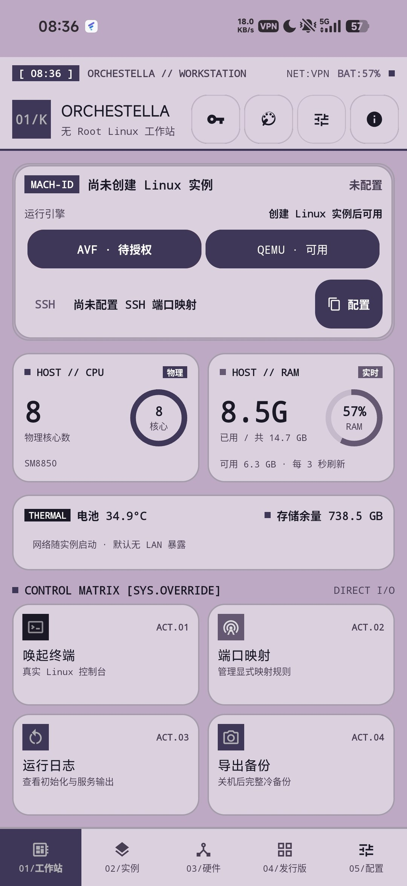
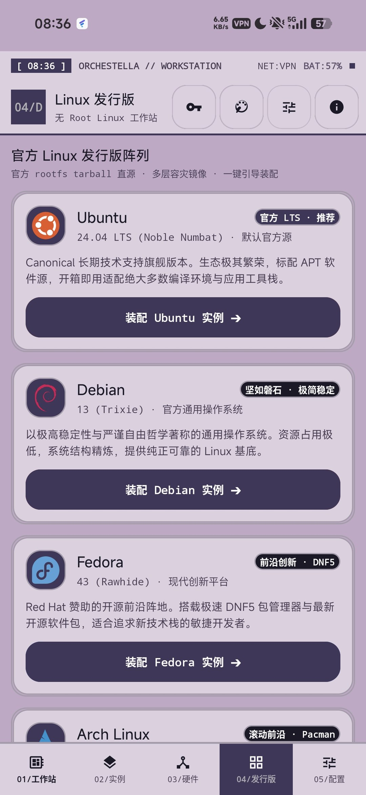
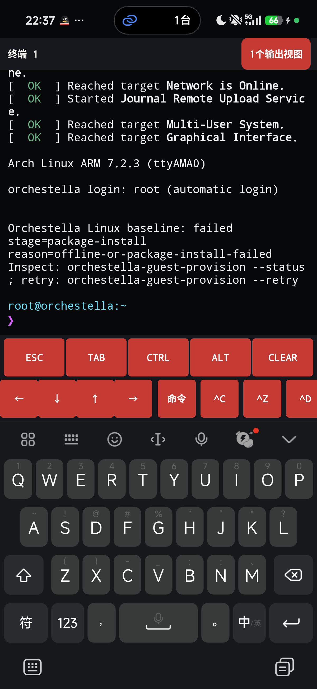

# Orchestella Studio

<div align="center">


**无需 Root 的 Android Linux 虚拟机与移动工作站**<br />
*Native Linux VM Runtime & Mobile Workstation for Android — no root required*

[](https://github.com/Nyzeep/Orchestella-Studio/releases)
[](LICENSE)
[-green.svg?style=flat-square)](https://developer.android.com)
[](#)
[](https://github.com/Nyzeep/Orchestella-Studio/actions)

**简体中文** · [English](README.en.md)

</div>

---

## 界面预览

| 工作台 | 发行版目录 |
| :---: | :---: |
|  |  |
| **实例管理** | **真实 Linux 终端** |
|  |  |

## 当前实现的功能

### 无 Root Linux 工作站（QEMU 车道 · 已验证）

- **完整 Linux 内核**：QEMU (TCG) 运行 ARM64 GKI 内核，guest 内完成 systemd 启动并给出
  root shell；`targetSdk 36` 域的执行限制已实测解除（执行类 AVC = 0）。
- **七种发行版一键装配**：Ubuntu / Debian / Fedora / Arch / openSUSE / AlmaLinux /
  Rocky Linux，配镜像测速与多层级回退（国内云源 → 教育网 → 官方源）。
- **终端**：真实 Linux 控制台（非模拟），48dp 触控按键条（ESC/TAB/CTRL/ALT…）、
  字号 / 字间距 / 行距 / 光标闪烁可调、终端背景图（cover 裁切 + 浓度遮罩）。
- **实例管理**：多实例并存，vCPU / 内存 / 存储 / GPU 加速按实例配置；开机、
  运行中断恢复、完整冷备份导出与导入。
- **网络与端口映射**：用户态网络栈（gvproxy），显式端口转发规则管理。
- **工作台仪表**：MACH-ID、CPU / RAM 实时环、电池温度、存储余量、网络状态。

### 界面主题（0.6.0 新增）

- **30+ 内置主题**（构成主义工控 / Claude / Catppuccin / GitHub / Gruvbox / Rose Pine…），
  每套含 UI 配色与终端 16 色 ANSI 调色板，自定义强调色与文字色。
- **「看板娘 · 淡紫工控」固定主题**：配色对原画实测采样（`tools/branding/sample_palette.py`，
  全部文字/背景组合 WCAG ≥ 4.5:1），只有一种形态、不随系统深浅色切换。
- 全局按钮圆角三档（8 / 12 / 16dp，默认 16），墙纸与表面不透明度，应用图标 =
  原画 1:1 直出（零处理）。

### 执行车道现状

| 车道 | 机制 | 状态 |
| :--- | :--- | :--- |
| **QEMU** | 软件翻译执行（TCG），完整内核 | **可用** — 上述功能的主体 |
| **proot / bare** | 宿主原生指令 + `ptrace` 系统调用改写，无 guest 内核 | **条件可用** — 仅 28 域 QA 通道 |
| **pVM** | Microdroid 跑在 EL2 硬件 vCPU（保护型） | **条件可用** — 依赖设备注册 `virtualizationservice`（扩展包承载 payload） |
| **UML** | 真实内核以普通进程运行 | **研究线** — 编译角色实测劣于原生 2.04×，转向长驻 / 容器方向 |

所有性能数字与状态标注的判定依据见
[四车道决策材料（ACR 草案）](docs/research/ACR-draft-four-lanes-20261029.md)；
仓库里取不到数的一律写「未验证」，不做估算。

### 双包形态（0.6.0 起）

- **主包** `io.github.nyzeep.orchestella`：应用本体 + QEMU 完整内核路径（上节全部功能）。
- **pVM 加速扩展包** `…orchestella.accel`（可选）：pVM payload 与编译器引擎。
  两包 `versionCode` 必须一致；只装主包 = 只有 QEMU 车道，pVM 入口会明确提示。

## 后续开发与优化方向

1. **36 域 pVM 闭环**（下一设备轮）：扩展包装机后 `AccelExtensionResolver` 探测复验
   （`<queries>` 可见性修复的实测判定）、pVM 车道跑出 `COMPLETED` distcc 编译。
2. **发行版 guest 装配修复**：guest 内核缺 `CONFIG_SECURITY_LANDLOCK` 导致 pacman 7
   下载沙箱起不来（装配 `package-install` 失败的唯一根因，网络实测健康）——内核配置
   或 pacconf 降级方案二选一。
3. **UML 研究线**：30 分钟长驻稳定性、动态链接、Docker；编译卸载角色已实测否定
   （2,000 函数夹具 940 ms vs 原生 460 ms，2.04×），仅保留长驻用户态 / 容器价值。
4. **16 KB 页真机执行**：ELF / APK 对齐已过门禁，真机运行未测。
5. **AVF 自定义内核评估**：protected 域被信任链封死（pvmfw 只收 Google/OEM 签名镜像），
   仅在 non-protected 设备上有意义——只评估，不承诺实现。
6. **性能基线**：四车道同轮、同夹具的统一测量（当前各车道数字来自不同轮次，不可互比）。

## 安装

### 你需要哪几个包

| 包 | 说明 |
| :--- | :--- |
| 主包（必需） | 应用本体 + QEMU 完整内核路径 |
| pVM 加速扩展包（可选） | 只有需要在 pVM 车道跑编译时才装 |

两条硬规则：两包 `versionCode` 必须一致（不一致运行期直接拒绝并说明原因）；升级时两包
同步更到同一版本，不要只升一个。

### 小米 / HyperOS 注意

- **新装应用需要屏幕上的确认**：锁屏 ADB 安装必然失败（`INSTALL_FAILED_USER_RESTRICTED`），
  装包前解锁并保持亮屏。
- **已装包的更新不受限**：不要为"干净安装"先卸载——卸载会带走应用私有目录里的实例数据。
- `settings put global adb_install_need_confirm 0` 对 HyperOS 无效。

### pVM 权限（仅扩展包用户）

```bash
adb shell pm grant io.github.nyzeep.orchestella android.permission.MANAGE_VIRTUAL_MACHINE
```

授权成功 ≠ pVM 可用：设备还必须注册 `virtualizationservice`，否则回落 QEMU。

## 从源码构建

JDK 17 · Android SDK Platform 36 · NDK 27.0.12077973 · CMake 3.22+：

```bash
git clone https://github.com/Nyzeep/Orchestella-Studio.git
cd Orchestella-Studio
./gradlew :app:assembleDebug
```

- 构建通道是 Gradle 属性，默认 `release`；内部通道 `-Porchestella.buildChannel=dev`，
  隔离 QA `-Porchestella.buildChannel=qa -Porchestella.buildPurpose=<purpose>`（可加
  `-Porchestella.qaTargetSdk=28` 启用 proot 车道）。
- 发布构建缺任一签名属性会在 `validateReleaseSigning` 直接失败（见
  [签名标准](docs/standards/RELEASE-SIGNING.md)）。
- `:accel-extension` 无 payload-less 变体：构建它需要预置输入目录
  （`-Porchestella.fastlane.payloadLibDir` / `-Porchestella.pvmCompiler.libDir`），
  仓库不带这些二进制。
- 质量门：全部 `:runtime:*:check` + `:app:testDebugUnitTest` + lint + 16 KB 打包检查 +
  敏感数据门禁（`tools/ci/`）。

## 已知限制

- **proot 车道只在 28 域 QA 包**：36 域只允许执行 `nativeLibraryDir` 下的 `.so`。
- **真实 AVF guest 成功样本为 0**：当前测试设备声明 AVF 能力但未注册
  `virtualizationservice`。
- **UML 仅研究**：`-c` 单文件编译之外（链接 / systemd / Docker / SMP）全部未验证。
- **16 KB 页**：真机执行未测。
- **签名**：仓库不含密钥；0.6.0 的发布证书指纹在 Release 页记录后才算数。

## 文档与反馈

- [文档索引（中文）](docs/README.md)：现状、研究依据、工单与归档。
- [四车道决策材料（ACR 草案）](docs/research/ACR-draft-four-lanes-20261029.md)。
- [版本与构建通道标准](docs/standards/VERSIONING.md)。
- 反馈：[提 issue](https://github.com/Nyzeep/Orchestella-Studio/issues/new) 或
  [Discussions](https://github.com/Nyzeep/Orchestella-Studio/discussions)。请先剔除
  密码、token、SSH 私钥与个人文件内容，并附应用版本、机型、Android 版本、发行版与复现步骤。

## 许可证与致谢

本项目整体 **GPL-3.0-or-later**，全文见 [LICENSE](LICENSE)。

| 组件 | 许可证 | 形态与备注 |
| :--- | :--- | :--- |
| QEMU 11.1.1 及静态链接库 | GPL-2.0（QEMU）；glib LGPL-2.1+ 等 | 随 APK 分发；对应源码记录见 [NOTICE.QEMU](app/src/main/assets/NOTICE.QEMU) |
| Guest 控制代理 | GPL-3.0-or-later（musl 1.2.6-r2 静态链接） | 随 APK 分发；[NOTICE.GUEST-RUNTIME](app/src/main/assets/NOTICE.GUEST-RUNTIME) |
| BusyBox 1.36.1-r31 | GPL-2.0-only | 随 Fast Lane 工具箱分发；[NOTICE-fastlane.md](NOTICE-fastlane.md) |
| distcc 3.4 | GPL-2.0-or-later | **不随 APK 分发**（独立进程） |
| gvproxy / gvisor-tap-vsock | Apache-2.0 | 用户态网络层 |
| clang / LLVM | Apache-2.0 WITH LLVM-exception | 不随包分发，无固定二进制 |
| UML 内核（`zalexdev/linux-um-arm64` 下游，基线 7.2-rc4） | GPL-2.0 | 二进制不入库、不随 0.6.0 分发 |

各发行版 guest rootfs 遵循其上游许可证；许可证一致性由 `tools/release/check_licenses.py`
校验，发布包必须包含 `tools/release/release_bundle_manifest.json` 列出的每个文件。

## 历史版本

v0.4.5 及更早的公开包已从 Releases 页下架（仅维护者可见归档）；当前主下载路径即
0.6.0 的 Release。两代之间的安装指南不通用，不要混用。
