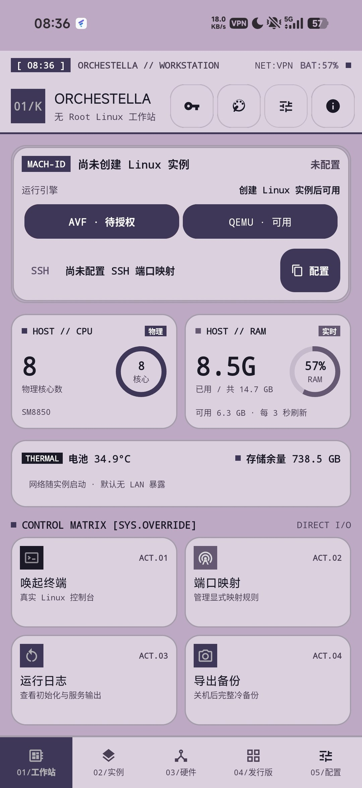
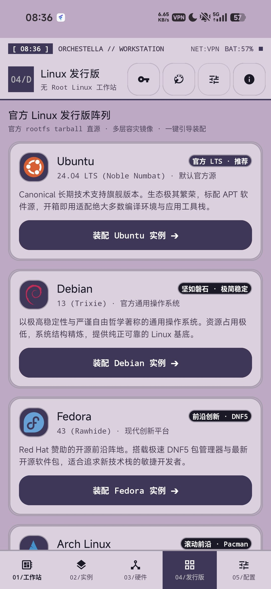
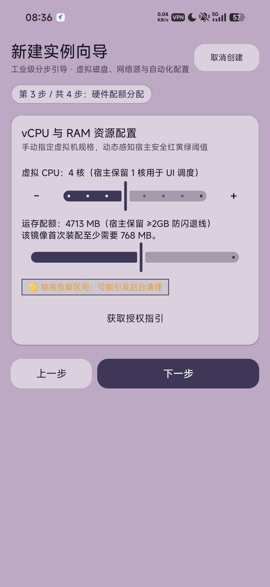
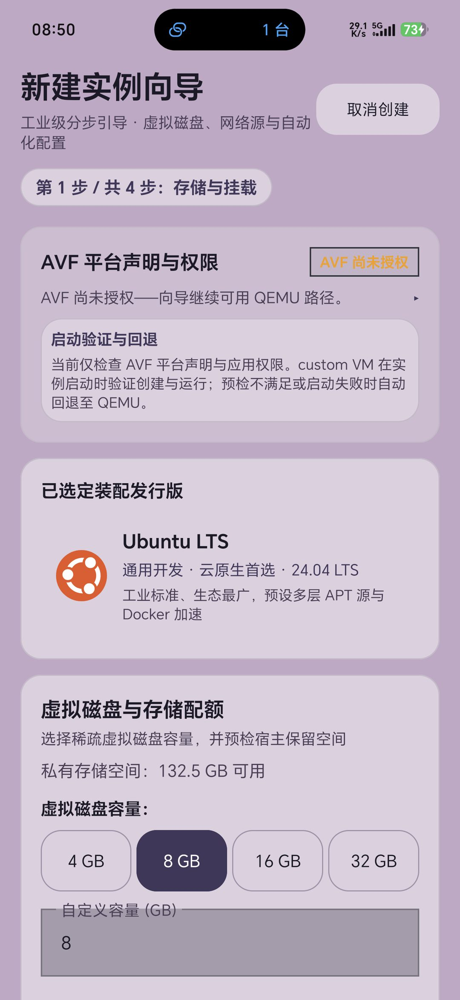
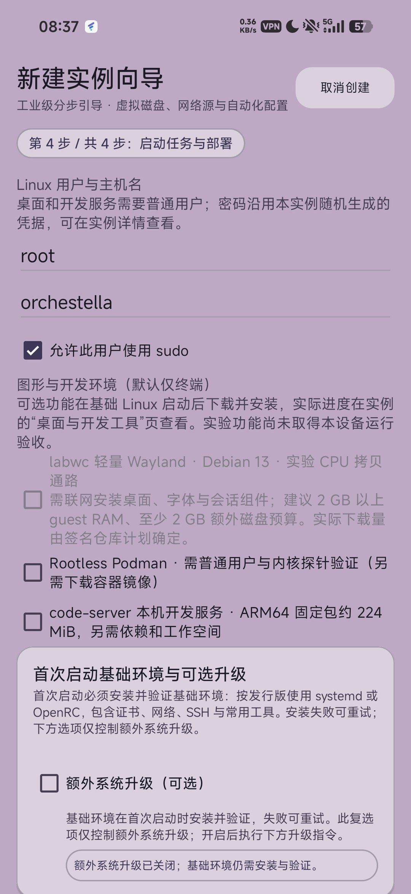
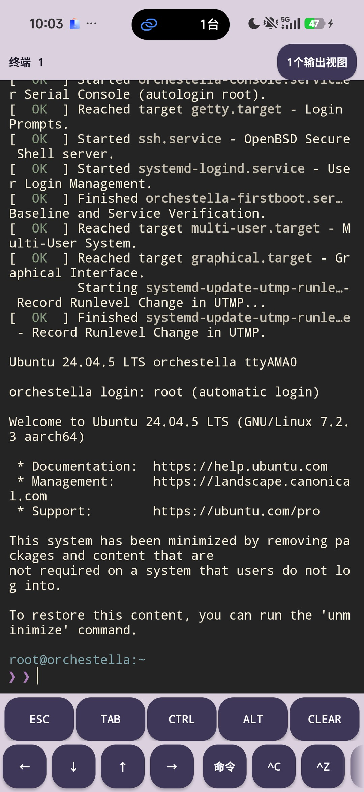

# Orchestella Studio

<div align="center">


**无需 Root 的 Android Linux 虚拟机与移动工作站**<br />
*Native Linux VM Runtime & Mobile Workstation for Android — no root required*

[](https://github.com/Nyzeep/Orchestella-Studio/releases)
[](LICENSE)
[-green.svg?style=flat-square)](https://developer.android.com)
[](#)
[](https://github.com/Nyzeep/Orchestella-Studio/actions)

**简体中文** · [English](README.en.md)

</div>

---

## 界面预览

截图取自真机（Android 16 / 17 设备），默认主题为「看板娘 · 淡紫工控」。

|  |  |  |
| :---: | :---: | :---: |
| **工作台 · 实时遥测** | **发行版目录 · 一键装配** | **新建实例 · 硬件配额** |
|  |  |  |
| **新建实例 · 存储配额** | **新建实例 · 启动与部署** | **真实 Linux 终端** |

## 当前实现的功能

### 无 Root Linux 工作站（QEMU 车道 · 已验证）

- **完整 Linux 内核**：QEMU (TCG) 运行 ARM64 GKI 内核，guest 内完成 systemd 启动并给出
  root shell；`targetSdk 36` 域的执行限制已实测解除（执行类 AVC = 0）。
- **七种发行版一键装配**：Ubuntu / Debian / Fedora / Arch / openSUSE / AlmaLinux /
  Rocky Linux，配镜像测速与多层级回退（国内云源 → 教育网 → 官方源）。
- **终端**：真实 Linux 控制台（非模拟），48dp 触控按键条（ESC/TAB/CTRL/ALT…）、
  字号 / 字间距 / 行距 / 光标闪烁可调、终端背景图（cover 裁切 + 浓度遮罩）。
- **实例管理**：多实例并存，vCPU / 内存 / 存储 / GPU 加速按实例配置；开机、
  运行中断恢复、完整冷备份导出与导入。
- **网络与端口映射**：用户态网络栈（gvproxy），显式端口转发规则管理。
- **工作台仪表**：MACH-ID、CPU / RAM 实时环、电池温度、存储余量、网络状态。

### 界面主题（0.6.0 新增）

- **30+ 内置主题**（构成主义工控 / Claude / Catppuccin / GitHub / Gruvbox / Rose Pine…），
  每套含 UI 配色与终端 16 色 ANSI 调色板，自定义强调色与文字色。
- **「看板娘 · 淡紫工控」固定主题（默认）**：配色对原画实测采样（`tools/branding/sample_palette.py`，
  全部文字/背景组合 WCAG ≥ 4.5:1），只有一种形态、不随系统深浅色切换；配置页
  `THEME SELECTION` 卡片首位可一键切回。
- 全局按钮圆角三档（8 / 12 / 16dp，默认 16），墙纸与表面不透明度，应用图标 =
  原画 1:1 直出（零处理）。

### 执行车道现状

| 车道 | 机制 | 状态 |
| :--- | :--- | :--- |
| **QEMU** | 软件翻译执行（TCG），完整内核 | **可用** — 上述功能的主体 |
| **proot / bare** | 宿主原生指令 + `ptrace` 系统调用改写，无 guest 内核 | **条件可用** — 仅 28 域 QA 通道 |
| **pVM** | Microdroid 跑在 EL2 硬件 vCPU（保护型） | **条件可用** — 依赖设备注册 `virtualizationservice`（扩展包承载 payload） |
| **UML** | 真实内核以普通进程运行 | **可路由 · 编译通道已接（2026-11-14 E2E：真实编译任务端到端 3 次全通）** — 实例启动随行 spawn/READY/清理全链真机验证，宽度入三面账本；编译通道（distcc D-1 桥）已接线并过真实编译 E2E（详见下文「UML 研究线现状」） |

所有性能数字与状态标注的判定依据见
[四车道决策材料（ACR 草案）](docs/research/ACR-draft-four-lanes-20261029.md)；
仓库里取不到数的一律写「未验证」，不做估算。

### UML 研究线现状（2026-11-12 · 可路由轮更新 2026-11-13 · 编译路由 E2E 更新 2026-11-14）

UML（User Mode Linux）车道在 2026-11-07 起的零设备开发线上完成了六个工作包
（U0 启动时间线 / U1 fast-boot profile / U2 预烘焙 rootfs / U3 seccomp 兼容矩阵 /
U4 warm-start 评估 / U6 多实例基准），并已在**两台真机**（Android 16 / API 36 /
内核 6.6 与 Android 15 / API 35 / 内核 5.10，均 4KB 宿主页）完成 ARM64 启动验证：

- **双设备启动矩阵**：fast profile（最小内核 + 内置 initramfs）UP 250–330 ms /
  SMP 4 核 300–410 ms 到达 first command（guest uptime 口径，n≥5，全程 `exit 0`）；
  Alpine 3.22 预烘焙 rootfs 经 hostfs 与 ext4 双通道 350–360 ms 级到 `READY`。
- **App 域兼容（跨内核代次）**：两个 SELinux 域（API 35 与 36）内 `seccomp=on`
  均落真 SECCOMP 快路径（非 ptrace 回退），启动矩阵全程零 SIGSYS；
  内核 ELF 按 16 KB 对齐构建。
- **多实例与长驻**：2 实例并存（SECCOMP 互不干扰，边际 RSS ≈ 18 MB/实例）；
  前台服务 + wake lock 长驻 60 分钟冻结计数为 0、内核 RSS 零漂移，kill 后恢复正常
  （双设备复刻）。
- **seccomp 12-case 能力矩阵**：API 35 profile 下 10/12 实测 PASS（hostfs/ext4
  双通道 boot、SMP ncpus=2/4、sigchld、clone、mount、personality、setrlimit、
  seccomp-fastpath 双 marker），2 case（vector-net/mconsole）受 runner 通道结构性
  限制转 adb-shell 通道，0 反例。
- **构建确定性**：内核 / rootfs / initramfs 产物在 pin 一致时逐字节复现，
  全部输入 sha256 pin 入 manifest；pinned 布局跨路径重建的 sha 差异已定界于
  内嵌 initramfs 段（源码/配置零漂移）。
- **产品化按 ACR 决议接线（2026-11-12 投票，D1–D5 全部通过）**：UML payload 管线
  （内置/下载双方案 + sha 记账 + 三层校验链）与 fast-profile 启动形态已实现并过独立
  审查；release 流水线显式传参开启内置 kernel 与 fast 形态（ACR D1/D4），装配链把
  UML 面接到 fast-profile 形态——flag on 构建的内置 initramfs 通道默认宽度 1；
  「编译通道（distcc D-1 桥）与 rootfs 下载增强待后续轮接线」已随后续轮闭环
  （rootfs 下载 2026-11-13 接线，编译通道 2026-11-14 接线并过 E2E）；本地裸构建
  三个 gradle flag 仍默认 false，flag off 时行为逐字节不变（测试锁定）。
- **warm-start 判词**：checkpoint/restore 与 hibernation 均 NO-GO（上游无机制 +
  CRIU 不支持 UML），预热点池为 CONDITIONAL GO（每实例常驻成本 ≈ 22 MB）。
- **尚未验证**（诚实边界）：fast profile 只承诺 T3 shell——无 systemd / 网络 /
  包管理器（产品化走 U2 预烘焙 rootfs 路径）；16 KB 宿主、systemd、
  vector-net/mconsole 两 case（adb-shell 通道）未测。

ACR 已于 2026-11-12 投票通过（D1–D5 全部按建议通过，决议记录见
`.scratch/uml-productization-20261112/acr/acr-draft.md` §8）：方案 A 内置 kernel +
fast 形态由 release 流水线显式传参开启（D1），UML 面默认宽度按 D4 接线为
「flag on 构建 = 1、flag off 构建 = 0」；rootfs 下载增强（方案 B 校验管线已闭环）
与编译通道（fabric-route D-1 桥）由产品调用方在后续轮接线，届时再评估受控内测。

**2026-11-13 可路由轮（生产调用方落地）**：上表「产品调用方为零」的如实边界本轮闭环——

- **face 生命周期接线（Lane A）**：实例启动链随行布防——dispatch 成功窗口经装配槽
  `umlFace()` 构造 face 并 start，stop 挂既有 lane 清理三 close 点；生命周期取
  设备窗证明的 §4 探针形态（`um.hold_ms=1000` 锁定命令行，`um.shell=1` 是测试接口
  不是内核契约，禁用）。device-b 真机全链验证：`started width=1 channel=unwired` →
  内核 200ms 到 `U1_T2_READY`/`U1_READY` → hold 自终止 `Power down` → console EOF
  收尸（teardown 竞态由宽限复探兜底）；三面恒等账本快照真路由
  （`host-native=0 uml=1 qemu=2 sum=3 ledger-budget=3`，QEMU_ONLY 时 UML 得 1）。
- **rootfs 下载产品调用方（Lane B）**：发行版 tab「UML rootfs (Alpine minirootfs)」
  就绪卡（flag 门控渲染，flag off 零入口）→ `RootfsTransport.downloadAndVerify` →
  安全解包（slip 防护 + exec 位保留）→ 幂等 pin 对账。device-b 首个真实 CDN 端到端
  PASS：3.8 MB 官方 minirootfs 下载→校验→解包 519 项→「已就绪」诚实呈现（官方镜像
  不含 `um-command.sh`——provisioner 解包后注入 owned 启动器（候选甲，0755 幂等），
  启动可用性已由 2026-11-14 编译路由 E2E 实证）。
- **发布门加固（Lane C）**：`check_uml_payload.py` APK 级断言门入 release.yml
  （auto=诚实 skip / `--require-payload`=打包机正向断言）；实弹抓获并修复 AGP strip
  破坏 pin 记账链（`keepDebugSymbols` 保 UML 两库，随包字节=pin 字节恢复成立）；
  打包机构建工单入库。
- **诚实边界（该轮）**：编译通道当时仍未接（fabric-route D-1 桥）——face 宽度是账本上
  的真实容量，UI/日志处处明示「编译通道未接」，不冒充可路由；三 flag gradle 默认
  仍 false，双门/降级语义零触碰（双 flag 变体测试全绿）。

**2026-11-14 编译路由 E2E 轮（编译通道接线闭环）**：上表「编译通道未接」的如实边界
本轮翻转，判词 PASS——

- **编译路由全链真机验证（3 次全通：同一 face 会话 2 次 + 跨重启 1 次）**：一笔真实
  编译任务端到端走通——QEMU guest distcc 客户端入口 `127.0.0.1:3633`
  （FabricCompileSubmitter→orchestrator.dispatch）→ 三面恒等账本扣放 → UML face
  D-1 通道（UmlTcpChannelFactory 拨 `127.0.0.1:3632`，显式 IPv4——设备上
  `getLoopbackAddress()` 返回 `::1` 的实测修复）→ passt 回环转发 → guest distccd
  （hostfs 属主映射）→ guest gcc 编译出 ELF `.o` 经原链回传落盘
  （`STAT status=0x0`，1408 字节）。
- **诚实纪律贯穿**：arm 行 `channel=wired/unwired` 随 face 生命周期登记进
  `UmlFaceStatusRegistry`，主页引擎条按真实状态渲染（wired=「UML · 运行中」，
  unwired=「UML · 运行中 · 编译通道未接线」），绝不在不可路由形态冒充已接；
  不可路由的构建形态（compile-bridge flag off）行为逐字节不变。
- **本轮后遗留边界**：guest 工具链预装策略未裁决（产品 launcher 只 `apk add
  distcc`；可编译还需 gcc/binutils/musl-dev，本轮为设备侧一次性安装，hostfs 树
  持久化后跨启动有效）；apk 在 hostfs 上的硬链语义（Android 禁 app `linkat`，
  本轮以 symlink 手工补齐）；QEMU guest 侧编译客户端→submitter(3633) 链路未测
  （E2E 客户端在宿主侧直连）；umnet 转发端口与 JVM 常量双处硬编码；16 KB 宿主与
  多设备矩阵继续开放。
研究明细见 [零设备方向 spec](docs/research/2026-11-10-proot-vs-uml-zero-device-direction.zh-CN.md)、
[ARM64 设备窗报告](docs/research/2026-11-11-uml-arm64-device-window-wave2.zh-CN.md)
与 [UML 产品化轮报告](docs/research/2026-11-12-uml-productization-round.zh-CN.md)。

### 双包形态（0.6.0 起）

- **主包** `io.github.nyzeep.orchestella`：应用本体 + QEMU 完整内核路径（上节全部功能）。
- **pVM 加速扩展包** `…orchestella.accel`（可选）：pVM payload 与编译器引擎。
  两包 `versionCode` 必须一致；只装主包 = 只有 QEMU 车道，pVM 入口会明确提示。

## 后续开发与优化方向

1. **36 域 pVM 闭环**（下一设备轮）：扩展包装机后 `AccelExtensionResolver` 探测复验
   （`<queries>` 可见性修复的实测判定）、pVM 车道跑出 `COMPLETED` distcc 编译。
2. **发行版 guest 装配修复**：guest 内核缺 `CONFIG_SECURITY_LANDLOCK` 导致 pacman 7
   下载沙箱起不来（装配 `package-install` 失败的唯一根因，网络实测健康）——内核配置
   或 pacconf 降级方案二选一。
3. **UML 编译路由后续**（编译通道 D-1 桥已接线，2026-11-14 真实编译 E2E 3 次全通；
   HOSTFS 外置根 face 形态的真实 init 语义已实证）：guest 工具链预装策略裁决（并入
   launcher 或镜像/预装树）、apk 在 hostfs 上的硬链语义（`--no-hardlinks` 类方案或
   镜像侧预处理）、umnet 转发端口单一来源化、QEMU guest 侧客户端链路实测、
   启动链幂等 rootfs 兜底（候选 B）、16 KB 宿主与多设备矩阵、full profile（systemd /
   网络）立项。
4. **16 KB 页真机执行**：ELF / APK 对齐已过门禁，真机运行未测。
5. **AVF 自定义内核评估**：protected 域被信任链封死（pvmfw 只收 Google/OEM 签名镜像），
   仅在 non-protected 设备上有意义——只评估，不承诺实现。
6. **性能基线**：四车道同轮、同夹具的统一测量（当前各车道数字来自不同轮次，不可互比）。

## 安装

### 你需要哪几个包

| 包 | 说明 |
| :--- | :--- |
| 主包（必需） | 应用本体 + QEMU 完整内核路径 |
| pVM 加速扩展包（可选） | 只有需要在 pVM 车道跑编译时才装 |

两条硬规则：两包 `versionCode` 必须一致（不一致运行期直接拒绝并说明原因）；升级时两包
同步更到同一版本，不要只升一个。

### 安装提示

- 从 Releases 页下载 APK 后按常规方式安装即可；本包为个人证书签名，系统提示
  「未知来源 / 未知证书」属正常现象。
- **不要为了"干净安装"先卸载**：卸载会带走应用私有目录里的实例、配置与凭据。
- 覆盖安装即可升级，两包形态下主包与扩展包同步更新到同一版本。

### pVM 权限（仅扩展包用户）

```bash
adb shell pm grant io.github.nyzeep.orchestella android.permission.MANAGE_VIRTUAL_MACHINE
```

授权成功 ≠ pVM 可用：设备还必须注册 `virtualizationservice`，否则回落 QEMU。

## 从源码构建

JDK 17 · Android SDK Platform 36 · NDK 27.0.12077973 · CMake 3.22+：

```bash
git clone https://github.com/Nyzeep/Orchestella-Studio.git
cd Orchestella-Studio
./gradlew :app:assembleDebug
```

- 构建通道是 Gradle 属性，默认 `release`；内部通道 `-Porchestella.buildChannel=dev`，
  隔离 QA `-Porchestella.buildChannel=qa -Porchestella.buildPurpose=<purpose>`（可加
  `-Porchestella.qaTargetSdk=28` 启用 proot 车道）。
- 发布构建缺任一签名属性会在 `validateReleaseSigning` 直接失败（见
  [签名标准](docs/standards/RELEASE-SIGNING.md)）。
- `:accel-extension` 无 payload-less 变体：构建它需要预置输入目录
  （`-Porchestella.fastlane.payloadLibDir` / `-Porchestella.pvmCompiler.libDir`），
  仓库不带这些二进制。
- 质量门：全部 `:runtime:*:check` + `:app:testDebugUnitTest` + lint + 16 KB 打包检查 +
  敏感数据门禁（`tools/ci/`）。

## 已知限制

- **proot 车道只在 28 域 QA 包**：36 域只允许执行 `nativeLibraryDir` 下的 `.so`。
- **真实 AVF guest 成功样本为 0**：当前测试设备声明 AVF 能力但未注册
  `virtualizationservice`。
- **UML 资产不入 0.6.0 发布包**：车道本体已接入应用——face 随实例启动布防、
  编译通道（distcc D-1 桥）已接线，2026-11-14 编译路由 E2E 真实编译任务端到端
  3 次全通（见「UML 研究线现状」）；但三 flag gradle 默认关、release 流水线显式
  传参开启，`docs/NOTICE.UML-DRAFT.md` 保持 DRAFT（正式化=资产真实入发布 APK，
  release 流水线工单）。遗留边界：guest 工具链预装策略未裁决、QEMU guest 侧
  编译客户端→submitter 链路未测；full profile（systemd / 网络 / Docker）未验证。
- **16 KB 页**：真机执行未测。
- **签名**：仓库不含密钥；0.6.0 的发布证书指纹在 Release 页记录后才算数。

## 文档与反馈

- [文档索引（中文）](docs/README.md)：现状、研究依据、工单与归档。
- [四车道决策材料（ACR 草案）](docs/research/ACR-draft-four-lanes-20261029.md)。
- [版本与构建通道标准](docs/standards/VERSIONING.md)。
- 反馈：[提 issue](https://github.com/Nyzeep/Orchestella-Studio/issues/new) 或
  [Discussions](https://github.com/Nyzeep/Orchestella-Studio/discussions)。请先剔除
  密码、token、SSH 私钥与个人文件内容，并附应用版本、机型、Android 版本、发行版与复现步骤。

## 许可证与致谢

本项目整体 **GPL-3.0-or-later**，全文见 [LICENSE](LICENSE)。

| 组件 | 许可证 | 形态与备注 |
| :--- | :--- | :--- |
| QEMU 11.1.1 及静态链接库 | GPL-2.0（QEMU）；glib LGPL-2.1+ 等 | 随 APK 分发；对应源码记录见 [NOTICE.QEMU](app/src/main/assets/NOTICE.QEMU) |
| Guest 控制代理 | GPL-3.0-or-later（musl 1.2.6-r2 静态链接） | 随 APK 分发；[NOTICE.GUEST-RUNTIME](app/src/main/assets/NOTICE.GUEST-RUNTIME) |
| BusyBox 1.36.1-r31 | GPL-2.0-only | 随 Fast Lane 工具箱分发；[NOTICE-fastlane.md](NOTICE-fastlane.md) |
| distcc 3.4 | GPL-2.0-or-later | **不随 APK 分发**（独立进程） |
| gvproxy / gvisor-tap-vsock | Apache-2.0 | 用户态网络层 |
| clang / LLVM | Apache-2.0 WITH LLVM-exception | 不随包分发，无固定二进制 |
| UML 内核（`zalexdev/linux-um-arm64` 下游，基线 7.2-rc4） | GPL-2.0 | 二进制不入库、不随 0.6.0 分发 |

各发行版 guest rootfs 遵循其上游许可证；许可证一致性由 `tools/release/check_licenses.py`
校验，发布包必须包含 `tools/release/release_bundle_manifest.json` 列出的每个文件。

## 历史版本

v0.4.5 及更早的公开包已从 Releases 页下架（仅维护者可见归档）；当前主下载路径即
0.6.0 的 Release。两代之间的安装指南不通用，不要混用。
