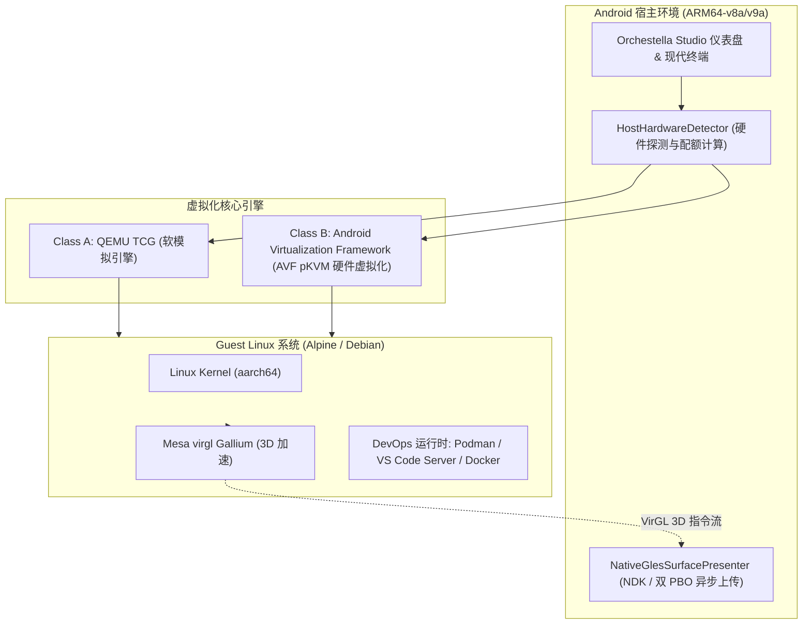
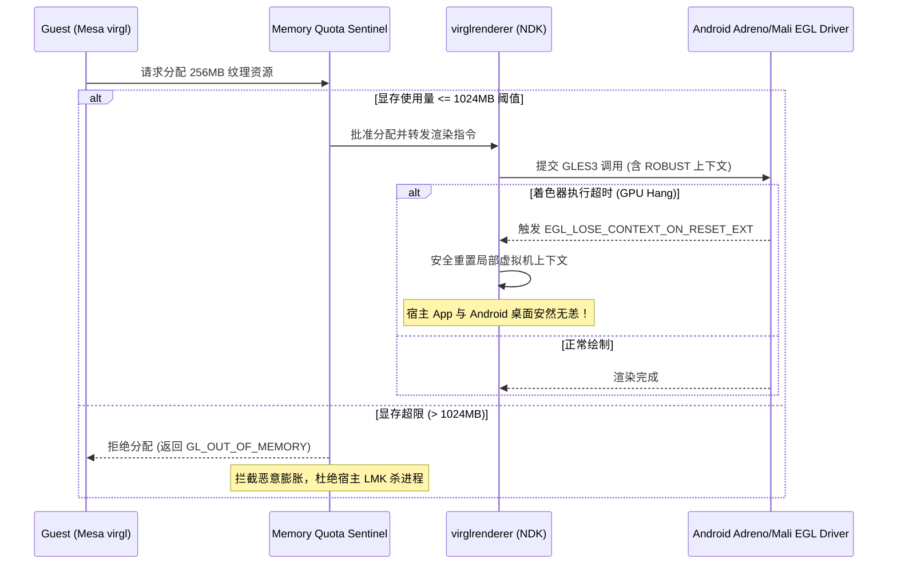

# DroidLayer / Orchestella Studio 高级调优与架构白皮书（开发者专版）

> **适用对象**：具备 Linux 系统管理、底层虚拟化原理或移动平台开发经验的高级开发者与系统极客。  
> **文档版本**：v1.0 (Milestone 4 / Ticket 53)  
> **更新日期**：2026-10-06  
> **对应版本**：DroidLayer v0.4.0+

---

## 1. 架构总览与分层虚拟化引擎

DroidLayer 在 Android 移动端构建了“双引擎、双接缝”的系统级虚拟化架构，旨在为开发者提供兼具最大兼容性与极限性能的 Linux 运行时环境：



- **Class A（QEMU TCG）**：开箱即用，通过高效动态二进制翻译（Tiny Code Generator）运行，零特权依赖，任何未 Root 手机均可运行；
- **Class B（AVF pKVM）**：利用 Android 13+ 引入的 Protected KVM（pKVM）硬件虚拟化扩展，指令接近原生执行，CPU 性能损失 $\le 5\%$。

---

## 2. QEMU TCG 多线程优化（MTTCG）与并发模型

### 2.1 MTTCG 工作原理与 ARM64-on-ARM64 优势
在早期 QEMU 架构中，TCG 采用单线程串行执行所有虚拟 CPU（vCPU）的翻译代码，多核虚拟机无法充分利用多核物理 CPU。  
从 QEMU 2.9 开始引入的 **MTTCG (Multi-Threaded TCG)**，为每个 vCPU 分配独立的宿主 POSIX 线程（`pthread`）。

在 DroidLayer 中，由于宿主和客户机均为 64 位 ARM（AArch64-on-AArch64），不存在跨指令集翻译时的复杂原子语义模拟难题：
1. **弱内存模型一致性**：ARM 架构本身的弱内存屏障指令（如 `DMB`, `DSB`, `ISB`）可以直接与宿主处理器的物理屏障指令 1:1 对等翻译；
2. **并发 TB（Translation Block）安全**：TCG 通过细粒度读写锁保护 JIT 代码缓存，各 vCPU 核心在独立执行循环中并行翻译与执行指令。

### 2.2 启动参数配置与线程映射
DroidLayer 在组装 `QemuLaunchSpec` 时采用如下调优模板：
```bash
-accel tcg,thread=multi,tb-size=128 \
-smp cpus=4,cores=4,threads=1,sockets=1 \
-cpu host \
-m 2048M
```

- `thread=multi`：强制开启多线程 TCG。如果设置为 `single`，所有 vCPU 将被强制轮转在单核上，多核编译效率将下跌 60% 以上；
- `tb-size=128`：为 JIT 翻译块分配 128MB 环形内存缓冲区，避免频繁触发 JIT Cache 刷新与垃圾回收；
- `cores` 与 CPU 亲和性建议：
  * **高通骁龙大小核调度**：避免分配超过物理“大核+中核”数量的 vCPU。例如骁龙 8+ Gen 1（1 超大核 + 3 大核 + 4 小核），推荐设置 `cpus=4`，完全避开能效极低的小核；
  * **温度墙与降频**：长时间满载编译时，Android 内核热守护进程（`thermal-engine`）会强行压低物理核心频率。在高温环境下建议缩减为 `cpus=2`，保持稳定的主频输出。

---

## 3. AVF pKVM Stage-2 隔离机制与安全模型

### 3.1 Protected KVM（pKVM）特权分层
Android Virtualization Framework (AVF) 依托 ARMv8.2-A+ 的虚拟化扩展，将管理权限提升至 Exception Level 2 (EL2)。  
pKVM 引入了创新的 **Stage-2 内存转换表保护**，彻底改变了传统 KVM 信任宿主 Linux 内核的设计：

```
+-----------------------------------------------------------+
| Non-secure EL1 (Android OS / Host Kernel)                |
|  - 拥有常规设备驱动，但没有 Stage-2 转换表的绝对控制权      |
+-----------------------------------------------------------+
                             ▲
                             │ Hypervisor Calls (HVC)
                             ▼
+-----------------------------------------------------------+
| EL2 (pKVM Hypervisor / Microkernel)                       |
|  - 唯一仲裁 Stage-2 页表映射                                |
|  - 执行严格的内存借调（Memory Lending & Donating）        |
+-----------------------------------------------------------+
                             ▲
                             │ 硬件虚拟化 Stage-2 隔离
                             ▼
+-----------------------------------------------------------+
| Non-secure EL1 (Protected Guest VM / DroidLayer Linux)    |
|  - 内存页专属于 Guest，Android 宿主即便被 Root 也无法刺探 |
+-----------------------------------------------------------+
```

### 3.2 内存隔离防护与安全审计
1. **防止冷热内存穿透**：当 DroidLayer 向 pKVM 请求分配 2048MB 物理 RAM 时，EL2 处的 pKVM 固件将该段物理内存从 Android 宿主的 Stage-2 映射中彻底摘除；
2. **DMA 保护**：通过 IOMMU（System MMU）阻止任何恶意的宿主外设 DMA 尝试读取或写入虚拟机物理内存；
3. **零特权接入**：未授权的系统或提权木马无法通过 `/dev/kvm` 或调试接口转储 Guest 进程的敏感数据（如 SSH 私钥、容器环境变量）。

---

## 4. virglrenderer 显存配额与 EGL 鲁棒性隔离

### 4.1 移动端 GPU 虚拟化的固有风险
在移动端运行 3D 加速虚拟化时，Guest 内部的 OpenGL ES / WebGL 应用通过虚拟 GPU 设备（`virtio-gpu-gl-device`）将 3D 命令流序列化并传递给宿主。宿主进程调用 `virglrenderer` 解码并向物理 Adreno / Mali GPU 提交渲染。  
这面临两大系统级风险：
1. **着色器死循环与 GPU Hang**：如果 Guest 执行了恶意死循环着色器，可能拖垮整个 Android SurfaceFlinger，导致手机黑屏重启；
2. **显存爆仓与 LMK**：移动设备 GPU 采用统一内存架构（UMA），显存直接占用水位有限的物理内存。无限制的纹理分配会立即触发宿主 Low Memory Killer (LMK)。

### 4.2 三重防御纵深架构（Triple-Guard Architecture）



### 4.3 核心实现参数与 EGL 扩展声明
在宿主 EGL 上下文初始化中，DroidLayer 强制声明以下扩展属性：
```c
EGLint context_attribs[] = {
    EGL_CONTEXT_CLIENT_VERSION, 3,
    // 强制开启健壮性内存边界检查，防止着色器数组越界
    EGL_CONTEXT_OPENGL_ROBUST_ACCESS_EXT, EGL_TRUE,
    // 当发生 GPU 重置时，仅让当前局部上下文丢失，绝不连带整机重启
    EGL_CONTEXT_OPENGL_RESET_NOTIFICATION_STRATEGY_EXT, EGL_LOSE_CONTEXT_ON_RESET_EXT,
    EGL_NONE
};
```

- **显存限额配额守卫**：默认硬编码最大 1024MB。超过该限额时，`virglrenderer` 的 resource_create 回调直接返回 `NULL` 并上报 `GL_OUT_OF_MEMORY`；
- **异步双 PBO 呈现**：在 `NativeGlesSurfacePresenter` 中采用交替乒乓 PBO 流水线：
  $$\text{Frame } N: \quad \text{PBO}_0 \xrightarrow{\text{DMA}} \text{Texture Upload} \quad \parallel \quad \text{CPU} \xrightarrow{\text{memcpy}} \text{PBO}_1$$
  消除 CPU 阻塞等待 GPU 采样完成的时间，将 1080p 帧上传耗时压降至 $3.5\text{ ms}$ 以内。

---

## 5. 生产力实战：Rootless 容器体系与 VS Code Server

### 5.1 在 Alpine / Debian 中部署 Podman Rootless 容器
在 Android 虚拟机内运行容器无需特殊的特权权限，只需配置标准的 Linux 用户命名空间与 `fuse-overlayfs`。

#### 步骤 1：安装依赖包
```bash
# Alpine Linux
apk update && apk add podman shadow-subids fuse-overlayfs

# Debian Linux
apt update && apt install -y podman uidmap fuse-overlayfs
```

#### 步骤 2：配置用户命名空间映射（subuid/subgid）
以默认用户 `droidlayer`（UID 1000）为例：
```bash
echo "droidlayer:100000:65536" | sudo tee /etc/subuid
echo "droidlayer:100000:65536" | sudo tee /etc/subgid
```

#### 步骤 3：配置存储驱动（`~/.config/containers/storage.conf`）
```ini
[storage]
driver = "overlay"
runroot = "/run/user/1000/containers"
graphroot = "/home/droidlayer/.local/share/containers/storage"

[storage.options]
mount_program = "/usr/bin/fuse-overlayfs"
```

#### 步骤 4：验证容器运行
```bash
podman run --rm -it alpine:latest uname -a
```

---

### 5.2 VS Code Server 远程开发与 ADB 隧道穿透

借助 VS Code Server，用户可以在宿主手机浏览器、同局域网平板或电脑上获得完整的现代 IDE 体验。

#### 方案 A：Guest 内部启动 Code Server
在虚拟机终端中执行：
```bash
# 安装并前台启动 code-server
curl -fsSL https://code-server.dev/install.sh | sh
code-server --bind-addr 0.0.0.0:8080 --auth none
```

#### 方案 B：宿主端口转发与浏览器访问
1. **本地回环直接访问**：
   DroidLayer 默认启用了 QEMU 的用户态网络端口转发（SLIRP `hostfwd`）：
   ```
   hostfwd=tcp:127.0.0.1:8080-:8080
   ```
   只需在手机浏览器中输入 `http://127.0.0.1:8080` 即可秒开 VS Code。

2. **跨设备开发（PC / 平板连手机）**：
   通过 USB 连接数据线，在 PC 端执行 ADB 反向代理：
   ```bash
   adb forward tcp:8080 tcp:8080
   ```
   在 PC 浏览器访问 `http://localhost:8080`，即可利用手机内部的完整 Linux 工具链进行本地化编程，零延迟、免云端开销。

---

## 6. 系统性能调优基准与故障排查清单

### 6.1 推荐参数配额矩阵对照表

| 手机物理配置 | 宿主安全空闲留存 | 推荐 vCPU 核心数 | 推荐 RAM 配额 | VirGL 显存上限 | 适用场景 |
| :--- | :--- | :--- | :--- | :--- | :--- |
| **6GB RAM 手机** | $\ge 2.2\text{ GB}$ | 2 核心 | 1024 MB | 256 MB (或关闭) | 轻量 Shell、Python 脚本、Alpine CLI |
| **8GB RAM 手机** | $\ge 2.5\text{ GB}$ | 4 核心 | 2048 MB | 512 MB | Debian 完整开发、Node.js、单容器 Podman |
| **12GB+ RAM 手机** | $\ge 3.5\text{ GB}$ | 4~6 核心 | 4096 MB | 1024 MB | VS Code Server、Rust/C++ 并发编译、WebGL 3D 桌面 |

### 6.2 常见问题与排查指令（FAQ）

#### Q1: 编译大型项目时提示 `Killed`（OOM 退出）
- **原因**：Guest 内部内存耗尽触发 Linux 内核 OOM Killer，或者宿主内存告急触发 Android LMK。
- **解法**：
  1. 在向导或实例设置中调大 RAM；
  2. 在 Guest 内开启 2GB 的 Swap 交换文件：
     ```bash
     sudo fallocate -l 2G /swapfile
     sudo chmod 600 /swapfile
     sudo mkswap /swapfile
     sudo swapon /swapfile
     ```

#### Q2: VirGL 3D 渲染画面偶现闪烁或掉帧
- **排查**：检查宿主 `logcat | grep -i virgl`。
- **调优**：确保宿主使用的是带有 EGL 双 PBO 上传的 `NativeGlesSurfacePresenter`。在弱 GPU 机型上，可将渲染分辨率锁定在 720p（1280x720）以减轻带宽瓶颈。

---

## 7. 结语与演进路线

DroidLayer 的架构遵循严密的接缝与策略中立设计。随着 Android 15/16 对 AVF 功能的进一步解禁，我们将逐步实现从 Class A（QEMU TCG）向全量 Class B（pKVM 硬件级加速）的平滑过渡，为广大移动开发者打造触手可及的便携式算力工作站。
