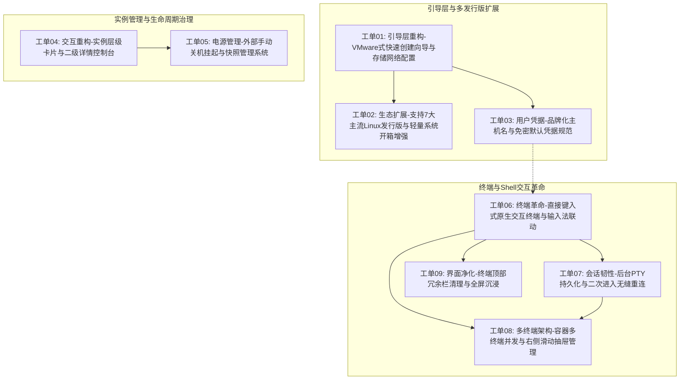

# Orchestella Studio 体验重塑与终端革命工单总览 (Phase 6.0)

> **版本基线**：v0.5.0-alpha（Commit `0b94794`，已全量核对 Git 状态，因发现关键交互与输入缺陷已从 Release 临时下架）  
> **工单性质**：下一阶段（Phase 6.0）必须全量攻坚并歼灭的体系化重构工单  
> **指导思想**：对标 VMware Workstation 经典向导、UTM/Proxmox 虚拟机生命周期治理、Termux 与 Windows Terminal 原生交互体验，推行深模块（Deep Modules）与测试驱动开发（TDD）

---

## 1. 行业优秀实践调研摘要

### 1.1 虚拟化软件向导与生命周期治理（VMware / UTM / Proxmox）
1. **VMware Workstation "New Virtual Machine Wizard"**：
   - **典型模式 vs 高级自定义**：提供快速向导，步骤分明（操作系统选择 -> 虚拟机命名与存储盘符挂载 -> 虚拟硬件核数与内存配置 -> 网络适配器与源配置 -> 初始用户与自动化 Easy Install 脚本）。
   - **向导式自动化脚本（Easy Install）**：在系统安装完成初次引导时，自动执行预设脚本（如用户创建、特权授予、更新命令）。
2. **UTM & Proxmox VE 交互层级**：
   - **卡片概览与二级控制台解耦**：一级界面仅展示状态概览卡片（运行状态、CPU/内存负荷、缩略图）；点击卡片无缝转入二级详情控制台，集中管理硬件规格、快照历史、驱动器挂载与日志。
   - **外部电源快捷键**：卡片与二级界面均配备「正常关机（ACPI）」、「强制断电（Kill）」、「挂起（Pause/Suspend）」与「快照（Snapshot）」。

### 1.2 终端与 Shell 原生交互体验（Windows Terminal / Termux / Termius / JuiceSSH）
1. **输入交互本质：去“输入框”化**：
   - Windows Terminal、macOS Terminal、Termux 从不使用独立的底部单行 EditText。
   - 终端画布本身即为输入捕获器（绑定原生 `InputConnection`），用户直接点击终端屏幕即可聚焦呼出软键盘，输入任意字符直接通过 PTY 流式传入 Shell，由远程/宿主终端实时 Echo 回显。
2. **移动端软键盘动态贴合（IME Insets Sync）**：
   - 底部辅助按键栏（ESC, TAB, CTRL, ALT, ^C, CLR, PASTE）必须动态侦听 Android `WindowInsets.Type.ime()`，软键盘弹出时紧贴键盘顶部无缝上移，软键盘收起时归位，绝不遮挡终端光标，亦无回车位置偏移。
3. **多终端会话（Multi-Session / Multi-Tab）**：
   - 对标 Termius / JuiceSSH：单个容器内允许开辟多个独立 PTY 伪终端会话（Session 1、Session 2），通过侧边滑出抽屉（Drawer）进行会话切换与新增，满足一边运行后台编译、一边查看日志的并发诉求。
4. **长效会话保持与重连（Session Persistence）**：
   - Activity 销毁并不意味着容器或 PTY 终结。后台守护线程持有 PTY 文件描述符与环形缓冲区（RingBuffer），前台重进时无损 Re-attach 并回放历史输出，严禁弹出 `[no live session]` 假死。

---

## 2. 工单 DAG 依赖拓扑图

---

## 3. 工单清单索引表

| 工单编号与文件名 | 核心关注领域 | 阻塞依赖项 | 预计工期/复杂度 |
| :--- | :--- | :--- | :---: |
| [工单01-实例快速向导与虚拟磁盘网络配置.md](./工单01-实例快速向导与虚拟磁盘网络配置.md) | 实例创建向导、存储挂载、网络源下拉、启动自动更新软件 | 无（可立即启动） | 中（Medium） |
| [工单02-支持7大主流Linux发行版与轻量系统开箱增强.md](./工单02-支持7大主流Linux发行版与轻量系统开箱增强.md) | 扩展7大发行版矩阵、Alpine等开箱套件推荐 | 工单01 | 中（Medium） |
| [工单03-用户凭据快速配置与Orchestella品牌标识固化.md](./工单03-用户凭据快速配置与Orchestella品牌标识固化.md) | 用户名/密码/sudo配置、默认root/1234、主机名Orchestella | 工单01 | 低（Low） |
| [工单04-实例管理界面重构与二级详情控制台.md](./工单04-实例管理界面重构与二级详情控制台.md) | 主页实例概览卡片、二级独立控制台、多级分层操作 | 无（可立即启动） | 高（High） |
| [工单05-外部手动关机挂起与快照管理系统.md](./工单05-外部手动关机挂起与快照管理系统.md) | 外部快捷关机、挂起/唤醒、快照创建与回滚恢复 | 工单04 | 高（High） |
| [工单06-直接键入式交互终端与软键盘动态联动.md](./工单06-直接键入式交互终端与软键盘动态联动.md) | 彻底移除独立输入框、终端画布直接键入、软键盘高度贴合 | 无（可立即启动） | 极高（Critical） |
| [工单07-后台终端PTY会话保持与二次进入无缝重连.md](./工单07-后台终端PTY会话保持与二次进入无缝重连.md) | 歼灭 `[no live session]` 缺陷、后台PTY保持与重连回放 | 工单06 | 极高（Critical） |
| [工单08-多终端并发支持与右侧滑出抽屉管理.md](./工单08-多终端并发支持与右侧滑出抽屉管理.md) | 实例内多终端并发、右侧滑出式抽屉切换与管理 | 工单06, 工单07 | 高（High） |
| [工单09-终端界面净化与无用标题桌面栏清理.md](./工单09-终端界面净化与无用标题桌面栏清理.md) | 移除顶部无用标题与进入图形桌面按钮，全屏沉浸 | 工单06 | 低（Low） |

---

## 4. 实施阶段与推荐推进路径

- **第一冲刺阶段（优先级最高，歼灭阻断性崩溃与交互瘫痪）**：
  - 实施 `工单06`（原生终端直接键入，修复回车偏移与输入无效）与 `工单07`（后台 PTY 会话保持，修复二次进入卡死）；
  - 实施 `工单09`（清理终端顶部标题与冗余按钮）；
- **第二冲刺阶段（架构升维与向导重塑）**：
  - 实施 `工单01`、`工单02`、`工单03`（VMware 级快速向导、7 大发行版扩容、品牌主机名与初始凭据规范）；
- **第三冲刺阶段（控制台多级深化与高级特性）**：
  - 实施 `工单04`、`工单05`（二级详情控制台、外部电源管理、挂起与快照系统）；
  - 实施 `工单08`（右侧抽屉式多终端并发管理）。
