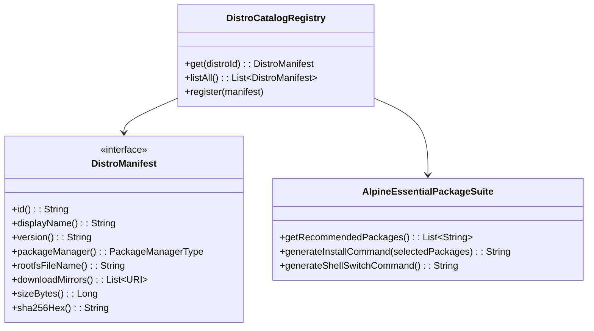

# 02: 支持7大主流Linux发行版与轻量系统开箱增强

**What to build:**  
将 Orchestella Studio 的 Linux 发行版支持能力从仅有的 Alpine 与 Debian 扩展至 7 款主流 Linux 发行版（Ubuntu、Debian、Arch Linux、Alpine Linux、Fedora、openSUSE、Kali Linux）。在创建实例向导中提供二级选择器与信息看板，并针对 Alpine Linux 等极简轻量发行版，在向导界面中推出“必备开箱软件推荐套件”勾选安装（如 `bash`, `curl`, `sudo`, `coreutils`, `ca-certificates` 等），使用户进入终端后即可拥有完备顺手的交互开发体验。

**Blocked by:** 工单01 (实例快速向导与虚拟磁盘网络配置)

**Status:** ready-for-agent

---

## 需求背景与痛点

1. **发行版选择狭窄**：当前代码仅硬编码了 `OfficialAlpineCatalog` 与 `OfficialDebianCatalog`，无法满足用户对 Arch Linux 滚启动态、Ubuntu 工业标准 LTS、Fedora/openSUSE 企业级环境及 Kali Linux 安全攻防工具链的多元化需求；
2. **轻量发行版“开箱简陋”体验断层**：
   - 官方 Alpine mini-rootfs 体积仅约 4MB，但其默认 shell 为 BusyBox ash，缺少 `bash`、`curl`、`sudo` 等基础高频工具；
   - 新手用户进入后不仅命令历史、快捷键行为不习惯，连下载安装脚本都因为缺少 `curl`/`ca-certificates` 而频繁报错，造成极大的心理挫败感；
   - 用户明确提出：像 Alpine 这种轻量版本，引导界面应支持推荐先行安装必备软件，让用户进入后先拥有完整顺滑的体验。

---

## 详细功能规格与交互设计

### 1. 7 大主流发行版矩阵规格定义

| 发行版标识 (`distroId`) | 发行版名称与版本 | 特色标签与使用场景 | 默认包管理器 | RootFS 规格与来源架构 (aarch64) |
| :--- | :--- | :--- | :---: | :--- |
| `ubuntu` | **Ubuntu 24.04 LTS (Noble)** | 🐧 工业标准 · 广泛支持 · 云原生首选 | `apt` | 官方 Ubuntu Base RootFS (`~85MB`) |
| `debian` | **Debian 13 (Trixie) / 12 (Bookworm)** | 🌀 稳如磐石 · 纯净开源 · 经典基石 | `apt` | Debian Official Minimal RootFS (`~90MB`) |
| `arch` | **Arch Linux ARM** | 🏹 极客首选 · 滚动更新 · 软件前沿 | `pacman` | Arch Linux ARM RootFS (`~180MB`) |
| `alpine` | **Alpine Linux 3.24.1** | ⚡ 极致轻量 · 极速启动 · 容器实验 | `apk` | Alpine Mini RootFS (`~4MB`) |
| `fedora` | **Fedora 41** | 🎩 前沿创新 · RPM 生态 · 开发者友好 | `dnf` | Fedora Minimal Container RootFS (`~120MB`) |
| `opensuse` | **openSUSE Tumbleweed** | 🦎 稳定滚更 · YaST 工具 · 严谨规范 | `zypper` | openSUSE Tumbleweed JeOS RootFS (`~110MB`) |
| `kali` | **Kali Linux Rolling** | 🐉 渗透测试 · 安全审计 · 攻防套件 | `apt` | Kali Linux Official RootFS (`~130MB`) |

### 2. 向导界面二级选择器设计（Distro Selector）
- 在创建向导中以二级卡片列表或下拉选择抽屉呈现 7 大发行版，清晰展示 Logo、发行版名称、版本号、下载体积预估与使用场景定位；
- 点击任意发行版时，动态展开其特性简报与推荐参数（如推荐分配的虚拟磁盘大小、推荐内存下限）。

### 3. Alpine 轻量发行版“开箱必备套件”引导与自动部署
当用户选择 Alpine Linux 时，向导中动态显现「✨ 推荐预置极客开箱必备套件（建议勾选）」卡片：
- **预选组件列表（用户可自由单独勾选）**：
  - [x] **GNU Bash & 交互补全** (`bash`, `bash-completion`)：告别简陋 ash，获得与桌面终端一致的交互体验；
  - [x] **网络传输工具** (`curl`, `wget`, `ca-certificates`)：确保即刻具备 HTTPS 脚本拉取与文件下载能力；
  - [x] **特权提升与安全工具** (`sudo`, `shadow`)：支持标准非 root 用户及 sudo 权限流转；
  - [x] **GNU 核心工具集** (`coreutils`, `grep`, `sed`)：提供完整的 Linux 命令参数支持；
  - [x] **进程诊断与编辑器** (`nano`, `procps`, `tar`)：开箱即用文本编辑与系统监控。
- **自动化执行流水线**：
  - 勾选的包名将汇总为依赖列表；
  - 在镜像源挂载完毕、初次引导时，系统自动执行 `apk add --no-cache bash bash-completion curl wget sudo shadow coreutils grep sed nano procps tar`；
  - 自动将 root 及新建用户的默认登录 Shell 无缝切换为 `/bin/bash`（`chsh -s /bin/bash root`）。

---

## 架构演进与深模块改造设计

1. **重构 `:runtime:distro` 模块**：
   - 废除零散单例，构建统一的 `DistroCatalogRegistry.java`；
   - 完善 7 款发行版的 `DistroManifest` 实现类（`UbuntuManifest`、`ArchLinuxManifest`、`FedoraManifest`、`OpenSuseManifest`、`KaliManifest` 等），固化版本元数据与 SHA-256 镜像校验基准；
2. **Alpine 推荐套件引擎 `AlpineEssentialPackageSuite.java`**：
   - 纯 JVM 独立深模块，输入勾选的特性标签集合，输出对应的 `apk add` 依赖解析结果与自动化执行指令；
3. **向导与实例创建器适配**：
   - `DistroInstanceCreator.java` 支持接收所有 7 款发行版清单，统一根卷稀疏分配、SHA-256 镜像流式校验与解包事务。

---

## 验收标准 (Acceptance Criteria)

- [ ] **7 款主流发行版目录全量注册**：在创建向导中能够完整展示并选择 7 款发行版（Ubuntu、Debian、Arch、Alpine、Fedora、openSUSE、Kali），各项参数（版本、包管理器类型、哈希基准）均经过契约校验；
- [ ] **Alpine 推荐软件勾选面板联动**：选择 Alpine 时界面正确浮现必备开箱套件推荐勾选区，选择其他发行版时自动隐藏或呈现该发行版专属选项；
- [ ] **开箱软件自动化安装落盘**：创建勾选了必备套件的 Alpine 实例后，系统初次启动自动拉起后台安装流程，登录默认 shell 成功变更为 `/bin/bash`，终端内可直接执行 `curl --version` 与 `sudo`；
- [ ] **纯 JVM 单元测试覆盖**：
  - `DistroCatalogRegistryTest.java` 验证全部 7 款发行版的元数据完整性与架构兼容性；
  - `AlpineEssentialPackageSuiteTest.java` 验证开箱软件组合的命令生成正确性；
  - 所有单测 100% 绿灯，耗时 ≤ 15s。
