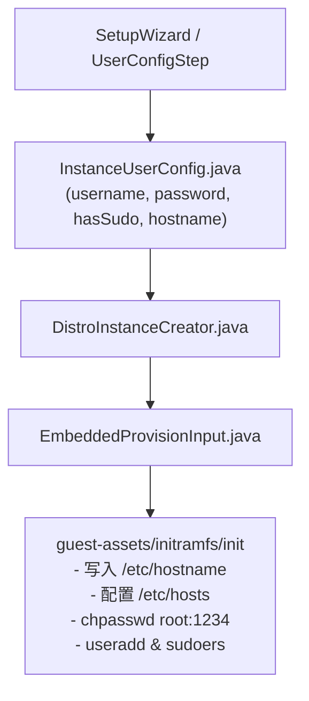

# 03: 用户凭据快速配置与Orchestella品牌标识固化

**What to build:**  
在实例创建向导中引入对标 VMware "Easy Install" 的用户配置卡片（快速设定自定义普通用户名、登录密码、是否授予 sudo 免密特权）；若用户选择“暂不创建普通用户直接跳过”，则向导明确告知系统初始超级用户为 `root`，默认初始密码统一预设为 `1234`，主机名（Hostname）强制固化为 `Orchestella`。彻底歼灭使用随机长 UUID 充当主机名并在终端提示符（PS1）中显示 `root@1c283e7c-daa9-4192-974c-41f4cc139ea7` 占满屏幕的恶劣缺陷。

**Blocked by:** 工单01 (实例快速向导与虚拟磁盘网络配置)

**Status:** ready-for-agent

---

## 需求背景与痛点

1. **终端提示符严重受污染**：
   - 现有代码在 `TerminalActivity.java` 与 `InteractiveTerminalEngine.java` 中直接将 `instanceId`（如 `1c283e7c-daa9-4192-974c-41f4cc139ea7`）作为主机名拼接到终端提示符中；
   - 截图中清晰可见，`root@1c283e7c-daa9-4192-974c-41f4cc139ea7 ~ ❯` 冗长丑陋，不仅遮挡真实命令行输入空间，更严重破坏品牌调性与专业感；
2. **缺乏初始用户与权限引导**：
   - 当前没有为用户提供创建日常非 root 账户的通道，用户要么直接裸奔 root，要么使用难以记忆的随机生成的 16 位密码；
   - 用户明确提出：在向导中快速配置用户名、密码、sudo 权限；跳过则告知初始为 root 用户，密码先设为 `1234`，用户名/主机名默认体现 `Orchestella` 品牌特性。

---

## 详细功能规格与交互设计

### 1. 向导内「用户与特权配置」卡片
在向导流程中提供「👤 用户与系统安全」配置面板：
- **自定义账户开关**：默认启用「创建日常开发账户（推荐）」；
- **配置表单项**：
  - **用户名（Username）**：合规性校验（小写字母开头，支持小写字母/数字/下划线，长度 2~16 位，如 `orchestella`、`nyzee`、`dev`）；
  - **密码（Password）**：输入框与明暗显示切换；
  - **Sudo 特权开关**：复选框「授予该用户 sudo 提权权限（免密模式 `NOPASSWD:ALL`）」；
- **跳过选项与初始凭据提示**：
  - 用户可点击「跳过账户创建，使用初始 root」；
  - 点击跳过后，界面弹窗或气泡卡片明确告知用户：  
    > ℹ️ **初始超级用户凭据通知**  
    > - 登录身份：`root`  
    > - 初始密码：`1234`  
    > - 系统主机名：`orchestella`  
    > - *建议进入系统后通过 `passwd` 命令及时修改密码。*

### 2. Linux 容器内部配置落地（Guest Provisioning）
系统在解包与初始挂载阶段，通过 `initramfs` 与 `guest-agent` 自动完成以下固化：
1. **主机名（Hostname）品牌固化**：
   - 将 Guest 内 `/etc/hostname` 写入 `orchestella`（若用户在向导中自定义了实例名称，则使用规范化后的实例别名，绝不允许填入 UUID）；
   - 同步更新 Guest 内 `/etc/hosts`：
     ```text
     127.0.0.1   localhost orchestella
     ::1         localhost ip6-localhost ip6-loopback orchestella
     ```
2. **用户创建与密码生效**：
   - 若用户创建了普通用户（如 `dev`）：
     - 执行 `useradd -m -s /bin/bash -G sudo,wheel dev`（或在 Alpine 执行 `adduser -D -s /bin/bash dev`）；
     - 设定密码 `echo "dev:user_password" | chpasswd`；
     - 若勾选 sudo：写入 `/etc/sudoers.d/99-orchestella-user`，内容为 `dev ALL=(ALL) NOPASSWD:ALL`，权限 `0440`；
   - 设定 root 密码：
     - 若跳过普通用户：`echo "root:1234" | chpasswd`；
     - 若创建了普通用户：root 密码同步设为相同密码或保持 `1234`。
3. **终端默认登录身份**：
   - 若创建了普通用户，默认以该普通用户登录进入交互 Shell，提示符形如 `dev@orchestella:~$`；
   - 若未创建普通用户，以 root 用户登录，提示符形如 `root@orchestella:~#`。

---

## 架构演进与深模块改造设计



1. **核心模型契约重构 `InstanceUserConfig.java`**：
   - 包含 `username`、`password`、`hasSudo`、`hostname`；
   - 提供 `InstanceUserConfig.defaultRoot()` 静态工厂：
     - `username = "root"`
     - `password = "1234"`
     - `hostname = "orchestella"`
     - `hasSudo = true`
2. **持久化与实例元数据改造 `InstanceLifecycle.Instance`**：
   - 移除写死生成 16 位随机字符的 `newGuestPassword()` 逻辑；
   - `Instance` 元数据模型增加 `hostname` 与 `defaultUser` 字段；
   - 持久化至 `instance.json`，确保实例重启、快照和备份时完整保留；
3. **彻底重构 `TerminalActivity` 与 `InteractiveTerminalEngine` 的提示符生成器**：
   - 彻底删除 `tvContext.setText("root@" + instanceId + " ~")` 逻辑；
   - 改造为由底层 Shell PTY 或实例配置的主机名驱动，默认呈现 `root@orchestella ~ ❯`。

---

## 验收标准 (Acceptance Criteria)

- [ ] **向导内用户配置界面就绪**：提供普通用户表单、密码输入框与 Sudo 选项，表单具备实时校验（用户名非法字符、密码过短等）；
- [ ] **跳过用户时明确告知默认凭据**：点击跳过后，界面清晰提示 root 初始密码为 `1234`，主机名为 `orchestella`；
- [ ] **主机名与 hosts 文件规范写入**：实例启动后，Guest 内执行 `hostname` 返回 `orchestella`，`/etc/hosts` 解析正确，无任何 UUID 污染；
- [ ] **密码验证通过**：通过终端执行 `su root` 输入 `1234` 能够顺利通过认证并切换权限；若配置了普通用户，普通用户可直接使用 `sudo -i`；
- [ ] **终端提示符清爽化**：终端进入后，命令行提示符绝不包含任何 UUID 随机串，整洁呈现品牌标识；
- [ ] **纯 JVM 单元测试覆盖**：
  - `InstanceUserConfigTest.java` 验证用户名校验规则、默认 root 初始工厂与序列化；
  - `InstanceLifecycleUserTest.java` 验证用户元数据持久化与读取兼容性；
  - 100% 绿灯通过。
