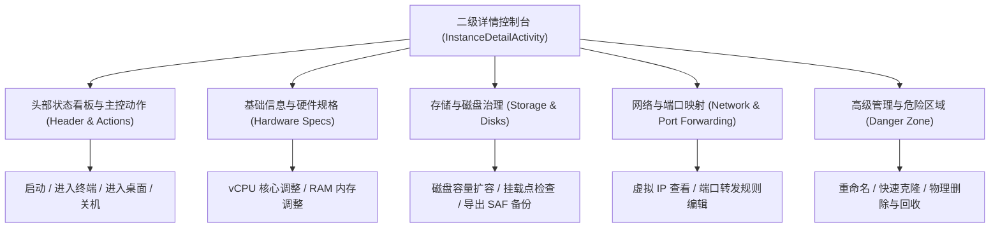

# 04: 实例管理界面重构与二级详情控制台

**What to build:**  
彻底颠覆当前主界面单卡片上堆砌滑块与删除按钮的扁平混乱设计。对标 VMware Workstation 虚拟机控制台与 UTM 管理面板，重构为符合工业级操作逻辑的「一级概览列表 + 点击直达二级详情控制台（Instance Detail View）」交互架构。所有高级配置参数（硬件升降配、存储扩容与挂载治理、端口转发、备份克隆、危险删除等）收敛沉淀至二级控制台内分层展示。

**Blocked by:** None (可立即启动)

**Status:** ready-for-agent

---

## 需求背景与痛点

1. **当前主界面卡片功能严重过载且易误触**：
   - 目前在 `MainActivity.kt` 的实例列表卡片上，启动、图形桌面、终端、硬件配置滑块、删除按钮等混杂在同一个卡片或扁平的 BottomSheet 中；
   - 用户在日常点击使用时极易误触危险的删除或未停止的配置项，且界面逼仄拥挤，缺乏专业虚拟化工作站的掌控感；
2. **缺乏系统化的虚拟机控制台**：
   - 用户明确要求：**每个已经创建的实例界面不再以卡片直接堆砌可调节参数的形式展示，直接设计为一个点击即可进入的二级界面，所有功能设计符合操作逻辑的二级或者多级界面**；
   - 参考 VMware、UTM、Proxmox VE，点击虚拟机应进入专属的“管理看板/控制台”，集中查看机器规格、状态指示、多项操作入口。

---

## 详细功能规格与交互设计

### 1. 一级主界面：现代极简实例卡片（Instance Overview Card）
主界面的每个实例卡片仅保留最核心的高频信息与进入二级界面的轻量触点：
- **卡片核心视觉**：
  - 发行版徽标（Ubuntu / Debian / Arch / Alpine 等矢量图标）；
  - 实例名称与别名（如 `My-Ubuntu-Dev`，副标题标明发行版版本）；
  - 运行状态胶囊 Badge（`● 运行中` 绿光呼吸灯、`○ 已关机` 灰色、`⏸ 已挂起` 琥珀色、`⚠ 崩溃告警` 红色）；
  - 硬件基础规格摘要（`4 核 · 2048 MB · 10 GB`）；
  - 网络简报（已分配的虚拟 IP 地址，如 `10.0.2.15`，或离线状态）；
- **卡片交互行为**：
  - **点击卡片主体**：直接以 Material 共享元素转场动画打开 **二级实例详情控制台（InstanceDetailActivity）**；
  - **卡片右侧快捷操作**：仅保留一个高优先级的「快捷电源/启动」按钮（已关机状态点击立即开机，运行中状态点击一键呼出电源菜单）。

### 2. 二级实例详情控制台（Instance Detail Console）
全屏沉浸式的二级管理控制台，顶部展示实例状态大看板，下设结构化的功能分区（可采用 Material 3 分组列表或 Segmented Tabs）：

#### 分区 1：头部状态看板与核心操作栏
- 动态状态巨幕，呈现虚拟机当前 CPU/内存实时负荷估算与运行时间；
- 核心操作按钮组（根据实例状态智能亮起/置灰）：
  - `[💻 打开终端]`（运行中时高亮，直接调起终端交互界面）；
  - `[🖥️ 进入桌面]`（仅当支持并配置了 Wayland 桌面时亮起）；
  - `[⚡ 电源管理]`（提供正常关机、强制断电、挂起与恢复下拉菜单）。

#### 分区 2：硬件规格调整（Hardware Specification）
- 仅在实例处于 `STOPPED` 或 `CREATED` 状态下允许修改（运行中状态锁定并提示关机后调整）；
- 内嵌 `InstanceHardwareConfigEditor`，提供优雅的可视化滑块与安全负荷提示（绿色安全、黄色警戒、红色拦截）。

#### 分区 3：存储与挂载管理（Storage & Mounts）
- 显示稀疏磁盘实际占用物理空间与逻辑分配空间；
- 支持一键增量无损扩容磁盘；
- 管理宿主目录共享挂载点；
- 「📦 导出整机 SAF 备份」操作入口。

#### 分区 4：网络与端口转发（Networking）
- 呈现当前网络模式与分配的虚拟 IP 地址；
- 内嵌端口转发规则管理列表（如将 Guest 22 端口转发至 Host 2222，Guest 8080 转发至 Host 8080）。

#### 分区 5：危险管理区（Danger Zone）
- 显眼的危险警示红框隔离：
  - 「🐑 克隆实例（Clone Instance）」：一键完整复制并派生全新独立实例；
  - 「🔄 重置实例运行状态（Reset State）」：针对异常宿主断电导致的死锁修复；
  - 「🗑️ 永久物理删除（Delete Permanently）」：二次弹窗确认后彻底回收磁盘与元数据。

---

## 架构演进与深模块改造设计

1. **解耦 `MainActivity.kt` 臃肿职责**：
   - `MainActivity.kt` 目前已接近 1200 行代码，充斥着大量的底层对话框与按钮监听；
   - 将实例卡片详情、硬件编辑、端口映射、删除确认等逻辑全量迁移至独立的 `InstanceDetailActivity.kt`；
   - `MainActivity.kt` 回归纯粹的“宿主硬件体检 + 实例列表概览 + 全局设置与向导”职责；
2. **纯 JVM 导航协议模型 `InstanceDetailViewModel.kt`**：
   - 维护二级界面的数据流与生命周期状态侦听，响应实例启动、关机事件并驱动 UI 刷新；
3. **布局模块化**：
   - 新建 `activity_instance_detail.xml`，采用 Material 3 现代化设计语言规范。

---

## 验收标准 (Acceptance Criteria)

- [ ] **点击卡片直达二级界面**：主界面实例卡片点击不再弹出杂乱的 BottomSheet 或原地展开滑块，而是平滑转场进入二级 `InstanceDetailActivity`；
- [ ] **主界面卡片极简化**：主列表仅保留状态指示胶囊、发行版名称与基础硬件摘要，卡片排版清爽整洁；
- [ ] **二级控制台功能分区分明**：二级界面清晰包含状态控制、硬件规格调整、存储备份、端口转发和危险管理等专区；
- [ ] **运行态权限保护**：实例在 `RUNNING` 状态下，二级界面的硬件修改控件明确置灰并提示“请先关机后再调整硬件参数”，彻底防范运行中改动导致的内核崩溃；
- [ ] **删除操作二次确认安全隔离**：删除实例操作位于二级页面底部的危险区域，点击后必须二次输入实例名或确认弹窗才可执行，杜绝误触；
- [ ] **纯 JVM 单元测试覆盖**：
  - 编写 `InstanceDetailViewModelTest.kt`，验证不同状态（RUNNING / STOPPED / CRASHED）下的控件可用性矩阵；
  - 测试通过率 100%。
