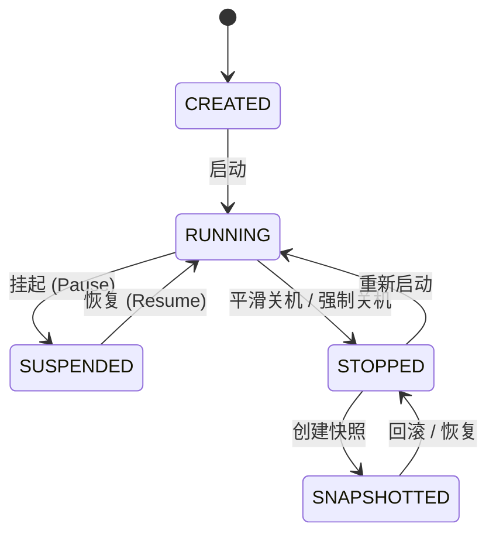

# 05: 外部手动关机挂起与快照管理系统

**What to build:**  
在主界面卡片快捷菜单与二级详情控制台中落地工业级虚拟机电源管理与状态快照（Snapshot）系统。支持用户在无需进入终端敲命令的情况下，从外部直接执行「平滑关机（ACPI Shutdown）」、「强制断电（Kill）」、「挂起与唤醒（Suspend / Resume）」；并引入轻量级快照管理系统，支持在关键操作前创建快照节点、一键回滚还原与快照清理。

**Blocked by:** 工单04 (实例管理界面重构与二级详情控制台)

**Status:** ready-for-agent

---

## 需求背景与痛点

1. **虚拟机外部控制手段缺失**：
   - 目前如果想关闭一个正在运行的虚拟机，用户必须先进入终端，手动键入 `poweroff` 或等待异常退出；
   - 一旦终端卡死（如当前出现的 `[no live session]` 问题），用户在界面上完全无法正常关闭实例，只能杀掉整个 Android App 进程，导致文件系统损坏风险剧增；
2. **缺乏虚拟化核心特性——挂起与快照**：
   - 移动端电池敏感且用户场景碎片化，临时切后台或休眠时，用户迫切需要一键「挂起（Suspend）」实例以冻结 CPU 占用并省电，随后能瞬间「恢复唤醒」；
   - 用户在系统内进行高危配置、编译大工程或升级软件前，亟需如 VMware/UTM 一般随时打一个「快照（Snapshot）」，一旦改崩即可秒级回滚。

---

## 详细功能规格与交互设计

### 1. 外部电源控制（Power Management）
在主界面卡片与二级控制台的电源操作面板中提供以下明确动作：

| 电源动作 | 触发机制与底层实现 | 适用状态 | 用户预期与安全防护 |
| :--- | :--- | :---: | :--- |
| **平滑关机 (ACPI Shutdown)** | 向 Guest 发送 ACPI 电源按键事件，或通过 Guest Agent 发送 `systemctl poweroff` / `poweroff` 信号 | `RUNNING` | 安全同步脏页，等待应用正常退出（附带 30s 优雅等待守卫） |
| **强制关机 (Force Power Off)** | 直接发送 `SIGTERM`/`SIGKILL` 终止 QEMU/AVF 进程，回收宿主内存 | `RUNNING` / `PROVISIONING` | 仅在系统无响应卡死时使用，弹出告警确认窗提醒数据丢失风险 |
| **挂起虚拟机 (Suspend / Pause)** | 通过 QMP/底层虚拟机监视器执行 `stop` 暂停 vCPU 调度，进入冻结态 | `RUNNING` | 瞬间释放 CPU 计算资源，冻结 guest 时间片，状态转为 `SUSPENDED` |
| **恢复唤醒 (Resume)** | 通过 QMP/底层监视器执行 `cont` 恢复 vCPU 调度，唤醒实例 | `SUSPENDED` | 瞬间恢复运行，终端与网络连接无缝续接，状态转为 `RUNNING` |

### 2. 实例快照系统（Snapshot Management）
在二级控制台增设「📸 状态快照管理器」卡片：
- **创建快照（Create Snapshot）**：
  - 用户输入快照名称（如 `升级前备份`）与可选说明；
  - 关机状态下：对当前 raw 根卷执行 COW（Copy-On-Write）增量快照分支，或保存增量差分记录及 `instance.json` 元数据配置；
  - 运行状态下：暂存磁盘脏页并标记一致性检查点；
- **快照列表展示**：
  - 时间线（Timeline）形式排列快照历史节点；
  - 每个快照显示创建时间、快照名称、占用差分体积及当时硬件规格；
- **回滚快照（Revert to Snapshot）**：
  - 点击指定快照的「🔄 回滚到此节点」；
  - 系统校验实例已停止，将磁盘指针与元数据原子原子替换回该快照分支；
  - 提示回滚成功，后续启动即为当时快照的系统环境；
- **删除快照（Delete Snapshot）**：
  - 合并或删除多余的快照分支，释放物理存储。

---

## 架构演进与深模块改造设计

1. **状态机契约扩展 `InstanceLifecycle.State`**：
   - 在已有的 `State` 枚举中补充 `SUSPENDED` 状态；
   - 增加状态迁移守卫规则：
     - `RUNNING -> SUSPENDED`（合法）
     - `SUSPENDED -> RUNNING`（合法）
     - `SUSPENDED -> STOPPED`（直接强制关机，合法）
2. **电源控制深模块 `InstancePowerController.java`**：
   - 纯 JVM 调度模块，抽象 `PowerActionSeam`：
     - `shutdownGraceful(instanceId, timeoutMs)`
     - `powerOffForce(instanceId)`
     - `suspend(instanceId)`
     - `resume(instanceId)`
3. **快照管理核心深模块 `InstanceSnapshotManager.java`**：
   - 独立存储管理，维护每个实例的 `snapshots/` 目录结构；
   - 采用快照清单 `snapshots.json` 记录节点链表，支持原子落盘与损坏回退。

---

## 验收标准 (Acceptance Criteria)

- [ ] **外部一键平滑关机可用**：在主界面或二级详情页点击“平滑关机”，运行中的虚拟机在 30 秒内完成系统卸载并自动转入 `STOPPED` 状态，无需进终端手动输命令；
- [ ] **挂起与唤醒全链路畅通**：运行中的实例可点击“挂起”，CPU 占用归零，卡片状态变更为 `SUSPENDED`（琥珀色）；点击“恢复唤醒”后秒级回到 `RUNNING`，终端可继续输入；
- [ ] **强制关机保底可用**：当虚拟机假死时，点击“强制关机”经二次确认后能直接杀掉后台进程，释放端口与内存占用；
- [ ] **快照创建与回滚生效**：
  - 成功为已停止的实例创建快照并在列表显示；
  - 在实例内创建测试文件后关机，执行“回滚到快照”，再次开机测试文件已被还原消失，证明快照回滚真实有效；
- [ ] **纯 JVM 单元测试覆盖**：
  - `InstancePowerControllerTest.java` 验证全部电源动作的状态流转与超时处理；
  - `InstanceSnapshotManagerTest.java` 验证快照创建、元数据隔离、回滚一致性与多快照级联删除；
  - 100% 绿灯通过。
