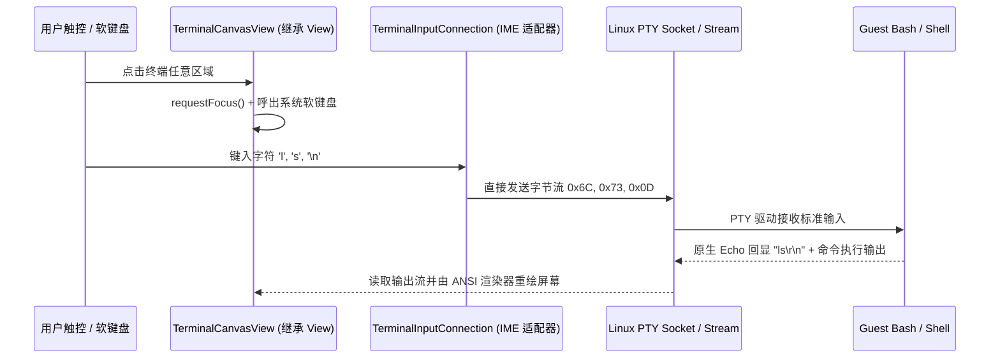

# 06: 直接键入式交互终端与软键盘动态联动

**What to build:**  
彻底颠覆并移除“底部独立单行输入框 + 确认按键”这一严重反人类、违背终端操作本质的错误设计。对标 Windows Terminal、Termux 与 Termius，重构为**原生直接键入式虚拟终端引擎**：用户点击终端屏幕画布的任意位置即可自动获得焦点并呼出系统软键盘；键入的任意字符、退格键、回车键直接作为原始字节流发送给 Linux PTY，由 Shell 原生回显显示在命令行当前光标处；修复软键盘回车键偏移与无法点击的恶劣缺陷；底部快捷按键条（ESC, TAB, CTRL, ALT, ^C, CLR, PASTE 等）深度联动 Android `WindowInsets.Type.ime()`，在软键盘呼出时无延迟平滑上移紧贴键盘顶部，软键盘收起时自动回到底部停靠。

**Blocked by:** None (可立即启动)

**Status:** ready-for-agent

---

## 需求背景与痛点

1. **阻断性交互 Bug（核心缺陷）**：
   - 当前用户在终端界面点击无反应，软键盘无法正常呼出；
   - 即使偶尔呼出，回车键（↵）位置出现严重偏移且无法点击，用户完全无法向 Linux 容器输入任何命令；
2. **错误的“底部输入框”伪终端设计**：
   - 现有代码在 `TerminalActivity.java` 底部放置了一个 `EditText` 和一个 `↵` 按钮，采用“在输入框打字 -> 点击发送 -> 拼接到终端界面”的聊天软件式设计；
   - 这种模式破坏了所有 Linux 交互式程序（如 `vim`、`nano`、`htop`、`fzf`、多级密码输入、Tab 自动补全、实时方向键导航等）；
3. **用户明确诉求**：
   - 彻底删除底部输入框与发送按钮；
   - 像 Windows Terminal 与 Termux 一样，用户直接在命令行处打字并显示，回车直接执行；
   - 快捷键条随软键盘浮动升降，不挡视野、不偏位。

---

## 详细功能规格与交互设计

### 1. 原生虚拟终端直接键入模型（Native Terminal Input Architecture）
参考 Termux 的 `TerminalView` 原生机制，重塑终端画布组件：



- **去输入框化**：彻底删除 `TerminalActivity.java` 中的 `inputBar`、`EditText input`、`Button btnSend` 及相关伪提示符胶囊；
- **全屏直接聚焦与输入连接**：
  - 新建或重构 `TerminalCanvasView`，继承 Android `View` 并实现可获取焦点（`setFocusable(true)`, `setFocusableInTouchMode(true)`）；
  - 实现 `onCreateInputConnection(EditorInfo outAttrs)`：
    - 配置 `outAttrs.inputType = InputType.TYPE_NULL`（或受控的 `TYPE_TEXT_VARIATION_VISIBLE_PASSWORD | TYPE_TEXT_FLAG_NO_SUGGESTIONS`）；
    - 配置 `outAttrs.imeOptions = EditorInfo.IME_ACTION_NONE | EditorInfo.IME_FLAG_NO_FULLSCREEN`，杜绝输入法横屏全屏覆盖（No Extract UI）；
  - 点击终端画布时，立即调用 `InputMethodManager.showSoftInput(view, SHOW_IMPLICIT)`，光标即时在最后一行命令提示符后闪烁；
- **原始键盘事件拦截与 PTY 直通**：
  - 用户按下普通字符（a-z、0-9、符号）：转换并直接写入 PTY OutputStream；
  - 用户按下 `Enter` 键：向 PTY 发送 `\r`（Carriage Return, 0x0D）；
  - 用户按下 `Backspace` 键：向 PTY 发送 `\x7f`（ASCII DEL）；
  - 用户按下 `Tab` 键：向 PTY 发送 `\t`（0x09），由 Bash 原生触发路径/命令自动补全；
  - 密码输入安全原生兼容：当 Linux 提示 `Password:` 时，用户敲击软键盘字符流直接流向 Linux，Linux 默认不回显字符，原生保证密码安全性，彻底解决原本在明文输入框暴露密码的致命漏洞。

### 2. 移动辅助按键栏（Auxiliary Key Bar）动态贴合联动
- **常驻快捷按键**：保留 `ESC`、`TAB`、`CTRL`、`ALT`、`^C`、`CLR`、`PASTE`、`↑`、`↓`、`←`、`→`；
- **与 Android WindowInsets 深度协同**：
  ```kotlin
  ViewCompat.setOnApplyWindowInsetsListener(auxiliaryKeyBar) { bar, insets ->
      val imeInsets = insets.getInsets(WindowInsetsCompat.Type.ime())
      val navInsets = insets.getInsets(WindowInsetsCompat.Type.navigationBars())
      // 软键盘弹起时，底部 padding 即为键盘高度；键盘收起时，底部 padding 为系统导航栏高度
      val targetBottomPadding = if (imeInsets.bottom > 0) imeInsets.bottom else navInsets.bottom
      bar.updatePadding(bottom = targetBottomPadding)
      insets
  }
  ```
- **位置无偏移保证**：
  - 辅助按键条高度固定（如 42dp），软键盘升起时，按键条精确骑在软键盘最顶端；
  - 软键盘收起时，按键条贴靠屏幕底沿；
  - 终端内容区域自动重新计算可视行高并滚动到底部，保证命令行输入行始终完全可见、绝不被键盘遮挡。

---

## 架构演进与深模块改造设计

1. **核心输入转接器深模块 `TerminalInputConnection.java`**：
   - 继承 `BaseInputConnection`，处理软键盘文本提交（`commitText`）、按键分发（`sendKeyEvent`）与组合键逻辑；
   - 联动 `StickyModifierStateMachine.java`：当用户在按键栏点亮 `CTRL` 时，下一个键入的字符 `c` 自动转化为 `0x03`（SIGINT），并自动解除瞬态挂起；
2. **纯 JVM PTY 字节流桥接测试 `PtyByteStreamBridgeTest.java`**：
   - 模拟用户键盘输入序列（`ls -la\n`、退格、Ctrl+C、ANSI 箭头移动），断言发往 PTY 的原始字节序列完全符合 VT100/Xterm 工业标准。

---

## 验收标准 (Acceptance Criteria)

- [ ] **彻底移除底部输入框**：终端界面上完全不存在独立的 `EditText` 与 `↵` 按钮，界面布局纯粹干净；
- [ ] **点击终端直接唤起键盘并键入**：点击终端屏幕任意空白处，系统软键盘秒级呼出，敲击键盘字符即时呈现在终端提示符光标后；
- [ ] **回车键与退格键正常响应**：
  - 键入命令后敲击软键盘回车键（Enter），命令立即在 Linux Guest 中执行并换行输出结果，无任何偏移、错位或无响应；
  - 敲击退格键（Backspace）能正确擦除前一个字符；
- [ ] **按键栏动态贴合键盘**：软键盘弹起与收起时，底部快捷键栏平滑上下移动，始终紧贴软键盘上沿，绝不遮挡终端命令行光标；
- [ ] **原生支持交互式全屏应用**：在终端内执行 `vi test.txt` 或 `top`，可通过直接敲击键盘和快捷栏正常编辑与导航；
- [ ] **纯 JVM 单元测试覆盖**：
  - `TerminalInputConnectionTest.java` 验证全部 ASCII 字符、控制符与换行符转换；
  - 100% 绿灯。
