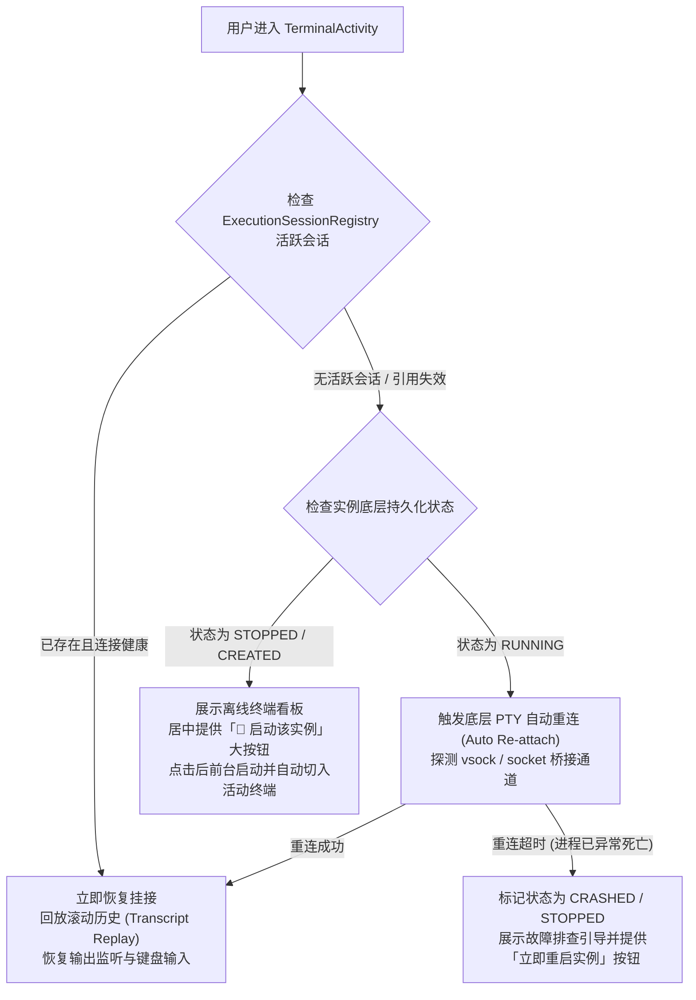

# 07: 后台终端PTY会话保持与二次进入无缝重连

**What to build:**  
彻底根除用户手机截图中所呈现的致命缺陷：二次进入已创建容器时屏幕直接打印 `[no live session for instance <uuid>]` 并卡死无法继续操作。重构终端会话后台驻留与重连机制，将虚拟机与 PTY 交互通道挂载至长效前台服务（`OrchestellaForegroundService`），使 Activity 的销毁与重建完全不影响后台 Shell 进程；当用户从任何入口（主页、通知栏、多任务切换）再次进入终端时，系统自动无缝 Re-attach 到现存活跃会话，瞬间回放历史屏幕缓冲区（Transcript Replay），恢复交互响应。

**Blocked by:** 工单06 (直接键入式交互终端与软键盘动态联动)

**Status:** ready-for-agent

---

## 需求背景与痛点

1. **阻断性缺陷（真机截图故障现场）**：
   - 截图中清晰显示：
     ```text
     Orchestella Studio terminal (1c283e7c-daa9-4192-974c-41f4cc139ea7)
     [no live session for instance 1c283e7c-daa9-4192-974c-41f4cc139ea7]
     ```
   - 终端输出这两行后直接 `return` 退出初始化逻辑，导致键盘无焦点、屏幕无响应、状态彻底僵死；
2. **生命周期绑定极其脆弱**：
   - 当前会话状态全部存储在静态单例 `ExecutionSessionRegistry` 的内存字典中；一旦用户按返回键退出 `TerminalActivity`，或应用切后台被系统暂停，会话句柄极易发生孤立丢失；
   - 当用户在主页点击「启动」或「进入终端」时，若底层进程在运行但内存引用丢失，系统根本没有任何自动重新探测、重新绑定或重新拉起会话的容灾重连机制。

---

## 详细功能规格与交互设计

### 1. 会话全生命周期与自动重连状态机
设计完备的重连与容灾策略：



### 2. 长效前台服务守护（Service-Backed PTY Daemon）
- **会话宿主迁移**：
  - 将所有活跃的 `ExecutionSession`、PTY 输入输出管道、终端输出环形缓冲区（`TerminalRingBuffer`）由原本轻量的 Activity 级别转移至 `OrchestellaForegroundService` 中托管；
  - 只要虚拟机还在运行，前台服务常驻并展示常驻通知，杜绝 Android LMK（低内存查杀）；
- **滚动历史无损回放（Transcript Replay）**：
  - 每个终端会话在后台维护最近 50,000 字符的 ANSI 屏幕快照；
  - 二次进入时，先清空屏幕，瞬间将缓冲区的历史输出写入终端画布并滚动到底部，用户感受不到任何“退出重进”的断裂感；
- **智能重连与故障恢复兜底**：
  - 彻底删除单纯打印 `[no live session]` 并直接 `return` 的自杀代码；
  - 若检测到底层进程异常终止，界面清晰给出原因（如退出码、内核日志片段），并直接在屏幕中央提供快捷操作按键：`[立即重启实例]`、`[返回实例列表]`。

---

## 架构演进与深模块改造设计

1. **重塑长效会话深模块 `PersistentTerminalSessionPool.java`**：
   - 纯 JVM 线程安全会话池，维护 `instanceId -> SessionHolder`；
   - 支持多读单写互斥锁，支持多个 UI 组件（或多次打开的 Activity）安全安全地 Attach/Detach，确保底层的 Socket 读写流永不竞争、永不提前关闭；
2. **实例状态协同感知契约 `InstanceSessionReconciler.java`**：
   - 提供 `ensureSessionAliveOrRecover(instanceId)` 纯 JVM 契约，测试用例可完整模拟断网、进程被杀、重连恢复三种场景；
3. **改造 `TerminalActivity.java` 接入**：
   - 在 `onCreate` 与 `onNewIntent` 中调用 `sessionPool.attach(instanceId, terminalCanvasView)`；
   - 在 `onStop` 中调用 `sessionPool.detach(instanceId)`，仅解除 View 绑定，后台继续监听收集日志。

---

## 验收标准 (Acceptance Criteria)

- [ ] **彻底消除 `[no live session]` 卡死白屏**：无论何时打开终端界面，绝不出现仅输出提示行然后无法操作的假死现象；
- [ ] **返回退出再进入无缝续接**：
  - 在终端中执行长耗时任务（如 `ping 127.0.0.1` 或大文件解包）；
  - 按系统返回键退回到手机桌面或应用主页；
  - 再次打开该实例终端，屏幕立即回显最新的持续输出，且输入功能完好如初；
- [ ] **已停止实例进入提供一键启动**：当实例处于关机状态进入终端时，呈现友好离线占位卡片并提供“一键开机并连接”按钮，点击后自动启动并直接进入 Shell；
- [ ] **纯 JVM 单元测试覆盖**：
  - `PersistentTerminalSessionPoolTest.java` 验证并发 Attach/Detach、环形缓冲区滚动与重连断言；
  - `InstanceSessionReconcilerTest.java` 覆盖崩溃重置与孤儿实例自动恢复；
  - 100% 绿灯通过。
