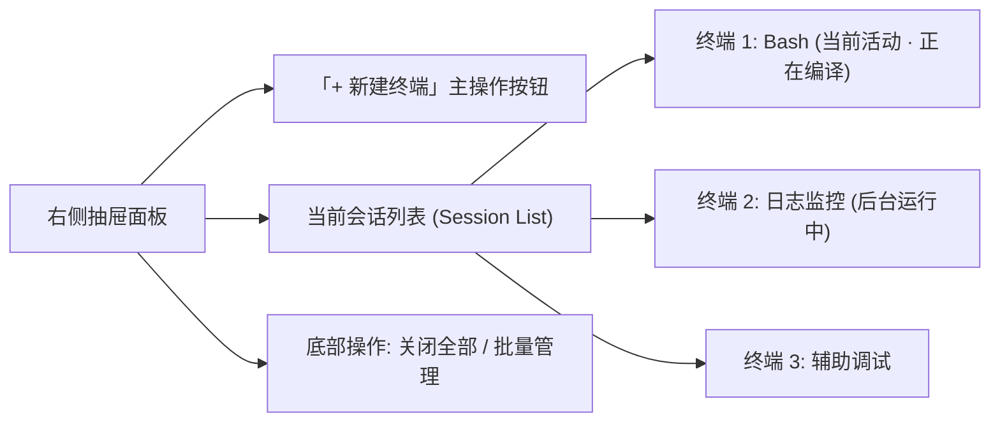

# 08: 多终端并发支持与右侧滑出抽屉管理

**What to build:**  
彻底打破“单个容器实例仅有一个终端会话”的严重生产力瓶颈。对标 Termius、JuiceSSH 与桌面级多标签页终端体验，在 Orchestella Studio 中为每个运行中容器赋予**多终端并发（Multi-Terminal Sessions）**能力。用户进入容器后，支持从屏幕右侧边缘滑出手势抽屉（Right Slide-out Drawer），实时查看当前容器的所有后台终端列表，一键新建终端、重命名标签、优雅关闭终端以及在多个终端之间毫秒级平滑切换，满足移动端一边后台编译、一边查看日志、一边编辑配置的高并发工作流。

**Blocked by:** 工单06 (直接键入式交互终端与软键盘动态联动), 工单07 (后台终端PTY会话保持与二次进入无缝重连)

**Status:** ready-for-agent

---

## 需求背景与痛点

1. **单终端受限，无法应对真实开发工作流**：
   - 目前在实例内执行长时间任务（如 `apt upgrade`、编译内核或启动本地 Web 调试服务）时，整个终端被完全占用；
   - 用户无法开辟新窗口去执行其他命令或查看文件，必须忍受漫长等待或繁琐地在宿主使用 ADB；
2. **用户明确提出交互规格**：
   - **每个容器都应该设置多个终端界面，也就是进入了一个实例，我可以右侧划出添加多个后台终端，用于处理不同的任务**。

---

## 详细功能规格与交互设计

### 1. 右侧滑出抽屉交互（Right Slide-out Drawer）
- **呼出机制**：
  - **边缘滑动（Edge Swipe）**：从屏幕右边缘向左滑动手势即可平滑拉出侧边抽屉；
  - **右上角快捷把手**：在终端界面右上角保留一个半透明轻量图标（双窗口 `◫` 形状徽标），点击同样可呼出抽屉；
- **抽屉内部面板构造**：

- **会话条目（Session Item）交互**：
  - **状态指示器**：绿点表示有输出活动，灰点表示空闲等待；
  - **会话标题与重命名**：默认命名为 `终端 1`、`终端 2`，长按可自定义别名（如 `Nginx 服务`、`Git 编译`）；
  - **点击切换**：点击任意条目，抽屉自动收起，主屏幕瞬间切换至该会话的画布与光标状态；
  - **关闭会话（Close Button）**：条目右侧带有 `✕` 按钮，点击提示确认后向该 PTY 发送 `SIGHUP` 信号并释放会话资源。

### 2. 底层多 PTY 虚拟终端通信管道
- **Guest 侧多 PTY 派生**：
  - Guest Agent（`droidlayer-guest-agent`）扩展多会话通道协议（`SessionChannelMultiplexer`）；
  - 当 Android 端请求新建终端时，Guest Agent 调用 Linux 原生 `openpty()` 创建一对新的 Master/Slave 伪终端设备文件；
  - 启动用户指定的登录 Shell（如 `/bin/bash`），并将 stdin/stdout/stderr 绑定到该 Slave PTY；
- **Android 端多会话状态机管理**：
  - 每个会话维护独立的：
    - `sessionId`（自增编号）；
    - `TerminalRingBuffer`（独立的屏幕输出快照）；
    - 光标位置与 IME 输入状态；
  - 切换会话时，底层各 PTY 均在后台持续运行，输出持续流入对应的 Buffer，切回时即刻重绘最新内容。

---

## 架构演进与深模块改造设计

1. **核心纯 JVM 多会话聚合器 `MultiTerminalSessionManager.java`**：
   - 维护 `Map<String, TerminalSessionInstance>`；
   - 核心 API：
     - `createSession(instanceId, title): TerminalSessionInstance`
     - `switchSession(instanceId, sessionId)`
     - `closeSession(instanceId, sessionId)`
     - `getActiveSession(instanceId): TerminalSessionInstance`
2. **纯 JVM 协议多路复用契约 `PtyMultiplexerProtocol.java`**：
   - 定义 Android 宿主与 Linux 虚拟机之间的多路数据帧协议（`FRAME_TYPE_DATA`、`FRAME_TYPE_RESIZE`、`FRAME_TYPE_CLOSE`）；
3. **单元测试矩阵覆盖**：
   - 验证并发创建 5 个独立终端会话并同时写入数据，确保数据流绝不发生跨会话串扰（Cross-session Bleed）。

---

## 验收标准 (Acceptance Criteria)

- [ ] **右侧手势顺畅呼出抽屉**：在终端任意页面从右边缘向左滑，能丝滑展开多终端管理抽屉，不卡顿、不抢占按键焦点；
- [ ] **支持创建多个独立终端**：点击抽屉中的「+ 新建终端」，能成功开辟全新的独立 Shell，并在抽屉中新增标签项；
- [ ] **会话无缝切换与后台并发**：
  - 在终端 1 中执行长命令（如 `top` 或大循环 `while true; do date; sleep 1; done`）；
  - 切换到终端 2 执行其他命令；
  - 再次切换回终端 1，命令仍在平稳运行且画面持续更新；
- [ ] **独立关闭与资源回收**：在抽屉中点击某个终端的关闭按钮，系统能优雅杀死对应的底层子进程并从列表中移除该项，不影响其他活跃终端；
- [ ] **纯 JVM 单元测试覆盖**：
  - `MultiTerminalSessionManagerTest.java` 验证多会话创建、切换、边界限制与并发写入隔离；
  - 100% 绿灯通过。
