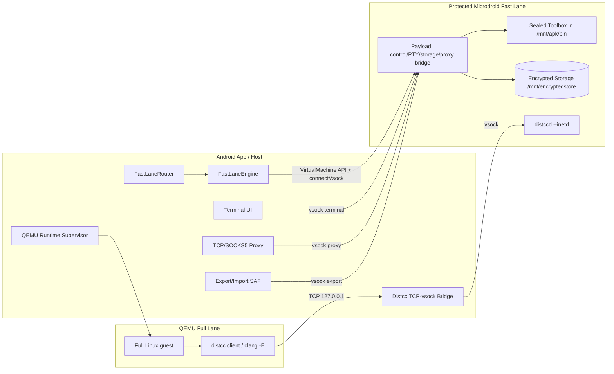
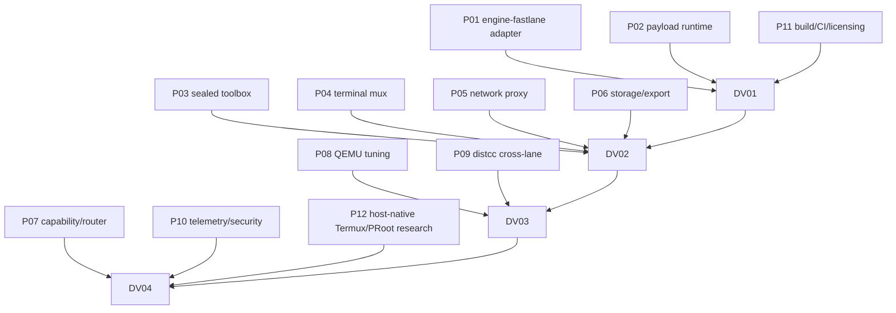

# Fast Lane × QEMU 交叉优化 Spec（2026-10-21）

> 状态：可实现规格；ACR-03 未决前不对外声明新 Runtime 类别，不进入默认发布。
> 目标：在无 Root、protected-only 设备上，让硬件 CPU 充分参与 Linux 工作负载；QEMU 继续承担完整 Linux 契约。
> 非目标：在 protected 内运行完整发行版 VM；绕过 pvmfw/SELinux；把 Fast Lane 叫 Full Linux。
> 基准：`main 4b075c93`；参考调研见 `docs/research/2026-10-21-cross-lane-reference-survey.md`。

---

## 1. 目标与非目标

### 1.1 目标

1. 在 protected-only 设备上提供一个**硬件 vCPU 加速的密封 Linux 工作区**（Fast Lane）：
   - shell + 常用工具 + 至少一个编译器；
   - 持久 encrypted home；
   - 终端通过 vsock；
   - 宿主代理 TCP；
   - 不依赖 Root/unlock/自定义 pvmfw。
2. 把 QEMU Full Lane 的 CPU 密集编译显式 offload 到 Fast Lane：
   - QEMU guest 保持完整发行版；
   - 通过 `distcc`/`distccd --inetd` 跨车道编译；
   - 不透明拦截 syscall，不破坏 POSIX 语义。
3. 用实测数据调 QEMU TCG（CPU model、tb-size、iothread、aio、discard、ZRAM 等），抬高 Full Lane 的地板。
4. 所有能力通过能力矩阵和 typed failure 暴露；不静默降级、不虚报。

### 1.2 非目标

- protected 自定义 kernel/完整发行版 VM（pvmfw 签名 + label + 网络硬门）。
- protected 内 chroot/proot/mount/overlayfs/FUSE 绕过 noexec。
- protected 内原生 `eth0`/NAT/DNS/端口转发。
- protected 内 GPU/3D/音频/USB。
- protected 内 systemd/PID1/Docker/Podman。
- 把 Host Termux/PRoot 的性能数字冒充 protected pVM 的数字。
- 在 ACR-03 通过前把 Fast Lane 设为默认或写进发布说明。

---

## 2. Runtime 类别与能力矩阵

### 2.1 类别

| 类别 | 执行策略 | 状态 |
| --- | --- | --- |
| Full Linux Runtime | QEMU（软件虚拟化）；未来 non-protected AVF | 现有承诺，当前唯一完整 Linux 交付 |
| Accelerated Linux Workspace（工作名） | protected Microdroid + 应用 payload | 新增，ACR-03 未决；实验开关 |
| Userspace Compatibility Runtime | PRoot/Termux 宿主侧 | 现有类别；不作为 Fast Lane 核心 |

### 2.2 Fast Lane 能力矩阵（v1 目标）

| 能力 | v1 | 说明 |
| --- | --- | --- |
| terminal | yes | PTY + vsock 多路复用 |
| hardwareCpu | yes | protected pVM vCPU；1 vCPU 起步，MATCH_HOST 待验 |
| persistentEncryptedStorage | yes | `/mnt/encryptedstore`；host 不可解密 |
| sealedToolbox | yes | APK `bin/` 内 Termux/静态工具；无 native 包安装 |
| tcpProxy | yes | 宿主 SOCKS5/HTTP CONNECT；默认 loopback |
| exportImport | yes | guest 侧 tar ↔ SAF |
| distccOffload | yes（实验） | QEMU guest → 宿主 TCP → vsock → distccd --inetd |
| display | terminal only | VNC/X11 不在 v1；无 GPU |
| nativeNetwork | no | 无 `eth0`/NAT/DNS/端口转发 |
| nativePackageInstall | no | 不能从 encrypted storage 执行新二进制 |
| docker/systemd | no | 无 PID1/namespace/服务管理承诺 |
| gpu/audio/usb | no | 不声明 |

### 2.3 Full Lane 能力矩阵

沿用现有 `FullLinuxContract.CapabilityMatrix`：terminal、bridge、GPU/display（按实际接线）、native network、端口转发、共享目录、systemd/Docker（guest 能力）。QEMU 是唯一完整 Linux 路径。

---

## 3. 架构



---

## 4. 模块与接口

### 4.1 `runtime/engine-fastlane`（宿主）

职责：

- 通过反射访问 `VirtualMachineConfig`/`VirtualMachineManager`/`VirtualMachine`；
- 构造 protected app payload（`setPayloadBinaryName`、`setProtectedVm(true)`、`setMemoryBytes`、`setCpuTopology`、`setEncryptedStorageBytes`、`setDebugLevel`）；
- create/run/stop/close；退出分类；
- 提供 `connectVsock(port)` 的字节流；
- 不直接依赖 Android UI；纯 Java + fake SDK 可测。

建议接口：

```java
interface FastLaneVirtualMachineApi {
    FastLaneHandle start(FastLaneLaunchSpec spec) throws FastLaneException;
    FastLaneChannel connect(FastLaneHandle handle, int port) throws FastLaneException;
}
interface FastLaneHandle {
    String instanceId();
    int status();
    void stop(long graceMs);
    void close();
}
```

`FastLaneLaunchSpec`：payload binary name、memory MB、vCPU topology、encrypted storage bytes、debug level、control/terminal/proxy/distcc vsock ports、toolbox manifest hash。

失败分类见 §6。

### 4.2 `fastlane-payload`（guest C/C++）

职责：

- `AVmPayload_main()`；
- 读取 `/mnt/apk`、`/mnt/encryptedstore`；
- 启动 control vsock server、PTY manager、proxy bridge、export handler、distcc bridge；
- fork/exec 工具（从 `/mnt/apk/bin/`）；
- 不假定 TCP/chroot/mount/systemd；
- 以 length-prefixed 二进制协议通信；协议版本化。

关键点：

- `distccd --inetd` 的 stdin/stdout 桥，避免 TCP；
- PTY 使用 `openpty`/`posix_openpt`；`devpts` 允许；
- 子进程环境：`PATH=/mnt/apk/bin:/mnt/apk/bin/usr/bin`、`HOME=/mnt/encryptedstore/home`、`TMPDIR=/mnt/encryptedstore/tmp`、`LD_LIBRARY_PATH` 按 toolbox manifest；
- 不把 token/源码/按键写入日志。

### 4.3 Sealed Toolbox（APK `bin/`）

- 候选 A：Termux bootstrap（Bionic/prefix）；候选 B：静态 busybox + 工具。
- 工具清单：name、version、SHA256、license、source URL、target ABI、依赖。
- APK 根 `bin/` 注入：必须发生在签名前；验证 `zipalign -P 16`、安装/更新、`bin/` 条目存在。
- 只读；数据写 encrypted storage。
- 不把 GPL 工具/补丁直接复制而不履行对应源码义务。

### 4.4 Terminal 多路复用

- 单 vsock 控制连接 + 每 PTY 一个数据连接，或单连接多路复用（推荐后者，减少 vsock 连接数）。
- 帧：`magic | version | type | sessionId | length | payload`。
- 命令：`OPEN_PTY`、`RESIZE`、`SIGNAL`、`CLOSE`、`EOF`、`PING`、`METRICS`。
- 流控：窗口/credit；避免终端输出淹没 vsock。
- 关闭语义：host close → 发送 `CLOSE`；guest 关闭 PTY → `EOF`；VM stop → 所有 session 终止。

### 4.5 网络代理

- 宿主：SOCKS5（RFC 1928）+ HTTP CONNECT；只绑 `127.0.0.1`；每连接超时/上限。
- guest：payload 在 vsock 上提供 proxy bridge；工具使用 `ALL_PROXY`/`http_proxy`/`git http.proxy`。
- DNS：SOCKS5 域名交给宿主解析；不承诺 ICMP/raw socket/UDP 广播。
- 不把代理端口默认暴露 LAN；LAN 暴露另做产品决策。
- 失败分类：`PROXY_CONNECT_FAILED`、`PROXY_DNS_FAILED`、`PROXY_TIMEOUT`。

### 4.6 存储/导出

- `/mnt/encryptedstore/home`、`/workspace`、`/tmp`、`/cache`；
- 首次运行初始化目录 + 版本 marker；
- 导出：guest 侧 tar（可选 gzip）→ vsock → 宿主 SAF；导入反向；
- manifest：路径、大小、SHA256、时间；不导出 token/密钥；
- 删除 VM = 数据不可恢复；UI 二次确认；
- host 不落 encrypted storage 明文。

### 4.7 Distcc 交叉编译

- QEMU guest：`CC=distcc clang`；本地 `clang -E`；连接宿主 `127.0.0.1:<port>`。
- 宿主：TCP listener → 每连接一条 vsock 连接 → payload。
- payload：accept vsock；fork/exec `distccd --inetd`；把 vsock 字节流与 child stdin/stdout 双向 splice。
- 工具链：v1 只支持 clang；双方同版本/同 target/flags；C 优先，C++ 单独验证。
- 并发：`distcc -j` / 宿主连接上限 / payload job 上限；1 vCPU 起步。
- 回退：服务器不可达 → distcc 本地编译；不使构建失败。
- 失败分类：`DISTCC_BRIDGE_FAILED`、`DISTCC_PROTOCOL_FAILED`、`DISTCC_COMPILER_MISMATCH`。

### 4.8 Capability/Router

- `FastLaneCapabilities`：数据类，唯一事实源；
- `FastLaneRouter.decide(deviceFacts, workload, instanceRequirements)` → `FULL` / `FAST` / `UNSUPPORTED` + reason；
- 规则：
  - 需要 systemd/Docker/native network/GPU/package install → FULL；
  - protected 可用 + 纯终端/编译/密封工具 → FAST；
  - 不确定 → FULL（保守）；
  - Fast Lane 不可用 → FULL + 明确 reason；
  - 不静默切换。
- UI 只消费能力矩阵，不写策略分支。

### 4.9 Telemetry/Security

- 事件：`FASTLANE_REQUESTED`、`VM_CREATED`、`PAYLOAD_READY`、`TERMINAL_READY`、`PROXY_READY`、`EXPORT_READY`、`DISTCC_READY`、`STOP_REQUESTED`、`STOP_CONFIRMED`、`STOP_UNCONFIRMED`。
- 指标：启动耗时、payload ready、终端字节、代理字节、distcc job 数/耗时/失败、CPU/RSS。
- 脱敏：不记录 token、口令、按键正文、源码正文、完整路径；只记录类型/计数/耗时。
- debug level：生产 `NONE`；FULL 只用于 QA，且明确削弱保护。
- 数据删除/导出：见 §4.6。

### 4.10 QEMU Tuning

- 扩展 `QemuTuning`：CPU model、tb-size（MiB，修正命名）、iothread、num-queues、aio、discard、detect-zeroes、vCPU；`cache=unsafe` 永不接受。
- 默认值不变；单变量实验；n≥10、控温、同设备/镜像/资源。
- 至少一个 workload 显著改善且无 >5% 回归才改默认。
- 详见参考调研 §10。

---

## 5. 数据流

### 5.1 Fast Lane 启动

1. Router 选择 FAST；
2. Engine 构造 config，create/run；
3. Payload 初始化，读 toolbox manifest，初始化 encrypted storage；
4. Payload 在 control/terminal/proxy/distcc 端口 listen；
5. Host `connectVsock`，握手（版本、token、能力）；
6. UI 显示 Fast Lane 徽章 + 限制。

### 5.2 终端

Host terminal UI → vsock control `OPEN_PTY` → payload fork shell → PTY 数据 → vsock → UI。

### 5.3 代理

Guest tool → `ALL_PROXY` → payload proxy bridge → vsock → host SOCKS5 → target。

### 5.4 Distcc

QEMU guest `make -j` → `distcc clang` → 宿主 TCP → vsock → payload → `distccd --inetd` → clang → `.o` 返回。

### 5.5 导出

Guest `tar` → vsock export channel → host SAF → 文件；导入反向。

---

## 6. 失败分类

| 分类 | 含义 | UI/回退 |
| --- | --- | --- |
| `PROTECTED_UNAVAILABLE` | 设备不声明 protected | 只提供 FULL |
| `HIDDEN_API_BLOCKED` | AVF 反射被拦 | FULL + 原因；不反复重试 |
| `PERMISSION_DENIED` | MANAGE/USE_CUSTOM 未授权 | 引导授权；不绕过 |
| `PAYLOAD_VERIFY_FAILED` | APK/idsig 校验失败 | 停 Fast Lane；检查签名/构建 |
| `VSOCK_FAILED` | connect/listen 失败 | 重试 bounded；仍失败停 |
| `STORAGE_FAILED` | encrypted storage 创建/挂载失败 | 停 Fast Lane；不降级到 shell 盘 |
| `TOOLBOX_EXEC_FAILED` | `bin/` 工具不可执行 | 降到静态工具/停 |
| `TERMINAL_PROTOCOL_FAILED` | 协议/PTY 失败 | 重连；仍失败停 |
| `PROXY_*` | 代理连接/DNS/超时 | 提示；可离线使用 |
| `DISTCC_*` | 编译桥/编译器不匹配 | distcc 本地回退；不失败构建 |
| `STOP_UNCONFIRMED` | 停止不收敛 | 保持 RUNNING/lease；禁止重启 |
| `DEVICE_UNSUPPORTED` | 设备/ROM 不满足 | FULL；不宣称支持 |

---

## 7. 测试策略

### 7.1 并行零设备（所有 P 票）

必须能在无 adb/无设备环境完成：

- JVM 单元测试（fake AVF SDK、纯函数 router、协议编解码）；
- 宿主进程测试（本地 TCP/Unix socket 代理、vsock 模拟流、distcc 假服务器）；
- 构建测试（payload `.so`、APK `bin/` 注入、`zipalign -P 16`、符号/许可证检查）；
- 静态分析（AOSP/SELinux 假设、无 TCP/chroot 依赖）；
- 不把 fake 结果写成真机通过。

### 7.2 串行真机（所有 P 票完成后）

- **DV-01**：protected payload create/run/vsock/encrypted storage/stop；
- **DV-02**：sealed toolbox 执行、终端、代理、导出；
- **DV-03**：distcc 端到端 + QEMU tuning A/B；
- **DV-04**：产品端到端/回归/发布门。

串行原因：真机窗口唯一、需要初态/签名/盘/事务保护；并行设备操作会互相污染。

---

## 8. 工单图



### 8.1 并行零设备票

| 票 | 模块 | 主交付 | 零设备验收 |
| --- | --- | --- | --- |
| P01 | engine-fastlane | 反射适配器、launch spec、session、stop 分类 | fake SDK 生命周期/失败分类/配置字段 |
| P02 | payload runtime | `AVmPayload_main`、vsock control、PTY、storage、bridge | NDK 构建、符号、协议单测、host 模拟流 |
| P03 | sealed toolbox | Termux/static toolbox、`bin/` 注入、manifest | APK zip 检查、16KB、许可证、工具可执行位 |
| P04 | terminal mux | 帧协议、多 PTY、resize/EOF/流控 | JVM 编解码/生命周期/压力测试 |
| P05 | network proxy | SOCKS5/HTTP CONNECT 宿主代理 + vsock 桥 | 本地 TCP 目标、DNS/TLS/并发/超时 |
| P06 | storage/export | encrypted home 布局、tar 导出/导入、SAF | 流式 tar/hash/失败回滚 |
| P07 | capability/router | 新 runtime 类别、能力矩阵、Full/Fast/Auto | 纯函数 truth table |
| P08 | QEMU tuning | CPU/tb-size/iothread/aio/discard 参数 | argv 快照、默认不变、无 unsafe |
| P09 | distcc | TCP↔vsock↔`distccd --inetd` | 假 distcc 客户端/服务器、字节桥、并发 |
| P10 | telemetry/security | 事件/指标/脱敏/删除 | schema、红action、顺序 |
| P11 | build/CI/licensing | payload/toolbox 构建、CI、NOTICE/SBOM | 构建绿、16KB、许可证清单 |
| P12 | host-native research | Termux/glibc/PRoot 兜底评估 | 报告 + 决策建议（无产品承诺） |

### 8.2 串行真机票

| 票 | 依赖 | 内容 |
| --- | --- | --- |
| DV-01 | P01/P02/P03/P04/P06/P07/P10/P11 | protected payload create/run/vsock/storage/stop；20 次启停 |
| DV-02 | DV-01 + P03/P04/P05/P06 | Termux/static toolbox 执行、终端、代理、导出 |
| DV-03 | DV-01/02 + P08/P09 | distcc 真实编译 + QEMU A/B（n≥10） |
| DV-04 | 全部 | 产品端到端、UI、ACR-03、P0 发布门 |

---

## 9. 验收指标

### 9.1 Fast Lane 平台

- payload create/run/stop；stop CONFIRMED；20 次无孤儿；
- encrypted storage 跨 stop/start/设备重启；host 不可读；
- vsock control/terminal 双向；失败 typed；
- `setProtectedVm(false)` 明确拒绝；custom image 拒绝可归因。

### 9.2 Fast Lane 产品

- shell + 至少一个编译器；数据持久；终端稳定；
- 边界测试有真实结论（exec-from-APK 通过；encrypted exec/chroot/proot/mount/memfd/JIT 允许/拒绝）；
- TCP 代理 curl/git/pure-Python pip；DNS/TLS；
- 导出/导入 host 不落明文；
- APK 体积预算明确。

### 9.3 交叉优化

- distcc 真实编译正确（`.o` 可链接/运行）；端到端 ≥1.5x 才产品化；
- QEMU tuning 至少一个 workload 显著改善且无 >5% 回归；
- Fast Lane 至少一个 CPU/编译 workload 对 QEMU ≥2x；
- 所有样本 n≥10、控温、保留失败样本。

### 9.4 发布

- ACR-03 通过；能力矩阵不虚报；实验开关默认关闭；
- P0 签名/停止/CI/输入仍优先；Fast Lane 不降低发布门。

---

## 10. 停止条件

- DV-01 `rejected_at_stage`/`blocked_external`/`stop_unconfirmed`：Fast Lane 停止或先修生命周期。
- P03 无法从 `/mnt/apk/bin` 执行任何工具：降级 native payload 或停止。
- P09 distcc 编译器不匹配/协议失败且无合法修复：停止 distcc，保留选道/终端。
- P05 代理无法支持 DNS/TLS：Fast Lane 只做离线/终端。
- P08 无显著收益或回归：保留 QEMU 默认。
- ACR-03 要求 Full Linux：Fast Lane 停止；QEMU-only。
- 任何门需要 Root/unlock/pvmfw/SELinux 修改：立即停止。

---

## 11. 待裁定

1. ACR-03：是否接受 Accelerated Linux Workspace 为第三类，及“无 native 包管理/无原生网络/无 GPU/无 Docker/systemd”的能力矩阵。
2. Fast Lane v1 工具集：Termux bootstrap 还是静态工具；APK 体积预算。
3. Distcc v1 范围：只 C/clang；是否接受 `CC=distcc clang` 的显式配置。
4. Host Termux/PRoot 兜底是否作为产品能力，还是仅研究/内部对照。
5. 串行真机窗口：DV-01/02/03 的顺序与设备唯一操作者。

---

报告人：CodeBuddy / DeepSeek-V4.1-Flash ｜ 日期：2026-10-21 ｜ 本 spec 未运行设备/构建；所有性能与真机结论待验证。
