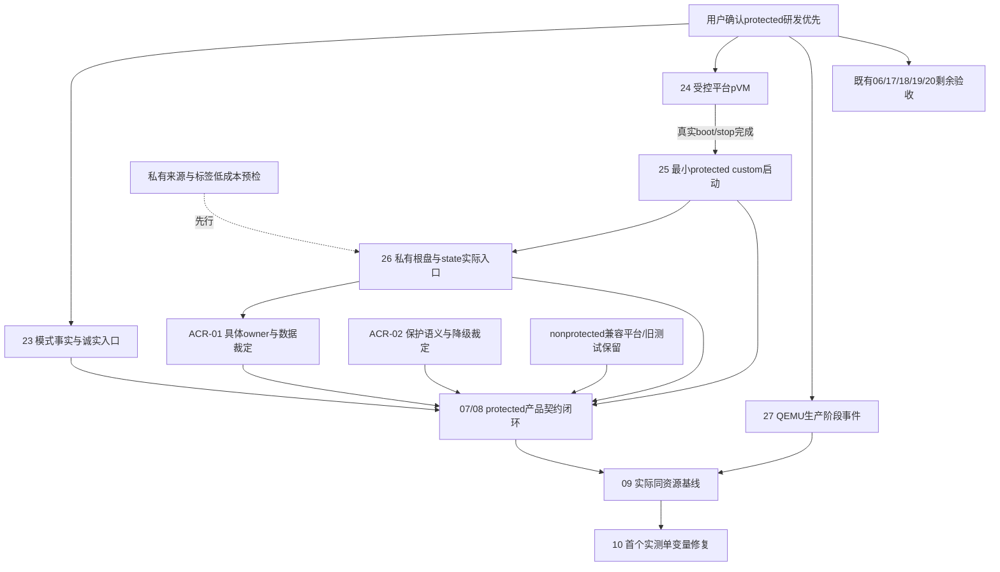

# Orchestella 近期优化方案：Protected 优先验证、双模式兼容与可靠交付

> **优先级说明（2026-10-18）**：本文的 Protected 专项门、证据要求和停止条件仍然有效，但“Protected 优先”的总体排序已被[下一阶段优化方案](next-optimization-plan-20261018.zh-CN.md)重排为 **QEMU 主线、AVF 时间盒研究**。两份文档冲突时，以 2026-10-18 方案为准；本文保留作 protected 专项依据。

- 日期：2026-10-17。Owner：Codex主协调。类型：研发优先级、分阶段执行与验收方案，非生产实现报告。
- 用户已确认的方向：protected VM优先研发，non-protected持续兼容，QEMU保证当前完整Linux可用；本轮要求据现况与大量资料调整近期方案并允许文档。
- 事实基线：唯一主仓Orchestella_dev，main@428860ad9a1cb335f8be78c157b2ff57faf2a6da，dirty0.5.3/code503、minSdk26/targetSdk36；未提交实现必须保留。单main/单worktree，规划前git diff --check通过。
- 活动tracker继续 `.scratch/orchestella-avf-shizuku/`。旧22票/历史验收不改绿，21无文件不补造；本次新增23–27及ACR-02，共28文件。仅方案与tracker文档更新，不改源码、accepted ADR/CONTEXT或设备。
- 本回合外部证据：开发根 `Orchestella/artifacts/protected-avf-plan/20261017/`（下称P），含明确文档before/after、来源指针、只读审查和preservation，长期保全不清理。计划是后续执行依据，任务是否完成仍由原票证据决定。

## 1. 决策摘要与目标

近期目标是验证“当前protected-only平台能否在无Root和既有数据保护边界内，运行本项目所需的完整Linux”，同时持续收紧已交付路径的可靠性。**Protected是优先验证的研发方向，不是已证可推广的默认能力。**

保持的产品目标：完整Linux拥有Guest kernel和真实init/systemd能力；无需Root；实例/凭据/根盘归用户且App私有；单运行实例、单控制reader和token；默认loopback；既有QEMU用户升级不失盘、不失身份。non-protected不是淘汰或仅等待未来的方案，兼容平台一旦可用仍持续验证。

推广覆盖率和non-protected设备增长属于待验证假设。当前只有具体设备/ROM的观测，没有可信社区占比数据。本轮既不因新机营销视频要求购机，也不把当前芯片号变成永久支持黑名单。

最优投入原则：每一阶段先回答最可能否决产品化的条件；QEMU稳定性轨道独立推进；只优化有数据的成本，不把protected研究与内核、GPU、桌面、存储格式重构同时展开。完整Linux、无Root或私有盘如必须改变，提交具体ACR，不用实验性成功暗中降格。

## 2. 已有事实、未验范围与资料依据

| 证据 | 当前可以相信的结论 | 本计划不允许推导的结论 |
| --- | --- | --- |
| 最新503编排/原件 | App747/98、零失败错误跳过；lint0Error/748Warning；隔离.phase5八框架场景，Debian QEMU systemd/ready、三停止/重开标记限定通过 | 所有故障/事务/OEM/签名升级通过，或这些是AVF结果 |
| 本机重检 | HONOR MEY-AN00/SM8735/API36，AVF feature、Gunyah驱动/节点，vm info仅protected；无/dev/kvm | 芯片硅层不能non-protected、后端必然pKVM、protected实际boot通过 |
| A15/A16 Custom VM/guide | 教程Debian/U-Boot为protected:false；平台CLI、普通App、系统Terminal有不同前提 | 照搬JSON即可用protected，所有字段都被本ROM接受 |
| A16 protected raw检查 | 参考实现拒绝典型app_data_file的kernel/initrd/整盘；FD转交不改标签；实际固件信任有多种分支 | Rootless App私有盘已解决、所有pVM必须OEM签名，或HONOR完全等于固定AOSP实现 |
| ADB/vsock与两参考App | adbd可为已启动Guest转发；App owning-FD接口/高位port不同；Podroid/TerminalAppPlus仍要求non-protected | 两grant/无线ADB创建了新硬件能力，SSH通就等于NAT/FullLinux |
| 离线recorder22 | 127工具回归与有限结构/时钟模型完成 | Android生产阶段接线、真实kernel/Guest/stop receipt已齐 |

直接依据，后续执行以这些canonical为入口，不重新复制全部原文：

- [设备重新检测](../../research/2026-10-17-avf-device-recheck.md)。
- [AVF/Custom Linux路线详细研究](../../research/2026-10-17-avf-custom-linux-route-study.md)：完整教程、discussion主帖+3评论+1回复，固定AOSP权限/label/firmware、ADB/sepolicy、Root Gunyah、参考App和官方营销核验。
- [最新503编排与限定设备验收](avf-shizuku-device-20261016.zh-CN.md)。
- [当前工单与旧证据索引](../../../.scratch/orchestella-avf-shizuku/map.md)，以及本回合scope/spec增补。

研究原文/完整revision/许可/下载失败在 `Orchestella/artifacts/avf-route-research/20261017/`。本轮方案复用资料，没有新增联网、下载镜像、clone或设备查询。

## 3. 三条工作轨道与顺序

### 3.1 可靠交付轨道：当前可用版本继续变稳

复用既有06/11/12/14/15及17–20验收缺口，不重复开“退出修复/输入修复/草稿修复”大票。

优先顺序：

1. **实例退出与冷恢复**：实际非零退出/wait异常、EOF先于owner退出、旧代晚到/stop归属、通知失败/Activity重入、App死亡后的真实冷恢复。先新QA根盘，无活包事务，不杀用户工作实例。已有三种QEMU停机/标记保留是对照，不重列未做。
2. **真实创建事务跨重建**：转屏/uiMode、Activity重建/进程死亡发生在下载/prepare/create期间时，只允许单次admission/唯一写盘；轻量creating marker和模型green不能代事务。不能为此顺手引入新长期任务owner，必要时另开决策。
3. **owned日志失败/recovery**：native失败一次摘要/操作码、无journal救援可见、console按event计数及编辑体验；只改变自有report/unit路由，不屏蔽audit/用户文本。
4. **授权与输入外部门**：固定当前user/QA的完整软件grant/readback/同session restore、拒绝/撤回/death/reconnect，旧前提/部分成功清楚；实体键盘/真实OEM IME/焦点/锁屏和物理配置变化按设备可用性完成。ADB对照不写成App内UX成功。

原产品code300与新签名不符、其他user数据已存在，原包升级兼容仍开；沿隔离QA验证不等用户升级完成，禁止卸载清数据解冲突。诊断/样本不导出凭据或真实盘。

### 3.2 Protected研发轨道：最早门逐步证明

研发优先级按如下顺序，**生命周期控制与数据可行性同样是早期条件**：

| 阶段 | 交付与真实通过门 | 不满足时的处理 |
| --- | --- | --- |
| G0 可信能力状态 | protected/non-protected/unknown分别按actor、来源、ROM/APEX、时间标记；平台声明与实际Guest分层；无隐式VM探测 | unknown如实展示；禁止把品牌提示当硅层能力或继续反复grant |
| G1 受控平台pVM | 独立QA控制器先具备总deadline/单flight/真实底层停止确认，再用系统可信最小payload完成create/start/固定挑战/高位vsock/正常stop与FD收尾 | 先修控制器或确认平台拒绝层；不直接运行无期限vm run-microdroid后杀host adb当停止 |
| G2 最小custom启动 | 合法来源、锁定hash的极小kernel/initrd，关闭网络/共享/GPU/GDB；固定串口或类型化标记+退出，记录firmware/label/API失败层 | 明确该ROM最早拒绝；不改全局策略、不换Root VMM让测试绿、不扩大桌面实验 |
| G3 私有数据/状态 | 尽早验证项目私有raw盘FD、kernel/initrd来源、合法VM state/instance identity和实际owner；最小合成盘，无用户数据；只读检查/来源规则分析可与G1并行 | 若只能shell测试盘/新增额外state/暴露embedded秘密，先进入ACR-01，不public-copy用户盘或改分区名绕门 |
| G4 产品契约闭环 | ACR-01及ACR-02适用部分裁定后，连接现07/08：同一实例认证/终端/resize/网络/服务ready/有界停止、death、盘lease与冷恢复 | Microdroid或自定义initramfs成功只留原型能力，不叫FullLinux产品完成 |
| G5 性能/推广 | 07真实闭环、生产recorder与正常stop已证后由09/10同资源冷热测量，再选单变量优化；支持矩阵绑定具体ROM和实际模式 | 无真实样本不报收益；不根据protected-only人口假设直接推广 |

G2与G3是产品化证据门，不要求在同一进程/同一个实验中同时首次跑通。G3先做低成本来源/元数据反证：若参考规则与ROM行为已明确冲突，提前冻结完整盘/GUI投入；kernel启动等独立问题可继续限定研究。真实create接口消费盘FD/跨重启所有权最终仍须设备证明。

### 3.3 Non-protected兼容轨道：保留成本可控、条件到齐就验证

- 保留当前adapter和旧20个AVF JavaExec、跨策略kernel/raw盘、失败与配置保真回归；不把实验protected逻辑直接覆盖其默认配置。
- 当前手机明确不声明non-protected，不用循环grant/启动来验证同一事实；声明/API与硬件缺失分开。
- 兼容平台不限最新骁龙：只有“型号+ROM/APEX+授权成本+模式+实际Guest/stop”齐备才入已验矩阵。没有设备时维持fixture/API源码兼容，标not-tested，不虚填通过，也不要求本轮购机。
- 若现原App持有VM的API兼容层足够，先做该最小方案评估；引入本进程非SDK依赖也要版本/targetSDK/来源/兼容审查，不默认等于可分发，且不能解决模式/label/firmware门。不要为了一个接口可见性问题先把全部VMowner迁进UserService。

## 4. 接下来两轮迭代的可执行frontier

这是按验收门组织的迭代，不承诺固定日历工期。缺设备/外设不阻塞合成fixture、既有产品验收或文档裁定。

### 迭代A：能力诚实、控制可收尾、稳定路径可用

| 任务 | Owner/接缝 | 交付/验收 | 依赖 |
| --- | --- | --- | --- |
| 新[模式事实与诚实入口](../../../.scratch/orchestella-avf-shizuku/issues/23-mode-capability-diagnostics.md) | capability+App授权同owner；facts/evaluator/页面公共状态 | unknown/模式/actor分开，两grant不抹平台限制；不隐式创建VM、不新增保护需求策略 | 无新架构依赖 |
| 新[受控protected平台验证](../../../.scratch/orchestella-avf-shizuku/issues/24-bounded-protected-platform-probe.md) | prototype owner；controller/public CLI或typed API，设备主代理执行 | 离线先证明deadline/底层flight/close；后才真实pVM挑战与正常stop | 控制fixture无外门；设备步骤需当前设备与明确QA窗口 |
| 新[生产启动阶段与停止来源](../../../.scratch/orchestella-avf-shizuku/issues/27-production-stage-recorder.md) | owner事件组件；先实际QEMU用户启动路径/原reader | 关闭零采集，版本化有界本地事件，缺信号unknown，synthetic不能写device；不记录正文/secret | 22离线已完成；与各模块owner写锁协调，无protected前置 |
| 既有[会话监督](../../../.scratch/orchestella-avf-shizuku/issues/17-session-exit-supervision-fix.md)/[草稿事务](../../../.scratch/orchestella-avf-shizuku/issues/20-wizard-saved-draft.md)缺口 | lifecycle与Androidowner | QEMU故障/通知/冷恢复及真实创建事务验证；red成立后原票增补局部fix，不再造同名修复 | 新QA数据；设备/事务控制 |
| 新[保护语义与证据口径裁定](../../../.scratch/orchestella-avf-shizuku/issues/ACR-02-protection-semantics.md) | 产品/架构用户；主协调证据包 | 当前优先级已确认；未来保护意图/降级、术语与ADR事实冲突具体裁定 | 无需等全部prototype才讨论语义；不阻塞上述无架构变更任务 |

迭代A出口：新状态/事件/控制器各有行为red→green与独立review；至少固定的QEMU验收缺口有可复查结果；G1得到真实成功/准确拒绝/设备阻塞之一，控制器不能收敛时维持blocked。数据/模式未知不能用文案变绿。

### 迭代B：回答protected能否保持FullLinux产品契约

- 先新[最小protected custom启动](../../../.scratch/orchestella-avf-shizuku/issues/25-protected-custom-boot-feasibility.md)，再以新[私有根盘与持久状态可行性](../../../.scratch/orchestella-avf-shizuku/issues/26-protected-private-data-feasibility.md)完成真实FD/state门；来源/标签静态检查提前准备，不等“大桌面已启动”才发现私有盘不能用。
- ACR-01依据具体owner、namespace、kernel/initrd/root/state能力及秘密可读边界裁定；与ACR-02的保护意图/降级语义不同，不用一个“允许Shizuku”代替所有选择。
- 两门可交付且决策闭合后才在07/08增加protected可实现契约；原non-protected分支及旧配置保真保持；具体数据面/网络若与现FullLinux/NAT承诺冲突，关联相应ADR另裁定，不静默改成必须手动proxy。
- 06/18/19/20的独立剩余门继续按可用资源完成：软件授权恢复、failed/recovery、实体键盘/OEM与创建事务。没有新运行反馈不重写这些刚验收模块。
- 09/10暂不预排“AVF提速百分比”；27的QEMU真实分阶段数据可先定位共有bootstrap/服务成本，但未形成足够前后样本前不写性能产品修复。若后续只证实QEMU瓶颈，可在既有FullLinux范围另切单变量票，不把它计为AVF提升。

迭代B出口为明确的路线判定，不要求强造“能跑”：若G3必须违反私有数据/无Root边界，则停止该设备的protected产品化扩张，保留已获研究结果和QEMU/non-protected兼容；若合法闭环成立，再形成具体protected集成spec/票和设备小范围预览矩阵。

## 5. 资源分配、并行和避免无效工作

不用固定人数/天数假装已测产能。原则是protected原型与稳定路径至少各有独立推进窗口；不能把全部工作压到同一个尚未证明的AVF入口。

- **一个设备写owner、一个Gradle/版本/APK owner**：默认主协调；worker交固定动作/前置/副作用/恢复包，不同时grant/install/start/stop。
- **按文件锁协作**：capability/授权页、AVF底层、lifecycle/Registry、Guest自有日志、输入/向导、recorder分别指定owner；Main/Setup/launcher/Bridge共用变更分时合入。输入冻结后构建，未完成slice留外部草稿。
- **先最小变量**：pVM原型只单CPU/满足payload预算RAM、无共享/GPU/network；阶段通过后才加一个变量；non-protected不要用MATCH_HOST冒充精确核数。
- **暂缓**：全GPU/桌面重构、kernel/QEMU/phone VMM替换、qcow2迁移、嵌套虚拟化、Root/OEM产品分支、多实例、热恢复、无线ADB常驻数据面、任意新发行版。它们不能消除当前最早门，反而扩大迁移/许可/安全面。
- **不清资产**：复用SDK/NDK/JDK、缓存、WSL、固定源码/rootfs、旧APK和原始证据；参考项目只学机制，不复制未完成许可审计实现；不重复clone/安装环境。

## 6. 保护性质、能力数据与ACR边界

用户已确认的是研发优先级，不是已经承诺“平台protected位=true就有可靠隐私保护”或批准VMowner迁移。

ACR-01继续处理调用进程、state/namespace、盘lease、FD/embedded initrd秘密可读、App/server死亡收敛与迁移。它不负责替平台增加non-protected能力。

ACR-02新增、保持needs-architecture-decision，集中处理：

1. 如果用户显式要求某保护性质，缺失或退化时如何拒绝/解释；建议不能自动改用较弱模式。未要求该性质的兼容执行是否允许按已有策略回退，另按实际安全声明和停机确认规定；本方案不自动启用新选择策略。
2. `protected`内存隔离、pKVM、Gunyah、固件验证/测量/密钥供应、安全启动和Guest→host显式通道分开；无firmware实验不自动继承完整pKVM/attestation承诺。
3. ADR0010旧“pVM阻断双向数据交换”与官方protected Microdroid/vsock代码相冲突，应以证据提出定点勘误；显示/共享内存限制不能覆盖所有字节通信。
4. ADR0002上层策略中性与用户可见的隔离需求如何兼容，应使用策略中性的能力/需求数据，不把AVF专属类型漏进FullLinux契约；正式字段/持久化/迁移在裁定后设计。

若G3要求放宽App私有根盘或附加持久rollback状态，关联ADR0005/0007/0008/0011/0016和ACR-01具体复核。共同kernel、私有单根盘、默认出站/NAT/DNS、单实例/冷恢复这些硬契约不能仅用能力矩阵把缺失改为不适用；必须提出具体产品变更。本计划不创建accepted新ADR、不改旧ADR状态、不把这些票变ready产品实现。

## 7. 验证、事件和样本口径

首选既有公共seam，失败先red，最小实现green，再独立review。不以字符串包含/重算同公式代替行为，不把同一集合重复运行加总。

- 能力：actor/来源/ROM/时间可追溯；读取失败保unknown。property、Java capability与vm info可能同源，不当独立硬件实测；support declaration/boot/fullLinux分别计数。
- 生命周期：caller deadline、pending退役、底层flight、VM已停、FD释放和盘可重用分别观察。stop未确认保持资源/盘lease，不同盘开QEMU也要遵守单运行约束；禁止以kill host adb推远端已停。
- 信号：只有Microdroid才要求其payload回调；customLinux用固定kernel/init挑战或原认证agent。没有观测就not_observed，不能补通用onVmStarted或解析任意用户终端正文。
- 数据面：Bridge原reader唯一；高位VSOCK端口与GuestTCP22/80区分，token/owner/请求版本不被CID或SSH替代；默认loopback，独立显式通道不等禁所有pVM双向通信。
- 可观测性：22离线继续可复用，但真实生产clock/source绑定由27闭合；关闭默认零采集/无后台queue。记录固定阶段/计数/原因，不含token、键入/候选/口令、完整metadata、raw根盘/embedded载荷。现bootstrap与adapter检查的实际顺序未必等于旧sample.CHAIN，27须先核真实偏序，必要版本化schema；不得为通过validator倒填时间。现Bridge未有固定QA-uname接口时not_observed，新增协议必须另票先协商，不偷偷加命令或解析任意正文。
- 性能：首个owned真实Guest全链后09同设备/ROM/资源/镜像/冷热/温控条件；所有失败/取消/回退保留，小样本median/range，不以match_host对1CPU、下载/首次装配对ready冷启。CPU/内存/网络/GPU分别计，16KiB不等hugepages。

近期验收看真实产出：一条protected平台受控结果、一条custom最早门结果、一份私有数据合法性结论、一条可靠QEMU故障/恢复结果、真实生产事件闭包。成功/拒绝/未知都要可重现，未通过的硬件门不改绿；不要求指定百分比提速或以测试数量当用户价值。

## 8. 推广与版本/交付门

目前适合定位开发预览；不能依据一次pVM成功宣布protected-only普遍支持。先建立按设备型号、ROM/APEX、caller、protected/nonprotected、实际Guest/kernel/盘、网络/stop、验收日期绑定的矩阵，缺项写未测。旧测机不代表社区样本，也不强制采购最新骁龙。

小范围交付前：真实授权拒绝/撤回/重启、错误模式/停止不确认、App死亡/数据保留、创建事务/IME关键路径、签名升级与对应源码都需明确范围。原包新503与现存旧签名冲突包的升级门仍须保护用户数据；.phase5通过不充当原产品升级成功。

版本随实际修改性质决定，在首次新APK前核全局版本；同bytes503可复用，改代码/资源绝不复用503。纯修复PATCH、新重要能力MINOR；本规划不提前打tag/构建新APK，不擅自提交/推送/发布。公开分发时必须完整GPL对应源码/编译资料和第三方NOTICE，与实际新二进制一一对应，不只给URL或清单。

## 9. 工作图、重排规则与停止条件

图中进入07/08是证据与决策齐备后进行对应模式集成，不表示所有ROM都必须同时提供两模式。non-protected兼容分支沿其现有前提独立推进，不依赖25/26的protected成败；旧09无AVF全链仍blocked。23、24、27与稳定性工作不互设虚假长依赖，ACR-02不能挡住它们；生产保护策略必须等裁定。

停止扩张的具体触发：平台自带protected payload失败且无已授权修复；ROM不接受合法自有启动输入；真实App私有数据来源被拒且无符合契约的入口；正常/death stop无法界定导致盘lease不可安全释放；完整网络语义只能靠未批准root/常驻ADB/新暴露面。记录准确版本/阶段/原因与已证负例，冻结相关product票，独立稳定性/兼容工作继续。只有新官方版本/实现证据、具体用户决策或明确平台条件变化时才重开同一失败门，不无谓反复grant。

## 10. 本轮文档产出、验证和未完成

本轮实际完成：读取现有基线/版本/22票与资料；两只读代理核就绪性与契约；制定两轮迭代/真实门/owner/退出；新增23–27与ACR-02并向原scope/map/spec追加方向，不重建tracker。旧文件before与本次after在P明确保全。

生产/设备/refs/acceptedADR未改；没有测试/构建/性能样本，没有宣称新能力通过。历史747App、127工具、8框架与QEMU结果只是基线。本轮验证仅文档路径/引用/状态/依赖图/新增票完整性、源码指纹不变与独立一致性审查；结果在P/最终规划审计，不代替未来测试。

未完成/风险：pVM实际boot、protectedcustom/私有数据/network/owner、用户ACR具体语义、外设/OEM/真实事务、non-protected平台、来源锁定/许可证与新发布验收都由后续票闭合。策略可依据证据裁剪，不能为“最优路线”预设成功或以投入增加为进展。当前计划可执行的定义是每个frontier任务都有验收与失败行为；整体路线未知有明确决策门，而非全部implementation ready。

报告人：Codex主协调 / GPT-6.1 ｜ 日期：2026-10-17 ｜ 耗时：未可靠计量
