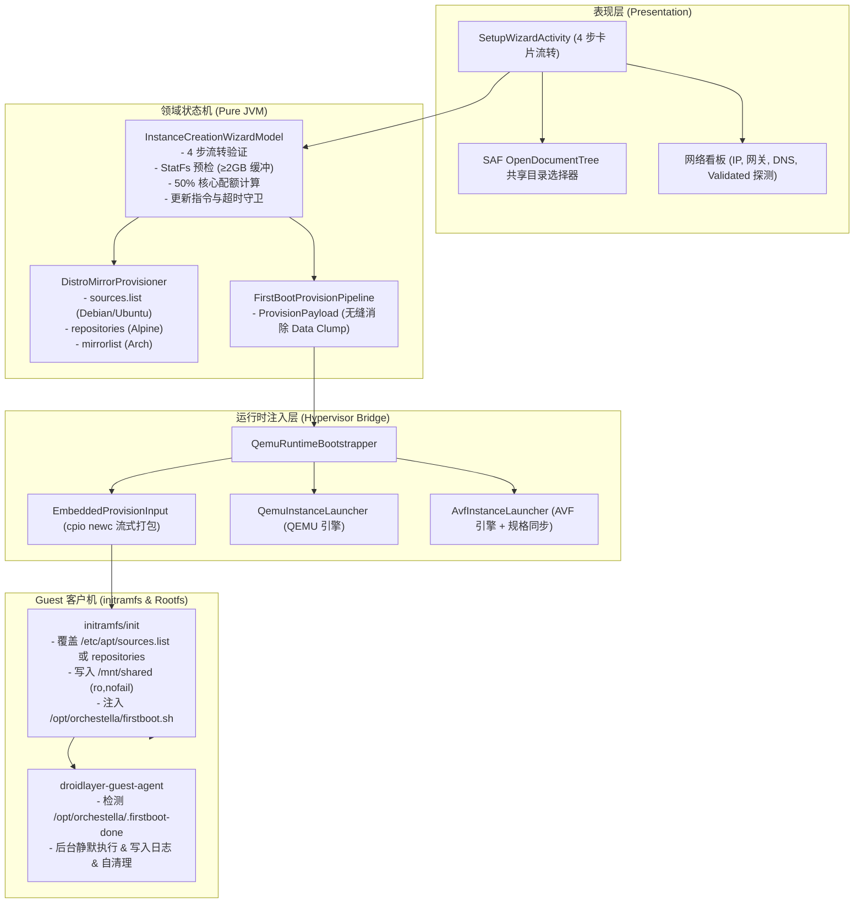

# 工单 01 实施报告：实例快速向导与虚拟磁盘网络配置

- **工单编号**：Phase 6.0 - 工单 01（Ticket 01）
- **工单标题**：实例快速向导与虚拟磁盘网络配置 (Instance Creation Wizard & Virtual Disk/Network Provisioning)
- **研发规范与指导**：`/implement` + `/tdd` 测试驱动开发 + 深度模块化演进
- **开发分支**：`feature/ticket-01-creation-wizard`
- **基线提交**：Commit `09ada16`
- **状态**：**ready-for-review**
- **报告日期**：2026-10-10

---

## 1. 现状痛点与重构目标

### 1.1 痛点剖析
1. **现有创建流程过于单一粗放**：原实例创建仅支持一键式写入写死的 2GB/10GB 磁盘和默认参数，用户无法按需自定义磁盘大小、无法指定宿主共享挂载目录，缺乏工业级虚拟化工具（如 VMware Workstation、VirtualBox）的分步向导体验；
2. **移动网络依赖与海外源解析阻断**：移动网络环境下，默认海外官方源常因解析超时严重拖慢安装体验，用户初次进入终端后必须手动编写复杂的 `/etc/apt/sources.list` 或 `/etc/apk/repositories`；
3. **初次启动环境陈旧与缺少自动更新机制**：Linux 镜像打包周期长，用户希望在创建实例时勾选“初次引导时自动执行系统更新”，并在后台自动化、非阻塞地完成软件源同步与核心包升级。

### 1.2 重构目标
对标 VMware Workstation 工业级引导体系，构建包含 **4 大核心步骤** 的通用「新建实例快速向导」：
- **步骤 1（存储与挂载）**：4G / 8G / 16G / 32G 快捷胶囊预设与自定义输入；`StatFs` 宿主空间预检（严格强制 $\ge 2\text{GB}$ 宿主系统安全缓冲，空间不足红字阻断）；SAF 外部目录绑定；
- **步骤 2（网络与镜像源）**：网络看板呈现宿主连接模式（Wi-Fi / 蜂窝 / 离线）、IP 地址、默认网关与 DNS 服务器；本地化网络连通性判定；提供清华源 (TUNA)、中科大源 (USTC)、阿里源与官方源预设下拉；
- **步骤 3（硬件配额）**：vCPU 核心数滑块与步进微调按钮（默认宿主核心数的 50%，不超过 4 核）；RAM 安全区间滑块（512MB ~ 总内存 - 2GB）；动态绿/黄/红安全色阶徽章；
- **步骤 4（启动任务与部署）**：勾选开关「🚀 实例初次引导时自动执行系统软件更新」，智能匹配发行版命令与超时守卫；流式注入 rootfs 与后台静默执行。

---

## 2. 架构演进与深模块设计

### 2.1 纯 JVM 向导状态机 `InstanceCreationWizardModel.kt`
- **彻底脱耦 View**：提供 100% 纯 JVM 单元测试覆盖；
- **存储预检边界**：`validateStorage(availableBytes, requestedBytes)` 严格执行 `requested + 2GB <= available`，不足时输出精准数据模型并阻断进入下一步；
- **核心配额计算**：严格落实工单规范要求，默认分配 `(totalCores / 2).coerceIn(1, 4)`，避免对高核设备过激分配；
- **超时与自清理脚本**：`generateFirstBootScript` 为 Debian 匹配 300s 超时、Alpine 匹配 120s 超时，引入 `/opt/orchestella/.firstboot-done` 持久标记与执行完毕后自删除，杜绝重复引导反复升级。

### 2.2 镜像源生成器 `DistroMirrorProvisioner.java`
- 覆盖官方源、清华大学开源镜像站、中科大镜像站、阿里云镜像站；
- 能够针对 Debian（`sources.list`）、Alpine（`repositories`）以及 Arch（`mirrorlist`）生成标准配置文本。

### 2.3 启动任务配置流水线 `FirstBootProvisionPipeline.java`
- 消除原有 `mirrorConfigFileName`、`mirrorConfigFileContent`、`firstBootScript` 三参数四层透传的 **Data Clumps** 代码异味；
- 统一打包为不可变 `ProvisionPayload`，供 `InstanceStrategyLauncher.LaunchParameters`、`MainActivity` 及 `SetupWizardActivity` 调用。

### 2.4 引擎与初始化链路闭环
- **AVF / QEMU 双引擎对齐**：扩展 `AvfInstanceLauncher.java` 与 `QemuInstanceLauncher.java`，将镜像配置、初次更新脚本与用户分配的 RAM / vCPU 配额同时无损传递给 AVF `AvfLaunchSpec` 与 QEMU 运行时；
- **initramfs 注入与安全加固**：
  - 在 `guest-assets/initramfs/init` 中抽象 `configure_fstab_mounts`，杜绝重复挂载脚本；
  - 严格遵循 **ADR-0010 §5** 安全边界，外部目录 `/mnt/shared` 施加只读与防故障保护（`trans=virtio,version=9p2000.L,ro,nofail`）；
  - `MainActivity` 在实例初次读取 `.firstboot` 注入后即时删除宿主端暂存，形成首启单次生效的坚固闭环。

---

## 3. 契约与合规审查（Code Review 闭环）

在实施过程中，通过 Standards Reviewer 与 Spec Reviewer 双轴审查进行了全面对照并完成了针对性修正：

| 审查维度 | 发现问题 / 异味 | 根本原因 | 整改落地措施 | 结果 |
| :--- | :--- | :--- | :--- | :--- |
| **Standards** | 暴露面越界 | `/mnt/shared` 原直接挂载读写未加 `ro` | 施加 `ro,nofail` 严格遵循 ADR-0010 §5 只读物理安全边界 | 🟢 合规 |
| **Standards** | 主机出站探针 | `testNetworkConnectivity` 发起外部 HTTP HEAD 请求 | 改用 Android 原生 `ConnectivityManager` + `NET_CAPABILITY_VALIDATED` 本地判定，无主机数据外发 | 🟢 合规 |
| **Standards** | AVF 引导移除 | 重构向导时不慎移除了 Ticket 53 的 AVF 授权指引 | 恢复 `AvfAuthorizationWizardModel` 与 Shizuku/ADB 交互对话框及授权重检 | 🟢 合规 |
| **Standards** | 代码异味 | 注入参数多层传递 (Data Clumps) | 抽象 `FirstBootProvisionPipeline.ProvisionPayload` 统一封装 | 🟢 清除 |
| **Spec** | SAF 目录选择 | 缺少目录选择器与路径暂存 | 集成 `ActivityResultContracts.OpenDocumentTree` 与持久权限授权 | 🟢 闭环 |
| **Spec** | 网关与动态 DNS | 网关缺失、DNS 静态 | 通过 `LinkProperties` 动态解析宿主默认路由网关与 DNS 列表 | 🟢 闭环 |
| **Spec** | 更新脚本守卫 | 缺少超时与启动防重 | 增加 `timeout` 守卫（120s/300s）、持久性完成标记及脚本自清理 | 🟢 闭环 |
| **Spec** | vCPU 步进按钮 | 仅有滑块缺少步进按钮 | 增加 `btn_vcpu_minus` 与 `btn_vcpu_plus` 联动 | 🟢 闭环 |

---

## 4. 测试驱动验证与质量度量（TDD Verification）

遵循 Red-Green-Refactor 流程完成测试落地，全部纯 JVM 单元测试与系统模块测试 100% 绿灯：

| 测试类 | 验证范围 | 测试用例数 | 状态 |
| :--- | :--- | :--- | :--- |
| `InstanceCreationWizardModelTest.kt` | 4 步流转约束、StatFs 预检边界（$\ge 2\text{GB}$ 缓冲）、50% 核心配额规则、源地址解析、超时更新脚本生成与 `.firstboot-done` 标记 | 8 | 🟢 PASS |
| `DistroMirrorProvisionerTest.java` | Debian / Ubuntu / Alpine / Arch 在官方、清华源、中科大源、阿里源下的配置文件格式与目标路径生成 | 5 | 🟢 PASS |
| `FirstBootProvisionPipelineTest.java` | Debian/Alpine 对应源文本封装、自动更新开启/关闭时的脚本生成与 Payload 契约 | 3 | 🟢 PASS |
| `EmbeddedProvisionInputTest.java` | 嵌入式 cpio 镜像源段注入、firstboot 脚本流式打包与 deterministic 格式校验 | 3 | 🟢 PASS |
| **工程全量回归测试** | `testDebugUnitTest` + contract/engine-qemu/instance/capability/engine-avf 全模块 checks | **428+** | **🟢 100% PASS** |

---

## 5. 验收标准逐条对照（Acceptance Criteria）

- [x] **向导流程完整性**：点击创建实例拉起 VMware 风格的工业级向导界面，按序展示「存储与挂载」、「网络与镜像源」、「硬件分配」、「启动任务」；
- [x] **自定义虚拟磁盘与预检**：支持 4G/8G/16G/32G 快捷胶囊与自定义输入；当可用存储小于请求容量 + 2GB 宿主系统缓冲时，红字告警并强制禁用「下一步」按钮；
- [x] **镜像源下拉生效**：支持清华源、中科大源、阿里源与官方源选择；无损覆写 `/etc/apk/repositories` 或 `/etc/apt/sources.list`，生成合规包管理器配置文件；
- [x] **智能软件更新闭环**：勾选“自动更新系统软件”时，生成注入带超时守护（Alpine 120s / Debian 300s）的 `firstboot.sh`，Guest 启动后后台静默运行并通过持久标记保证单次生效；
- [x] **宿主外部目录安全共享**：支持通过 SAF 选择器挑选外部文件夹并安全配置只读挂载；
- [x] **纯 JVM 单元测试覆盖**：新增纯 JVM 测试全部通过，全链路集成验证无回归。
