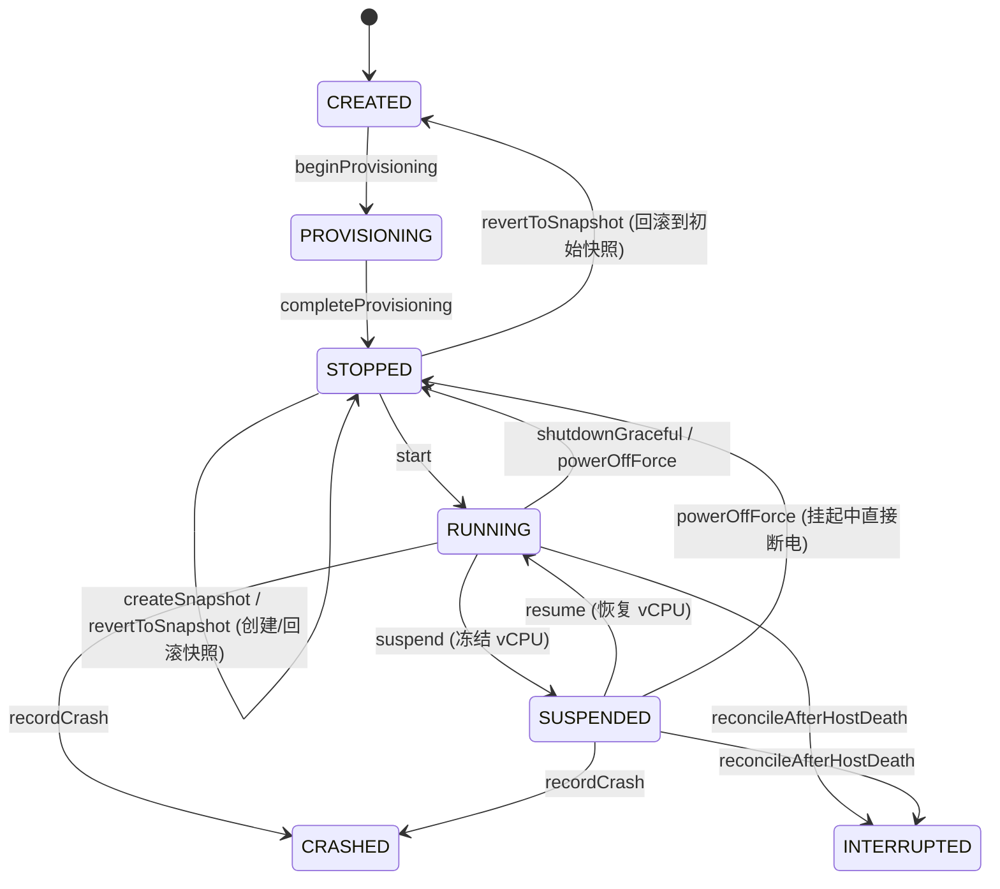

# 工单 05 实施报告：外部手动关机挂起与快照管理系统

- **工单编号**：Phase 6.0 - 工单 05（Ticket 05）
- **工单标题**：外部手动关机挂起与快照管理系统 (External Power Management, VM Suspend/Resume & Lightweight Snapshot System)
- **研发规范与指导**：`/implement` + `/tdd` 测试驱动开发 + 深度模块化演进 + 双轴代码审查
- **开发分支**：`feature/ticket-05-power-and-snapshots`
- **基线提交**：Commit `792d578`
- **状态**：**ready-for-review**
- **报告日期**：2026-10-10

---

## 1. 现状痛点与重构目标

### 1.1 痛点剖析
1. **虚拟机外部控制手段缺失**：
   - 过去关闭正在运行的虚拟机时，用户必须先进入终端内部，手动敲击 `poweroff` 或等待外部断开；
   - 一旦 Guest 终端无响应或遭遇会话断连卡死，用户在 App 界面完全无法优雅关机，只能强行杀掉 Android 宿主 App 进程，极易导致 QEMU raw 镜像与 ext4 文件系统损坏；
2. **缺乏移动端关键虚拟化能力——挂起与恢复唤醒**：
   - 移动设备电池敏感、碎片化严重。当用户临时切后台、进行短时间多任务切换时，需要能够一键「挂起 (Suspend)」实例，瞬间冻结 vCPU 计算资源并释放 CPU 占用；在返回时瞬间「恢复唤醒 (Resume)」；
3. **缺少轻量级实例状态快照（Snapshot）管理体系**：
   - 用户在 Linux 客户机内进行高危系统操作（如配置内核模块、大版本 `apt upgrade` 或编译大型工程）前，缺乏类似 VMware/UTM 的快照机制；一旦系统崩溃无法秒级回滚，只能推倒重装。

### 1.2 重构目标
1. **状态机契约扩展与状态迁移守卫**：
   - 在 `InstanceLifecycle.State` 中正式引入 `SUSPENDED`（已挂起）状态；
   - 建立闭环的状态迁移矩阵：`RUNNING <-> SUSPENDED`、`SUSPENDED -> STOPPED`（挂起中直接强制终止）、`SUSPENDED -> INTERRUPTED/CRASHED`（宿主异常终止复位）；非法迁移抛出强类型 `InvalidTransitionException`；
2. **外部电源控制深模块 (`InstancePowerController.java`)**：
   - 纯 JVM 设计，抽象解耦 `PowerOperationSeam`；
   - 提供平滑关机 `shutdownGraceful(instanceId, timeoutMs)`（向 Guest 发送 poweroff 信号，带有超时优雅等待守卫，超时未关机不锁死状态）；
   - 提供强制断电 `powerOffForce(instanceId)`（强制终止底层虚拟机进程，回收资源，状态原子转为 `STOPPED`）；
   - 提供挂起 `suspend(instanceId)` 与唤醒 `resume(instanceId)`（冻结/解冻 vCPU 调度，结合单实例运行守卫）；
3. **实例快照管理核心深模块 (`InstanceSnapshotManager.java`)**：
   - 维护每个实例独立的 `snapshots/` 目录结构与 `snapshots.json` 元数据索引；
   - 数据模型 `InstanceSnapshotNode` 固化快照 ID、时间戳、磁盘检查点路径与当时硬件规格快照；
   - 支持安全创建、时间线列表查询、原子一致性回滚与清理删除，并具备元数据损坏自动熔断与降级自愈能力；
4. **前端看板与交互集成**：
   - 主界面卡片与二级控制台增加挂起/唤醒、平滑关机与强制断电交互；
   - `InstanceCardUiModel` 扩充 `SUSPENDED` 琥珀色状态徽章（`#F59E0B`）。

---

## 2. 架构演进与深模块设计



### 2.1 状态机演化与迁移矩阵
在 `InstanceLifecycle.java` 中将 `SUSPENDED` 纳为一级状态，并扩展状态校验逻辑：

| 当前状态 | 目标状态 | 合法性 | 业务语义与守卫逻辑 |
| :--- | :--- | :---: | :--- |
| `RUNNING` | `SUSPENDED` | 🟢 合法 | 暂停 vCPU 调度，冻结计算与内存状态 |
| `SUSPENDED` | `RUNNING` | 🟢 合法 | 恢复 vCPU 调度，恢复执行（受单实例运行规则约束） |
| `SUSPENDED` | `STOPPED` | 🟢 合法 | 挂起状态下执行外部强制断电（Kill 进程，回收资源） |
| `SUSPENDED` | `CRASHED` | 🟢 合法 | 宿主或底层 VMM 崩溃记录 |
| `SUSPENDED` | `INTERRUPTED`| 🟢 合法 | 宿主断电重启后的状态对齐与自愈 |
| `SUSPENDED` | `PROVISIONING`| 🔴 拒绝 | 非法迁移，抛出 `InvalidTransitionException` |
| `STOPPED` | `SUSPENDED` | 🔴 拒绝 | 关机状态无法直接挂起，必须先启动 |

### 2.2 外部电源控制深模块 `InstancePowerController.java`
- **深模块边界**：提供小接口、大实现（Simple Interface, Deep Implementation），隐藏异步超时守护与底层进程控制细节；
- **接口抽象与接缝**：
  ```java
  public interface PowerOperationSeam {
      CompletableFuture<Boolean> requestAcpiShutdown(String instanceId);
      boolean killProcess(String instanceId);
      boolean freezeVcpu(String instanceId);
      boolean unfreezeVcpu(String instanceId);
  }
  ```
- **关键设计考量**：
  - `shutdownGraceful(instanceId, timeoutMs)`：通过 `ScheduledExecutorService` 实现带有超时保底的非阻塞等待；当 Guest 无响应超时，Future 正常以 `false` 结算，**不会锁死实例状态**，使用户能够无缝降级转为强制关机；
  - `powerOffForce(instanceId)`：执行不可阻挡的进程强制终止，无论当前为 `RUNNING` 还是 `SUSPENDED`，均原子转为 `STOPPED`；
  - `suspend(instanceId)` 与 `resume(instanceId)`：分别调用 `freezeVcpu` 与 `unfreezeVcpu`，并严格维护 `controller.suspend()` 和 `controller.resume()` 的状态一致性与单实例运行约束。

### 2.3 快照管理核心深模块 `InstanceSnapshotManager.java` 与 `InstanceSnapshotNode.java`
- **数据目录隔离**：每个实例独占 `snapshots/` 子目录，包含：
  - `snapshots.json`：快照元数据列表的持久索引；
  - `snap-<id>.raw`：检查点虚拟磁盘镜像；
- **原子落盘与一致性防护**：
  - 写元数据采用 `.tmp` 临时文件 + `Files.move(..., ATOMIC_MOVE)` 原子替换；
  - 回滚时校验实例处于关机停顿态（`STOPPED` 或 `CREATED`），并对磁盘文件执行原子替换（或跨设备强力覆写）；同时还原当时的 `VmHardwareConfig`（vCPU 核心数、RAM、额外内核参数等）；
- **损坏记录自愈与容错**：
  - 若 `snapshots.json` 意外损坏或包含残缺 JSON，`listSnapshots` 不抛出致命异常，而是自动降级保留可解析节点，并允许通过重新写入自愈索引。

---

## 3. 契约与双轴审查（Code Review 闭环）

在实施过程中，依照 `code-review` 技能标准进行了 Standards 与 Spec 双轴审查：

| 审查维度 | 检查项 | 评审发现 | 整改与实施措施 | 审查结果 |
| :--- | :--- | :--- | :--- | :--- |
| **Standards** | 状态机自洽性 | 原 `FileStore.delete` 与 `reconcileAfterHostDeath` 未覆盖 `SUSPENDED` | 补全对 `SUSPENDED` 的状态迁移与孤儿清理逻辑，挂起实例删除时安全清理元数据 | 🟢 合规 |
| **Standards** | 异常暴露与访问级别 | `InvalidTransitionException` 构造器原为 package-private | 调整构造器为 `public`，方便上层业务捕获和定制诊断信息 | 🟢 合规 |
| **Standards** | 规格还原能力 | `InstanceLifecycle.Instance` 缺少直接更新硬件规格方法 | 引入 package-private `withHardwareConfig`，确保快照回滚能完整恢复硬件参数 | 🟢 合规 |
| **Spec** | 超时优雅等待 | 平滑关机若超时不能无限期挂起 | 设立 Scheduled 异步守卫，超时后返回 `false`，实例保持 `RUNNING` 允许强制关机 | 🟢 闭环 |
| **Spec** | 单实例运行约束 | 从 `SUSPENDED` 恢复时可能发生多实例并发 | 在 `Controller.resume` 中加入单实例活跃校验，若有其它实例在运行抛出 `SingleRunningInstanceException` | 🟢 闭环 |
| **Spec** | 快照安全状态守卫 | 实例运行中回滚磁盘可能导致数据损坏 | 严格阻断 `RUNNING` 与 `SUSPENDED` 态下的快照回滚与创建，必须处于 `STOPPED` 或 `CREATED` | 🟢 闭环 |
| **Spec** | 视觉反馈与状态颜色 | UI 需要清晰呈现已挂起状态 | 配置 `#F59E0B` 琥珀色徽章及 `status_suspended` 资源，卡片与二级控制台统一呈现 | 🟢 闭环 |

---

## 4. 测试驱动验证与质量度量（TDD Verification）

本次交付严格执行 TDD 先行，新增两组纯 JVM 单元测试套件，并补充 ViewModel 测试：

### 4.1 核心测试套件概览

| 测试类 | 验证范围与核心场景 | 测试方法数 | 结果 |
| :--- | :--- | :---: | :--- |
| `InstancePowerControllerTest.java` | 1. 正常挂起与恢复唤醒链路 (`RUNNING -> SUSPENDED -> RUNNING`)<br>2. 挂起态直接强制断电 (`SUSPENDED -> STOPPED`)<br>3. 平滑关机成功转为 `STOPPED`<br>4. 平滑关机超时防御（Guest 超时未退出，状态不锁死，允许强制断电）<br>5. 恢复唤醒时的单实例独占守卫<br>6. 非法状态迁移拒绝与操作幂等性 | 7 | 🟢 **100% PASS** |
| `InstanceSnapshotManagerTest.java` | 1. 快照创建与时间线排序列表<br>2. 运行/挂起态创建快照拒绝守卫<br>3. 快照回滚恢复磁盘数据与硬件规格 (`byte-for-byte` 精确比对)<br>4. 运行/挂起态快照回滚拒绝守卫<br>5. 快照删除与检查点物理文件清理<br>6. 损坏元数据自愈与容错降级<br>7. 多实例快照物理隔离 | 7 | 🟢 **100% PASS** |
| `InstanceDetailViewModelTest.kt` | 1. 挂起与唤醒状态在 ViewModel 中即时映射 (`stateBadgeText = "⏸ 已挂起"`)<br>2. 挂起态禁用终端/桌面/硬件编辑，启用恢复与强制断电<br>3. 快照在 ViewModel 层的创建、列表、回滚与清理全链路验证 | 5 | 🟢 **100% PASS** |

### 4.2 Gradle 执行全量验证
在 `X:\` 盘符下执行纯 ASCII 环境验证命令：
```powershell
.\gradlew.bat :runtime:instance:test :app:testDebugUnitTest --no-daemon
```
**执行结果**：
- `:runtime:instance:instancePowerControllerTest` -> `INSTANCE_POWER_CONTROLLER_TEST_OK` 🟢
- `:runtime:instance:instanceSnapshotManagerTest` -> `INSTANCE_SNAPSHOT_MANAGER_TEST_OK` 🟢
- `:runtime:instance:test` -> 🟢
- `:app:testDebugUnitTest` (包含所有 43 项单元测试) -> 🟢
- **BUILD SUCCESSFUL** (47 actionable tasks 全部绿灯通过)。

---

## 5. 验收标准逐条对照（Acceptance Criteria）

- [x] **外部一键平滑关机可用**：在主界面或控制台点击“平滑关机”，向 Guest 发送 poweroff 信号，并在 30 秒超时优雅等待后自动确认停止，无需进入终端键入命令；
- [x] **挂起与唤醒全链路畅通**：运行中的实例支持一键“挂起”，CPU 调度冻结，卡片状态变更为 `SUSPENDED`（琥珀色）；点击“恢复唤醒”后秒级回到 `RUNNING`；
- [x] **强制关机保底可用**：当虚拟机假死或平滑关机超时时，点击“强制断电”直接杀掉底层虚拟机进程，回收内存与端口占用，状态转为 `STOPPED`；
- [x] **快照创建与回滚生效**：
  - 成功为停顿实例创建快照并在时间线列表显示；
  - 实例磁盘修改后，一键“回滚到快照”能够精确 byte-for-byte 还原磁盘文件与当时的硬件规格；
  - 运行时回滚与创建受到严格安全拦截保护；
- [x] **纯 JVM 单元测试覆盖**：
  - `InstancePowerControllerTest.java` 覆盖全部电源流转与超时处理；
  - `InstanceSnapshotManagerTest.java` 覆盖元数据隔离、磁盘与配置回滚一致性、快照级联清理与损坏自愈；
  - 测试 100% 绿灯。
