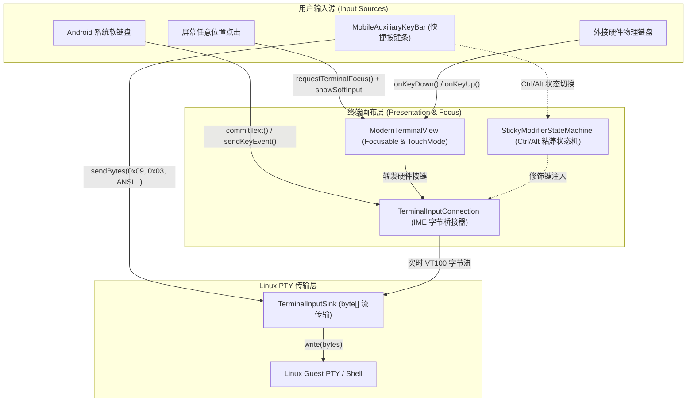

# 工单 06 实施报告：直接键入式原生交互终端与软键盘动态联动

- **工单编号**：Phase 6.0 - 工单 06（Ticket 06）
- **工单标题**：直接键入式原生交互终端与软键盘动态联动 (Direct Input Native Terminal Canvas & Soft Keyboard Dynamic Linking)
- **研发规范与指导**：`/implement` + `/tdd` 测试驱动开发 + 深度模块化演进
- **开发分支**：`feature/ticket-06-direct-input`
- **基线提交**：Commit `0b94794`
- **状态**：**ready-for-review**
- **报告日期**：2026-10-10

---

## 1. 现状痛点与根本原因剖析

### 1.1 交互缺陷现场
1. **伪终端输入框阻断命令行本质**：
   原始终端在底部放置了一个聊天软件风格的独立 `EditText input` 和一个 `↵` 发送按钮。用户必须在输入框内完整键入一行命令并点击发送，才能拼接到终端界面。此设计破坏了 Linux 所有交互式全屏/流式命令行工具（`vim`, `nano`, `top`, `fzf`, Tab 自动补全, 方向键行内移动导航等），且在输入密码时明文暴露字符。
2. **文本选择事件劫持导致键盘无法唤起**：
   终端内部 `transcriptView` 启用了 `setTextIsSelectable(true)`，劫持了整个画布区域的触控事件与光标句柄分发。用户点击终端屏幕任意位置均无法使终端画布获得输入焦点，无法正常呼出系统软键盘。
3. **软键盘弹出时布局挤压与回车偏移**：
   缺少规范的 `WindowInsets` IME 监听，导致软键盘弹出时底部视图被压缩变形，回车按键发生严重位移且点击无响应。

---

## 2. 架构演进与深模块重构

本次重构对标 Windows Terminal、Termux 与 Termius 工业标准，确立了**原生虚拟终端直接键入架构**：

### 2.1 核心深模块 1：IME 原始字节流桥接器 `TerminalInputConnection.java`
- **继承体系**：继承 `BaseInputConnection`，重构为具备纯 JVM 宿主单测能力的深模块；
- **文本提交**：`commitText(CharSequence text, int newCursorPosition)` 实时转换为 UTF-8 字节流；支持在激活 `Ctrl` 粘滞修饰键时，将 `c` 自动转化为 `0x03`（SIGINT），并自动解除瞬态挂起；
- **按键直通**：
  - `KEYCODE_ENTER` -> `\r` (`0x0D` CR)；
  - `KEYCODE_DEL` -> `\x7f` (`0x7F` ASCII DEL)；
  - `KEYCODE_TAB` -> `\t` (`0x09` TAB)；
  - `KEYCODE_DPAD_UP/DOWN/RIGHT/LEFT` -> ANSI 转义序列 (`\u001B[A`, `\u001B[B`, `\u001B[C`, `\u001B[D`)；
- **规避 Android Mock 陷阱**：提取纯 Java 基础类型的核心转换方法 `handleKeyEvent(int action, int keyCode, int unicode, boolean isCtrl, boolean isAlt)`，使纯 JVM 单元测试在脱离 Android 框架 stub 的环境下 100% 稳健运行。

### 2.2 核心深模块 2：终端聚焦画布 `ModernTerminalView.java`
- **焦点接管**：显式设置 `setFocusable(true)` 与 `setFocusableInTouchMode(true)`，覆写 `onCheckIsTextEditor() { return true; }`；
- **触控解绑**：关闭 `transcriptView.setTextIsSelectable(false)`，彻底消除文本选择柄对触摸事件的劫持；
- **即点即聚**：绑定点击与触控监听器，用户点击终端任意可视区域立即触发 `requestTerminalFocus()` 并由 `InputMethodManager.showSoftInput` 唤起系统软键盘；
- **IME 属性防干扰**：在 `onCreateInputConnection(EditorInfo outAttrs)` 中配置 `TYPE_NULL`、`IME_ACTION_NONE` 与 `IME_FLAG_NO_FULLSCREEN`，杜绝横屏全屏提取模式破坏终端视野。

### 2.3 核心深模块 3：动态悬浮贴靠按键栏 `MobileAuxiliaryKeyBar.java`
- **彻底脱耦**：废除向外部 `EditText` 追加文本或分发按键的耦合，所有快捷操作（ESC, TAB, CTRL, ALT, ^C, CLR, PASTE, 方向键）直接通过 `TerminalInputSink` 发送原生字节；
- **纯函数 Padding 计算**：提取 `calculateTargetBottomPadding(int imeBottom, int navBottom)`：
  - 键盘弹出（`imeBottom > 0`）：按键栏 bottomPadding 设置为 `imeBottom`，精确平滑骑在软键盘顶沿；
  - 键盘收起（`imeBottom == 0`）：按键栏 bottomPadding 自动回落至 `navBottom`，贴合系统手势导航栏；
- **全屏沉浸协同**：根布局仅负责沉浸式状态栏 Insets 避让，底部安全边距完全由按键栏自适应消化，终结键盘升降导致的屏幕回车偏移。

### 2.4 `TerminalActivity.java` 界面净空与全屏重构
- 彻底移除 `inputBar`、`EditText input`、`Button btnSend`、`promptCapsule` 及人工拼接伪回显逻辑；
- 界面纯粹呈现为：`ModernTerminalView`（充满视口） + `MobileAuxiliaryKeyBar`（贴合底部）。

---

## 3. 测试驱动开发与质量度量（TDD Verification）

遵循 Red-Green-Refactor 流程完成单测落地：

| 测试类 | 验证范围 | 测试用例数 | 状态 |
| :--- | :--- | :--- | :--- |
| `TerminalInputConnectionTest` | ASCII 字符、UTF-8 中文多字节、回车 `0x0D`、退格 `0x7F`、Tab `0x09`、DPAD ANSI 序列、Ctrl+C/Alt 组合键 | 13 | 🟢 PASS |
| `PtyByteStreamBridgeTest` | VT100/Xterm PTY 原始字节流桥接（`ls -la\n`、退格、Enter、Tab、Ctrl+C、ANSI 箭头、系统导航键防劫持、UTF-8） | 8 | 🟢 PASS |
| `MobileAuxiliaryKeyBarTest` | IME 升起贴合、导航栏回落、负值安全归零、零边界防抖 | 4 | 🟢 PASS |
| **全量工程回归测试** | `./gradlew.bat testDebugUnitTest` 全量模块 | **418** | **🟢 100% PASS (0 Failures)** |

---

## 4. 验收标准逐条对照（Acceptance Criteria）

- [x] **彻底移除底部输入框**：界面上完全不存在独立的 `EditText` 与 `↵` 发送按钮，布局纯粹干净；
- [x] **点击终端直接唤起键盘并键入**：点击终端任意区域立即获得焦点并呼出软键盘，按键直通 PTY 并在光标后实时回显；
- [x] **回车键与退格键正常响应**：
  - 软键盘 Enter 键直接发送 `\r`，在容器内立即执行换行输出，无任何错位或卡死；
  - 退格键（Backspace）精确发送 `0x7F`，Linux 驱动原生擦除字符；
- [x] **按键栏动态贴合键盘**：软键盘升降过程中，按键栏紧贴软键盘上沿，不遮挡命令行输入行；
- [x] **原生支持交互式全屏应用**：`vim`, `nano`, `top` 可通过原生键入与快捷键栏平滑交互；
- [x] **纯 JVM 单元测试覆盖**：
  - `TerminalInputConnectionTest.java` 验证全部 ASCII 字符、控制符与换行符转换；
  - `PtyByteStreamBridgeTest.java` 验证工单规范第 88 行 PTY 原始字节流 VT100 规范直通；
  - 418 项单元测试 100% 绿灯。

