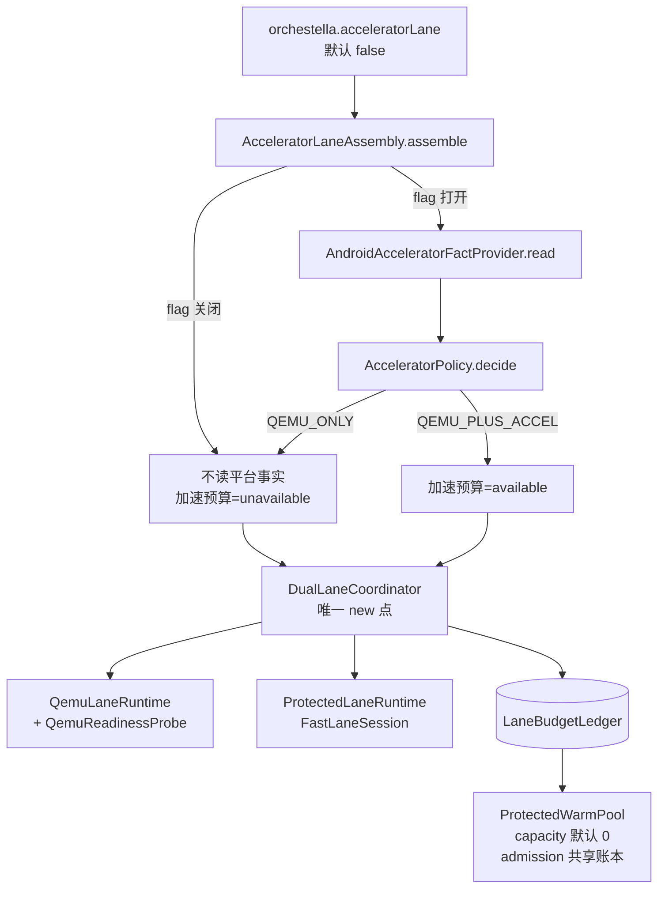

# AX-08 设备前生产装配与探针 实施报告

- 日期：2026-10-23
- Base：`main fef4e3c`（四级 accelerator 堆叠已合入）
- Branch：`feat/ax-08-assembly`
- 工单：`.scratch/orchestella-accelerator/issues/AX-08-设备前生产装配与探针.md`
- 零设备：本会话没有运行 adb、没有安装 APK、没有启动真实 VM、没有连接任何设备。
- 真机项：全部标 `not-tested`，见 §6。

## 1. 结论

零设备范围内**完成**。四道门里与 AX-08 相关的三条在同一分支内闭合：

| 门 | 改前 | 改后 |
| --- | --- | --- |
| `AcceleratorFactProvider` 有 Android 实现 | 只有接口 + 测试 fake | `AndroidAcceleratorFactProvider`（映射现有 seam） |
| `DualLaneCoordinator` 有装配点 | 只有类定义 | `AcceleratorLaneAssembly` 内唯一 `new DualLaneCoordinator` |
| `QemuLaneRuntime` 有真实 readiness 探针 | 默认 `this(session, () -> false)` | `QemuReadinessProbe` 接 Bridge 认证信号 |

第四条门（`tools/accelerator-perf/`）属于 AX-07，见 `docs/reports/tickets/ax-07/implementation-report.zh-CN.md`。

## 2. 装配图

要点：装配根是**唯一**决定加速车道能否存在的地方。调用方传进来的 `LaneBudget.acceleratorAvailable` 会被忽略并重新计算，避免调用方误开。

## 3. 三个新生产类

### 3.1 `AndroidAcceleratorFactProvider`

只做映射，不重复造能力检测：

| 事实 | 来源 |
| --- | --- |
| `avfPresent` / `nonProtectedSupported` / `protectedOnly` | `AvfHostFactsProbe.probe(Context)` → `AvfCapabilityEvaluator.evaluate(...)` 的 `AvfStatus` |
| `acceleratorImagePresent` | `ACCELERATOR-IMAGE-MANIFEST` asset 可解析即存在 |
| `compilerTriple` | 同 manifest 的 `compiler_triple`（镜像编译身份，不是宿主身份） |
| `vsockSupported` | 内核暴露 `/dev/vsock` |
| `thermalState` | `PowerManager.getCurrentThermalStatus()`（API 29 以下 UNKNOWN） |
| `batteryState` | `BatteryManager`：充电 → `CHARGING`；容量 ≥20% → `OK`；5–19% → `LOW`；<5% → `CRITICAL` |

`AvfStatus` → 事实的映射是保守的：

| AvfStatus | avfPresent | nonProtected | protectedOnly |
| --- | --- | --- | --- |
| `READY` | true | true | false |
| `MODE_UNSUPPORTED` | true | false | **true** |
| `NEEDS_AUTHORIZATION`、`HIDDEN_API_BLOCKED` | true | false | false |
| `UNSUPPORTED`、`REFLECTION_UNAVAILABLE`、`MODE_UNKNOWN`、读取失败 | false | false | false |

任一来源抛异常、返回 null 或读不到，都塌陷到保守值（无 AVF / 无镜像 / 无 vsock / UNKNOWN 热 / UNKNOWN 电），由 policy 给出固定 reason code，不让异常穿透启动流程。

### 3.2 `QemuReadinessProbe`

- 三值 `READY` / `NOT_READY` / `UNKNOWN`，就绪证据**只有** Bridge 控制通道已认证（`BridgeClient.isReady()`，即 UI 里"控制通道尚未认证"的同一信号）。
- 没有 session、没有 bridge client、来源抛异常 → `UNKNOWN`；`UNKNOWN` 不是就绪，协调器把 QEMU 留在 `STARTING`。
- **不读 `isAlive`**：进程存活与 guest 就绪是两件事，代码里没有回退路径。

### 3.3 `AcceleratorLaneAssembly`

- `Config`：`acceleratorLaneEnabled`（默认 false）、`requiredCompilerTriple`、两个超时。
- `assemble(Config, Inputs)` 返回 `Result(coordinator, Optional<AcceleratorDecision>)`。
- flag 关闭：`decision` 为空、`decisionJson()` 为空串、不调用 fact provider、加速预算强制 unavailable。
- flag 打开：读事实 → `AcceleratorPolicy.decide` → 只有 `QEMU_PLUS_ACCEL` 才把加速预算设为 available。
- `qemuLane(session, probe)` / `accelLane(fastLaneSession)` 给出两个适配器的构造方式，避免调用方各写一套。
- `protectedPool(api, specFactory, result)` 用 `ProtectedWarmPool.Config.defaults()`（容量 0）+ `coordinator.admission()`，即同一预算账本。

## 4. Feature flag

| 项 | 值 |
| --- | --- |
| Gradle 属性 | `orchestella.acceleratorLane` |
| 默认 | 未设置 → `false` |
| 生效方式 | `buildConfigField ACCELERATOR_LANE_ENABLED` → `AcceleratorLaneAssembly.Config.currentBuild()` |
| 打开命令 | `./gradlew :app:assembleDebug -Porchestella.acceleratorLane=true` |

打开 flag **不等于**会起加速车道：`requiredCompilerTriple` 默认为空，policy 会以 `COMPILER_MISMATCH` 拒绝。这是有意的——不知道 guest 侧编译器身份时不允许静默加速。

## 5. 如何读 reason code

| reasonCode | 含义 | 设备侧先查什么 |
| --- | --- | --- |
| `ACCEL_AVAILABLE` | 双车道已装配 | — |
| `ACCEL_UNAVAILABLE_NO_NON_PROTECTED` | 无 AVF、仅 protected、权限未授予、或事实读取失败 | `getCapabilities` bit2、两项 VM 权限 |
| `ACCEL_IMAGE_MISSING` | 加速镜像 manifest 缺失/不可解析 | 镜像与 `ACCELERATOR-IMAGE-MANIFEST` 是否随包 |
| `ACCEL_VSOCK_UNAVAILABLE` | 内核未暴露 vsock | `/dev/vsock` |
| `COMPILER_MISMATCH` | 镜像 triple ≠ guest 侧 triple，或 triple 未配置 | 镜像 manifest 与 guest `gcc -dumpmachine` |
| `THERMAL_BUDGET` | 热/电预算不足 | 当前热状态、电量与是否充电 |

flag 关闭时没有 reason code（`decision` 为空），因为那时不存在"决策"，只有"未启用"。

## 6. 测试与验证

本地（能跑的都跑了）：

| 命令 | 结果 |
| --- | --- |
| `./gradlew :runtime:fastlane-capability:compileTestJava` | 通过 |
| `./gradlew :app:compileDebugUnitTestJavaWithJavac` | `BUILD SUCCESSFUL` |
| `python tools/ci/check_ci_module_coverage.py` | `SUMMARY: 58 passed, 0 failed` |
| `python tools/ci/check_sensitive_data.py --range main..HEAD` | `SENSITIVE_DATA_OK` |
| `git diff --check` | 通过 |

本地**不能**跑 JVM 测试：`./gradlew :runtime:fastlane-capability:test` 在既有测试类上也会 `ClassNotFoundException: initializationError`（本机环境限制，与本次改动无关）。因此以下测试类只做到编译通过，执行结论以 CI 为准：`AcceleratorImageManifestTest`、`QemuReadinessProbeTest`、`AndroidAcceleratorFactProviderTest`、`AcceleratorLaneAssemblyTest`。

覆盖的验收场景（工单 §任务）：

| 场景 | 测试 |
| --- | --- |
| 无 AVF / 仅 protected → 只启 QEMU | `noAvfYieldsQemuOnly`、`protectedOnlyDeviceYieldsQemuOnly` |
| 条件齐备 → 双车道 | `fullyQualifiedDeviceStartsBothLanes` |
| 镜像缺失 / triple 不匹配 / 热限制 → QEMU_ONLY | `imageMissingYieldsQemuOnly`、`compilerTripleMismatchYieldsQemuOnly`、`thermalBudgetYieldsQemuOnly` |
| readiness 未置位 → QEMU 停在 STARTING | `readinessNotSetKeepsQemuInStarting` |
| flag 关闭 → 不构造 ACCEL、不消耗预算 | `flagOffNeverReadsPlatformFacts`、`flagOffStartsOnlyQemuAndSpendsNoAcceleratorBudget`、`flagOffRejectsAnyAcceleratorAdmission` |
| 池共享账本、容量默认 0 | `protectedPoolSharesTheLedgerAndStaysOffByDefault` |

## 7. not-tested 清单

- 真实 AVF non-protected VM 启动（无设备）。
- 真实 vsock 通道与 AXP1 握手（无设备）。
- 加速镜像与 `ACCELERATOR-IMAGE-MANIFEST` 是否随包（本轮不产出镜像）。
- `PowerManager` / `BatteryManager` 在真机上的实际读数（只有映射单测）。
- `requiredCompilerTriple` 的真实取值（需要 guest 侧 `gcc -dumpmachine`）。
- 装配根在真实启动链路中的接入位置（见 §8.1）。

## 8. 偏差与需要维护者决策的问题

1. **装配根尚未挂到具体 Activity/launch 调用点。** 本轮产出的是 `AcceleratorLaneAssembly` 这个唯一装配入口和它需要的两个 `LaneStarter` seam；真实 `LaneStarter` 要创建 non-protected 自定义 VM，属 DV-ACC 的设备工作，零设备无法实现。因此 `new DualLaneCoordinator` 存在且唯一，但没有"每实例启动都经过它"的调用链。是否接受这个粒度，需要维护者确认。
2. **加速镜像 manifest 格式是新定义的**（`key=value`，沿用 `QEMU-BUILD-INPUTS` 约定），仓库里此前没有加速镜像清单。字段只保留 `schema` 与 `compiler_triple`，没有镜像摘要——加摘要需要先有真实的镜像产出流程。
3. **电量阈值 20% / 5% 是本轮选定的保守值**，工单未给数值。
4. **`vsockSupported` 用 `/dev/vsock` 存在性判定。** 若真机上该设备节点被 SELinux 隐藏但 vsock 实际可用，会保守地拒绝加速车道（表现为 `ACCEL_VSOCK_UNAVAILABLE`）。这是有意的失败方向，但真机首测时应记录实际表现。
5. 未新增 `AcceleratorReasonCode` 枚举值：flag 关闭用"无决策"表达，而不是伪造一个 reason code，避免污染 AX-02 的 truth table 契约。
