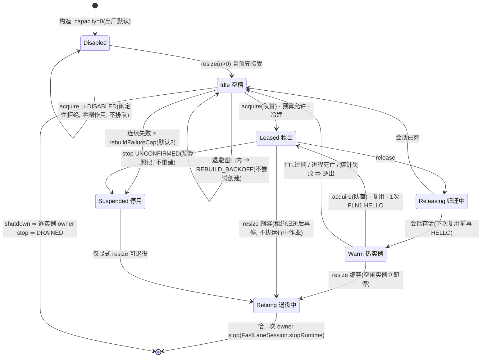

# PVM-06 实现报告 · 编译 worker 池与调度

- 票：`PVM-06`（`.scratch/orchestella-pvm-compiler/issues/PVM-06-编译worker池与调度.md`）
- 基线：本轮 Lane B（E2），规格见 `.scratch/orchestella-pvm-compiler/round-pvm11/spec.md` §2
- 日期：2026-11-03（零设备推进轮）
- 设备：**全程未使用**，`adb` 一次未调
- 自验口径：**javac 直编零错误 + JUnit 直跑全绿**；Gradle 门禁未跑（与并发车道互斥，归主会话统一执行）

## 0. 摘要

把 `ProtectedWarmPool` 的单槽预热池扩成了 N 槽编译 worker 池：新增 `WorkerPool`
接口（`acquire(job) / release(lease) / cancel(job) / health() / resize(n) / shutdown`）与
`ProtectedWorkerPool` 实现。实现采用**组合而非重写**——每个槽位是一个 capacity=1 的
`ProtectedWarmPool`，PL-01 的租约语义（每次复用前一次有界 FLN1 HELLO、检查失败逐出并
只重建一次、只经 `FastLaneSession.stopRuntime` 的单一 owner stop）逐字复用；worker 池
在其上叠加有界 FIFO 队列（默认 2×N）、预算准入（每实例 1 vCPU + 内存，复用
`LaneBudgetLedger` 语义不改其行为面）、重建退避与上限、注入式健康探测、固定码埋点。

一句话：**容量默认仍是 0 —— 池子造好了，但默认一天比一天没有任何行为差异。**

## 1. 结论与判据表

新测试类 `app/src/test/java/io/github/nyzeep/orchestella/ProtectedWorkerPoolTest.java`
**21/21 通过**（JUnit 4.13.2 直跑，0.49 s）；既有回归 `ProtectedWarmPoolTest`
**18/18**、`DualLaneCoordinatorTest` + `AcceleratorLaneAssemblyTest` **43/43**，合计
**82/82 绿**。javac 对全部新/改主源与测试源**零错误**。

| # | 工单要求 | 落点 | 结果 |
| --- | --- | --- | --- |
| 1 | `WorkerPool` 接口四方法 | `app/src/main/java/io/github/nyzeep/orchestella/WorkerPool.java:333-381`（另有 `cancel/stats/shutdown`） | **绿** |
| 2 | 复用租约语义；容量 0 不建 VM | `ProtectedWorkerPool.java`（组合 N×capacity-1 `ProtectedWarmPool`）；默认容量 0，acquire 即 `DISABLED` 确定性拒绝，`startCount=0` | **绿**（测试 `defaultCapacityIsZero…`） |
| 3 | 有界队列 2×N、`POOL_SATURATED`、`JOB_TIMEOUT`、FIFO、取消 | `ProtectedWorkerPool.java:380`（acquire）、`:531`（claim）、`:725`（cancel）；公平锁 + 队头才可认领 | **绿**（饱和 / 超时 / 取消 / FIFO 顺序四条测试） |
| 4 | 计入 `LaneBudget`（1 vCPU + 内存），超预算拒绝带 reason | `WorkerPool.java:260`（`Admission` 缝 + `ledgerBacked` 适配器）、`ProtectedWorkerPool.java:576`；reason 复用 `LaneRejectCode`，`LaneBudgetLedger` **零改动** | **绿**（CPU_EXCEEDED / RAM_EXCEEDED 两条） |
| 5 | 拓扑默认 `ONE_CPU`，`MATCH_HOST` 实验开关默认关 | `ProtectedWorkerPool.Config`（`topology`/`allowMatchHost` 双闸）；launch 规格经由 `FastLaneLaunchSpec.CpuTopology`（`runtime/engine-fastlane/.../FastLaneLaunchSpec.java:19`，`ReflectiveFastLaneApi.java:214` 的 `CPU_TOPOLOGY_ONE_CPU` 平台常量即由它驱动） | **绿**（默认 ONE_CPU / MATCH_HOST 需显式 opt-in 两条） |
| 6 | 心跳/连接探测接口位；失败下线重建；重建失败计数 + 退避 + 上限 | `WorkerPool.java:318`（`HealthProbe`）+ `ProtectedWarmPool.java:326/341` 两个最小增量钩子；退避 `base·2^(failures-1)` 封顶，`rebuildFailureCap`（默认 3）后停用槽位 | **绿**（探针失败下线重建 / 三次探针失败停用 / 退避+上限三条） |
| 7 | 停止顺序与 `DualLaneCoordinator` 一致；UNCONFIRMED 保留 lease 与预算；不新增 stop owner | 池无 QEMU 引用、从不起平台 stop——全部经内层池的 `FastLaneSession.stopRuntime`；每实例恰一次 stop 有断言；UNCONFIRMED 槽位停用且预算照记 | **绿**（单 owner stop / UNCONFIRMED 两条） |
| 8 | 埋点只计数不含 job 内容 | `WorkerPool.Stats`（19 个计数器 + 固定码表）；`Job` 仅作身份匹配 | **绿**（`statsCarryOnlyCountersAndFixedCodes`） |
| 9 | 测试：容量 0/1/N、队列满、崩溃重建、取消、预算拒绝、停止顺序 | 21 条测试逐一覆盖（清单见 §4） | **绿** |
| 10 | 状态机说明（Mermaid） | 本报告 §3 | **交付** |

## 2. 改动清单

| 文件 | 性质 |
| --- | --- |
| `app/src/main/java/io/github/nyzeep/orchestella/WorkerPool.java` | **新增**：接口 + 固定码 `Code`（17 项）+ `WorkerPoolException`（带 `LaneRejectCode` reason）+ `Lease`/`Job`/`HealthReport`/`Stats`/`ShutdownResult` + `Admission`（含 `ledgerBacked` 静态适配）+ `HealthProbe` |
| `app/src/main/java/io/github/nyzeep/orchestella/ProtectedWorkerPool.java` | **新增**：实现（组合 N 个 capacity-1 `ProtectedWarmPool`）+ `Config`（默认容量 0）+ `WorkerSpecFactory` + 调度/预算/退避/健康/缩容/停机全部逻辑 |
| `app/src/main/java/io/github/nyzeep/orchestella/ProtectedWarmPool.java` | **最小增量**：`Code` 追加 `PROBE_FAILED`（`:75`）；新增只读 `warmSessionIfReady()`（`:326`）与健康逐出 `evictWarm()`（`:341`）。PL-01 既有语义零改动，既有 18 条测试原样全绿 |
| `app/src/test/java/io/github/nyzeep/orchestella/ProtectedWorkerPoolTest.java` | **新增**：21 条零设备测试（fake VM + fake clock，fake 形态对齐 PL-01 测试） |

未触碰：`RuntimeProcessSupervisor`、`DualLaneCoordinator`、`AcceleratorLaneAssembly`、
`runtime/instance/duallane/*`（预算账本只读复用）、`fastlane-payload/`、
`runtime/fastlane-distcc/`、PVM-11 相关文件、任何产品启动路径（**零接线**）。

## 3. 池生命周期状态机

每个槽位（= 一个 capacity-1 `ProtectedWarmPool`）的派发级状态机；池级行为由 N 个槽位
+ 一条有界 FIFO 队列复合而成：



调度的三条不变式（与图配合阅读）：

1. **队列先于创建**：队列非空时，新 acquire 一律入队（不许插队认领空闲槽）；只有队头
   才能认领槽位。派发锁是公平锁，等待者按 FIFO 唤醒——自由槽永远先给等得最久的作业。
2. **锁外做平台等待**：认领在池锁内完成，内层 acquire（冷建 / 就绪等待 / HELLO）与一切
   平台 stop 都在池锁外执行；RELEASING 状态保证归还期间槽位不被抢认。
3. **重建不风暴**：冷建失败或探针失败 → 连续失败计数 +1 并开启 `base·2^(failures-1)`
   退避窗（封顶 `rebuildBackoffMaxMs`）；窗口内派发立即以 `REBUILD_BACKOFF` 失败；计数
   达 `rebuildFailureCap` 槽位 SUSPENDED，之后派发一律 `REBUILD_GIVE_UP`。只有健康探测
   成功会清零计数（探针证明当前实例可用；替换性创建不算——之前失败的就是探针本身）；
   SUSPENDED 只有显式 `resize` 能退役重建。stop UNCONFIRMED 直接 SUSPENDED 且该实例
   预算照记（可能还活着），这就是「UNCONFIRMED 保留 lease 与预算」在池内的形态。

预算口径：`Admission` 收到的是**累计足迹**（现存实例 + 候选实例）×（每实例 1 vCPU +
memoryMb）；`ledgerBacked` 适配器按「加速器可用 → vCPU 余量 → RAM 余量」的顺序返回
`LaneRejectCode`，与 `LaneBudgetLedger.reserve()` 的拒绝次序一致。池从不在账本里预约
（沿用 `canAdmitPool` 的「池拥有自己的租约」约定），只在 `resize(n)`（按 n 实例的最坏
情形预检）与每次**增长性冷建**（替换性重建不算增长，不重复预检，避免「旧实例刚死就
拒绝重建」的反效果）两处询问。

## 4. 测试清单与证据

`ProtectedWorkerPoolTest`（21 条，JUnit 4 直跑）：

- 容量 0：`defaultCapacityIsZeroNeverCreatesAndRefusesDeterministically`（不建 VM、不排队、health 为空）
- 容量 1：`capacityOneServesAndReusesTheWarmInstance`（1 建冷 + 1 复用，同实例）
- 容量 N：`capacityNServesConcurrentJobsAndCreatesLazilyUpToN`（3 槽惰性建 3、实例 id 互异）
- 队列满：`queueFullIsRejectedWithPoolSaturated`（2×N 之外 `POOL_SATURATED`，`saturatedTotal=1`）
- 排队超时：`queueWaitTimesOutWithJobTimeout`（120ms 真实有界等待 → `JOB_TIMEOUT`）
- 取消：`cancelledQueuedJobWakesWithCancelled`（唤醒返回 `CANCELLED`；二次取消 false）
- FIFO 公平：`fifoOrderServesTheLongestQueuedJobFirst`（A、B 按入队顺序被派发，且都复用同一热实例）
- 崩溃重建：`crashedInstanceIsEvictedAndRebuiltOnNextAcquire`（`PROCESS_DIED` 逐出 + 换新实例）
- 退避与上限：`rebuildFailureBacksOffThenGivesUpAtTheCap`（失败→退避窗内 `REBUILD_BACKOFF`（`api.startCount` 不变）→ 伪造时钟推进后重试 → 三次达 cap → `REBUILD_GIVE_UP`；`resize(0)+resize(1)` 换新槽复活）
- 预算拒绝（注入）：`budgetRejectionCarriesTheFixedReason`（`BUDGET_REJECTED` + `RAM_EXCEEDED` reason，0 建冷）
- 预算拒绝（账本）：`ledgerBackedAdmissionCountsVcpuAndMemory`（QEMU 占 1 vCPU 后第二实例 `CPU_EXCEEDED`）
- 预算上界：`resizeIsBoundedByTheBudgetLedger`（`resize(2)` 被拒，reason `RAM_EXCEEDED`，容量保持 1）
- UNCONFIRMED：`unconfirmedStopSuspendsTheSlotAndKeepsTheBudget`（逐出 stop 未确认 → 槽停用、不重建、`activeInstances` 保守计 2）
- 停止顺序/单 owner：`shutdownStopsEachInstanceExactlyOnceThroughTheOwner`（每实例 `stopRuntime` 恰 1 次；停后 acquire = `CLOSED`）
- 有界停机：`shutdownWithOutstandingLeaseIsBoundedAndReleasesAreNoOps`（`TIMED_OUT`；事后 release = false）
- 关停取消排队：`closeCancelsQueuedJobsAndReportsUnconfirmedStops`（排队者收 `CLOSED`；强制停的 UNCONFIRMED 上浮为 `STOP_UNCONFIRMED`）
- 健康探测：`healthProbeFailureTakesInstanceOfflineAndRebuilds`（探测失败 → `PROBE_FAILED` 逐出 → 下次派发重建）
- 探测风暴防护：`repeatedProbeFailuresSuspendTheSlotAtTheCap`（三轮探针失败后停用，恰好 3 次冷建）
- 拓扑：`matchHostTopologyIsAnExperimentalOptIn` + `defaultTopologyIsOneCpu`
- 埋点：`statsCarryOnlyCountersAndFixedCodes`

自验命令与输出摘录（系统临时目录，未进仓库树；junit/hamcrest 取自本机 Gradle 缓存）：

```
javac -encoding UTF-8 -d <tmp>/classes-main -sourcepath app/src/main/java;runtime/...  (三个主源)
javac -encoding UTF-8 -d <tmp>/classes-test -cp <classes-main>;junit-4.13.2.jar;hamcrest-core-1.3.jar (测试源)
java -cp ... org.junit.runner.JUnitCore io.github.nyzeep.orchestella.ProtectedWorkerPoolTest
  → OK (21 tests)   Time: 0.486
java -cp ... org.junit.runner.JUnitCore io.github.nyzeep.orchestella.ProtectedWarmPoolTest
  → OK (18 tests)   Time: 0.332          ← 增量改动零回归
java -cp ... org.junit.runner.JUnitCore ...DualLaneCoordinatorTest ...AcceleratorLaneAssemblyTest
  → OK (43 tests)   Time: 0.16           ← 邻接回归
```

回归跑 `DualLaneCoordinatorTest`/`AcceleratorLaneAssemblyTest` 时在临时目录放了一个
`BuildConfig` 桩（Gradle 生成的类在纯 javac 下不存在）；桩只在临时目录，未进仓库。

## 5. 为什么容量 0 不改

决策地图 §8 第 4 条（2026-10-24 维护者裁定）：**「预热池默认容量：保持 0；flag 打开后
允许 1，不自动扩张——默认零副作用是既有约定；1 个预热实例能消掉首次编译的等待，2 个
以上要过预算与内存评审。」** 本票是 worker 池（N 实例），比「1 个预热实例」更进一步，
更没有理由动默认。因此：

- `ProtectedWorkerPool.Config` 的 `capacity` 默认 0，与 `ProtectedWarmPool.Config` 一致；
- 容量 0 时**不创建任何 `ProtectedWarmPool` 槽对象之外的任何东西**（槽壳对象本身零副作用），
  `acquire` 在任何排队/预算逻辑之前就返回 `DISABLED`——确定性拒绝，不建 VM、不入队、
  不触碰平台 API；
- `Admission.ledgerBacked` 与 `resize` 的预算预检意味着「开 N>0」必须同时过账本，
  与决策地图「2 个以上要过预算与内存评审」的口径衔接；
- 默认行为与今天**可观测等价**：关闭池的世界里没有新类被构造、没有线程、没有 VM。
  产品接线（flag → 构造 → 派发）归 PVM-09，本票零接线。

## 6. 未验证项

- **Gradle 门禁未跑**（工单验收命令 `./gradlew :app:testDebugUnitTest :runtime:instance:test
  --console=plain` 与 `python tools/ci/check_ci_module_coverage.py`）：本车道与并发车道
  互斥 Gradle daemon，按轮规格 §2 由主会话统一执行。javac/JUnit 口径已全绿（§4），
  但 Gradle 的 Android 单测变体（Kotlin 编译链、BuildConfig 生成、manifest 合并）未经过。
- **MATCH_HOST 仅验证「开关与参数传递」**：fake 平台只断言 `CpuTopology` 进入 launch
  规格；真实平台对 match-host 的内存代价（vCPU×内存随宿主核数放大）未测，注释已声明
  实验性质。
- **`WAIT_TIMEOUT` 码在池内按设计不可达**（worker 层串行化保证槽位独占，内层
  `maxWaitMs=100ms` 仅吸收读竞态）；保留该码只为映射完整性，无测试覆盖其触发路径。
- 真机行为（多实例并发编译的实际收益、vsock 端口并发、重建风暴在真实设备上的表现）
  全部 `not-tested`——本轮零设备；下个设备窗口从 DV-PVM-02 的 02b crossfire 延伸即可。
- **`build/pvm-service` 与 `:app` 的模块覆盖检查**依赖主会话门禁，未在本车道重复。

## 7. 需维护者决策

1. **重建退避参数默认值**（base 1s / max 30s / cap 3）是为可测性取的保守值；真机上若
   冷建成本在 30s 级（就绪等待默认 30s），base 应至少与冷建耗时同量级，否则退避形同
   虚设。建议接线时（PVM-09）按实测冷建耗时不校。
2. **`Admission.ledgerBacked` 的 vCPU 口径**：`MATCH_HOST` 拓扑下单实例 vCPU >1，但
   适配器只按 `cpuPerInstance` 累计；若将来默认开 MATCH_HOST，需要把宿主核数喂进
   `cpuPerInstance`（当前默认 1 与 ONE_CPU 严格对应）。
3. **SUSPENDED 的恢复路径**目前只有「resize 退役重建」一条；若运维上需要「探活恢复」，
   是新增 API 还是接受重建式恢复，留给接线票定。

## 8. 声明

- 未跑 Gradle（含 daemon）；未做任何 git 操作；自验产物全部在系统临时目录。
- 未接线：产品启动路径零改动，`grep -rn "new ProtectedWorkerPool" app/src/main` 无命中
  （仅测试与实现自身）。
- 未改 `RuntimeProcessSupervisor` 所有权、未新增 stop owner；池内一切 stop 都经
  `FastLaneSession.stopRuntime`（每实例恰一次有断言钉住）。
- 未改 `LaneBudgetLedger`/`LaneBudget`/`LaneRejectCode` 的任何行为面（只读消费）。
- 未把池容量默认改成非 0；未动 `Axp1DistccAccelerator`、`fastlane-payload/`、
  `runtime/fastlane-distcc/`、PVM-11 文件。
- 未放宽既有断言；`ProtectedWarmPool` 既有 18 条测试未改动一行且全绿。
- 埋点只含计数与固定码；`Job` 内容不进任何计数器、日志或异常消息。
