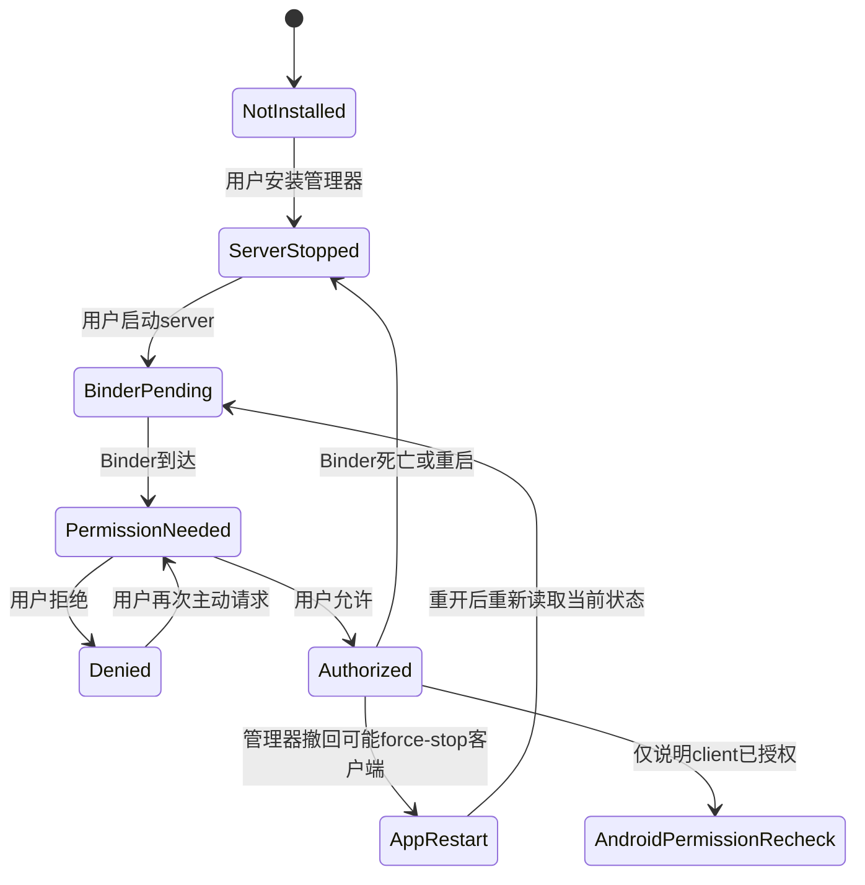
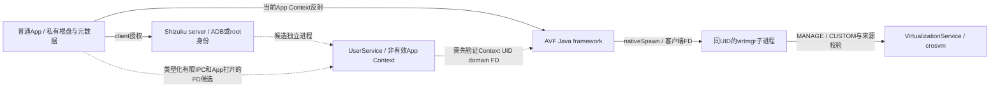

# 研究报告：Shizuku 本机准备、AVF 可交付路径与性能升级

- 日期：2026-10-15；研究基线：`main@428860ad9a1cb335f8be78c157b2ff57faf2a6da`，v0.4.5 / 405。
- 执行者：Codex 主协调 + 授权、AVF性能、缺陷CI、设备工具四条独立研究线。
- 活动 effort：`.scratch/orchestella-avf-shizuku/`。本报告是事实与实施依据；不替代新特权代理架构批准。
- 原始证据根：开发根 `Orchestella/artifacts/avf-shizuku-next-stage/20261015/`，以下简记 E；各子目录的 `preservation/` 为即时保全。Owner 为本阶段主协调，长期保留至验收归档，不自动清理。
- 实际完成范围：固定一手来源、本地源码与已知CI隔离复现、权限与所有权比较、性能实验设计、工单依据。真实AVF、Shizuku设备授权和性能样本均未运行。

## 1. 结论与用户价值

现有普通App反射路径尚未证明可交付。旧403设备实验已在两权限+1vCPU条件下被hidden API拒绝，随后实际回退QEMU；重复授予权限或只把Binder事务转发给Shizuku不能解决App端Java接口访问。推荐先交付可独立验证的准备工作：清洁检出Guest生成闭环、两权限与诚实预检、普通Shizuku客户端生命周期、只读设备与样本工具。类型化UserService VM代理先做隔离可行性并走ACR，不能直接进入生产。

本轮没有连接设备。真实AVF端到端门、同资源性能基准和优化收益保持blocked。可观测性和fixture可先做；没有数据时不替换kernel、不调整GPU/CPU/内存策略，不宣称“近原生”或数倍提升。

相较交接新增的证据是：Shizuku/API完整clone与发布库核对、Binder wrapper与UserService边界、AOSP客户端virtmgr/Context/文件owner、平台connect与stop共锁、custom Linux不应等待Microdroid payload回调，以及CI模板缺失与CRLF字节误判的真实隔离复现。没有新增的事实是：目标ROM上的代理可行性、真实Guest ready与任何AVF性能。

## 2. 基线、取证级别与限制

本轮只读核对：主仓HEAD与本地origin/main相同，单main、单worktree、初始clean；未fetch主仓，不能据本地ref声称实时远端无变化。W:主仓/V:外部根映射不变；SDK/JDK/NDK/CMake和既有缓存保全。JDK17.0.10，WSL Ubuntu-24.04实际Python3.12.3可运行。adb发现零设备。历史405 APK为106454644字节，SHA256 `b280472dcec24e941b893eacb4eadfa99306aff6ad287c8db2d209272277b541`，本轮重算一致，未修改。

| 级别 | 本文含义 | 示例 |
| --- | --- | --- |
| 既有实机 | 引用原版本原设备证据，非本轮重测 | 403 hiddenAPI→QEMU；405键盘/PATH的QEMU验收 |
| 本轮运行 | 本轮实际执行并有结果 | Git/adb发现、CI缺模板隔离fixture |
| 静态已证 | 固定源码可直接确认的行为 | 单权限预检、Context私有目录、平台锁 |
| 待设备 | 缺真实ROM/接口/Guest结果 | UserService有效Context、FD访问、AVF ready |
| 假设 | 必须通过测量裁定的瓶颈 | 重复输入嵌入、缓存/I/O或vsock成本 |

既有713App/65Guest、lint及405设备结果引用最近报告，不计本轮测试。原403日志不能换成405；405走QEMU不代表405已复测同一AVF实验。feature、permission、系统其他crosvm或空终端都不是成功样本。[H1][H2]

## 3. 参考来源、版本与引入结论

| 来源 | 完整revision | 本轮实际处理 | 产品构建与许可 |
| --- | --- | --- | --- |
| RikkaApps/Shizuku | `b844bc491f1790c72328e1a8e5b2349f8978f0ea` | 开发根Shizuku，depth1 clone，未递归子模块 | 只读参考；Apache-2.0，名称/图标/包名声明单列 |
| RikkaApps/Shizuku-API | `a27f6e4151ba7b39965ca47edb2bf0aeed7102e5` | 开发根Shizuku-API，depth1；等于上仓api gitlink | MIT；普通client拟使用Maven发布api/provider13.1.5，不把HEAD当发布库 |
| AOSP Virtualization android16-release | `c984fc337c11ca5edc03ccf02037b2455dd8fcaf` | 官方Git clone443失败exit128；官方Gitiles确认commit后定点源码导出 | 不称checkout、不参与产品构建；逐文件license核对，非整仓统一推定 |
| AOSP frameworks/base android-16.0.0_r1 | `99b01a65cc4c104933788b3143285ab6bae65827` | Shell/Context/权限相关定点GET | 只读，Apache-2.0文件头；不引入平台实现 |
| AOSP system/sepolicy android-16.0.0_r1 | `d4a7f392598cee96d9479a8ac0f84259c19b043a` | 身份/文件规则定点GET，失败路径也记录 | 只读；不能据通用规则替代OEM实测 |
| 现有google/crosvm | `0e9c99daf64e6f5f57f416fa5cfb949f3199c48b` | clean，只读复用，不pull/checkout | BSD-3-Clause及依赖另查；不替换手机VMM |
| 现有gfxstream | `07ee40efb0e7037a9a9b7fe59071e7c4997e7cbe` | 仅核remote/revision/clean，未做本轮图形实现审计 | 不引入、不声称图形跑通 |
| 现有qemu | `c3d48b7d1e89604920e5b81b91140c2ad39a1943` | 仅核remote/revision/clean；保留项目既有pinned构建 | 不升级，GPL对应源码交付不变 |
| 现有virglrenderer | `c8e3fc3bd2f367d92fb1027061fe51afeec5136e` | 仅核remote/revision/clean | 不引入新依赖、不声称GPU性能 |

Shizuku clone逻辑总字节含.git分别1591280和457903；此为本地逻辑文件尺寸，不是网络流量。完整来源、许可证/NOTICE、读过文件、响应hash和体积口径由A/B的reference manifest登记。官方Android16分支pin提交于2025-04，不等于目标ROM或最新AVF模块。本轮不拉整套AOSP、内核历史或十几个无关项目。[A][B]

普通client若实施，锁定 `dev.rikka.shizuku:api:13.1.5` 和 `provider:13.1.5`，官方MavenCentral POM/license已核；传递aidl/shared同版。只引入client/provider，不内嵌管理器server、品牌资源或上游程序。升级后附MIT声明，最终构建实际解析与许可必须再验。管理器Git revision、server协议版本和库发布版本分别记录。

## 4. 首次使用、授权状态与逐门矩阵

Android11+本机无线调试减少电脑依赖，但用户仍需开发者选项、无线调试、系统配对确认和启动Shizuku。配对记录与server进程存活不同；设备重启后通常要重新启动server，不能承诺永久授权常驻。Android10及以下、OEM配对/后台限制、禁用ADB或政策限制需要明确手动兜底。用户锁屏密码/指纹只由本人操作。[A1]

“已安装”不能证明server运行；Binder尚未到达不能永久判不支持；拒绝不轮询弹窗；请求必须来自用户可见动作。异步回调应绑定当前lifecycle和Binder代际，旧结果不能把新一轮覆盖成已授权。管理器撤回的源码路径可force-stop客户端并移除其UserService，不保证原Activity收到撤回事件；重开时需按持久实例状态诚实冷恢复。Shizuku自身权限撤回不等于Android development grant已撤销，二者必须分别复查。[A2]

| 检查门 | 需要的事实 | 失败/未知处理 |
| --- | --- | --- |
| 平台 | feature、ABI、API/module、nonprotected/protected支持 | unsupported与unknown区分，不猜品牌 |
| Shizuku | manager安装、server Binder、server身份、App授权 | 显示当前阶段与操作；不自动启动特权进程 |
| Android权限 | MANAGE与CUSTOM分别实际授予 | 两项状态/ADB模板一致，缺一可进入准备向导 |
| 接口/调用身份 | 目标进程能访问完整custom API与平台入口 | hiddenAPI拒绝保留固定原因，不能用grant覆盖 |
| SELinux/文件/owner | kernel/initrd/root FD与state目录可合法访问 | 拒绝越界，不改全局目录权限、不复制用户盘到公共目录 |
| VM生命周期 | create/run、真实owner/session、失败回调、stop | run返回仅是阶段事件，不能标Guest ready |
| Guest | vsock/认证agent/固定QA命令/服务状态 | 终端可交互与native services分别确认 |
| 性能 | 同设备同资源、真实AVF且无回退的完整样本 | 未闭环/回退/失败只保留失败组，不算AVF收益 |

## 5. 调用路线、身份与所有权取舍

### 5.1 四条路线比较

| 路线 | 有证据的收益 | 已知反证/缺口 | 结论 |
| --- | --- | --- | --- |
| 仅通过Shizuku授development权限 | 可减少手敲ADB | App hiddenAPI仍受限；两权限非SDK豁免 | 可研究权限工具，但不作为AVF打通方案 |
| App解析Java接口+Binder wrapper | 转发远程Binder事务身份 | 类/构造器解析仍在App，当前阻塞发生在这里 | 不采用为本轮AVF解决方案 |
| 类型化UserService受控VM代理 | 官方描述非SDK边界不同，有机会以server身份调用 | Context不是有效App进程，UID/domain、私有文件、state、owner和死亡语义未证 | 首选隔离实验，生产必须ACR与设备门 |
| 平台原生/libavf或平台Terminal方案 | 固定源码可学习完整生命周期与配置 | libavf为APEX/LLNDK平台构建、unstable RPC依赖；不是已证普通NDK分发面 | 平台集成研究备选，不向普通APK直接交付 |

ShizukuBinderWrapper的transact改变远程事务路径，不能重写App classloader的hiddenAPI处理。UserService创建使用systemMain/packageContext等机制不等于改变Linux UID。默认daemon=true不符合本项目“App死亡VM随停”的现行契约，受控实验应显式daemon=false并验证死亡，不能靠配置名假定停止一定及时。[A2][A3]

### 5.2 当前与候选调用链

图中虚线均非已实现或已批准。不能把guest请求转为任意shell命令；App与UserService IPC只允许固定VM操作与版本化字段，验证caller UID/package、实例/代际、资源预算和请求状态。所有未知操作、越界路径、错误FD、重复启动、旧回调、无授权与取消均应确定性失败。

固定Android16 `VirtualMachineManager`/`VirtualMachine.getVmDir`把config/state放在 `context.getDataDir()/vm/<name>`，名称在package命名空间内。构造还依赖package与部分Context服务。路径型kernel/initrd/root需要调用方开FD；shell通常不能直接读App私有路径。仅更换package字符串不能把shell变成App UID，也不能建立合法owner。[B1]

`VirtualizationService`客户端通过JNI启动本客户端virtmgr，保存UDS/RpcBinder/FD。virtmgr `get_calling_pid`用父PID、`get_calling_uid`用当前UID，源码明确二者共享UID；服务端保存requester UID/PID/domain并检查权限。单纯转发某个system binder不能保持原App的完整持久所有权。`IVirtualMachine`对象可按capability转交部分操作，也不意味着创建身份和磁盘访问问题已解决。[B2]

候选FD方案必须区分：原始只读kernel/基础initrd、含秘密的本轮embedded initrd、App私有可写根盘、平台config/instance state。不能记录载荷或真实路径集合；禁止world-readable chmod、symlink逃逸和公共盘副本。是否平台接受调用者传入FD、哪些路径仍被持久化、App升级/UID变化/代理死亡如何收敛，必须实验证明。这个所有权决定不能由本轮主代理代用户批准。

## 6. 可行性实验与设备矩阵

| 环境 | 本轮能确认 | 仍需的门 |
| --- | --- | --- |
| 无AVF feature/非目标ABI | 可纯fixture验证诚实拒绝/软件路径 | 不运行隐式VM探测 |
| Android11+本机无线调试+Shizuku | 官方启动前提、client状态机与源码 | 目标OEM实际配对、server重启、拒绝/撤回 |
| Android16有feature且两权限 | 历史403仍hiddenAPI blocked | 当前ROM完整接口/identity/FD/owner |
| nonprotected custom Linux | 当前adapter精确1vCPU且setProtectedVm(false) | 本应用create/run/Guest/stop完整闭环 |
| protected-only | 与当前nonprotected配置不相容 | 不以Microdroid或pVM成功冒充custom guest |
| 平台Terminal/Soong环境 | 只读参考可解释实现 | 不外推普通第三方APK可用 |

最小实验顺序：先记录APK/commit/ROM/API/module/公开设备别名；在普通App与UserService分别取固定身份/API shape；只用合成只读FD和新QA状态目录验证Context/文件边界；再在明确批准的新QA盘上create/run；绑定owner/session/generation记录vsock/agent/QA命令；最后正常stop并验FD释放、App/server死亡和取消。不得为了通过而改hidden_api_policy、SELinux、targetSdk、thermal、Root/Bootloader或系统分区。

当前设备为零，真实实验未运行。A已交付 `E/research-auth/isolated-probe/` 的AIDL、IdentityProbeService和README：固定独立QA包、caller UID校验、generation、只读身份/有限class/member shape，Class.forName不初始化；capabilityBits明确NOT_QUERIED。研究封板时它是source-only未编译，非完整可安装QA工程。报告与工单后主协调将其落在 `prototypes/avf-shizuku-identity-probe/`，首次aidl真实失败（混用自动/显式方法id），修正inspect显式id=0后aidl/javac各exit0、6个class；这是compile-only新增证据，原研究事实不改写。详见 `docs/reports/prototypes/avf-shizuku-identity-probe/prototype-report.zh-CN.md`。未打包/安装/运行，仍不能证明身份/API/AVF可行。D另交可实际运行的标准库preflight/样本工具及合成fixture；字段标engine=avf或布尔值不是真实性证明。

## 7. AVF生命周期与性能实验设计

### 7.1 正确readiness门

AOSP `VirtualMachine.run`明确返回不代表VM或OS ready。custom Linux不能等待Microdroid `onPayloadStarted/onPayloadReady/onPayloadFinished`作为通用门；平台Terminal明确这些回调不适用于custom VM，当前callback接口没有通用onVmStarted。应记录run returned/状态观察，再独立证明kernel/认证agent/终端命令与服务ready。[B3]

现有App control/terminal lazy vsock，启动注册成功可能发生在Guest可用之前。后台terminal pump失败不会重新回到同步AVF→QEMU catch路径。因此“正在使用硬件虚拟化”与“Guest可交互”要分层，不能把空终端计成功。

项目旧票09已修STOP/FD/持久配置兼容性等边界，不重复包装为本轮新修复。新增固定源码证据：平台connectVsock可在自身mLock中阻塞，stop/close也需同锁；native连接无此方法显式timeout参数。异步包装只能让调用方有deadline，必须另验迟到FD关闭、僵住线程数量和进程死亡；不能写成底层connect已被中断。[B4]

### 7.2 单调阶段事件

至少分离：用户启动、能力/权限读取、资产大小/SHA检查、输入嵌入与原子写、manager/create、run returned、VM状态/错误观察、kernel/init标记、vsock connect、agent认证、终端固定QA命令可执行、native服务ready、stop requested与stopped。若某信号现有通道不可取，标unknown，不解析任意终端正文补时间。单调时钟用于区间，墙钟只做批次关联；不得诊断按键、口令、token或embedded载荷。

冷热组分开：下载解包/首次baseline、已有ready根盘冷启、同配置重启、持久VM config复用与宿主页缓存。同版本同设备同vCPU/RAM/盘与输入hash比较；当前adapter精确只支持1vCPU，MATCH_HOST不能替代用户任意核数。QEMU回退样本保留真实路径，不混入AVF组。

### 7.3 可验证的瓶颈假设

| 假设 | 现有依据 | 首个实验与否决条件 |
| --- | --- | --- |
| ready盘重复装配输入占启动大头 | 共用bootstrap仍准备rootfs/嵌入initrd | 各阶段wall/CPU/bytes；只有占比显著且身份/校验仍可保持才设计缓存，不跳SHA |
| vsock阻塞/重试与lazy失败主导首命令延迟 | retry间隔不是系统call总deadline，平台共锁 | 成功/迟到/永久阻塞/取消fixture与设备计时；无真实分布不调buffer/次数 |
| 单核与全核造成不公平收益 | API仅ONE_CPU/MATCH_HOST，现adapter拒非1 | 首先同1CPU同RAM对照；平台无法表达精确多核则诚实unsupported |
| 磁盘缓存/flush或输入读取影响冷启 | App私有raw盘、FD与缓存层次 | 新合成QA盘固定读写/sync，吞吐/延迟与正确性；不用用户盘做写压力 |
| 网络/服务装配掩盖CPU收益 | 首次包事务、DNS/NAT与ready独立 | 本地可控端点和服务阶段；公网/包镜像波动不当VMM性能 |

CPU：不擅用MATCH_HOST占满宿主。固定libavf API36头文件/实现确有setVCpuCount(int)/CpuTopology::CpuCount，区别于Java的ONE_CPU/MATCH_HOST；但同一实现仍spawn virtmgr、执行RawConfig权限门且受平台LLNDK/APEX分发约束，不能据符号存在说当前APK已有任意核数。其kernel/initrd/disk/createRaw FD存在无论成功与否的ownership转移，移植前需逐项审计。[B5]

内存：RAM预算、RSS/peak与宿主压力分记；16KiB页不是hugepages。固定Java Config.toVsRawConfig没有把mShouldUseHugepages传入custom raw配置，另一个app payload转换路径才有此赋值；当前adapter也没有设置hint。balloon默认false且另有hypervisor.memory_reclaim.supported门。不能用setter/注释证明custom路径THP/balloon已生效，不改sysfs。

I/O：可写测试只用新合成QA数据，明确flush持久化。网络：当前adapter useNetwork(true)对应平台rawConfig网络/TAP门；App的AvfSession未override openServiceForward，生产没有AvfVsockPortForwarder调用，端口转发UI仍接QEMU侧NetworkGatewayDaemon。库中vsock relay可作候选，不能写成AVF产品转发已接线。区分平台出站网络、QEMU gvproxy与入站规则，默认仍回环，不扩大LAN暴露。

图形：CPU虚拟化、guest GPU、宿主渲染与上屏分别验；本轮无FPS数据。温控/电耗：记录充电、温度、性能模式、背景负载和长时节流，不关闭安全机制。

每组保留全部失败与原始样本，先固定噪声控制和试跑，再确定样本数。小样本只给median/range；p95/p99须足够样本并注明算法。禁止先定“提速50%”再拼样本。首个优化票只改已测瓶颈的一个变量，有前后正确性/资源/失败门和回滚。

## 8. 当前缺陷清单与实施边界

| 项目 | 证据级别/触发 | 处理 |
| --- | --- | --- |
| clean checkout guest_init缺文件 | 本轮运行：精确脚本+14输入fixture，--check rc1/FileNotFoundError | 独立早期修复票01 |
| 输出父目录缺失使默认生成失败 | 本轮运行：generation-missing-parent rc1 | prepare模式建generated父目录，失败不得改canonical |
| CRLF模板漂移误通过 | 本轮运行：模板bytes不同而--check rc0 | canonical/render/resource全部原bytes门 |
| 预检/确认/ADB模板只看MANAGE | 静态已证：facts/probe/evaluator/wizard与两个Activity | 两权限一致、预检非运行、1CPU限制、无“近原生”承诺 |
| 退出码丢弃/统一normal stop | 静态已证，实际用户症状待运行 | 明确纯fixture与代际并发门后再修，不顺便移owner |
| stale session/恢复替身与UI线程连接 | 原静态风险；报告后11在actual Controller+合成Store公共seam重现旧A完成将新B的RUNNING写STOPPED，exit1；Android可达顺序/ANR未测 | 保留局部代际缺口证据，上层guard/registry/设备门另验，不称已发生用户数据损坏 |
| 自有report多路console/journal | 多写入源码已证，具体重复次数未测 | 先受控sink/失败可见性实验，保留audit与用户文本 |
| 向导系统重建草稿 | 模型无显式恢复，控件可能部分自动恢复 | Activity recreate门，禁止以configChanges掩盖 |
| 右Alt/死键 | 编码路径静态缺口，真实布局待验 | 框架事件/KeyCharacterMap与硬件键盘门 |

CI实际fixture结果见E/research-defects/evidence/ci-repro-01/results.json：八种观测；输入bytes保持不变；预建父目录两次生成幂等；缺模板/canonical漂移/模板内容漂移拒绝；CRLF误过。既有405 APK的唯一guest_init条目233538字节，SHA256 `0d8a30100a626d544dde3ce2e87c82483bf3cb8c3abf989a1f0cc91490c02c84`，等于canonical，但不能证明clean Gradle接线。

推荐CI小范围方案：`--prepare-resource`先在内存render并严格核canonical，失败零写入；成功只生成APK模板/父目录，canonical不写。`--check`严格核两项原bytes并明确缺文件；Guest入口preflight后prepare再check。保留App现有Copy职责，不引入Python到App preBuild，不为本票迁移全部sourceSets。默认更新canonical行为只留给显式源码更新，不在CI先跑它掩盖漂移。

报告后11有限运行补证：八份精确生产纯Java源码+外部latch harness，actual InstanceLifecycle.Controller/MemoryStore在A正常停止、B已beforeLaunch后，迟到A的afterGuestExit将B状态RUNNING改STOPPED，即使合成新session仍alive。对照当前代exit0正常停止exit0，旧代断言真实exit1，源码hash前后不变。E/reproduction-11/result.json可复核。它只证明公共seam没有代际保护；上层Android调度/Registry/通知/exit23/异常仍NOT_RUN，不能据此声称设备竞态已发生。生产修复不混入本轮01–04，需在可达调用链与状态契约反馈后独立限定范围。

## 9. ADR冲突、ACR与不采用方案

普通client、诚实预检、CI和本地验证工具不扩大guest→host命令面，符合现有L2评估与bugfix范围。新UserService owner/IPC/文件capability与App死亡/撤回语义触及ADR0002/0003/0007/0009/0010/0011/0016，创建ACR-01并冻结相关生产实现。ACR需用户裁定是否按“App拥有用户数据、代理仅持有本轮有限FD、App/server死亡即正常收敛”的边界继续产品化；原型通过也不自动批准。

不采用：全局hiddenAPI豁免、SELinux permissive、Root/解锁、降低targetSdk、私有盘公共复制或全局chmod；不以平台Terminal的删除重建配置逻辑覆盖本项目持久VM；不把Microdroid/pVM、系统其他crosvm、feature/grant、run返回或mock当custom Linux闭环；不替换内核/手机VMM/GPU栈；不在App按regex吞日志/用户文本。

三份治理缺文档已追到66cf781d85435b651f53aeec9584766b273c1623（docs转本地资产）。移出前父提交5c118560879fd44e3a05496777924f2fd462fb4e的原文已定点保全在E/governance-history/，带SHA256。历史GPL policy“当前状态”早于现公开发布，不静默恢复为今日active结论。治理票核历史恢复与勘误，不能凭标题编造正文。已有版本与安全政策不在本轮放宽。

## 10. 分阶段交付、迁移与回滚

报告后先建立spec和独立票：01清洁Guest闭环、02诚实预检/两权限、03普通Shizuku client、04只读验证工具可独立实现；03不得grant或VM代理。05身份/Context/FD隔离实验待设备；ACR-01等待证据与用户；真实Guest、readiness取消与性能依次受设备/owner门；历史风险另列复现票。集成只包含已完成票，按实际功能性质递增版本；增加普通client属于MINOR，拟本地0.5.0/code500，不复用405。无自动发布授权。

迁移不改用户实例、root卷、凭据、硬件选择或持久VM namespace；只生成可再生模板和客户端状态。客户端权限由用户主动请求；拒绝/death保持软件路径。回滚定点撤回本票源码/依赖与文案，保留既有证据和数据。不能通过旧版本覆盖安装、关闭lint/跳测试、清缓存或删除用户盘获得“回滚成功”。

实施后每票中文实施报告与独立双轴review，统一运行实际契约入口与App/Guest/构建/lint，APK逐项bytes/签名/版本核对。设备项只标未运行，不拿JVM覆盖替代。

## 11. 来源与证据导航

- [H1] `docs/reports/tickets/device-avf-validation-20261015/implementation-report.zh-CN.md`，结合428860a发布后交接更正“尚未提交”的历史时间状态。
- [H2] 外部 `Orchestella/artifacts/device-avf-validation-20261015/avf-map/report.txt`，原403证据；不复制其设备ID或秘密。
- [A] E/research-auth/report.zh-CN.md 与 reference-manifest.json；Shizuku/API clone、官方发布POM和源码jar、setup官方资料、固定Shell/sepolicy资料。
- [A1] https://shizuku.rikka.app/guide/setup/ 及本轮保全来源；首次/重启/OEM限制。
- [A2] https://github.com/RikkaApps/Shizuku-API/tree/a27f6e4151ba7b39965ca47edb2bf0aeed7102e5 ：Shizuku、ShizukuBinderWrapper、UserService、provider；https://github.com/RikkaApps/Shizuku/tree/b844bc491f1790c72328e1a8e5b2349f8978f0ea ：server授权/撤回与manager。
- [A3] https://github.com/RikkaApps/Shizuku-API/blob/a27f6e4151ba7b39965ca47edb2bf0aeed7102e5/README.md ，结合官方Maven13.1.5发布sources，不混版本。
- [B] E/research-performance/report.zh-CN.md 与 reference-manifest.json；固定GET原件/URL/hash与失败clone记录。
- [B1] https://android.googlesource.com/platform/packages/modules/Virtualization/+/c984fc337c11ca5edc03ccf02037b2455dd8fcaf/libs/framework-virtualization/src/android/system/virtualmachine/VirtualMachine.java 和同目录 VirtualMachineManager.java。
- [B2] 同pin `VirtualizationService.java`、`android/virtmgr/src/main.rs`、`android/virtmgr/src/aidl.rs`；MANAGE/CUSTOM声明为 `android/android.system.virtualmachine.res/AndroidManifest.xml`。
- [B3] 同pin `android/TerminalApp/java/com/android/virtualization/terminal/Runner.kt`与framework VirtualMachineCallback.java/run文档，B保存原件及请求receipt。
- [B4] 同pin VirtualMachine.connectVsock/stop/close；virtmgr connectVsock；平台libavf边界见 `libs/libavf/Android.bp`。
- [B5] 同pin `libs/libavf/include/android/virtualization.h`、`src/lib.rs`、`libavf.map.txt`与Android.bp；原始FD转移/CPU符号与平台构建范围交叉判断，不把header注释中的balloon名称当实际导出函数。
- [C] E/research-defects/report.zh-CN.md、CI fixture results与只读源码符号；当前代码导航由该报告承载。
- [D] E/validation-design/report.zh-CN.md、README与工具tests；样本工具验证结构/来源关联，不认证物理真实性。
- 主代理本轮：E/baseline.md、historical-apk-identity.json、environment-check.md、governance-history/manifest.json。所有报告引用canonical证据，不整体归档源码/.git。

## 12. 验证与交付状态

本研究未修改生产代码、Guest、CI、ADR、安全policy或全局设置；仅研究文档、本地tracker草稿、外部证据和隔离工具。没有commit/push/tag/release/远程issue/PR。正式实施验证在报告和工单之后单列，不回写为研究阶段设备通过。

本轮研究实际运行：Git/映射/目录核对、零设备发现、历史APK hash、JDK/WSL/SDK定点检查、参考clone/官方GET、CI八观测隔离fixture。D原型最终synthetic-002实际96 unittest通过、无failure/error/skip，71样本为3 synthetic preview与68拒收，设备候选0；CLI正例/混合/恶意manifest分别exit0/1/2符合预期。93项首轮与96项最终不累加，所有时间均为合成，绝不是AVF性能。来源与保全见D报告。

未运行：真实Shizuku交互/权限grant、UserService VM、AVF Guest、性能测量、系统重建/物理键盘/OEM复制菜单。缺设备与ACR在map准确保留。报告后的生产升级与本地集成另见逐票实施报告；其结果不回写成研究阶段设备成功。

## 13. 报告后实施与验证补记

报告/spec/17票建立后，01–04按owner在单main/单worktree实施。已落实：prepare-resource先核canonical再只写generated、strict bytes与入口闭环；两项Android权限和UNKNOWN一致化、完整ADB命令/精确1CPU/诚实预检；官方SDK13.1.5普通client真实transport/共享对话框/请求代际/拒绝/death/timeout；只读preflight与结构样本工具。没有grant/exec/UserService/VM代理产品实现。

实施与审查取得真实反馈并修正：04旧Python地板与junction API不符，现要求Python3.12+且缺能力fail-closed；02确认后向导卡片旧状态已刷新、保留硬件值；03授权readback后旧timeout误覆盖已退役。首审与red/green原件均保留，未以全套成功掩盖审查问题。工具独立双轴最终approve，01独立双轴approve；02/03最终结论见各review报告，不改写设备未验。

本轮实际验证：策略中性/AVF20JavaExec/QEMU相关入口56任务成功；WSL Guest65、新sync10、依赖门6；审查修复后工具100 unittest；离线capability与App715 tests/96 suites，failures/errors/skips全0，Android lint无Error/Fatal但747Warning。四个实际解析AAR为api/provider/aidl/shared13.1.5，完整SHA在E/integration/client-checks-first-pass.json和Gradleprovenance中。两次App suite714→715为同范围迭代，不相加。原型aidl/javac仅compile-only成功，不设备。

新增client触发本地MINOR0.5.0/code500。MIT许可全文入asset并About可达，.gitignore只精确放行third-party-notices.txt，生成Image/resources/docs仍ignored；不强制add原始诊断。当前最终APK/签名/unique guest_init与notice字节门由13实施报告记录，公开发布仍v0.4.5，不自动发布。

可运行工具源码在tools/device-validation/，身份源码在prototypes/avf-shizuku-identity-probe/；正式逐票报告位于docs/reports/tickets/avf-shizuku-01/02/03/04/13，独立review相同id目录。docs与tracker为本地ignored，明确保全于E/planning-seal及后续closeout，不假设fresh GitHub clone已带文档。

始终未运行：真实Shizuku配对/拒绝/撤回/OEM、App安装后UI、真实AVF/Guest/stop/性能、云Guest kernel/build/smoke或Actions重跑。无设备、VM owner/IPC ACR-01、平台取消/FD与性能基线门仍blocked；真实AVF样本0、无提速结论。无新commit/push/tag/release/工作树，保留旧APK、实例和ClassA资产。

报告人：Codex 主协调 / GPT-6.1 ｜ 日期：2026-10-15 ｜ 耗时：未可靠计量

## 2026-10-16 resume-01 最终证据收口

本节仅追加20261016已有实际执行与独立审查事实，复用前文固定研究及本批原型/实施报告；不重做外部研究，不改写20261015“零设备/未实施”的历史段落。E为Orchestella/artifacts/avf-shizuku-device-20261016/batch-01，R为E/resume-01。事实基线仍main@428860ad9a1cb335f8be78c157b2ff57faf2a6da，0.5.0→0.5.3未提交实现全部保留。

### 当前ROM、Context与FD的真实补证

E/device/qa3-manager-capability-receipt.json：UserService真实UID2000/shell调用manager constructor/getCapabilities，返回bits1、protected=true、nonprotected=false；App固定constructor METHOD_UNAVAILABLE。当前ROM不兼容现nonprotected custom Linux adapter，这是真实返回的能力声明，非create/run失败实测，不拿protected/Microdroid替代。

E/device/qa3-context-fd-receipt.json：App新私有QA state可写；US对所给App Context目录在DATA_DIR_LSTAT得OS_ERROR_13/EACCES。固定32B App→US合成RO/RW PFD正向读写、App观察mutation、receiver副本关闭/caller原件保持成立；wrong mode/type/same/replay/symlink/stale/end分项拒绝。closed FD只证发送或接收边界拒绝，不编造具体端或错误。合成PFD可用不证明G4实际VM FD入口、Java path配置/virtmgr/crosvm、合法持久namespace或VMowner；Context目录拒绝与FD可用分别成立。详05原型及ACR/07/08报告。

### 权限对照、QA4末P2与真实隔离生命周期

QA3 MANAGE实际变更后App/US退出、action receipt未更新；重开App真实partial再经固定ADB恢复。退出触发者UNKNOWN，不能由旧回执/新timer修复倒推原因。R/permission-control-summary.json的CUSTOM单项及MANAGE→两权限逐次ADB grant/cold-readback/revoke全PASS、最终双DENIED，仅签ADB对照与恢复，不签软件内grant/readback/同session restore或原产品向导UX。

QA4旧submit deadline P2的精确新源码/patch/实际Activity合成队列原件位于R/qa-deadline-fix，seal identity-v4-frozen-source SHA256 6f83dcaffb72038776fd8088115aac93a6fdff0e0113a09590e73d36ec25af15。旧QA3八失败+当前deadline对照通过→QA4九场景110断言全PASS，每operation token/自己的timer和finish隔离，真实底层返回才释放全局flight。05/spec-final-qa4-20261016与standards-final-qa4-20261016均限定源码/JVM approve；不认证真实Android/Binder精确在途交错。

R/qa4-device-summary.json为PASS_LIMITED_REAL_QA_SESSION_AND_LIFECYCLE：实装code4普通permission session同epoch跨旧5秒点8277ms仍readback；normal remove；App force-stop→US0/server活；固定shell server TERM→App观察SERVER_DEAD_PERMISSION_RESTORE_NOT_CONFIRMED、US0；官方starter重启后binder/clientGranted=true并重新bind成功。最终双DENIED、US0/server1、crosvm/virtmgr0。原件R/device/qa4-final-*及早期after-qa-app-death.json保留。无权限变更、无VM、未强制真实B在途timer交错，不等完整软件grant/restore、VM death或真实平台stop。

QA1 ProbeActivity/IdentityProbeService/IIdentityProbe.aidl三份精确历史源码bytes缺口持续；QA2/QA3/QA4双份raw snapshot和后续source关联修正不倒填QA1，原失败/首审request-changes保留。

### 契约内修复、本地集成与框架实测

20261016授权在11/12/14/15实际反馈后继续必要契约内修复，17/18/19/20承接，22仅离线工具；不是新生产VMowner/自动grant批准，无21文件。C17三P2后seal在E/lifecycle-logs/p2-stop-dispatch-fixed/final-freeze.json；expected-session捕获、watcher先于通知、排他admission均真实red→green，34JDK/Main精确片段与来源绑定有证，17两轴复审均approve。18自有日志五受控sink与双轴approve、canonical/Guest回归已完成，真实PID1/journal/屏显仍未验。

19的30项本地输入与20的14项模型回归、源码双轴及502框架复审已approve；503保持D五份冻结输入不变并在实装.phase5 503/probe3再次运行8场景全部PASS：七向导（真正Activity.recreate第3/4步、invalid schema/distro/resource、creating及invalid-schema-creating）加一输入（KeyEvent/getDeadChar/ModernTerminalView，右Alt resolver仍受控）。creating仅marker，没有真实下载/create事务。实体键盘/OEM IME、物理rotation/uiMode和真实事务跨重建/进程死亡仍独立未验。

R/integration-503/tests-and-source-audit.json：App747 tests/98 suites、failure/error/skip0；lint0Error/0Fatal/748Warning，C17输入与D五输入全匹配。R/integration-503/framework-acceptance.json记录上述503八真机框架PASS。R/integration-503/final-apk-verification.json核两503包版本/签名/唯一guest_init和完整MIT、pinned Image/baseinitrd/runtime manifest/QEMU同500。原包106520160B/SHA256 53a2c4947724a048101ba62918da44996204b827a0422c4d806f3a09860f2dd2；.phase5 106520184B/SHA256 9a02ca4327fdf6ca5cc2bc55182e0899c8a4411a5909e655e2da0fec13ed6399。仅.phase5真实安装；原产品code300另一签名及user128数据保留，不卸载/清数据绕过，原包503仅为已核产物。更多固定条目/证书见13本批补记及原件，不复制载荷。

本批原runtime contract/capability/AVF20/QEMU64任务、Guest65/sync10/依赖6和工具127=100+27各有独立实际原件。22离线recorder双轴approve，仅COMPLETE_OFFLINE/synthetic_seam/Python或注入clock，不产生真实receipt/样本；生产事件偏序和固定QA来源缺口沿原owner动作包，不回填时间、不解析终端正文或增reader。旧715→746→747、126→127及局部/重复套件均不累计覆盖。

### 对既有决策、当前阻塞与交付的影响

真实nonprotected=false加G4/state/owner未闭合，使07/08准确blocked，09真实AVF样本0，10无数据不优化/不报收益。ACR-01用户未裁定，当前R0保留软件执行是技术建议；未来需兼容平台、合法G4/state和具体owner/FD/assembled initrd秘密可读边界、正常停止/死亡/迁移回滚实证后，再由用户裁定及必要ADR/spec修订。本轮未实施新生产VMowner/特权IPC或改变暴露面。

未验门保留：完整软件grant/readback/同session restore、拒绝/记忆拒绝/管理器撤回、首次本机配对、设备reboot/OEM、原产品升级及向导UX；跨UID Binder/真实在途deadline/迟到FD/state升级；真实FGS/UI重入/VM正常退出/强停/冷恢复；真实Guest日志/PID1/journal/native/recovery/failed和编辑体验；物理键盘/OEM IME、rotation/uiMode、真实创建事务；真实Guest/服务/normal stop与AVF/QEMU同资源基准、云CI及发布。QA4 US死亡不能关闭VM stop门，8框架/127工具不能签AVF成功。

scope/spec对新授权以20261016增补解释，map整体更新日期、22文件矩阵、依赖图与frontier并保留历史引用；01–04/16历史范围保留。指定13报告追加当前集成事实，正式最终编排报告由主协调写。本次文档收口无生产/tests/version/sign/设备/Gradle/git/ref/network/清理，研究原文只追加。R/tracker-closeout与R/preservation/tracker-closeout保存精确文档/显式源码before/after及证据hash索引，无整仓/.git归档、.log或secret/serial/用户正文外发。

报告人：文档收口 Worker / Codex GPT-6.1-sol ｜ 日期：2026-10-16 ｜ 耗时：未可靠计量

## 2026-10-17：独立 Debian QEMU 真机验收增补

本节为后续实测，前文“待设备/待真实Guest”保留当时含义；当前进度以本节为准。唯一摘要为本批 `resume-01/qemu-device-summary.json`（19份原件的路径/bytes/SHA），原件及摘要均有即时 preservation。设备user0，独立 `.phase5` code503，新建且仅本轮使用的 `qa-qemu-503-01`；未操作原产品实例或其他user数据。

真实输入为Debian13、1vCPU、801MiB、4GiB新raw盘；App私有rootfs实核90351092B、SHA256 `000f18fbcea39b276754dee7a1972df357f53329371c2df477e6504e15ed2907`，与当前清单一致。实际下载命中端点未完整观察，不将配置URL当实际端点。App显示QEMU软件虚拟化，且进程为独立App UID下的QEMU子进程；这不是AVF成功或性能对照。

原终端固定查询实证UID0、PID1=systemd、`status=ready/stage=verified/attempt=1/operation_exit_code=0`及done存在。owned firstboot服务`Result=success/ExecMainStatus=0/ActiveState=active/SubState=exited`，`StandardOutput=journal/StandardError=journal`；当次owned marker在journal和owned文件均可查。没有完整统计常规console副本数或逐report唯一性；owned文件重复repository-refresh阶段名不能当同一event重复，audit/kernel消息继续保留。

Guest `/sbin/poweroff`、App“正常关机”、仅新QA“强制断电”均实际令QEMU子进程退出并显示/持久化STOPPED。强制停止及最终关机后owned前台服务不存在；同一实例在正常与强制停止后重开，固定持久标记仍为`ORCHESTELLA_QA503_PERSIST=1`，force后停机记录与重启后最终停机记录的实例ID及根盘引用hash一致。最终通过Guest正常关机收尾，QEMU0、owned前台服务无，测试盘保留。成功停止的精确owner exit code未独立记录，不能由UI或EOF倒推0；force后UI复用“guest正常关机”文案，仅签有意停止及底层退出，不称Guest进行了graceful shutdown。

剩余：真实exit23/wait异常/错代竞态注入、EOF先于owner退出、Activity重入与通知完整矩阵、App进程死亡后VM的真实冷恢复；日志native-failed一次摘要、无journal recovery、console全程计数/逐event exactly-once及完整编辑体验仍未验。原型QA4的US死亡不代VM死亡；QEMU结果不关闭07/08/09/10/ACR。当前ROM nonprotected=false、真实AVF样本0不变。创建/停止过程中未改源码或系统策略、未清数据/卸载/公开根盘/增reader。

报告人：主协调 Codex / GPT-6.1 ｜ 日期：2026-10-17 ｜ 本节仅同步新增实测，不重写旧封板
