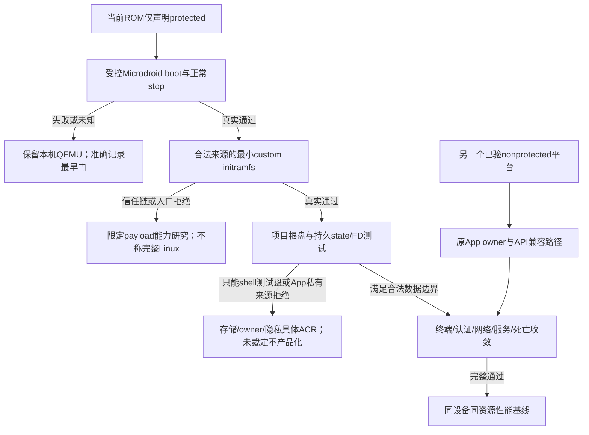

# 详细调研：AVF 自定义 Linux、骁龙支持范围与当前设备路线选择

- 日期：2026-10-17；执行者：Codex主协调与AOSP/protected、ADB/vsock、平台主张三条独立研究线。
- 用户问题：提供新骁龙设备视频文案，要求读lfdevs教程、AOSP Custom VM和无root vsock讨论，判断没有新设备时能否调整当前SM8735路线或开展研讨。
- 当前研究基线：main@428860ad9a1cb335f8be78c157b2ff57faf2a6da + dirty0.5.3；不改生产/Guest/设备/ADR/工单，不运行教程或新VM、不commit/push/发布。
- 证据简称E：开发根 `Orchestella/artifacts/avf-route-research/20261017/`；blog、aosp-protected、vsock-adb、platform-claims各自有原件/manifest与preservation。旧设备证据继续引用canonical，不伪装成本轮新实测。
- 封板状态：研究完成。博客全文、discussion完整快照、AOSP版本与protected路线、两参考App、供应商主张已合成；未证/未实测逐项保留。来源manifest及研究级核验另见E，不将资料保全当设备测试。

## 1. 目前可成立的结论

现有证据不支持“SM8735硬件物理上不能运行unprotected VM”的结论。已证的是当前HONOR ROM不声明non-protected支持，且现Orchestella adapter以该支持位为必要条件。硬件EL2能力、固件hypervisor、ROM模式开放、调用身份/权限、Guest镜像信任、产品交付分别是门，不能合并成一个芯片支持/不支持标签。

用户给的“最新骁龙/小米18/Android17”视频文案、教程当前页面与教程配置不是同一份版本证据。主代理完整取得博客，B固定guide当前main并完整读取discussion；能确定教程U-Boot示例`protected:false`，不能据此证明当前protected-only设备可运行。供应商官网已确认Gen6的两个营销名及Xiaomi18ProMax产品名；具体SoC/GPU/内存/ROM组合与“新增Linux官方支持”未取得完整一手证据，不凭训练知识断言虚假，也不以旧博客替新视频。

无root ADB vsock通信有公开源码与讨论依据，但它解决已启动Guest的访问，不增加VM模式、不解除普通App hiddenAPI，也不保证完整IP网络。一个可以在电脑/本机终端运行的shell命令，不等于能安全迁入普通APK、管理私有盘并维持用户会话。

方向建议按“保留当前Full Linux产品契约，现手机做有界protected能力实验；兼容nonprotected平台做原路线验证”的并行评估，不立即重构生产或改Rootless承诺。protected实际boot、custom完整Linux、无电脑产品化须分别设停止门，源码/理论通过不能直接作为承诺。

参考App还说明API访问适配与VMowner迁移是两件事：在兼容模式的平台上，可以先比较“仍由原App持有VM、最小API兼容层”与“新增UserService owner”的代价；本进程非SDK访问处理需独立targetSDK/ROM/依赖审查，并不天然等于修改全局hidden_api_policy。不能为了处理接口访问就预付所有跨进程owner/FD复杂度，也不能以此绕过当前protected-only或固件来源门。本文没有引入/执行这些库。

## 2. 输入、版本与证据层级

| 来源 | 实际读取/版本 | 使用边界 |
| --- | --- | --- |
| 用户视频文案 | 小米18ProMax、Snapdragon8EliteExtremeGen6、Adreno850、HyperOS4.0.6.0.XEOCNXM.D01/Android17 | 作为待核主张；文案本身不是当前设备实测或官方变更记录 |
| lfdevs博客 | 原始48693B HTML、完整260行文本；published2025-08-26T16:24:42+08:00、modified2026-09-15T19:35:33+08:00；CC BY4.0 | 作者教程及当前快照，不普遍替所有ROM背书 |
| guide GitHub源码 | `c2b1a045c3b402c453d7a3a0a7413d830cd824af` | B核fullSHA及配置，不能把moving main当已锁输入 |
| discussion2 | 主帖2026-01-06，更新2026-09-30；3顶层+1回复，pagination全部hasNextPage=false | 用户实测/评论，未给精确设备、ROM、adb版本；非产品端到端验收 |
| AOSP Custom VM | android15-qpr1-release固定 `a435bfa0ea482e240d7d05d5f459e8304db149b2` | 用户指定cs链接的官方Gitiles等价源码；与Android16及目标ROM分开 |
| AOSP Android16 | 已固定 `c984fc337c11ca5edc03ccf02037b2455dd8fcaf` | 解释服务检查与API，不冒充HONOR APEX精确源码 |
| 当前手机 | 前一回合2026-10-17检测，HONOR MEY-AN00/SM8735/API36 | 本轮只引用，真实AVF Guest样本仍0 |

博客嵌入BV1PdaJzbEa4，但用户新视频文案没有给自身视频链接。不能把该旧iframe当小米18新测试的身份。所有抓取失败、动态文档、未核许可在各source ledger里记录；不以HTTP失败推不存在。下载只限必要公开小文件，无大型Debian镜像、上游脚本执行或整AOSP clone。

## 3. 指定教程实际做了什么

### 3.1 前置条件与路线

教程正文“系统需求”为Android13+，列Tensor、Dimensity9400、Exynos2500、XringO3及更新；同时称骁龙8Elite/Gen5仍仅保护型，并指向polygraphene的Root Gunyah指南。这是作者当前表述，需要与真实ROM/上游检查交叉验证，不能转成所有同芯片型号永久黑名单。

无头路线下载Google AVF Debian资产（ferrochrome/latest），对root_part做4KiB尺寸对齐，kernel/initrd/extra/root分别放`/data/local/tmp`，以系统`vm run`启动。另一条U-Boot路线下载boot_crosvm_aarch64的u-boot.bin和Debian13 nocloud ARM64全磁盘，再`vm run --cpu-topology match_host`。它并未演示普通第三方App如何避开hiddenAPI、拥有平台state、把App私有根盘合法交平台。

教程中的sudo mount/chroot/qemu-img属于开发主机镜像制作，不应误读成手机每一步均要求Android root。但其网络FAQ的TAP设置明确包含adb root；vsock/桌面FAQ又保留“需要root、未测”的旧说法，与新discussion的无root通信方法有版本差异。

博客建议默认`vm run-microdroid`判断自定义Linux支持，依据不足：protected Microdroid和nonprotected custom不是同一能力；默认命令失败可能仅默认非保护配置不兼容，protected payload成功也不证明任意Linuxkernel/U-Boot成功。应分别查询模式，再用同模式、同身份、同镜像的受控启动取证。

### 3.2 U-Boot配置的重要差异

B固定guide的JSON原件，主代理逐字读取：

```text
protected: false
bootloader: /data/local/tmp/u-boot.bin
writable raw disk: /data/local/tmp/debian-13-nocloud-arm64.raw
cpu_topology: match_host
memory_mib: 8192
sharedPath: /sdcard, writable=true
network.backend: user
auto_memory_balloon: true
gpu.backend: virglrenderer, context_types=[virgl2]
```

这里只摘决策字段，不执行。每项都依赖相应平台版本/编译/权限，JSON里存在不等目标ROM接受。尤其`protected:false`直接区别于当前手机能力；可写整个/sdcard与本项目只读Downloads白名单冲突；全宿主核数/8GiB/balloon改变用户资源语义；GPU字段不证明实际硬件渲染。不能把整套示例复制进产品获得“支持”。

镜像也不同：nocloud是带分区的全磁盘与U-Boot启动，当前Orchestella是pinned共同kernel/initrd+App私有raw单根盘及Guest内provision。U-Boot/磁盘分区本身不必然破坏Full Linux语义，但若替换当前根盘形态、boot-device、身份、输入来源或跨策略兼容，就需有明确迁移与ACR，不直接用下载盘覆盖用户实例。

`latest`镜像/U-Boot在线最新选择不是项目锁定输入：若以后采用，需固定来源、SHA/size、版本和LICENSE/对应源码，不重复用浮动URL作为发布验证。本文未下载这些大型资产。

## 4. 无root vsock讨论：有效机制与不足

主帖以已启动Guest为前提：Guest预装openssh-server+socat，将VSOCK端口22转到Guest本地TCP22；Android主机本机无线ADB配对/连接后执行：

```text
Guest: socat VSOCK-LISTEN:22,fork TCP:127.0.0.1:22
Android本机ADB client: adb forward tcp:22222 vsock:<实际CID>:22
Android本机SSH: ssh root@localhost -p22222
```

CID2048只是帖子样例，应每session发现/绑定，不能硬编码或按CID猜owner。Guest内root与Android root不同，Linux服务安装/低端口不等Android提权。另一个Guest实现为systemd ListenStream=vsock::22/Accept=yes，再sshd -i，省去socat。

作者“本机ADB”说明不必始终连接电脑，但仍有开发者选项/无线调试/配对/client环境/server生命周期前提；ADB的vsock远端连接发生在adbd身份，普通APK没有因此获得任意vsock/VM操作权。讨论中的SSH用途是已启动Guest的访问，非创建/持有VM/避免hiddenAPI的解法。

ADB源码Android16固定 `ce023afef190b0cea7f8939e9dd5ee3ee79b137b` 实际支持vsock:CID:PORT socket解析/AF_VSOCK连接；对照的旧Android8.1固定system/core `f469ebae8604bc756259c7305f8cb7617ca18ddc` snapshot没有该分支。本轮未追到首次引入提交/最低platform-tools发行版，不能把前期未封板信息或两个时间点变成最低版本结论；可以确定它不是Android17或用户新芯片独有的新通信能力。SELinux固定 `d4a7f392598cee96d9479a8ac0f84259c19b043a` 允许adbd_common建vsock socket，普通App不在同类直接create/connect域；原VMowner通过manager创建并回传FD是不同的受限路线。

重要端口差异：固定Java `MIN_VSOCK_PORT=1024`，validatePort和virtmgr connectVsock拒绝privileged低端口。所以ADB直连Guest vsock:22可以成立，并不意味着APK `connectVsock(22)`同样可用；产品应选择>=1024的Guest VSOCK端口，再在Guestrelay到TCP22。本项目9100/9101规划应保留，不为沿用教程样例变低端口；此为源码门，尚未在本轮设备新测。

主帖网络只提出SSH反向隧道/gost/HTTP-SOCKS代理/WireGuard的理论组合，并报告大流量降0、MTU和限流无解。gvisor-tap-vsock推荐被划掉且未尝试。不能把这篇当“无root virtio-net/NAT、apt/DNS完全可用”的验收。原讨论回复还明确官方Terminal是virtio-net上网、端口vsock不必经过adb forward，且该ADB链性能差；它也没有给精确性能样本。

后续评论提Podroid和TerminalAppPlus，仅是新参考线索，不能据“两个grant即可”直接推当前SM8735适用。B已核既有Podroid固定checkout `ce0121896b2895637ab1f656cbb0d75fa2874489`：集成local HiddenApiBypass6.1、启动时调用豁免，而其AvfCapabilities仍要求non-protected，protected-only会明确Unsupported并回退QEMU。所谓“两个权限足够”隐含已有API访问处理和兼容VM模式，不等本项目App直接反射只grant便通。TerminalAppPlus固定 `88a015928ebc26012f515ae34859a431de1a9c98` 的README声称作者验证PKB110/MT6991/Android17/GenieZone；compile/min/target均37，当前API36手机不能直接安装它的现配置APK。Application使用本进程HiddenApiBypass、compileOnly hidden37 stub不打包实际实现；VmConfigDocument.parse明确拒绝protected:true。数据面由App拥有VM的connectVsock(7682)转PFD、Guest按目标TCP端口relay，listeners限loopback，Shizuku主要用于固定两权限授权，不是一个持久UserService数据面。这是可借鉴连接设计，不能把它说成已经解决本机protected路线。仓内混合AOSP/Termux等许可证，整体许可未完成闭包，未复制实现、构建或实测该App。

还有明确ADR影响：ADR0010历史修订称pVM会“阻断双向数据交换”，与官方固定vm_shell.sh提供protected Microdroid→adb forward→Guest adbd双向访问不一致。应在现ACR-01影响检查中提出更正该绝对表述，并分别描述内存隔离、合法vsock字节流、显示/共享数据面。本文只记录冲突和建议，不静默修改ADR；通信可行也不关闭customLinux启动门。

## 5. AOSP/protected/Gunyah关键核对

### 5.1 官方示例、权限和版本

A完整读取A15QPR1文档9165B：完整Debian/ChromiumOS示例均protected:false。文档headless步骤写adb root，但服务实际权限函数是UID0豁免部分Androidpermission，其余caller仍可按MANAGE/CUSTOM走相应检查；不能把示例root改写成服务对一切custom硬要求UID0，也不能反过来宣称所有普通APK只grant即可。

Android16文档1218B已删去完整Debian/ChromiumOS步骤、指向Terminal GUI，删文不是拒绝Debian或证明protectedDebian的代码。官方main本轮解析为175a51b30123fa6b02b541f1969665708f7ec2c3、元数据时间2025-03-26，不能把这个moving main叫Android17支持证明。

固定A16 CLI raw VmConfig与Java/VmLauncher转换不同；前者没有教程所有GPU/network/sharedPath字段且不拒未知字段，一些字段可能解析时被忽略。JSON parse成功不证明GPU/网络/共享已生效；还需实际二进制、buildflag和服务接线。U-Boot与直接kernel/initrd是不同且互斥的启动输入，不是一个增加权限的中间层。

### 5.2 App私有盘是比“能boot”更直接的产品门

固定A16 virtmgr protected分支检查kernel、initrd、整盘disk.image及多数partition的实际FD标签。允许shell_data_file、apk_data_file、staging_data_file、system_file等，明确排除app_data_file/privapp_data_file；vm-instance身份分区有特定豁免，不能把用户根盘改名冒充。A15和A16整盘检查位置/覆盖有差异，旧版本行为不能倒推本机Android16。

这对本项目不是小细节：App预先打开其私有root FD，再经Shizuku/UserService传递，**不会改变原文件label**。若目标ROM沿该protected规则，现私有raw根盘会被拒。`/data/local/tmp`合成测试文件可能通过该来源门，但将真实用户盘长期放那里违背ADR0007/Export及隐私边界；本轮不采用公共复制/chcon/目录放权。

APK文件允许标签也不代表可把APK中的asset直接当rawkernel/root：已读raw接口只持整个FD，没有AssetFileDescriptor子区间offset/length语义，crosvm通用镜像加载从offset0读。把asset解包到App私有目录又回到标签门。正常Microdroid AppConfig专门理解APK/idsig，与任意raw镜像不同。更换启动封装/存储owner之前需独立证据与ACR。

### 5.3 Gunyah固件不是统一的OEM签名故事

A16 virtmgr/crosvm区分有firmware、customfirmware、without-firmware的protected模式，某些Qualcomm认证路径另需Gunyah与instance/PAS身份；普通customJSON没有自动获得这些条件。AOSP正常pvmfw验证kernel的AVB格式/签名、initrd hash descriptor与实际embedded trusted key，还有设备树/page/rollback等要求。

但AOSP默认key构建指向avb_testkey_rsa4096；目标OEM可能替换，因此应写“实际固件信任键”，不能一概“只能OEM私钥签”。pvmfw还有为Qualcomm QTVM在无DICE handover时跳过本层DICE/AVB/RBP的分支，验证可能在TrustZone完成；这不是未经验证任意Guest获准的说明，也证明不能把普通pKVM/pvmfw要求一概套Gunyah。

HONOR的实际固件/信任key/驱动分支/without-firmware可用性仍未知。本轮未读取key文件、不更改pvmfw属性或固件，不能把AOSP测试键或QTVM分支存在当本机解法。U-Boot也可能先被外层启动链拒绝，不能绕开最早信任门。

### 5.4 Root参考具体改变了哪些层

polygraphene/gunyah-on-sd-guide固定61ac570c2d467274d1d7d73605dcc685af6945b8，作者目标是Lenovo Y700 gen4、Snapdragon8Elite、Android15特定ZUXOS，前提Unlocked bootloader+APatch root。README主路径使用外来crosvm-a16、Binder库/LD_PRELOAD和memlock调整，直接protected-without-firmware、自编Linux/Debian；PVMFW.md则记录该外机信任AOSP公钥，通过AVB包装/额外vm-instance和DT配置运行，未要求必须patchpvmfw。

两条都是外机作者Root实验记录，既不是HONOR无Root证据，也不是新骁龙官方普通App支持。Root只绕某些permission检查，直接crosvm还绕开平台服务的一部分来源检查；无firmware安全承诺不同。文档的可选SELinux削弱步骤不在本项目默认路线，本轮没有执行。

最后，A16服务的platform networkSupported/TAP路径对protected有明确拒绝，属于网络门，不能因此说Guestboot或vsock必然不可用。若protectedboot成立，后续只能再独立验证合法数据面/IP服务，不能先承诺沿当前平台网络零改动迁移。

完整逐主张、固定源码URL/文件级许可证/失败与未知见E/aosp-protected/report.zh-CN.md、manifest.json。

## 6. 新芯片“官方Linux支持”的主张

C已完成有限官方核验并保存原文/元数据，结论必须拆成几条，不整段一律认可或否定。

| 视频文案中的主张 | 核验结果 | 依据与限制 |
| --- | --- | --- |
| Snapdragon8EliteExtremeGen6、Snapdragon8EliteGen6名称 | VERIFIED | Qualcomm官方smartphones HTML JSON-LD与smartphones.md正文明示两名称；网页资源Last-Modified不是产品发布日期 |
| Xiaomi18ProMax产品名称 | VERIFIED | mi.com首页和官方产品页导航/标题确有名称 |
| 手机所用SoC、Adreno850、16GB组合 | UNVERIFIED | 本次参数页与概述页返回完全相同hash的网页壳，没取得技术规格正文；不能由官网名称推配置 |
| Android17与完整HyperOS4.0.6.0.XEOCNXM.D01构建 | UNVERIFIED | 没取得这组ROM的官方更新公告/版本索引或视频原件绑定，不是判不存在 |
| “终于官方支持LinuxcustomVM” | UNVERIFIED | 当前所读高通/小米页面未给对应非保护VM开放/驱动/固件技术声明或提交；产品名不是功能证据 |
| SM8735官方营销身份及本机硅层限制 | UNVERIFIED | 本轮有限一手资料没有完成芯片号到商品规格映射，更没有证明其物理不能unprotected |

新视频原始URL/BV/发布时间未给，博客旧iframe不能作该新测试证据。官方页面确认名称不能认证作者实际测试过程；网页取不到规格也不能否定视频真实性。本轮检索受WebSearch provider、CAPTCHA、GitHub API限额及部分官网壳/超时限制，全部如实留痕，UNVERIFIED不声称穷尽搜索。

QUIC Gunyah官方README固定 `254727746fce809aba0e629a13711a954b246968`，明示Arm64 EL2、独立于Linux及RM平台策略层。官方RM初始2021提交 `a16ed594c84312cce7ae84f0d208e9e2112d0866` 当时明确仅primary；2023提交 `54ce6544c7cabac01d876f545d3d1faf19704e01`移除该限制段。它体现软件/文档演进，不是nonprotected首个实现日，也不是旧商业手机stock/rootless支持的发布承诺。

所以，即使新平台“正式开放customLinux”进一步被证实，也可能是固件/RM策略、内核驱动、crosvm/AVF或OEM接口开放的变化，不足以推出上一代芯片完全没有硬件虚拟化，更不能给当前手机永久硅层否定。详细矩阵和最小官方引文见E/platform-claims/report.zh-CN.md及source-excerpts.zh-CN.md。

## 7. 对当前设备的含义

当前已证：MEY-AN00/SM8735，Android16/API36，CONFIG_KVM/GUNYAH=y，/dev/gunyah有、/dev/kvm无；平台vm info退出0，仅protected，OS列表microdroid；旧US getCapabilities bits1且两权限已granted。当时普通App hiddenAPI受限、US访问App私有state EACCES，合成32B FD成功。这些是多道独立门，不互相替代。

未知：精确后端/固件版本；为什么未开放nonprotected是芯片硅限制还是OEM配置/策略；protected实际Guestboot；合法customLinux boot/文件FD/网络/owner是否可交付。当前无硬件Guest成功样本，系统qcrosvm不能借用作本App通过证据。

因此现在讨论“硬件不支持该放弃”过早，讨论“只改protected=true即可”也过早。应先以最小合法protected实例证明底层能启动和有界停止，再决定fullLinux路线投入。缺新芯片不妨碍这项判定，但它不能验证最新芯片/Android17的新功能。

## 8. 候选路线与取舍（研究建议，非已批准变更）

| 路线 | 当前设备收益/可验证问题 | 主要依赖与代价 | 建议 |
| --- | --- | --- | --- |
| 保留QEMU Full Linux，诚实mode能力检测 | 已有Debian/systemd/正常停止基础，产品继续可用 | TCG CPU成本，不能称硬件加速 | 主线继续，避免为AVF等待停止所有产品工作 |
| 兼容nonprotected平台保留原AVF路线 | 最贴近共同kernel/raw根盘与现adapter，能验证真实加速 | 用户暂无合适新设备；不限最新骁龙，Tensor/其他平台也只按具体ROM实测选择，不凭教程名单采购 | 中期并行；不要求现在购机，远程合作测试仍需明确授权/数据范围 |
| 当前手机protected Microdroid诊断 | 证明当前硬件路径能否实际create/start/payload/vsock/stop | 受限API、控制进程、有限时限/FD/stop；成功不等完整Debian | 首个研究实验候选，不立即改生产 |
| 当前手机protected custom Linux | 可能保留自有guestkernel和Linux语义 | 目标firmware未知；A16典型App私有kernel/initrd/rawdisk来源被拒，平台pVM网络亦有独立拒绝门；state/owner/迁移未证 | 有界研究候选；先boot事实，再App私有盘/能力门，不能直接取代现路线 |
| Microdroid payload承载专用工具 | 可试硬件执行某些受限任务 | 不保证systemd/Docker/任意rootfs/共同kernel/现根盘；新类别与能力语言 | 只有用户接受产品承诺变化才研讨，不透明替换Full Linux |
| Root/OEM Gunyah定制 | 有助说明限制在哪层、可能运行任意guest | 违背当前无Root默认、系统/安全/分发/维护代价 | 只读对比，不在本轮执行/不设默认前提 |
| Userspace Compatibility Runtime | 在受限环境提供部分原生用户态工具 | 无独立guestkernel，承诺与Full Linux不同 | 可单独产品决策，不称VM硬件加速或第三执行策略 |

保护型VM可通过vsock通信，不等必须完全取消宿主Guest交互；硬件CPU虚拟化、网络、图形加速、显示与共享数据分别研究。不得拿GPU/桌面截图或快的PRoot用户态程序证明AVF加速。

## 9. 建议最小实验与停止门

本节只定义可审阅实验，不运行设备、不默认批准新owner架构。



1. **模式/身份声明**：固定ROM/APEX、QA APK/source/hash、当前user、App/控制进程UID/domain、两permissions、protected/nonprotected分开。App/API不可达时记录类别；只grant不算过门。
2. **受控protected Microdroid基线**：新QA实例、系统可信内置payload，不使用用户盘；实际create/start→payload挑战→合法vsock→明确stop/FD回收，App/server/deadline分门。主机Future超时不当远端已结束；运行前必须具备总deadline、停止确认和禁止同盘并发的控制。
3. **custom启动最小挑战**：只有上一步成立，才尝试合法来源、已校验的极小自有QA guest；明确文件label/FD、bootloader/firmware要求，禁止修改全局策略或公共复制用户盘让门绿。protected系统payload成功不代customLinux。
4. **私有持久state/根盘与owner**：新合成QA盘，固定App保有权、代理最小capability/秘密可读范围、调用验证/代际/正常和死亡stop，满足ACR-01具体裁定；32B FD成功非真实VM入口。
5. **完整Full Linux契约**：同类rootfs、PID1/systemd/真实root、bridge/终端/resize、DNS/出站/loopback转发、服务ready/正常stop/数据保留。缺项如实能力化，不把Microdroid工具环境冒充完整Debian。
6. **性能**：真实AVFsession+同CPU/RAM/输入/冷热条件才与QEMU比较，保留所有失败；一次只优化已测瓶颈，不使用match_host全核对单核TCG，不关thermal/降资源底线。

最早步骤失败须给API/权限/信任/文件/资源/超时等具体门，不无限重试或先写完整产品代理再补证据。若只能靠root/解锁/系统分区或验证绕过，停在本项目授权边界，给研究结论而非执行。

## 10. 研讨需要裁定什么

- 保留“无需Root、完整Linux、共同kernel与持久raw根盘”的核心契约，还是愿意新增能力较窄的受保护工具Runtime？这是产品选择，硬件声明不能代答。
- 当前手机protected fullLinux若合法boot/state或网络不可行，是接受本机QEMU+其他兼容平台AVF，还是投入Root/OEM独立路线？现默认推荐前者，不能让新平台视频强迫购买特定芯片。
- 新控制进程可以读取本轮embedded initrd/token/凭据的最小范围是什么，App/server死亡时谁确认VM停止与盘lease？属于现ACR-01，用户研究授权不等于已批准。
- ADB/vsock仅作为QA调试与可选本机高级入口，还是允许产品长期依赖无线ADB？建议优先内部原认证通道，ADB调试单独签收；讨论反馈的吞吐问题不能成为默认产品网络。

这些选择在实验门1–3拿到结果后才有实质依据。当前可自主完成资料/隔离测试设计，不需先问用户泛泛“是否继续AVF”；真正新权限/数据/架构承诺再拿具体证据研讨。

## 11. 验证、许可与未完成

本轮实际读取公开博客全文/metadata、guide配置、discussion全部主帖/评论/回复与固定官方源码/有限供应商资料。没有下载执行上游脚本、拉镜像或操作手机；当前设备结果来自前一回合canonical。正式报告外的每来源全文/短片段、URL/time/fullpin/hash、失败记录在E对应线manifest，原始证据不用.log且即时preservation。

博客CC BY4.0署名保留；guide根许可证未确认不复制其代码入产品。AOSP/Gunyah/其他参考按文件来源审许可，研究引用不等引入依赖；新增U-Boot/kernel/rootfs若分发需完整对应源码/许可证/资产自检，不只上游URL。现pinned二进制未替换。

未完成：新骁龙文案设备实测/官方支持时间线充分闭包、目标protected Guest/customLinux、无rootADB吞吐/稳定性/出站网络、普通APK本机完整授权/owner/FD/持久性。新生产架构、用户裁定、AVF性能均未执行或声称通过。研究建议不改accepted ADR或原工单Status，不新增默认LAN/共享目录/特权Guest操作。

## 12. 关键来源导航与后续使用

以下为实际读取的一手/作者原始来源；官方实现固定版本与第三方经验分开。逐文件hash/bytes/time/失败在E各主题manifest，不复制所有原文到canonical。

- [用户指定lfdevs教程](https://blog.lfdevs.com/posts/avf-run-linux-zh/)：作者教程、CC BY4.0，本轮完整HTML与文本快照在E/blog。原博客标注的“需要root”“OEM签名”等应由后续固定实现限定，不作为平台普遍事实。
- [Android15QPR1官方Custom VM文档](https://android.googlesource.com/platform/packages/modules/Virtualization/+/a435bfa0ea482e240d7d05d5f459e8304db149b2/docs/custom_vm.md)：用户cs.android.com链接等价固定源码，Debian protected:false。
- [guide固定U-Boot JSON](https://github.com/lfdevs/run-linux-on-android-guide/blob/c2b1a045c3b402c453d7a3a0a7413d830cd824af/configurations/avf/u-boot/u_boot_vm_config.json)：第三方原配置，不是本项目可直接采用的安全/资源默认值。
- [完整vsock discussion2](https://github.com/lfdevs/run-linux-on-android-guide/discussions/2)：完整3顶层/1回复均核；其“rootless”指Android侧ADB能力，不证明App/网络/任意Guest。
- [AOSP固定vm_shell.sh](https://android.googlesource.com/platform/packages/modules/Virtualization/+/c984fc337c11ca5edc03ccf02037b2455dd8fcaf/android/vm/vm_shell.sh)：官方protected Microdroid与adb/vsock双向访问，反驳“pVM必无双向交换”。
- [A16 virtmgr checks](https://android.googlesource.com/platform/packages/modules/Virtualization/+/c984fc337c11ca5edc03ccf02037b2455dd8fcaf/android/virtmgr/src/aidl.rs)及[firmware选择](https://android.googlesource.com/platform/packages/modules/Virtualization/+/c984fc337c11ca5edc03ccf02037b2455dd8fcaf/android/virtmgr/src/crosvm.rs)：权限/label/network与boot独立门。
- [A16 pvmfw README](https://android.googlesource.com/platform/packages/modules/Virtualization/+/c984fc337c11ca5edc03ccf02037b2455dd8fcaf/guest/pvmfw/README.md)、[正常验证与QTVM分支](https://android.googlesource.com/platform/packages/modules/Virtualization/+/c984fc337c11ca5edc03ccf02037b2455dd8fcaf/guest/pvmfw/src/main.rs)：不能只凭generic pKVM或protected布尔值判断HONOR实际信任链。
- [Root Gunyah指南固定README](https://github.com/polygraphene/gunyah-on-sd-guide/blob/61ac570c2d467274d1d7d73605dcc685af6945b8/README.md)及[PVMFW章节](https://github.com/polygraphene/gunyah-on-sd-guide/blob/61ac570c2d467274d1d7d73605dcc685af6945b8/PVMFW.md)：Lenovo特定Root/解锁实验，不执行、不推普通App支持。
- [高通官方smartphones.md](https://www.qualcomm.com/smartphones.md)、[Xiaomi18ProMax官方产品入口](https://www.mi.com/prod/xiaomi-18-pro-max)：只对成功取得的名称/正文作证，不据动态页面壳推具体VM功能。
- [QUIC Gunyah固定说明](https://github.com/quic/gunyah-hypervisor/blob/254727746fce809aba0e629a13711a954b246968/README.md)和[RM 2023文档变更](https://github.com/quic/gunyah-resource-manager/commit/54ce6544c7cabac01d876f545d3d1faf19704e01)：架构与软件演进证据，不当商品机nonprotected兼容清单。
- [Podroid固定源码](https://github.com/ExTV/Podroid/tree/ce0121896b2895637ab1f656cbb0d75fa2874489)与[TerminalAppPlus固定源码](https://github.com/KawaiiHachimi/TerminalAppPlus/tree/88a015928ebc26012f515ae34859a431de1a9c98)：只读机制比较、逐许可未完成闭包，不复制代码/二进制到产品。

三份专题报告E/aosp-protected/report.zh-CN.md、vsock-adb/report.zh-CN.md、platform-claims/report.zh-CN.md是支撑材料，正式研究事实以本文合成并链接的固定证据为准。当前设备事实引用 `docs/research/2026-10-17-avf-device-recheck.md`，不重复从手机采集或改变其终态。

报告人：Codex主协调 / GPT-6.1 ｜ 日期：2026-10-17 ｜ 耗时：未可靠计量
