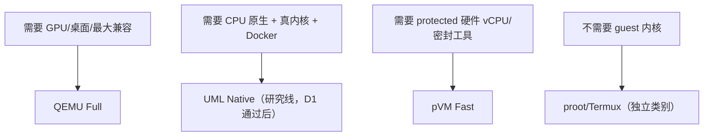

# 从「proot 速度 + QEMU 内核 + pVM 加速」到三条车道：protected-only 设备的原生内核路线探究（2026-10-28）

> **性质**：探究与方案文档，不是实现报告，不是产品承诺；不修改 `CONTEXT.md`、ADR、工单或代码。
> **配套证据**：[用户态内核 + 原生执行可行性研究](./2026-10-28-userspace-kernel-native-execution.zh-CN.md)（含完整源码行号、AOSP 策略与来源清单；本文引用简称「证据报告」）。
> **证据等级**：**[官方事实]** 官方文档/源码/策略；**[社区经验]** 第三方仓库自述、社区基准、issue；**[本项目未验证]** 本仓库推断或尚未在真机执行。
> **日期**：2026-10-28。本环境未运行 adb、Android 构建或真机测试；本文所有「本项目」性能与设备结论均为 `not-tested`。

---

## 0. 结论摘要

**用户假设「像 proot 那样原生执行 + 跑 QEMU 的完整内核 + 还能用 pVM 硬件加速」，在 protected-only + 无 Root + 普通 App 三条件下不成立。** 这不是性能问题，也不是「再写一个桥」能解决的，而是三个独立硬门：

1. **pVM 的硬件 vCPU 只属于 pVM 内的 guest。** vCPU 由 EL2 的 pKVM/Gunyah 提供；guest 内核必须是被 pvmfw/AVB/文件标签信任链接受的镜像。第三方 App 不能把自己的内核塞进 pVM，也不能把 pVM 的 vCPU 借给宿主进程或 QEMU。
2. **UML 这类「内核即宿主进程」的架构拿不到 vCPU。** guest 指令由宿主 CPU 原生执行，guest 内核是真的，guest 二进制由 guest 内核的 ELF loader 加载、不经过宿主 `execve`；但它只是 App 沙箱里的一个进程，pKVM 不会把 EL2 借给它。
3. **把 UML 放进 protected Microdroid 被策略明文禁止。** Microdroid 的 SELinux 有 `neverallow * self:process { execmem execheap execstack }` 与 `neverallow * *:file execmod`，encryptedstore 是 noexec，也没有可执行的 tmpfs 通道；UML 需要的可执行 guest RAM 一条路都没有。

**但「缺失的象限」存在，而且不是纸面：UML（User-Mode Linux）。** 把执行模型拆成五类后，现有能力占三个角：

| 模型 | 指令 | guest 内核 | vCPU | 代表 |
| --- | --- | --- | --- | --- |
| 全系统模拟 | 翻译 | 有 | 否 | QEMU TCG（现状 Full Lane） |
| 宿主内核兼容 | 原生 | 无 | 否 | proot / Termux |
| 硬件虚拟化 | 原生 | 有 | 是 | protected Microdroid（现状 Fast Lane） |
| **用户态内核** | **原生** | **有** | 否 | **UML（本文候选）** |
| 用户态 ABI 内核 | 原生 | 无（ABI 模拟） | 否 | gVisor |

UML 把 Linux 内核作为普通 App 进程运行；guest 计算是真实 ARM64 指令；guest 内的 systemd/Docker/namespace 由 guest 内核实现；rootfs 放 noexec 的 ext4 镜像也不影响 guest 执行。它是唯一同时满足「原生指令 + 真 guest 内核 + 无 Root」的架构。

**证据状态**：arm64 UML 仍不在 mainline；2026-08-15 LKML RFC 明确「33 patches on uml/next」、能启动 Alpine/Debian、4K/16K、SECCOMP/ptrace，同时明确「I cannot commit to maintaining this long-term」、UP only、无 32-bit compat。下游 `zalexdev/linux-um-arm64`（base 7.2-rc4，38 commits，GPL-2.0）与 `Raymer8639` Android/Termux fork 已把它工程化：bionic NDK/API 30、静态链接、`stub_exe`、passt、dockerd + overlay2、16K guest；在 Poco F3（Android 15）与 Galaxy S26 Ultra（Android 16）上有真机自述；纯计算接近原生，syscall 约 2 µs，openat 约 4.5 µs（proot 约 28 µs）。这些是**社区自述**，不是本项目复现。

**决定性的门是 D1，不是 arm64 本身。** 现代 targetSdk 36 App 跑 UML 需要 `check_tmpexec()` 对 guest RAM 后备文件做 `PROT_WRITE|PROT_EXEC` 映射；SELinux 要求 `file:file execute` + `process execmem`。AOSP 的 `app_data_file execute` 在源码上自相矛盾（`app_neverallows.te` 注释说不能全禁，`app.te` 又找不到显式 allow），只能真机探针判定。D1 三组探针里，只要 filesDir 文件或 memfd 的可执行映射有一组通过，UML 就能启动；全部失败，UML 只能留在 Termux/targetSdk 28 类域，不能作为产品架构。

**产品建议：放弃三合一，改成三条车道。** 当前 QEMU Full Lane + protected Fast Lane 继续交付；UML 只作为时间盒研究线，D1 通过后再开 ACR，讨论它作为 **Full Linux 的第三种执行策略**（不是第三 Runtime 类别）。pVM 不能加速 QEMU 或 UML；它只能是并列的一条车道。

---

## 1. 问题与术语纠偏

### 1.1 「proot 的硬件加速」其实是原生指令执行

- proot 不模拟 CPU；guest 是 ARM64 二进制，直接由宿主 CPU 执行。它用 `ptrace` 拦截 syscall、重写路径，模拟 chroot/mount/bind。所谓「快」是**没有指令翻译**，不是硬件虚拟化。
- 代价是 syscall 密集路径：公开单机样本（proot-distro issue #634）CPU 单核接近原生，但内存约 2.6× 慢、glmark2 约 2.2× 慢；UML 下游的 `openat` 也显示 proot 约 28 µs vs native 2.5 µs。**不能把 proot 叫「硬件加速」**；产品文案应写「原生指令，syscall 有开销」。

### 1.2 「QEMU 的内核」不是特殊内核

QEMU 是 VMM + TCG 翻译器；guest 内核是项目 pinned 的 arm64 Linux。换一个执行策略（UML）需要的是**同一内核源码的 `ARCH=um` 构建变体**，不是「QEMU 专属内核」。因此「跑在 QEMU 的内核里」应改写成「跑一个真实的 Linux 内核」；QEMU 只是其中一种载体。

### 1.3 pVM 是并列执行环境，不是加速器

- pVM 的 vCPU 在 EL2 上执行 guest 内核；它不能把 vCPU 暴露给宿主进程，也不能给 QEMU 提供 KVM。
- 在 pVM 内再跑 QEMU 只会多一层 TCG，更慢；在 pVM 内跑 UML 被 `execmem`/`execmod` neverallow 与 noexec 挡住。
- 因此「pVM 加速 QEMU/UML」不是未实现，而是架构上不成立；pVM 只能作为独立车道，做它自己的 guest。

### 1.4 五类执行模型

| # | 模型 | guest 指令 | guest 内核 | 隔离 | 在 Android 无 Root 下的形态 |
| --- | --- | --- | --- | --- | --- |
| 1 | 全系统模拟 | TCG 翻译 | 有 | 进程级 | QEMU Full Lane |
| 2 | 硬件虚拟化 | 硬件 vCPU | 有（平台信任） | pVM/EL2 | protected Microdroid Fast Lane |
| 3 | 宿主内核兼容 | 原生 | 无 | 弱（共享内核） | proot / Termux |
| 4 | 用户态内核 | 原生 | 有 | 进程级 | **UML** |
| 5 | 用户态 ABI 内核 | 原生 | 无（ABI 模拟） | 进程级 | gVisor |

---

## 2. 这次找到的关键资料

> 完整引用、源码行号、AOSP 策略与逐条证据等级见[证据报告](./2026-10-28-userspace-kernel-native-execution.zh-CN.md) §2–§5 与 §9。本节只列决策相关的事实。

### 2.1 arm64 UML：有 RFC、有下游、无 mainline、无维护

- **上游**：`arch/um/Makefile` 只映射 `x86 x86_64 i386`；`arch/arm64/um/` 不存在。[官方事实-源码]
- **LKML RFC（2026-08-15，Oleksii）**：`ARCH=um SUBARCH=arm64` 已能工作，**33 patches on `uml/next`**；启动 Alpine/Debian、4K/16K pages、SECCOMP 与 ptrace、loadable modules；已知 no 32-bit compat、UP only、RSS-counter BUG；原话「**I cannot commit to maintaining this long-term**」。[一手 RFC]
- **下游 `zalexdev/linux-um-arm64`**：base Linux **7.2-rc4**（`origin/next`），`um-arm64` 分支 **38 commits**，GPL-2.0；README 明说不是官方上游，作者不维护。[社区经验-项目自述]
- **Android/Termux fork `Raymer8639/linux-um-arm64`**：增加 `docs/` 与 `harness/`；bionic NDK r29、API 30、静态链接；`stub_exe` 从路径 exec（Android 16 拒绝 memfd exec）；passt over vector fd；`dockerd` + overlay2 + cgroup v2；Alpine/Debian 12、4K/16K guest；Poco F3（Android 15，host 4.19）与 Galaxy S26 Ultra（Android 16，host 6.12.30）实测。[社区经验-项目自述]

**性能（Poco F3，`adb shell`，7 轮交错，中位数，µs/op，SECCOMP 模式，512K fault 窗口）**：

| | native | proot | UML |
| --- | --- | --- | --- |
| syscall（`getppid`） | 0.079 | 0.166 | 1.999 |
| openat | 2.503 | 28.005 | 4.466 |
| forkexec | 3196 | 516 | 1177 |

- `compute` 是纯用户态校验项：guest 用户代码是真实指令，**纯计算接近原生**。
- syscall 约 2 µs（proot 的 12×、native 的 25×），但远低于 TCG 的毫秒级；`openat` 比 proot 快约 6×。
- `forkexec` 一行反直觉（native 3196 > UML 1187 > proot 516），作者未解释，本文不据此下结论。
- 作者另称同一内核在 Android app 内约 1.9 µs/syscall、compute 慢约 18%；但仓库没有对应 App 代码，targetSdk 未核实。[社区经验-自述]

**限制**：UP only（无 cpuset，Docker 会警告）；no 32-bit compat；guest vDSO time 未合并（长时间 `clock_gettime` 会 wrap）；4K 的 RSS-counter BUG 未复测；`check_tmpexec()` 仍保留原版 `create_tmp_file()`，没有改 memfd。

### 2.2 Android 侧的四道硬门

| 门 | 事实 | 影响 |
| --- | --- | --- |
| guest RAM 后备文件 `execute` | `check_tmpexec()` 对 TMPDIR 文件做 `PROT_WRITE\|PROT_EXEC`；SELinux 要 `file:file execute` + `execmem` | 现代 App 的 `app_data_file` 是否允许 `execute` 源码未闭环 → **D1 go/no-go** |
| guest 二进制加载 | UML 的 ELF loader 从 guest VFS 读二进制并映射到匿名内存；**不经过宿主 `execve`** | rootfs 可以放 noexec 的 ext4；只有 UML 内核/stub 需要宿主可执行路径 |
| `stub_exe` | UML 默认从 `memfd_create(MFD_EXEC)` exec stub；Android 16 拒绝 memfd exec | 必须把 stub 放 nativeLibraryDir 并传 `stub_exe` |
| 16 KB 宿主 | 下游只验证了 4K 宿主上的 4K/16K guest；4K guest 在 16K 宿主上会因 `mmap` 偏移不对齐失败（源码推断） | 目标设备若 16 KB 内核，必须用 16K guest；未实测 |

补充：`ptrace` 对 `untrusted_app_all` 有 allow；`execmem` 对 appdomain 有 allow（但 `app_data_file execute` 是另一条权限）；Microdroid 的 `execmem/execmod` 是 neverallow。证据报告 §2.3/§4.3 有源码行号。

### 2.3 protected pVM：能做 Fast Lane，不能做完整发行版

- 当前设备 `getCapabilities()` 只声明 protected；`setProtectedVm(false)` 抛 `UnsupportedOperationException`；`/dev/kvm` 不存在，`/dev/gunyah` 存在（Gunyah 后端）。[本项目既有事实]
- protected custom Full Linux 不可行：pvmfw 只启动 Google/OEM 签名的 boot image；virtmgr 对 kernel/initrd/整盘做 label 检查，`app_data_file` 被排除；protected crosvm 不提供原生 virtio-net；Microdroid payload 不能 chroot/mount、不能从 encryptedstore 执行、无 ptrace allow、无 TCP。
- Microdroid 的 `neverallow execmem/execmod` 还意味着 **Fast Lane 永久不能支持 JIT**（Node/JVM 只能 AOT 或不可用）；能力矩阵应写死。
- pVM 的硬件 vCPU 是真的；但它只属于 pVM 内的 Google 内核 guest，不是第三方自有内核的载体。

### 2.4 gVisor / proot / LKL：为什么不是答案

- **gVisor**：用户态 ABI 内核，不是真内核；rootless 需要 user namespace + ptrace/systrap；Android App 的 `unshare`/mount 门未闭环；systemd/Docker 只部分可用；无 GPU。它不满足 Full Linux 的「guest 内核」承诺。
- **proot**：无 guest 内核；syscall/path 重写；不能 systemd/Docker/真实 namespace；只能作为 Userspace Compatibility。
- **LKL**：内核库，单地址空间，无独立进程模型；跑不了发行版/systemd。
- **WSL1 式**：需要宿主内核驱动/模块，无 Root 不可能。

---

## 3. 为什么三合一不可能

### 3.1 单条决定性事实

**硬件 vCPU 与「自有内核」在无 Root 的第三方 App 路径上互斥。** vCPU 只能由 EL2 的 pKVM/Gunyah 提供，而 hypervisor 只执行被平台信任链接受的镜像；UML 的内核是宿主进程，拿不到 vCPU。三合一不是「缺实现」，而是**需要平台把镜像纳入信任根**——这正是第三方 App 无 Root 得不到的东西。

### 3.2 三个组合，各自必须放弃一项

| 组合 | 得到 | 必须放弃 |
| --- | --- | --- |
| UML（Termux/legacy 域） | 真内核 + 原生指令 + 无 Root + Docker/passt | 现代 targetSdk、protected 隔离、16 KB 宿主的 4 KB guest、GPU、pVM |
| protected Microdroid（Fast Lane） | 硬件 vCPU + 原生速度 + 真内核（Google 的）+ 无 Root | 自有内核、systemd/Docker、原生网络、GPU、可写可执行目录 |
| protected 自定义 pVM（需平台信任） | 真内核 + 硬件 vCPU + 完整发行版 | 无 Root/仅 App、原生网络、GPU、可交付性 |

**结论**：不要继续寻找「让 QEMU 的 kernel 跑在 pVM 上」或「在 pVM 里跑 UML」的桥；这两条都被架构/策略否掉。真正有价值的是第三条路：**把 kernel 从 QEMU 里拿出来，放进用户态（UML）**。

---

## 4. 方案：三条车道

### 4.1 车道表

| 车道 | 执行策略 | 得到 | 放弃 | 适用 |
| --- | --- | --- | --- | --- |
| **QEMU Full** | QEMU TCG + VirGL | 完整契约、GPU、全设备、成熟 | CPU 慢 | 桌面、GPU、兼容性、默认 |
| **UML Native**（研究线） | `ARCH=um`：真内核作为 App 进程，guest 指令原生执行 | 真内核、原生 CPU、Docker/passt、无 Root、protected-only 可用（不经过 AVF） | GPU、pVM、protected 隔离、UP only、现代 App 待 D1、16 KB 宿主待验 | CPU 密集、终端、开发、Docker |
| **pVM Fast** | protected Microdroid | 硬件 vCPU、protected 隔离、密封工具链 | 自有内核、systemd/Docker、原生网络、GPU | 编译、工具、受保护任务 |

### 4.2 共享契约

三条车道共享 Full Linux 的策略中立面：

- **rootfs / DistroManifest**：QEMU 用 virtio-blk，UML 用 `ubd`，读同一个 raw ext4；Provisioning、导出/导入共用。
- **guest agent / bridge**：QEMU 走 vsock，UML 走 passt/vec 上的 TCP；协议不感知传输。
- **终端 / 端口转发 / 共享目录**：UML 的转发由宿主 passt/代理实现；共享目录用 hostfs/9p，保持只读 Downloads 白名单。
- **生命周期**：UML 进程组由 `RuntimeProcessSupervisor` 类组件持有；停止确认、根盘 lease、冷恢复沿用现有模型；不引入第二个 stop owner。
- **能力矩阵**：UML 行显式写 `GPU=UNSUPPORTED`、`HARDWARE_VIRTUALIZATION=UNSUPPORTED`、`PROTECTED_VM=UNSUPPORTED`、`systemd/Docker=待验证`；UI 徽章只消费矩阵。

### 4.3 Lane Router

Auto 默认 QEMU（保守）；UML 只在 D1、16 KB 宿主、systemd/Docker、`stub_exe` 四门闭合后出现在 Auto 里。

### 4.4 隔离与产品语言

- UML：进程级（guest 内核是 App 进程，guest 用户进程在 App 沙箱内），按 ADR-0010 的 L1 措辞描述；**不得写 protected / 硬件隔离 / 硬件加速**。
- pVM：protected/EL2；QEMU：L1 软件虚拟化；三者不能混写。
- UML 车道建议命名「原生内核（实验）」/“Native Kernel (Experimental)”；性能徽章写「原生指令，syscall 有开销」，不写「硬件加速」。
- 在四门闭合前，不进入发布说明、不上默认 UI、不写「Full Linux 已支持 UML」。

### 4.5 当前产品路线不变

QEMU Full Lane 继续交付；protected Fast Lane 继续做 distcc/工具卸载；UML 不阻塞 P0/P1 发布门。三条车道是方向，不是本版本承诺。

---

## 5. 产品定位与治理

### 5.1 UML 是 Full Linux 的第三种执行策略，不是第三 Runtime 类别

`CONTEXT.md` 的 Full Linux 定义是「Guest 拥有自己的 Linux kernel」；UML 满足。它缺的是 GPU、硬件 vCPU、protected 隔离，这些可以作为「策略专属增强」写进能力矩阵（ADR-0002 允许）。因此推荐：

- 在 Full Linux Runtime 下新增 **执行策略 `Native Kernel (UML)`**；不是新类别。
- 若 ACR 认为 UML 无法满足 Full Linux 契约（systemd/Docker/显示/隔离差异过大），再考虑新类别；不要在未裁定前改 `CONTEXT.md`。

### 5.2 需要修订的 ADR/契约（提案，不是已接受）

| 文档 | 需要的变更 |
| --- | --- |
| ADR-0001（两层 Runtime） | 明确 Full Linux 可有第三种执行策略，不改变两类并列结构 |
| ADR-0002（Full Linux 契约） | 确认 UML 满足核心契约；GPU/protected 作为策略专属增强 |
| ADR-0005（Guest Kernel 契约） | 「单一 pinned 版本」改为「同一源码版本 + 每策略构建 profile」；UML 是 `ARCH=um` 变体，不能与 arm64 Image 共用二进制 |
| ADR-0010（隔离承诺） | 明确 UML 为 L1·进程级，不承诺 protected；更新残余风险 |
| 能力矩阵 | 新增 UML 行；GPU/vCPU/protected=UNSUPPORTED；systemd/Docker=待验证 |
| `CONTEXT.md` | 只在 ACR 通过后改；不预先改 |

### 5.3 内核基线的现实

下游 UML 基于 **7.2-rc4**（`uml/next`），与项目 pinned 内核/Guest Kernel 契约不一致。两条路：

1. **升级/重定基线**：项目 pin 一个含 arm64 UML 的下游树；代价是内核升级流程 + 安全维护。
2. **回移补丁**：把 arm64 UML 系列回移到项目 pinned 内核；代价是移植/维护，且补丁作者不维护。

在 ACR 里必须明确选哪条；没有这个决定，UML 不能进入产品。

---

## 6. 验证计划与 go/no-go

### 6.1 零设备（本环境可做）

| ID | 内容 | 通过判据 |
| --- | --- | --- |
| Z1 | 用下游 arm64 UML 补丁在 arm64 Linux 主机（容器）构建 `ARCH=um SUBARCH=arm64`，启动 Alpine | 能构建 + 能到 shell（只证明补丁可用） |
| Z2 | 源码核对 `check_tmpexec`/`phys_mapping`/`os_map_memory`/`file_map_prot_to_av` | 源码行号闭环 |
| Z3 | 用 `checkpolicy`/`sesearch` 对 AOSP sepolicy 求值：`app_data_file`/`appdomain_tmpfs` 的 `execute`、Microdroid 的 `execmem/execmod` | 与证据报告 §2.3/§4.3 一致 |
| Z4 | 查 `vm.memfd_noexec` 与 `memfd_create(MFD_EXEC)` 在 App 域的行为 | 给出 memfd 缝隙结论 |
| Z5 | 只读核对目标 ROM 的 `ro.boot.hypervisor.*`/`vm info` | 确认 protected-only（已知） |

### 6.2 真机（需设备窗口，串行）

| ID | 内容 | 预期/停止 |
| --- | --- | --- |
| **D1** | targetSdk 36 App 三组探针：① filesDir 临时文件 `mmap(PROT_READ\|PROT_WRITE\|PROT_EXEC, MAP_PRIVATE)`；② 匿名 `PROT_EXEC`；③ `memfd_create` + `mmap(PROT_EXEC)`。记录 errno + AVC | ① 预期 EACCES；② 预期成功（execmem）；③ 决定 memfd 缝隙。①/③ 任一通过 → 结论翻转 |
| D2 | 同一组探针在 Termux（targetSdk 28）里做 | 预期全过（对照组） |
| D3 | Termux 内跑下游 UML（1 vCPU、256–512 MB、Alpine） | 预期可启动；记录 16 KB 页行为 |
| D7 | 把 `linux-bionic`/`stub_exe` 放 nativeLibraryDir，验证 exec + `stub_exe=` | 预期可启动内核；不解决 guest RAM execute |
| D8 | 16 KB 宿主 + 16K guest | 记录是否 panic/失败 |
| D9 | UML 内 systemd/Docker（Debian 12） | systemd/Docker 可用性 |
| D10 | 同设备 QEMU vs UML：编译/终端/Docker，n≥10、控温 | 记录 median/IQR；建议门槛 ≥1.5× QEMU，最终 ACR 定 |

**D1 是最高优先级**：它一条就能判定 UML 路线在产品里是否还有可能。注意：D1 的 ②（匿名 `PROT_EXEC`）通过只说明 `execmem` 可用，不足以让 UML 启动；`check_tmpexec()` 需要的是**文件**的 `execute`，所以 ① 或 ③ 才是关键。

### 6.3 go/no-go 与停止条件

- **Go**：① 或 ③ 通过，且 D8/D9/D10 没有不可接受的失败。
- **No-go**：①/③ 全部失败；或需要 targetSdk ≤ 28、改 SELinux、Root/解锁、`/data/local/tmp` 公共盘才能跑。
- **停止**：16 KB 宿主无法解决；systemd/Docker 不可用；D10 相对 QEMU 无 ≥1.5× 收益或有 >5% 回归；下游补丁无人维护且项目无法承担。
- **时间盒**：一个零设备批次 + 一个设备窗口；D1 不通过就停止产品化，保留证据报告，不进入 ACR。

---

## 7. 风险与未决

| 风险 | 影响 | 缓解 |
| --- | --- | --- |
| arm64 UML 不在 mainline，作者不维护 | 长期维护/安全更新不可依赖 | 项目自维护 fork；pin 下游树；或放弃产品化 |
| 内核基线 7.2-rc4 与项目 pinned 不一致 | Guest Kernel 契约冲突 | ACR 决定升级/回移；不能静默换基线 |
| UP only / 无 cpuset | 并行编译/容器受限 | 用 pVM Fast Lane 做并行编译；UML 定位单核/终端/Docker |
| 16 KB 宿主未验证 | 新设备可能直接不可用 | D8；必要时只支持 4 KB 宿主 |
| systemd/Docker 未独立验证 | Full Linux 契约缺项 | D9；失败则降级为「实验终端/Docker 受限」 |
| `stub_exe` / memfd 策略随 Android 版本变化 | 启动路径脆弱 | nativeLibraryDir + 版本矩阵；不依赖 memfd |
| GPL-2.0 对应源码 | 分发义务 | 随 APK 提供 UML 内核源码/配置；复用现有 GPL 流程 |
| APK 体积（内核 + rootfs） | 分发/安装体验 | 首次下载/装配；不要把 Debian 镜像塞 APK |
| 无 GPU、无 protected 隔离 | 不能替代 QEMU/pVM | 能力矩阵写死；Lane Router 分流 |
| 性能不如预期 | 产品价值不足 | D10 同设备 A/B；<1.5× 停止 |

**未决**：目标 ROM 的 `pvmfw` 信任键；protected 下 virtio-fs/sharedPath；`vm.memfd_noexec`；`CONFIG_USER_NS`（影响 gVisor，不影响 UML）；UML 在 16 KB 宿主的真实失败点；任何本项目 UML/pVM 性能数字。

---

## 8. 建议

1. **不要再追三合一。** pVM 不能加速 QEMU/UML；UML 不能拿 vCPU；UML 放进 Microdroid 被 neverallow 挡住。把这三条写进 ACR 的「已评估并否决」，避免后续重复投入。
2. **当前产品路线不变。** QEMU Full + protected Fast Lane distcc 继续交付；先完成 P0/P1 发布门。
3. **把 UML 当作时间盒研究线。** 先做 Z1 + D1；D1 是现代 App 的 go/no-go，不是 arm64 本身。
4. **D1 通过后再开 ACR。** 讨论「UML 作为 Full Linux 第三种执行策略」、内核基线、能力矩阵、隔离表述；不要预先改 `CONTEXT.md`/ADR。
5. **D1 失败就停止产品化。** 保留证据报告与负结果；不买新设备、不改 targetSdk、不改 SELinux、不要求 Root/解锁。
6. **不要在 pVM 里跑 UML/QEMU。** 这是源码级否决，不是性能取舍。

---

## 9. 资料索引

### 9.1 一手/官方

- LKML RFC `[RFC] um: an arm64 subarch for User Mode Linux`（2026-08-15）：https://lkml.iu.edu/hypermail/linux/kernel/2608.1/14307.html
- 上游 UML SMP 提交 `1e4ee5135d81`（Tiwei Bie，2025-10-27）：https://github.com/torvalds/linux/commit/1e4ee5135d81
- `arch/um/Makefile`、`arch/um/Kconfig`、`arch/um/os-Linux/mem.c`、`arch/um/kernel/physmem.c`、`arch/um/kernel/exec.c`：见证据报告 §9.1
- AOSP `system/sepolicy`：`untrusted_app_27.te`、`app.te`、`app_neverallows.te`、`te_macros`、`microdroid/system/private/domain.te`、`microdroid_payload.te`：见证据报告 §9.2
- AVF：`VirtualMachineConfig.java`、`docs/custom_vm.md`、`docs/device_assignment.md`、`docs/hugepages.md`：见证据报告 §9.2

### 9.2 下游/社区（自述，未独立复现）

- `zalexdev/linux-um-arm64`（base 7.2-rc4，38 commits，GPL-2.0，作者不维护）：https://github.com/zalexdev/linux-um-arm64
- `Raymer8639/linux-um-arm64`（Android/Termux fork，docs/harness）：https://github.com/Raymer8639/linux-um-arm64
- `harness/README.md`：https://raw.githubusercontent.com/Raymer8639/linux-um-arm64/um-arm64/harness/README.md
- `docs/TESTING.md`、`docs/SECURITY.md`、`docs/UPSTREAM.md`、`docs/RELEASE.md`：同仓 `docs/`
- `michaelamoetoevsky/uml4termux`：https://github.com/michaelamoetoevsky/uml4termux
- `fahrulseptiana/drolin`（Ubuntu 26.04 + systemd PID 1，自述 APK）：https://github.com/fahrulseptiana/drolin
- `quangdz-comeback/uml-kernel-build`（SMP 历史/backport 记录）：https://github.com/quangdz-comeback/uml-kernel-build/blob/main/docs/technical_changelogs.md

### 9.3 gVisor / proot

- gVisor 概览/平台/rootless：https://gvisor.dev/docs、https://gvisor.dev/docs/architecture_guide/platforms/、https://gvisor.dev/docs/user_guide/rootless/
- PRoot 官方：https://proot-me.github.io/
- proot-distro 性能 issue #634：https://github.com/termux/proot-distro/issues/634

> 完整来源、访问日期与逐条证据等级见[证据报告](./2026-10-28-userspace-kernel-native-execution.zh-CN.md) §9。

---

报告人：CodeBuddy / DeepSeek-V4.1-Flash ｜ 日期：2026-10-28 ｜ 本文未运行设备/构建；所有「本项目」性能与真机结论为 `not-tested`。
